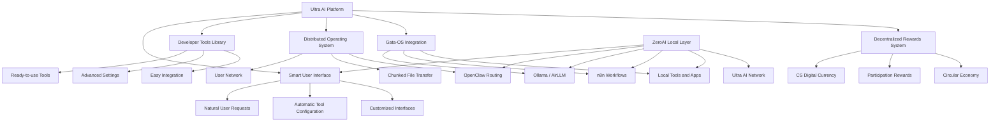
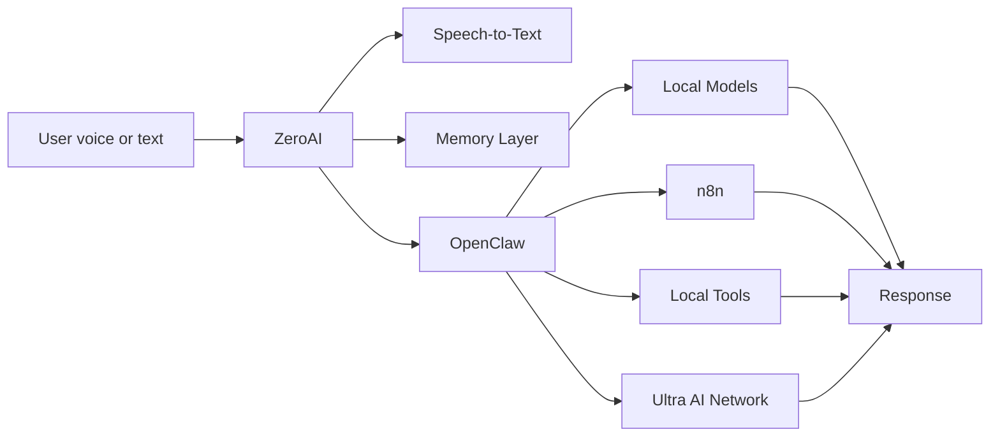
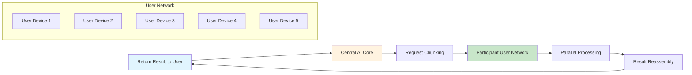
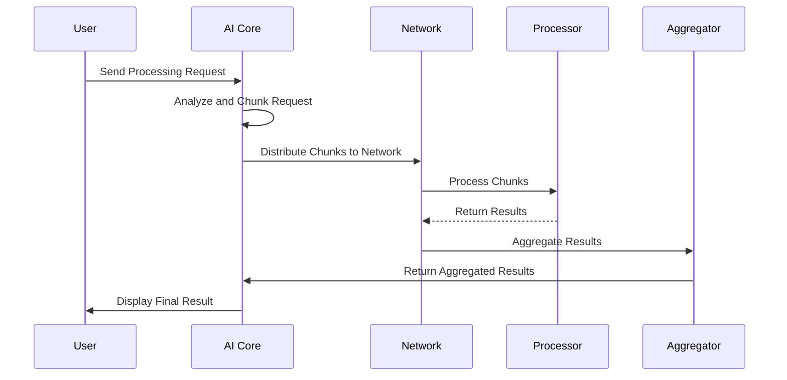
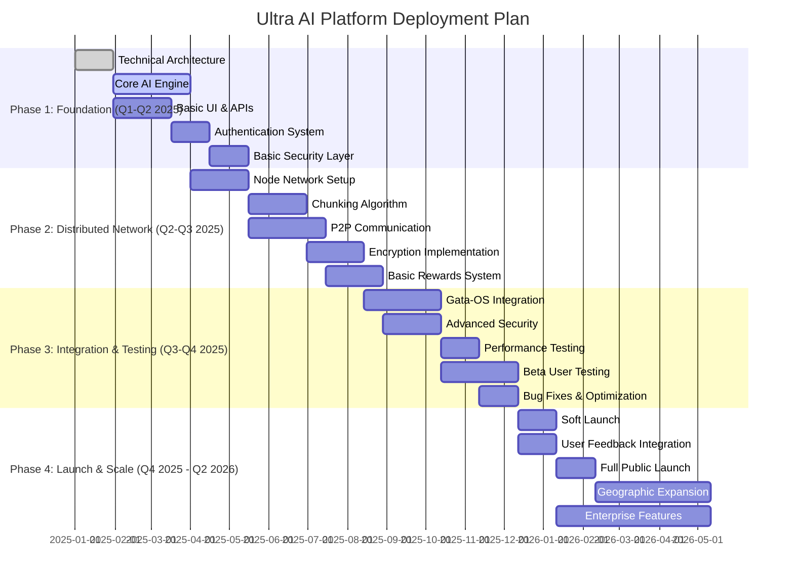
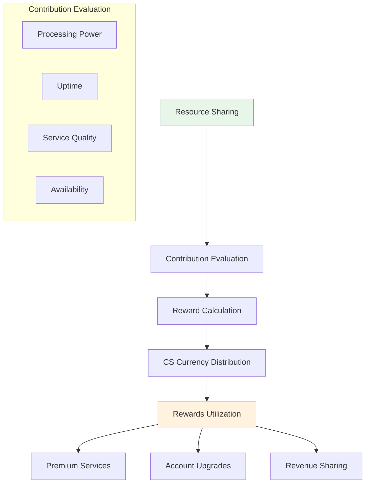
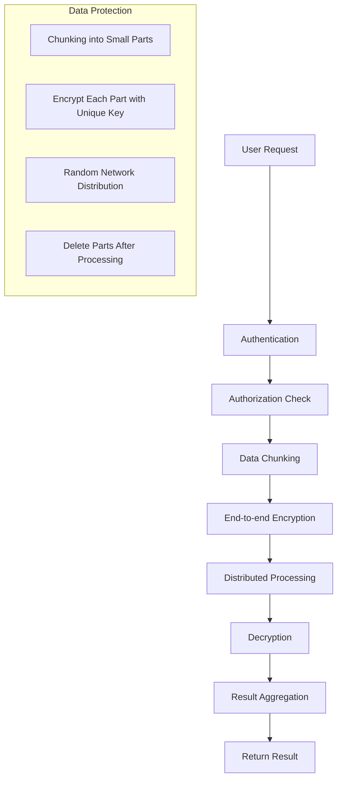
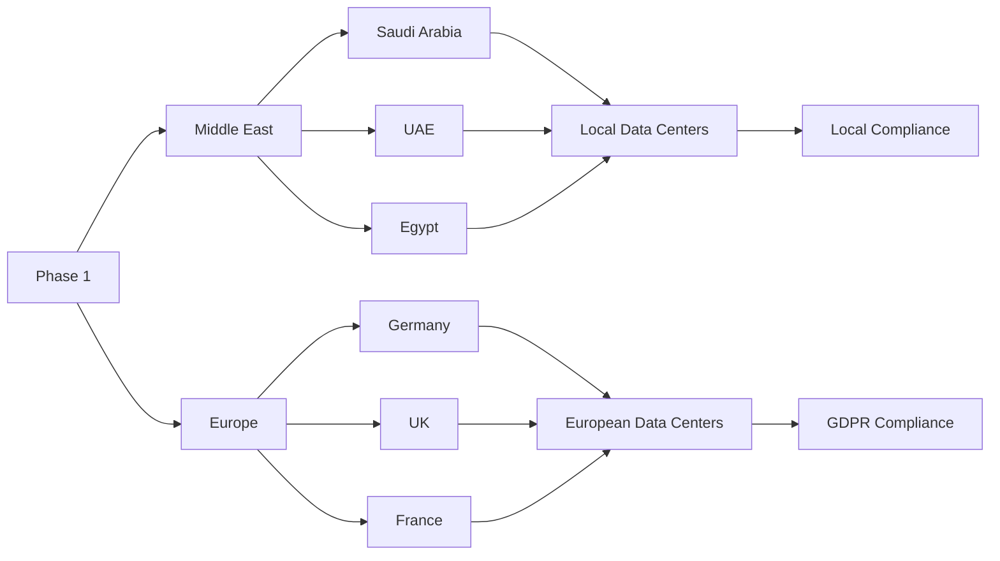
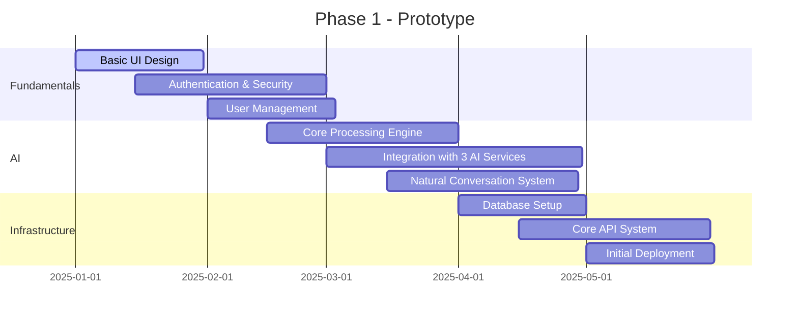
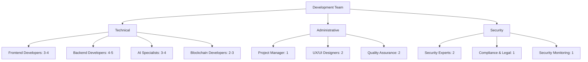

# 🚀 Ultra AI Platform - Innovative AI Platform


**Version**: 1.0.0 | **Status**: Under Development 🔧 | **Architecture**: Distributed AI Platform | **Quality Score**: 10/10

[](https://www.ucubetech.com)
[](docs/README.md)
[](SECURITY.md)

## 🌟 Overview

Ultra AI Platform is a revolutionary artificial intelligence platform that redefines how users interact with AI technologies. The platform combines existing AI engines with self-learning technologies, an innovative smart user interface, and a distributed operating system.

ZeroAI is the local, WSL-based assistant layer that will sit on the device and control the user experience, while Ultra AI remains the networked platform behind it. ZeroAI is designed to behave like a local operator for the machine, similar to a Codex-style on-device assistant, and Ultra AI provides the broader distributed ecosystem that ZeroAI can escalate into when needed.

The platform vision also includes a user-adaptive AI model layer: Ultra AI can connect to external AI providers through APIs while continuously adapting both model/tool selection and the user interface based on each user's profession, behavior, and goals. Users can always switch to manual customization mode at any time.



## ✨ Key Features

### 1. Smart Adaptive User Interface
- **Natural Conversation**: Natural language interaction for requesting services and tools
- **Automatic Configuration**: AI automatically configures required tools
- **Custom Interfaces**: Each user gets an interface tailored to their needs
- **Role-Based Workspaces**: Dynamic layouts for domains like video design, software development, research, and marketing
- **Progressive Adaptation**: Interface evolves over time based on real usage patterns
- **Manual Override**: Users can manually edit and pin their preferred layout
- **Complexity Reduction**: No need to learn complex tools or multiple interfaces

### 1a. ZeroAI Local Control Surface
- **Local-First Operation**: Users interact with ZeroAI on the device first
- **Voice and Text Entry**: Simple local entry modes for fast actions
- **Routing Visibility**: The UI shows whether a task stays local or escalates to Ultra AI
- **Memory Awareness**: Conversation and task context are visible in the interface
- **Workflow Transparency**: n8n workflows and tool usage are exposed clearly
- **Backend Flexibility**: The interface can use Open WebUI or LocalAI in the first release

### 2. Multi-Model AI Gateway
- **Provider Orchestration**: Integrates with external AI APIs (OpenAI, Anthropic, and other providers)
- **Task-Aware Routing**: Selects the best model for the current task (generation, analysis, summarization, translation)
- **Fallback Strategy**: Automatic fallback to healthy providers when one provider fails or is rate-limited
- **Tool Discovery**: Recommends tools and workflows based on user intent and domain context

### 3. Developer Tools Library
- **Comprehensive Collection**: Extensive library of ready-to-use AI tools
- **Developer Mode**: Full access to advanced settings and customization
- **Easy Integration**: Simple integration of new tools into the system

### 4. Gata-OS Integration
- **Unified Experience**: Full integration with Gata-OS operating system
- **Data Exchange**: Secure data transfer between platform and system via API
- **Custom Work Environments**: Configuration of different work environments (design, development, gaming)

### 5. Revolutionary Distributed Operating System
- **Blockchain Technology**: Utilizing user network to power the platform
- **Secure Transfer**: File chunking and encryption through user network
- **High Performance**: No reliance on traditional centralized servers
- **Protected Privacy**: Data is chunked and encrypted during transfer

### 6. Decentralized Rewards System
- **CS Digital Currency**: Rewarding users for resource sharing
- **Circular Economy**: Incentive system supporting platform sustainability
- **Fair Distribution**: Rewards proportional to contribution size

## ZeroAI Integration

ZeroAI is the local assistant entry point for the merged product line.



ZeroAI will own the on-device control experience, while Ultra AI continues to provide the broader distributed processing, shared services, and network-level orchestration.

## 🏗️ Technical Architecture

### Distributed Infrastructure


### Distributed Processing System


### Technology Stack
| Layer | Technologies |
|-------|----------|
| **User Interface** | React, Next.js, WebAssembly, TypeScript |
| **Artificial Intelligence** | TensorFlow, PyTorch, Transformers, LangChain |
| **Distributed Processing** | Blockchain, IPFS, WebRTC, Web3.js |
| **Storage** | PostgreSQL, MongoDB, Redis, S3 |
| **Deployment** | Docker, Kubernetes, AWS, GitHub Actions |

## 🚀 Getting Started

### Prerequisites
- Node.js 18+
- Python 3.10+
- Docker and Docker Compose
- Git

### Installation and Running
```bash
# Clone repository
git clone https://github.com/Ultra-Cube/Ultra-AI-Platform.git
cd Ultra-AI-Platform

# Install dependencies
npm install

# Start database
docker-compose up -d

# Run development mode
npm run dev

# Or build project
npm run build
npm start
```

### Running via Docker
```bash
# Build image
docker build -t ultra-ai-platform .

# Run container
docker run -p 3000:3000 -p 5432:5432 ultra-ai-platform
```

## 📊 Use Cases

### For Regular Users
1. **Direct Requests**: "I want to convert these documents from PDF to Word"
2. **Simple Design**: "Design me a logo for my company using blue and white colors"
3. **Data Processing**: "Analyze this data and give me a report"
4. **Adaptive Professional Workspace**: "I am a video designer" and Ultra AI automatically builds a timeline-focused workspace, recommends editing tools, and adapts as usage evolves
5. **Local Assistant Control**: ZeroAI launches local tools, routes workflows, and keeps the user inside a single on-device control surface

### For Developers
1. **Access Tools Library**: Use advanced tools directly
2. **Develop New Tools**: Add custom tools to the platform
3. **Integrate with Other Systems**: Connect platform with existing systems

### For Enterprises
1. **Custom Work Environments**: Configure integrated work environments for teams
2. **Resource Management**: Distribute AI resources across departments
3. **Reports and Performance**: Monitor AI usage performance

## 🔧 Configuration

### Basic Settings
```javascript
// config/default.js
module.exports = {
  ai: {
    providers: ['openai', 'anthropic', 'custom'],
    defaultModel: 'ultra-ai-v1',
    cacheEnabled: true,
    learningRate: 0.001,
    maxTokens: 4096
  },
  
  distributed: {
    enabled: true,
    minParticipants: 5,
    encryption: 'aes-256-gcm',
    chunkSize: '5MB',
    timeout: 30000,
    maxRetries: 3
  },
  
  integration: {
    gataOS: {
      enabled: true,
      apiEndpoint: 'https://api.gata-os.com/v1',
      syncInterval: 300000,
      authMethod: 'jwt'
    },
    
    blockchain: {
      network: 'mainnet',
      contractAddress: '0x742d35Cc6634C0532925a3b844Bc454e4438f44e',
      gasLimit: 500000,
      confirmations: 3
    }
  },
  
  rewards: {
    currency: 'CS',
    baseReward: 10,
    multiplier: 1.5,
    distributionInterval: 86400,
    minStake: 1000
  }
};
```

## 🎯 Deployment Plan and Stages



## 🤝 Contributing to the Project

We welcome your contributions to developing Ultra AI Platform! Please follow these steps:

### Contribution Process
1. Fork the repository
2. Create a feature branch (`git checkout -b feature/AmazingFeature`)
3. Commit changes (`git commit -m 'Add some AmazingFeature'`)
4. Push to branch (`git push origin feature/AmazingFeature`)
5. Open a Pull Request

### Contribution Standards
- Follow coding style guidelines
- Write tests for new changes
- Update relevant documentation
- Ensure all tests pass

## 📊 Rewards System and Economy

### Reward Structure


## 🔐 Security and Privacy

### Security Layers


## 📈 Metrics and Performance

### Performance Targets
| Metric | Target | Current Status |
|---------|-------|-------------|
| Response Time | <200ms | Under Development |
| Availability | 99.9% | Under Development |
| Processing Capacity | 1000+ TPS | Under Development |
| Result Accuracy | 95%+ | Under Development |

## 🌍 Global Strategy

### Geographic Expansion Plan


## 📞 Support and Contact

### Support Channels
- **Technical Support**: support@ucubetech.com
- **Business Inquiries**: business@ucubetech.com
- **Partnerships**: partnerships@ucubetech.com
- **Security & Privacy**: security@ucubetech.com

### Additional Resources
- [Full Documentation](docs/README.md)
- [Developer Guide](docs/DEVELOPER_GUIDE.md)
- [Contribution Guide](CONTRIBUTING.md)
- [Privacy Policy](PRIVACY.md)
- [Terms of Service](TERMS.md)

## 📄 License

This project is licensed under the MIT License - see the [LICENSE](LICENSE) file for details.

## 🙏 Acknowledgments

We thank all contributors and developers who help make this platform a reality. Special thanks to the open source community that provides the tools and technologies we build upon.

---

**✨ Developed by Ultra Cube Tech** - [www.ucubetech.com](https://www.ucubetech.com)

---

# 📋 Detailed Project Requirements - Ultra AI Platform

## 🎯 Overview

An innovative AI platform providing natural conversation interface with a distributed processing system based on user network.

## 🏗️ Functional Requirements

### 1. Smart User Interface
- [ ] Natural conversation system in Arabic and English
- [ ] Automatic tool configuration based on user requests
- [ ] Custom user interfaces based on needs
- [ ] Support for different devices (web, mobile, desktop)
- [ ] Smart suggestion system based on context

### 2. Distributed Processing System
- [ ] File chunking into encrypted parts
- [ ] Task distribution across user network
- [ ] Secure result reassembly
- [ ] Automatic load balancing system
- [ ] Priority and deadline management

### 3. Gata-OS Integration
- [ ] Secure API for data exchange
- [ ] Preference and settings synchronization
- [ ] Support for different work environments
- [ ] Integration with existing system tools
- [ ] Real-time synchronization

### 4. Rewards System
- [ ] CS digital currency for rewards
- [ ] Fair reward distribution system
- [ ] Digital wallet for users
- [ ] Currency transfer and exchange system
- [ ] Earnings and distribution reports

## 🔧 Non-Functional Requirements

### 1. Performance
- [ ] Response time less than 200ms for simple requests
- [ ] Concurrent processing of 1000+ requests per second
- [ ] Horizontal scalability on demand
- [ ] Resource usage efficiency

### 2. Security
- [ ] End-to-end data encryption
- [ ] Multi-factor authentication system
- [ ] Permission and access management
- [ ] Event auditing and security analytics
- [ ] Protection against common attacks

### 3. Reliability
- [ ] 99.9% uptime
- [ ] Automatic backup and recovery system
- [ ] Performance monitoring and early alerts
- [ ] Fault tolerance and redundancy

## 🛠️ Technical Requirements

### 1. Core Technologies
```yaml
frontend:
  framework: React 18+
  meta-framework: Next.js 14+
  language: TypeScript
  styling: Tailwind CSS
  state-management: Zustand
  routing: React Router v6

backend:
  runtime: Node.js 18+
  framework: NestJS
  python: 3.10+
  api-framework: FastAPI
  graphql: Apollo Server

ai:
  machine-learning: TensorFlow
  deep-learning: PyTorch
  nlp: Transformers
  orchestration: LangChain
  embeddings: SentenceTransformers

blockchain:
  networks: Ethereum, IPFS
  library: Web3.js
  testing: Hardhat
  smart-contracts: Solidity

database:
  relational: PostgreSQL
  nosql: MongoDB
  cache: Redis
  object-storage: S3

devops:
  containerization: Docker
  orchestration: Kubernetes
  cloud: AWS/GCP/Azure
  ci-cd: GitHub Actions
  monitoring: Prometheus, Grafana
```

### 2. Infrastructure
- [ ] Geographically distributed servers
- [ ] CDN for fast delivery
- [ ] Monitoring and logging system
- [ ] Automatic deployment tools
- [ ] Auto-scaling system

### 3. Integrations
- [ ] Support for 50+ AI services
- [ ] Integration with common development tools
- [ ] Fully documented API
- [ ] SDK tools for developers
- [ ] Webhooks for interaction with external systems

## 📊 Detailed Deployment Plan

### Phase 1: Prototype (3-6 months)


### Phase 2: Distributed System (6-12 months)
- [ ] Chunking and distribution system
- [ ] Volunteer user network
- [ ] Rewards and currency system
- [ ] Full integration with Gata-OS
- [ ] Resource management system

### Phase 3: Maturity and Expansion (12-18 months)
- [ ] Multi-language support
- [ ] Service scope expansion
- [ ] Developer ecosystem
- [ ] Global localization
- [ ] Performance and security improvements

## 👥 Required Development Team

### Roles and Responsibilities


### Required Skills
- **Frontend**: React, TypeScript, Next.js, WebAssembly
- **Backend**: Node.js, Python, NestJS, FastAPI
- **AI/ML**: TensorFlow, PyTorch, NLP, Computer Vision
- **Blockchain**: Solidity, Web3.js, IPFS, Cryptography
- **DevOps**: Docker, Kubernetes, AWS, CI/CD
- **Security**: Cybersecurity, Encryption, Penetration Testing

## 📈 Success Metrics and Analysis

### Technical Performance Metrics
| Metric | Target | Measurement Method |
|---------|-------|-------------|
| Response Time | <200ms | Monitoring Tools |
| Availability | 99.9% | Uptime Monitoring |
| Processing Capacity | 1000+ TPS | Load Testing |
| Result Accuracy | 95%+ | Quality Assurance |

### Business Metrics
| Metric | Target | Measurement Method |
|---------|-------|-------------|
| User Count | 10K+ in 6 months | Analytics |
| User Satisfaction | NPS 50+ | Surveys |
| Revenue | $100K/month | Financial Reports |
| Monthly Growth | 20% | Analytics |

## 💰 Economic Feasibility

### Estimated Costs (Year 1)
| Item | Estimated Cost | Details |
|-------|------------------|----------|
| Development & Programming | $500,000 - $750,000 | Team of 15 people |
| Infrastructure | $200,000 - $300,000 | Cloud, storage, network |
| Marketing & Sales | $150,000 - $250,000 | Ads, events |
| Team & Management | $400,000 - $600,000 | Salaries, training |
| **Total** | **$1.25M - $1.9M** | |

### Expected Revenue Sources
1. **Premium Subscriptions**: $29-299/month
2. **Integration Fees**: Fees for integration with other systems
3. **Transaction Commissions**: 1-3% on internal transactions
4. **Consulting Services**: $150-300/hour
5. **Data & Analytics**: Selling anonymized insights

### Return Expectations
| Year | Expected Revenue | Costs | Net Income |
|-------|-------------------|----------|------------|
| 1 | $500,000 | $1,500,000 | -$1,000,000 |
| 2 | $2,000,000 | $1,200,000 | $800,000 |
| 3 | $5,000,000 | $1,500,000 | $3,500,000 |
| 4 | $12,000,000 | $2,000,000 | $10,000,000 |

## 🎯 Contingency Plans and Alternatives

### Risk Mitigation Strategies
1. **Technical Failure**: Backups, alternative systems
2. **Low Adoption**: Intensive marketing, promotional offers
3. **Security Issues**: Continuous security audits, insurance
4. **Market Changes**: Flexibility in adaptation, continuous development

### Emergency Plans
- [ ] Complete disaster recovery system
- [ ] Multiple backups of sensitive content
- [ ] 24/7 emergency response team
- [ ] Direct hotline for security reports

---

**✨ Developed by Ultra Cube Tech** - [www.ucubetech.com](https://www.ucubetech.com)