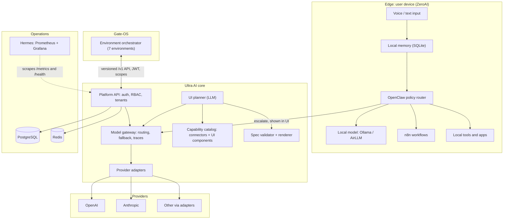

# Ultra AI — Corrected Master Plan (v2)

**Status:** Proposed — needs owner approval of the decisions in section 4 before Phase 0 starts.
**Date:** 2026-11-08
**Basis:** Full review of the repository (about 66 files in `docs/`, 117 Mermaid diagrams in 29 files, `wsl-ai-stack/`, `external-integrations/` manifests, code layout, CI, commit history) plus the Ultra Cube definitions of Ultra AI as the AI layer of Gate-OS.
**Supersedes:** the phase schemes in `docs/planning/DEVELOPMENT_ROADMAP.md`, `ROADMAP_NEXT_PHASES.md`, `TASKS-CHECKLIST.md`. Amends `docs/MASTER_ARCHITECTURE.md` (which stays correct about what is real today).

---

## 1. What Ultra AI is (corrected statement)

> **Ultra AI is the open-source AI layer for Gate-OS: a multi-provider model gateway with local-first routing (ZeroAI), and an adaptive interface that assembles one personalized workspace from a safe catalog of APIs and components — instead of many installed apps.**

The repository grew from four different ideas written at different times. They were never reconciled, which is why the documents contradict each other:

| Era | Idea | Where it lives |
|---|---|---|
| Mar 2026 | Volunteer distributed network, chunked encrypted processing, CS token on blockchain | `README.md`, `docs/architecture/distributed-processing.md`, `docs/business/*`, `packages/distributed` |
| Jun–Aug 2026 | Gateway to 40+ providers (9router), imported tools, control center, desktop shell | `packages/api-gateway`, `external-integrations/`, `PROJECT-CATALOG.md` |
| Jul 2026 | ZeroAI: local-first assistant (voice → memory → OpenClaw → Ollama/n8n/tools → escalate) | `wsl-ai-stack/`, `docs/architecture/zero-ai-integration.md`, `apps/web/app/zeroai` |
| Oct–Nov 2026 | Real stack, Hermes monitoring, 32-agent studio, and the Gate-OS direction (adaptive UI, one adaptable edition) | `monitoring/hermes`, `packages/api/src/services/agents`, `docs/MASTER_ARCHITECTURE.md` |

The corrected plan keeps the ideas that are real or that serve Gate-OS, reshapes the ones that are technically unsound, and defers or drops the rest.

---

## 2. Verified baseline (what was actually checked)

| Item | Result |
|---|---|
| `npm install` (workspaces) | Works (1374 packages). **No `package-lock.json` is committed**, although `BUILD_PLAN.md` says one was created. |
| CI (`.github/workflows/ci.yml`) | Uses `npm ci` → **fails without a lockfile**. |
| Type-check | 9 of 10 workspaces pass. `@ultra-ai/api` could not be verified in the review sandbox because Prisma engine download was blocked (network), not because of a known code error. |
| Tests run | `ai-core` 3, `api-gateway` 45, `distributed` 55 → **103 pass**. |
| Tests not run | `api` (documented as 306) — needs Prisma engine. Must be re-verified on a normal machine. |
| `LICENSE` file | **Missing**, while `package.json` declares MIT. |
| Code comments | Only 11 `TODO`s: notifications delivery (email/push/SMS/webhook), file-storage download/delete/virus scan, tenant storage tracking, multipart upload, gateway `loadProviders` and internal routing. |
| Size | `external-integrations/` is 529 MB; `.git` is ~493 MB. |

---

## 3. Idea inventory and verdict

| Idea (from docs and diagrams) | Reality in code | Verdict |
|---|---|---|
| Multi-provider model gateway with failover | Real: `ai-core` (OpenAI, Anthropic, Mock), `api-gateway` HTTP server | **Keep — this is the core product** |
| Task-aware routing, routing modes (quality/cost/latency/hybrid) | Task affinity exists; modes are type-only | **Keep — finish** |
| ZeroAI local-first control surface (simple + operator views, traces) | Demo-grade, JSON state file, no auth | **Keep — productionize** |
| Adaptive workspace per role (Omar the video designer, businessman dashboard) | `workspace-recommender` + profile endpoints; no renderer | **Keep — rebuild as declarative UI spec** |
| Gate-OS integration | Docs call it "hypothetical", mock only; spelled "Gata-OS" | **Keep — Gate-OS now exists; define a real contract** |
| Hermes monitoring (Prometheus, Grafana, Alertmanager) | Real | **Keep** |
| Auth, RBAC, GDPR endpoints, multi-tenancy, analytics, caching, webhooks | Real service modules in `packages/api` | **Keep, but trim to what the gateway needs first** |
| Agent studio (32 agents, quality gates) | Real registry and tests | **Keep as developer tooling, isolate from product API** |
| Volunteer distributed network with "private chunked" inference | Code exists (`packages/distributed`), unwired | **Reshape and defer** — see D5 |
| CS token, blockchain rewards, IPFS | Off-chain math only, no contract | **Drop from roadmap** — see D6 |
| Desktop Electron shell, voice-recognition, memory-optimizer, control-center package | Stubs | **Merge or delete** |
| MongoDB, IPFS, Elasticsearch, Kafka, multi-cloud Terraform | Docs only | **Drop until a measured need exists** |
| Business plan ($1.25M–1.9M budget, investor decks, 5-year forecasts, hypothetical survey) | Documents only | **Archive** — not engineering input |
| 9router, OpenClaw (AionUi), JARVIS, quant-mind, biome, godmode, Kimi-K2.5 | Fork clones, 8 upstreams | **Adapters behind the gateway, optional** |

---

## 4. Decisions proposed for approval

**D1 — Product identity.** Ultra AI = the AI layer for Gate-OS (gateway + ZeroAI + adaptive UI). It also runs standalone.

**D2 — The gateway is the spine.** Every model call, local or remote, goes through one adapter interface (`generate`, `stream`, `embed`, `toolCall`). Provider quirks live in adapters only. Every request emits a routing trace.

**D3 — ZeroAI contract.** Input → local memory → OpenClaw policy → one of: local model (Ollama/AirLLM), n8n workflow, local tool, or escalate to the gateway. The UI always shows whether a task stayed local or escalated. Sensitive actions need confirmation. OpenClaw is never bypassed for model choice.

**D4 — Adaptive UI is declarative.** The planner (LLM) outputs a JSON UI spec that references only catalog items. A renderer validates it against JSON Schema and renders from a fixed component registry. No generated executable code runs on the host. Generated web apps are sandboxed (iframe sandbox, strict CSP, least-privilege OAuth scopes). Manual override and pinning always win; every adaptation is reversible.

**D5 — Distributed network: the privacy claim is unsound as written and must be reshaped.** The documents say nodes process "encrypted chunks" so no node sees the data. But a node must decrypt a chunk to compute on it, and an LLM prompt cannot be meaningfully split across nodes without leaking content (the docs themselves list this as Critical Issue #1 and propose noise/padding, which does not fix it). Proposed reshaping:
- Phase 6 (optional): a **personal device mesh** — the user's own devices (ZeroAI nodes) share load. No trust problem.
- Public volunteer compute only for **non-sensitive, embarrassingly parallel batch jobs** (for example embeddings of public data, transcription of public media), with redundant execution and result voting.
- Remove "private by chunking" from all marketing text until a real mechanism (trusted execution, or cryptographic proof) exists.

**D6 — Drop the blockchain and CS token from the roadmap.** No contract exists, the legal framework flags securities/AML risk, and nothing in D1–D4 needs it. If incentives return later, start with an off-chain credits ledger.

**D7 — Real Gate-OS contract.** Versioned `/v1` API, JWT auth, explicit JSON schemas, backward-compatible changes only, read/write limited by scope. Replace the mock with contract tests against Gate-OS (environment/profile sync across its seven environments).

**D8 — Integrations as optional adapters.** Replace the 529 MB in-repo copies with git submodules or a separate `ultra-ai-integrations` repository. Health-gate 9router first (port 20128), then JARVIS (5678), then biome; keep Kimi and godmode as mock/docs.

**D9 — Data stores.** PostgreSQL 15 + Redis only. ZeroAI state moves from JSON file to Postgres (SQLite for the purely local edge).

**D10 — Documentation.** One source of truth per topic. Archive phase/session reports and business plans under `docs/archive/`. Fix "Gata-OS" → **Gate-OS** everywhere. Arabic and English must both work end to end in product and user docs.

---

## 5. Corrected architecture



Distributed/device-mesh is intentionally absent from this diagram; it returns in Phase 6 only after the preceding phases are done.

---

## 6. Target repository structure

```text
ultra-ai/
├── apps/
│   └── web/                  # Next.js: dashboard, gateway, zeroai, hermes, adaptive workspace
├── packages/
│   ├── ai-core/              # adapters, router, model catalog (single source of truth)
│   ├── api/                  # Fastify: auth, RBAC, tenants, gateway routes, Gate-OS /v1
│   ├── api-gateway/          # provider management service (:20129)
│   ├── adaptive-ui/          # NEW: catalog, JSON schemas, validator, renderer
│   ├── shared/               # types and trace schema
│   └── agents/               # moved out of api: developer tooling only
├── labs/
│   └── distributed/          # parked; not in default build
├── integrations/             # git submodules (9router, jarvis, ...)
├── wsl-ai-stack/             # ZeroAI edge scripts
├── monitoring/hermes/
├── k8s/  infrastructure/  scripts/
└── docs/
    ├── architecture/  api/  operations/  security/  ux-design/
    └── archive/              # phase reports, business plans, old roadmaps
```

Merge or delete: `desktop-ui`, `voice-recognition`, `memory-optimizer`, `control-center` (voice stays as a ZeroAI edge script, not a package).

---

## 7. Build phases

Each phase ends with something runnable and a measured claim. Order is fixed by dependencies; sizes are rough for one senior developer.

### Phase 0 — Honest baseline (≈ 3–5 days)
- Commit `package-lock.json`; make `npm ci` pass in CI; CI green on lint, type-check, test, build.
- Add `LICENSE` (MIT as declared, or change `package.json`); fix README clone URL (`Ultra-AI`).
- Rewrite `README.md` from this plan; delete the stale `.github/copilot-instructions.md` ("no code yet").
- Move `external-integrations/` to submodules; restructure `docs/` per section 6; rename Gata-OS → Gate-OS.
- Reconcile ports: API 4000, gateway 20129 (note `PROJECT-CATALOG.md` still says 20128, which is 9router's port).
- **Done when:** fresh clone → `npm ci && npm run build && npm test` is green on a machine with network access.

### Phase 1 — Gateway v1 (≈ 1–2 weeks)
- Adapter interface (`generate`, `stream`, `embed`, `toolCall`) with OpenAI, Anthropic, Ollama and Mock adapters.
- Routing modes (quality / cost / latency / hybrid), timeouts, retry with backoff, circuit breaker, ordered fallback, 429 handling.
- Trace schema in `shared`: route decision, provider, latency, tokens, fallbacks. Resolve gateway TODOs (`loadProviders`, internal routing).
- Tests with mocked providers: timeout, 429, 5xx, fallback chain. Config example and docs.
- **Done when:** a request fails over from a failing provider to a healthy one and the trace shows it. State clearly what was not verified against live providers.

### Phase 2 — ZeroAI productionized (≈ 1–2 weeks)
- Postgres-backed state, authentication, per-user memory (short-term, long-term, task).
- Local/escalate decision implemented per D3; operator view shows the full trace, simple view shows a summary.
- Sensitive-action confirmation; offline behavior documented.
- **Done when:** the same prompt runs locally with Ollama and escalates with the local model stopped, and the UI shows both paths.

### Phase 3 — Gate-OS integration API (≈ 1–2 weeks)
- Versioned `/v1` endpoints for profile and environment sync, scopes, JSON schemas, JWT; contract tests.
- **Done when:** contract tests pass against a running Gate-OS orchestrator, not a mock.

### Phase 4 — Adaptive UI (≈ 2–3 weeks)
- `packages/adaptive-ui`: capability catalog (connector + scopes + rate limits + data shape; component schema), UI spec JSON Schema, validator, renderer, feedback loop with reversible history.
- Sandboxing and CSP; widgets show data source and freshness; visible failure states; WCAG 2.2 AA; Arabic/English with RTL.
- First two profiles: businessman dashboard (market, watchlist, news, calendar, mail digest with read-only scopes) and video designer.
- **Done when:** a profession statement produces a valid spec, an out-of-catalog spec is rejected, and a pinned widget survives adaptation.

### Phase 5 — Hardening (≈ 2 weeks)
- Security pass (OWASP, MFA, rate limiting at gateway, secret handling), load test against realistic targets (not 1000+ TPS claims), backup/restore, k8s deployment on a real cluster, Hermes alerts verified.

### Phase 6 — Optional research: device mesh (open-ended)
- Own-device mesh first; public batch compute only under D5 constraints. Starts only if Phases 1–5 are done and there is demand.

---

## 8. Risks and open questions for the owner

1. **Approve or change D1–D10.** D5 and D6 remove headline features from the original vision; they are the biggest decisions.
2. **License:** keep MIT, or choose another for Ultra Zone releases?
3. **Which providers are first-class** for Phase 1 beyond OpenAI, Anthropic, Ollama?
4. **Gate-OS contract owner:** who on the Gate-OS side approves the `/v1` schemas?
5. **Team size** (roles and owners per deliverable) — needed to turn section 7 into a sprint plan.
6. **Unverified here:** the 306 `api` tests and Prisma migrations; Docker/k8s deployment; any live provider call.

---

## 9. Definition of done (all phases)

Code reviewed, tests added and passing, docs updated in English (and Arabic for user-facing docs), no secrets committed, CI green, claims measured and not aspirational.
