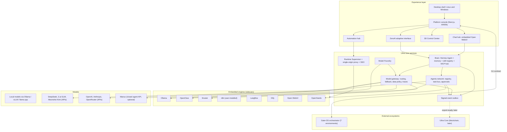
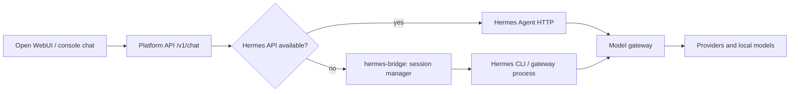
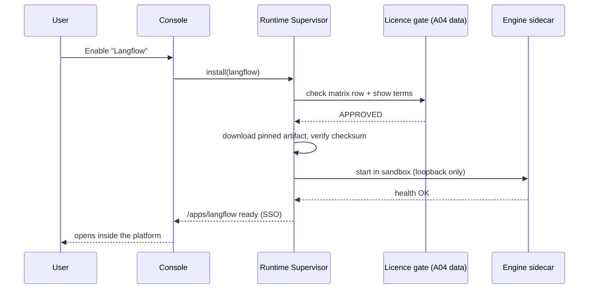
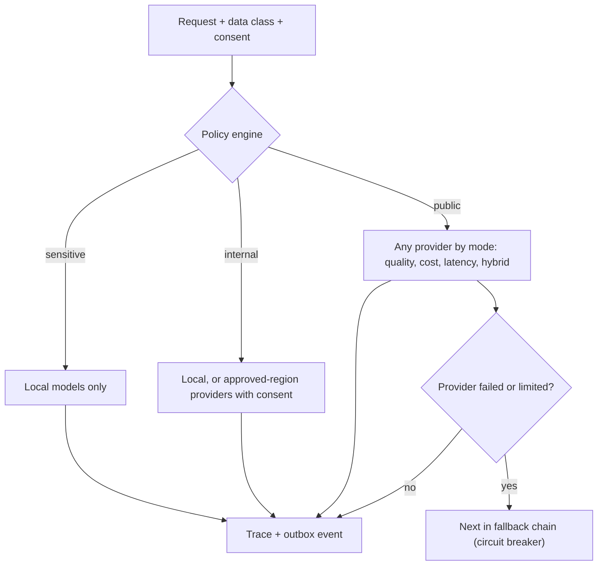
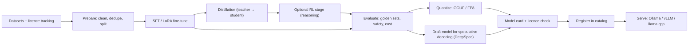
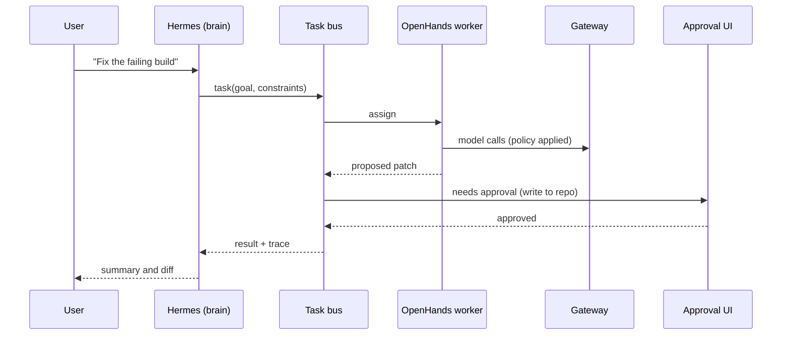
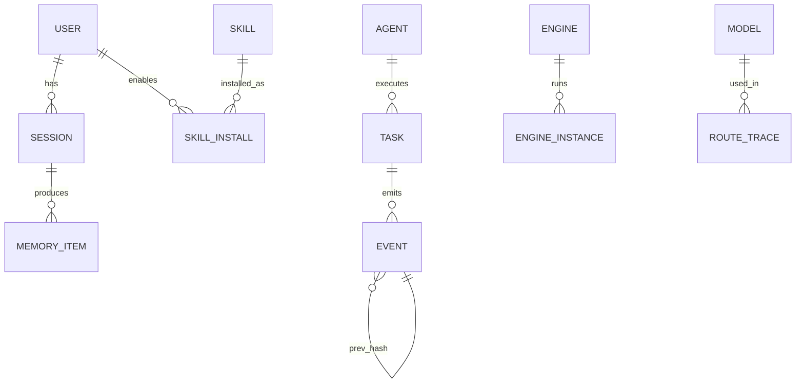
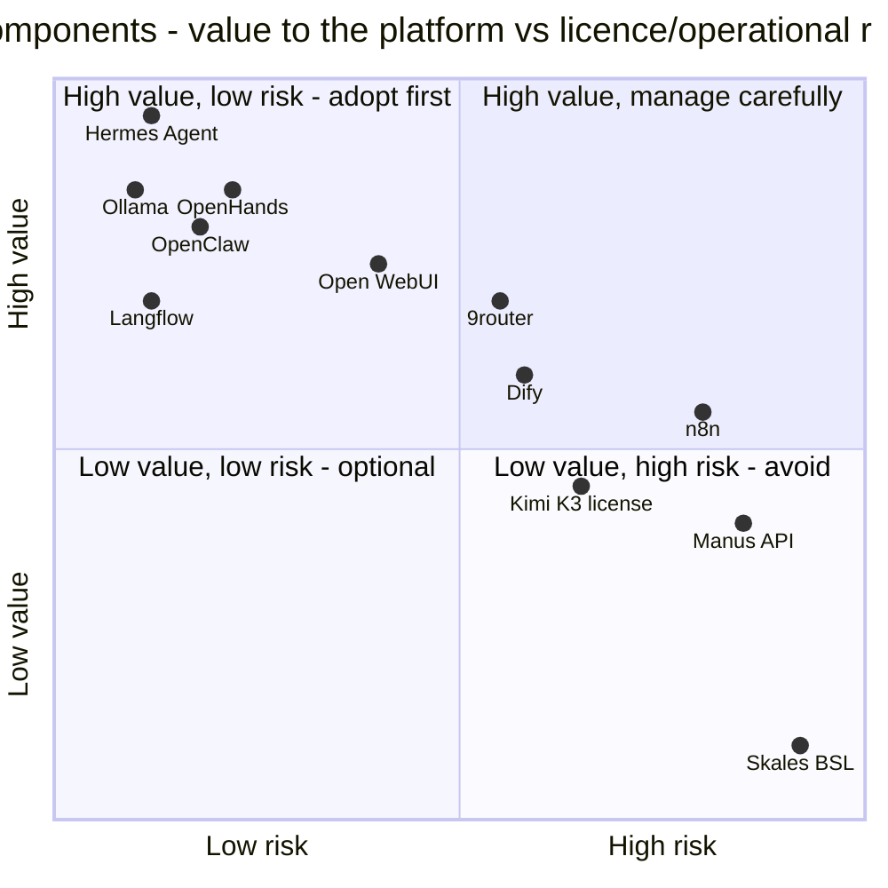
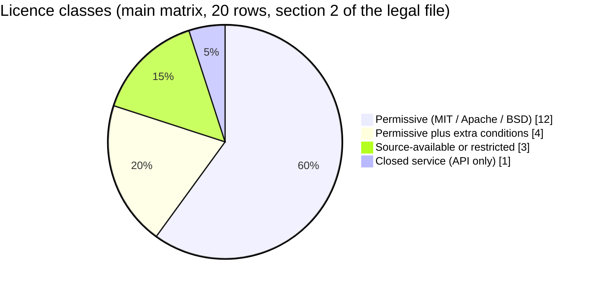

# ULTRA AI — V2 TECHNICAL SPECIFICATION

**Status:** PROPOSED (needs owner gates G-0.x … G-4.x) · **Date:** 2026-11-09 · **Language:** English (user-facing UI: Arabic RTL + English)
**Relation to existing docs:** this spec **adds to and corrects** `docs/MASTER_ARCHITECTURE.md` and the earlier `MASTER_PLAN.md`; it deletes nothing. Items that conflict are logged in `ultra-ai-v2/memory/contradictions.md`.
**Status vocabulary:** `IDEA` → `SPEC` → `STUB` → `WORKING` → `VERIFIED`. External facts carry a source in `ULTRA_AI_LEGAL_LICENSING.md` §2; anything else unverified is marked `UNVERIFIED`.

---

## 1. Scope and owner requirements → design

| Owner requirement (2026-11-09) | Design response | Section |
|---|---|---|
| Platform with AI, built on **Hermes**; memory, skills and "brain" inside it | Hermes Agent is the cognitive core; Ultra adds a Memory Bank, Skill Registry, MCP hub | §4 |
| Use all open-source tools, linked together | Runtime Supervisor embeds engines as managed sidecars behind one origin | §5 |
| OpenClaw, Ollama, 9router, n8n working **inside** the platform, no leaving, no re-install | Engine manifests + first-run provisioning + reverse proxy + SSO | §5 |
| Add **Langflow, Dify** next to n8n for automation | `WorkflowEngine` port with three adapters | §8 |
| **Open WebUI** and **OpenHands** as open-source chat UIs for Hermes | Chat hub embeds Open WebUI; OpenHands for agentic coding | §8, §12 |
| Add **Chinese models** (DeepSeek, GLM, Kimi, Manus); DeepSeek's model-making idea | Provider adapters + data-policy engine; **Model Foundry** | §6, §7 |
| Agents/clients network | Agent registry, task bus, delegation policy | §9 |
| 3D display designs to control memory, skills, brain | 3D Control Center (three.js) with 2D fallback | §10 |
| Direct interaction interface like ZeroAI, adaptive | Declarative UI-spec renderer | §11 |
| Desktop app, Linux + Windows; Devin-like; VS Code open source as option | Shell options matrix; OpenHands; Code-OSS "Ultra Studio" | §12 |
| Gate-OS: prepare for linking only, after operational phases, before blockchain | Versioned `/v1` contract, packaging, contract tests | §13 |
| Blockchain deferred; **Ultra Core** is a separate Ultra Cube project; build to link/export | Signed event outbox + exporter port; no chain features | §14 |
| Preserve all previous ideas | Memory Bank + planning release + preservation script | Super Prompt §5, §8 |

---

## 2. Naming and glossary (resolves collisions)

| Term | Meaning in v2 | Note |
|---|---|---|
| **Hermes Agent** | Nous Research's open-source agent (MIT) — the platform brain | Always write "Hermes Agent" in new docs |
| **Hermes monitoring** (legacy) | Prometheus + Grafana + Alertmanager in `monitoring/hermes` and the `/hermes` page | Proposed rename **Sentinel** (G-0.4); old files stay untouched |
| **ZeroAI** | The adaptive, local-first interaction layer (voice/text → memory → policy → local/cloud) | Existing docs in `wsl-ai-stack/ZeroAI` |
| **Runtime Supervisor** | Component that installs/starts/stops/updates embedded engines | New |
| **Memory Bank** | File-based, provenance-tagged knowledge store (facts, ADRs, ledger) | New; Hermes memory holds pointers |
| **Model Foundry** | Pipeline to customize/distill/evaluate/serve models | New |
| **Ultra Core** | Ultra Cube's blockchain platform (separate project) | Interface unknown (F10) |
| **Gate-OS** | Ultra Cube Linux distribution: one edition, seven environments | `github.com/Ultra-Cube/Gate-OS` |

Existing contradictions to be ledgered (non-exhaustive): phases 3/12/17/30; API port 4000 vs 5555; gateway 20129 vs 20128 (20128 is 9router's default); Postgres drift (resolved to 15 in `MASTER_ARCHITECTURE.md:222`; stale mention left in `docs/DOCKER_SETUP.md:33`); **n8n default port 5678 vs JARVIS 5678**; web app 3000 vs OpenHands default 3000; "OpenClaw" mapped to a different upstream (AionUi) in some catalogs; README "1.0.0 / 10/10" vs `package.json` 0.1.0.

---

## 3. System architecture (v2)



**Layering rules.** (1) UI never talks to an engine directly — only through the supervisor's origin and the platform API. (2) Engines never call each other directly — they go through the gateway/MCP hub so policy and traces apply. (3) Everything that matters (model call, tool call, agent action, skill change) emits a signed event into the outbox. (4) Every layer has a mock adapter so tests run without GPUs or paid APIs.

---

## 4. Brain — Hermes Agent as the core

### 4.1 What Hermes Agent provides (verified from its public repo/site, 2026-11-09)
MIT licence; built by Nous Research; released Feb 2026. Persistent agent memory (curated `MEMORY.md` / `USER.md`, plus full-text search over past sessions), skills created from experience and stored as `SKILL.md` compatible with the **agentskills.io** standard, MCP integration, a messaging gateway (Telegram, Discord, Slack, WhatsApp, Signal, CLI), any OpenAI-compatible endpoint as model provider, and an importer for OpenClaw settings/memories/skills. Install is one command; **native Windows support is described as experimental and WSL2 is recommended**.

### 4.2 What Ultra AI adds
| Capability | Design |
|---|---|
| **Memory Bank** | Provenance-tagged facts/ADRs/ledger (Super Prompt App. F). Hermes' small memory files hold pointers; heavy knowledge lives in the bank with FTS5 (and optional pgvector). |
| **Skill Registry** | Import/export agentskills.io skills, semantic versions, signatures, scopes (`global`, `environment:<name>`, `profile:<name>`), review status. |
| **MCP hub** | One MCP server exposing platform tools (gateway, engines, memory, outbox) to Hermes, OpenClaw and OpenHands, with per-agent allow-lists. |
| **Provider wiring** | Hermes' custom provider points to the **platform gateway** (OpenAI-compatible `/v1`) so every call gets routing, policy and tracing. The repo already contains this pattern in `config/brain/brain.config.yaml`. |

### 4.3 Open spike (blocks P1A design) — `UNVERIFIED`
Does the installed Hermes version expose an HTTP/OpenAI-compatible server that Open WebUI can talk to, or only CLI + messaging gateway? **Task P1A-01** must answer with evidence on Linux, WSL2 and native Windows. Fallback: a thin `hermes-bridge` service (OpenAI-compatible → Hermes session API/CLI).

### 4.4 Integration modes


---

## 5. Runtime Supervisor and embedded engines

### 5.1 Engine table
Ports are upstream defaults and **must be re-verified at pin time**; ports marked ✔ were seen in this session's sources.

| Engine | Role | Default port | Licence class (see Legal) | Embed mode | Notes |
|---|---|---|---|---|---|
| **Hermes Agent** | Brain | n/a (CLI/gateway) | MIT | managed process (WSL2 on Windows) | P1A-01 spike |
| **Ollama** | Local models | 11434 | MIT (re-verify) | sidecar | GPU/CPU probe, GGUF import |
| **OpenClaw** | Multi-channel assistant, skills | 18789 ✔ | MIT | sidecar (Node ≥ 22 ✔) | Pairing/allow-list on by default |
| **9router** | Provider router / token saver | 20128 ✔ | MIT | sidecar | OAuth-subscription pooling **off** by default |
| **Open WebUI** | Chat UI | 8080 (container) | **BSD-3 + branding clause** | separate service, iframe | Keep branding (G-1.4) |
| **OpenHands** | Agentic coding (Devin-style) | 3000 | MIT core; `enterprise/` **excluded** | sidecar | Remap port (collides with web) |
| **Langflow** | Visual LLM flows | 7860 | MIT | sidecar | Default flow builder (G-1.1) |
| **Dify** | App/RAG builder | 80 / 5001 | **Apache-2.0 + extra conditions** | sidecar, single tenant | No multi-tenant, keep logo |
| **n8n** | Workflow automation | 5678 | **Sustainable Use (source-available)** | user-installed, connect only | Never bundled (G-1.2) |


**Host constraint (from `wsl-ai-stack/README.md:17`):** the owner's WSL distro has **no Docker**. Engines whose usual deployment is container-based (Dify, and typically OpenHands' sandbox) need either Docker/Podman provisioned by the supervisor or a non-container deployment; this is `UNVERIFIED` per engine and must be settled in P1C before those engines are promised. Owner forks to evaluate: `APP_WebUI-desktop` (Open WebUI as a native desktop app) and `VSCodroid` (`external-integrations/FADHEL-SH-REPOSITORIES.md:11,29`).

### 5.2 Engine manifest (one per engine, validated by JSON Schema)
```yaml
id: openclaw
display_name: OpenClaw
version_pin: "<exact version>"          # never "latest"
source: { type: npm, name: openclaw, integrity: "sha512-…" }
license: { spdx: MIT, matrix_row: L-02, status: APPROVED }
runtime: { kind: node, min: "22" }
ports: { gateway: { default: 18789, bind: 127.0.0.1 } }
health: { http: "/health", interval_s: 10 }
data_dirs: [ "${PLATFORM_DATA}/engines/openclaw" ]
sandbox: { user: nonroot, caps_drop: [ALL], read_only_root: true }
expose: { path: "/apps/openclaw", sso: jwt, iframe: true }
lifecycle: { install: "…", start: "…", stop: "…", update: "pin-bump-with-review" }
```

### 5.3 "Never leave the platform, never re-install" — how
1. **First-run provisioning** downloads pinned, checksum-verified engines into the platform data directory, after a licence screen the user accepts per engine. Engines with restrictive licences (n8n) are **detected/connected**, not redistributed.
2. **Single origin**: the supervisor's reverse proxy serves every engine under `/apps/<id>` with SSO and a strict CSP/`frame-ancestors` policy; the console embeds them.
3. **One config store, one port registry** resolves collisions automatically (5678, 3000, 8080 …).
4. **Offline mode** uses already-provisioned engines; updates are explicit.



---

## 6. Model gateway and the Chinese models

### 6.1 Adapter port (TypeScript sketch)
```ts
interface ProviderAdapter {
  id: string;                                  // "deepseek", "zai", "moonshot", "ollama" …
  capabilities: { stream: boolean; tools: boolean; embed: boolean; vision: boolean; reasoningControl?: string[] };
  generate(req: GenerateRequest, ctx: PolicyContext): Promise<GenerateResult>;
  stream(req: GenerateRequest, ctx: PolicyContext): AsyncIterable<Chunk>;
  embed?(req: EmbedRequest, ctx: PolicyContext): Promise<EmbedResult>;
  health(): Promise<Health>;
}
```
Every call carries a `PolicyContext` (data class, user consent, region rules) and returns a **trace** (route decision, provider, model, latency, tokens, fallbacks, cost).

### 6.2 Provider and model catalog (verified 2026-11-09 unless marked)
| Provider | Models / ids | Open weights? | Licence | Integration notes |
|---|---|---|---|---|
| **DeepSeek** | `deepseek-v4-pro` (≈1.6T total/49B active), `deepseek-v4-flash` (284B/13B active); V4.1-Flash (Sep 2026) | Yes | **MIT** (models); apps proprietary | Old aliases `deepseek-chat`/`deepseek-reasoner` were scheduled to retire 2026-07-24 → use V4 ids; configurable `reasoning_effort` (low/high/max) on Flash; 1M-token context on the API |
| **DeepSeek Harness (dsh)** | agent runtime, preview (Aug 2026) | code | **MIT** | Candidate component for the agents network; maturity `UNVERIFIED` |
| **DeepSeek DeepSpec** | speculative-decoding draft-model training code | code + draft checkpoints | **MIT** | Used by Model Foundry (§7) |
| **Z.ai GLM** | GLM-5 (744B, 40B active, Feb 2026), 5.1 (Apr 2026), 5.2 (1M context) | Yes | **MIT** | API `api.z.ai`; also on Hugging Face (`zai-org`) |
| **Moonshot Kimi** | K2.6 (Apr 2026), **K3** (2.8T total/104B active, weights 27 Jul 2026) | Yes | K2.x **Modified MIT**; **K3 License** (custom) | K3 needs preserved reasoning history across turns (adapter must replay prior assistant reasoning + tool calls); K3 weights ≈1.56 TB → API only for almost all users |
| **Manus** | hosted agent product, API (`open.manus.ai`) | **No (closed)** | commercial ToS | Integrate only as an optional *agent provider* with the user's key. Meta's acquisition was blocked/unwound in 2026 → availability and data-flow risk; treat as volatile |
| **OpenManus** | open framework replicating the Manus approach | code | **MIT** (FoundationAgents) | Candidate open agent framework for the agents network |
| OpenAI, Anthropic, OpenRouter, Ollama | existing adapters | — | provider ToS | already in `packages/ai-core` (OpenAI, Anthropic, Mock) |

**Hardware reality:** frontier open weights (V4-Pro, GLM-5.x, K3) are datacenter-scale. On user machines the *local* tier is small/quantized models served by Ollama; the Chinese frontier models are reached **by API** (or by the user's own GPU cluster via vLLM/SGLang).

### 6.3 Routing and data policy

Default (G-1.5): **sensitive data never leaves the device**; third-country APIs (including China-hosted) require explicit per-provider consent for `internal`/`public` data; a visible badge shows where each answer was computed.

---

## 7. Model Foundry — "model-making" pipeline (DeepSeek-inspired)

**Goal:** let users and Ultra Cube build, customize, evaluate and serve models inside the platform, reusing open recipes and code — honestly scoped (no GPU exists in the design sandbox, so every training step is `UNVERIFIED` until run on a GPU host).



| Stage | Reuse (verified unless marked) | Constraint |
|---|---|---|
| Draft-model training for speculative decoding | **DeepSeek DeepSpec** (MIT; Eagle3/DFlash/DSpark variants) | Needs GPU host |
| Serving | Ollama, vLLM, SGLang, llama.cpp | per-engine licence rows |
| SFT/LoRA, RL recipes | open community recipes (e.g. Hugging Face TRL, open-r1) — `UNVERIFIED`, verify licences when selected | GPU host; dataset licences |
| DeepSeek infra libraries (e.g. kernels, expert-parallel, file system) | DeepSeek's open-source repos — `UNVERIFIED` per repo | Datacenter GPUs; out of scope for v0 |
| Distillation | teacher = **local or licence-permitted** models | **Provider ToS may forbid using API outputs to train competing models** → A04 sign-off + R2 card |

**Licence inheritance:** a fine-tuned/distilled model inherits the base model's licence terms (Llama community licence, Gemma terms, Apache, MIT, Kimi licences differ). The model card must list base model, dataset licences, and obligations. **Regulatory note:** publishing a general-purpose model may trigger provider obligations under the EU AI Act — counsel review before any public release.

---

## 8. Chat and automation

- **Chat hub:** Open WebUI embedded as a separate service (branding kept) pointing at the platform's OpenAI-compatible endpoint, which fronts Hermes (§4.4). A native quick-chat exists for the desktop tray.
- **OpenHands:** agentic coding workspace (Devin-style) — also the basis for P2 (§12).
- **Automation hub:** unified list/run/inspect of flows from three engines through a port:

```ts
interface WorkflowEngine {
  id: "langflow" | "dify" | "n8n";
  list(): Promise<FlowSummary[]>;
  run(flowId: string, input: unknown, ctx: PolicyContext): Promise<RunResult>;
  import(def: unknown): Promise<FlowId>;      // engine-native format
  health(): Promise<Health>;
}
```
- **Default order (G-1.1):** Langflow (MIT) → Dify (single-tenant) → n8n (user-installed). Flows are exposed to agents as MCP tools so Hermes/OpenClaw can trigger them under policy.

---

## 9. Agents network

| Concept | Spec |
|---|---|
| **Agent registry** | Each agent: `id`, `kind` (hermes, openclaw, openhands, openmanus, dify-app, langflow-app, manus-connector, studio-persona), `capabilities`, `endpoint`, `owner`, `budget`, `scopes`, `status` |
| **Task bus** | Tasks with `goal`, `inputs`, `constraints`, `deadline`, `approvals`, `trace_id`; transports: MCP (tools), evaluate ACP and A2A |
| **Delegation policy** | Which agent may call which tool/engine, spend limits, human approval for R2-like actions (send, delete, pay, publish) |
| **Audit and replay** | Every action → signed event; deterministic replay of tool calls in a sandbox |
| **Separation** | The existing 32-persona Studio is **dev-time crew**, kept out of the product API (ADR) |



---

## 10. 3D Control Center (memory, skills, brain, agents, engines)

**Purpose:** make the invisible state of the AI controllable — see, filter, edit and approve.

| Scene | Entities → visual | Data source | Controls |
|---|---|---|---|
| **Brain** | Regions: *Episodic* (sessions), *Semantic* (facts), *Procedural* (skills), *Working* (current task); nodes sized by use/recency | Memory Bank + Hermes session index | select, pin, merge, forget (with confirm), time scrub |
| **Skills** | Skills as nodes, edges = "calls/depends on"; colour = scope/status | Skill Registry | enable/disable, version diff, promote scope |
| **Agents network** | Agents as nodes, tasks as moving edges; status halos | Agent registry + task bus | pause, reassign, approve |
| **Engines** | Sidecars + ports + health | Supervisor | start/stop/update |
| **Models** | Catalog with region/licence badges | Catalog | set routing, set data-class rules |

**Technical:** three.js (+ React Three Fiber) in the console; instanced meshes; level-of-detail; worker-side force layout; data via a graph JSON API (`/v1/graph/{scene}`); command palette for keyboard control.
**Budgets (to be measured, not assumed):** ≥ 60 fps on integrated GPU up to ~5 k visible nodes; graceful degradation beyond.
**Accessibility:** every scene has an equivalent **table/tree view**, full keyboard navigation, `prefers-reduced-motion` support, colour-blind-safe palette, Arabic/English labels (RTL aware).

---

## 11. ZeroAI adaptive interface

**Principle:** the planner (LLM) outputs a **declarative UI spec**; a validator checks it against a JSON Schema and a **catalog of allowed components/connectors**; a renderer builds the UI from a fixed component registry. No generated executable code runs on the host. Generated mini-apps (if ever allowed) run in a sandboxed iframe with strict CSP and least-privilege scopes. The user can override, pin and undo everything.

```json
{
  "version": "1",
  "profile": "business",
  "locale": "ar",
  "layout": { "type": "grid", "columns": 12 },
  "widgets": [
    { "id": "w1", "component": "market-watchlist", "span": 6,
      "source": { "connector": "market-data", "scopes": ["read"], "refresh_s": 60 }, "pinned": true },
    { "id": "w2", "component": "news-digest", "span": 6,
      "source": { "connector": "rss", "scopes": ["read"], "refresh_s": 900 } },
    { "id": "w3", "component": "task-board", "span": 12,
      "source": { "connector": "local-tasks", "scopes": ["read", "write"] } }
  ],
  "explain": "Selected for a business profile; all connectors are read-only except local tasks."
}
```
**Catalog entry:** `component`, `props schema`, `connectors`, `scopes`, `rate limits`, `data shape`, `a11y notes`. **Rules:** show data source + freshness on each widget; visible failure states; reversible adaptation history; never auto-install connectors; consent per scope.
**First profiles:** *Businessman* (markets, news, calendar/mail digests read-only, tasks) and *Video designer* (project board, asset browser, render queue) — derived from the personas in `docs/ux-design`.

---

## 12. Desktop application (Linux and Windows)

### 12.1 Shell options (decision G-2.1)
| Criterion | **Tauri 2 shell** ⭐ | Electron | Code-OSS based |
|---|---|---|---|
| Footprint | small (system webview) | large (bundled Chromium) | very large |
| Sidecar management | first-class sidecar support (`UNVERIFIED` detail) | Node child processes | extension host + custom |
| Existing repo asset | none | `desktop-ui` is labelled Electron-based but has no Electron dependency or code (F6) | none |
| Effort | low–medium | low | **high** |
| Risk | webview differences on Linux | memory use | upstream churn, marketplace terms |

### 12.2 Devin-like experience (decision G-2.2)
- **Option 1 ⭐ — embed OpenHands:** MIT core, model-agnostic, local GUI + CLI + SDK, supports external agents via ACP; exclude its source-available `enterprise/` directory.
- **Option 2 — "Ultra Studio" on Code-OSS:** build from Microsoft's MIT-licensed `vscode` source with a **clean `product.json`** (no Microsoft branding/telemetry/Marketplace endpoints), publish extensions via **Open VSX** (Marketplace terms limit use to Microsoft products); follow VSCodium's approach. Highest effort, best IDE fidelity.
- **Option 3:** both, sequentially (OpenHands first).

### 12.3 Windows and Linux specifics
- **Windows:** Hermes Agent via managed **WSL2** (native Windows flagged experimental upstream); installer + code signing; engines as Windows services or WSL2 processes per manifest.
- **Linux:** `.deb` and AppImage first; systemd user services; later reused for Gate-OS packaging.
- **Both:** first-run wizard (hardware probe → model suggestions → engine opt-ins with licence screens), auto-update channel with signature verification, tray quick-chat, offline mode.

---

## 13. Gate-OS readiness (integration points only)

Nothing is built *inside* Gate-OS. We deliver a **contract, packages and tests** so Gate-OS can adopt Ultra AI as its AI core.

**Contract `/v1` (OpenAPI 3.1 + JSON Schema, G-3.1):**
| Endpoint (sketch) | Purpose |
|---|---|
| `GET /v1/capabilities` | What this Ultra AI instance supports |
| `PUT /v1/environments/{env}/profile` | AI profile for an environment (models, engines on/off, budgets) |
| `POST /v1/intents` | Natural-language intent → adaptive UI spec / actions |
| `GET /v1/ui-spec/{env}` | Current adaptive UI spec for rendering by the Gate-OS shell |
| `POST /v1/events` | Orchestrator → AI events (environment switched, resource pressure) |
| `GET /v1/health` | Liveness/readiness |

**Environment presets (first draft; confirm with Gate-OS maintainers):**
| Environment | AI profile focus | Engines on | Resource note |
|---|---|---|---|
| Everyday | assistant, search, simple automation | Hermes, Ollama (small), Open WebUI | low |
| Gaming | minimal footprint, voice commands, overlays | Hermes (idle), Ollama off | **lowest** |
| Dev | OpenHands, code models, Langflow | + OpenHands, Langflow | high |
| Design | asset search, prompt tools, render queue | + Ollama (vision), n8n if present | high |
| Media | transcription, tagging, summarization | + Ollama (audio), flows | medium–high |
| Security | isolated, offline-first, audit-heavy | Hermes (local only), no cloud routing | isolated |
| Business | dashboards, mail/calendar digests, reports | + Langflow/Dify, connectors | medium |

**Packaging:** `.deb` + systemd units + AppArmor profiles + offline-first defaults. **Security:** local-socket auth, JWT scopes, audit log; Ultra AI as a separate process (network boundary) so Gate-OS's GPL components are not combined with Ultra AI code (counsel to confirm).

---

## 14. Ultra Core bridge (readiness only; blockchain deferred)

**Principle:** the platform never holds user private keys or tokens; it emits **signed, hash-chained events** that an exporter can deliver to Ultra Core later.

```json
{
  "schema": "ultra.event.v1",
  "id": "01J…",                       // ULID
  "ts": "2026-11-09T10:00:00Z",
  "type": "usage.model_call",          // usage.* | contribution.* | provenance.*
  "subject": { "instance": "…", "agent": "…" },
  "payload": { "provider": "deepseek", "model": "deepseek-v4-flash", "tokens_in": 812, "tokens_out": 304 },
  "prev_hash": "sha256:…",
  "sig": { "alg": "Ed25519", "key_id": "…", "value": "…" }
}
```
- **Outbox:** append-only local log with a hash chain (tamper-evident), offline queue, idempotent export port (`ExportTarget.send(batch)`).
- **Connector:** `ultra-core-bridge` implements `ExportTarget` against Ultra Core **once the owner supplies its interface** (G-4.1); until then a mock target and contract tests.
- **Not built:** tokens, wallets, mining/rewards, smart contracts, chain nodes. The legacy `packages/distributed` is **re-scoped** (device mesh first; no "private by chunking" claim — see `MASTER_PLAN.md` D5).
- **Legal gate:** any token/crypto feature requires a written legal opinion first (G-4.2).

---

## 15. Security and privacy architecture

| Threat | Mitigation |
|---|---|
| Prompt injection via web/docs/tool output | Treat all external content as data; tool allow-lists; approvals for side effects; output filters |
| Malicious or compromised engine/skill | Pinned versions + checksums, SBOM, sandbox (non-root, dropped caps, read-only FS, loopback), signed skills |
| Data leakage to third-country APIs | Data classes, default-deny for sensitive, consent per provider, region badge, egress allow-list |
| Credential theft | OS keychain/secret vault, no secrets in git, short-lived tokens |
| Supply-chain (npm/pip) | Lockfiles, 14-day-old-version rule for new releases, audit in CI |
| Rogue agent actions | Delegation policy, budgets, audit log, kill switch in 3D Control Center |
| Unauthenticated local services | Loopback bind + SSO at the proxy; no engine port exposed on LAN by default |

---

## 16. Observability (Sentinel)
Reuse the existing Prometheus + Grafana + Alertmanager stack (renamed per G-0.4, old files preserved). Add exporters for the supervisor (engine health, restarts), gateway (latency, tokens, fallbacks, cost), agents (task success, approvals) and outbox (lag, chain integrity).

---

## 17. Data model (core entities)


Stores: PostgreSQL 15 (platform), SQLite (edge/desktop), file-based Memory Bank, Redis (optional cache). MongoDB/IPFS/Elasticsearch stay out until a measured need exists.

---

## 18. Component charts

### 18.1 Value vs legal/operational risk (qualitative, from the Legal file)


### 18.2 Licence classes of the components in the matrix


---

## 19. Non-goals (v2)
No blockchain, tokens or wallets; no volunteer public compute network; no multi-tenant SaaS built on Dify/n8n/Open WebUI; no claims of throughput/uptime without benchmarks; no changes inside Gate-OS; no frontier-model training.

## 20. Open questions for the owner
1. Ultra Core interface (G-4.1). 2. Which agent runtime executes the Crew (G-0.1). 3. Desktop shell and Devin-like base (G-2.x). 4. Licence of Ultra AI (G-0.3). 5. Is a commercial/paid tier planned? (It changes the n8n, Open WebUI, Dify and Kimi analysis.) 6. Target hardware for the local tier.
