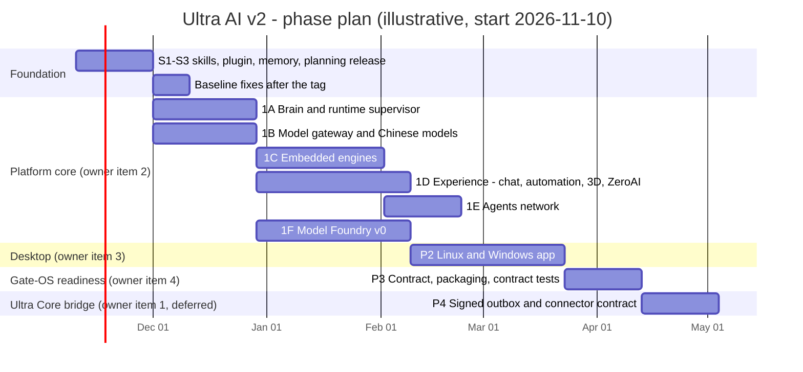
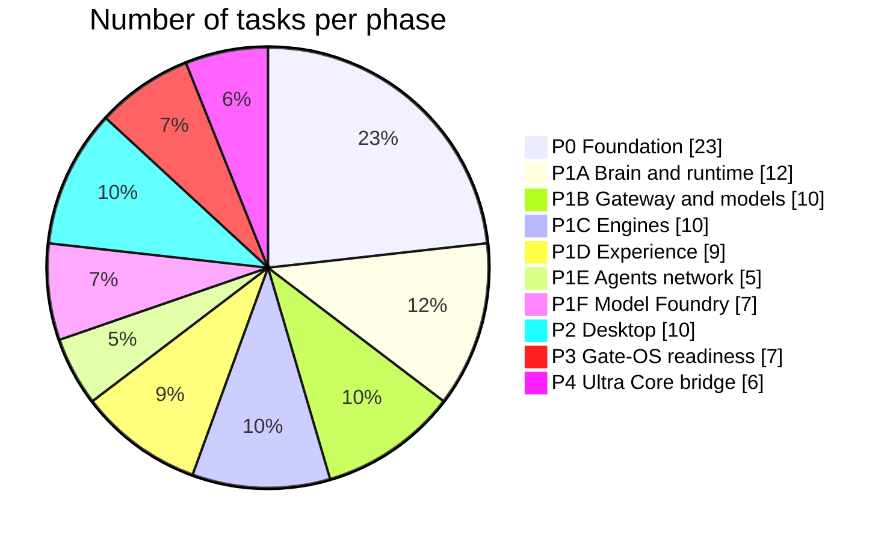
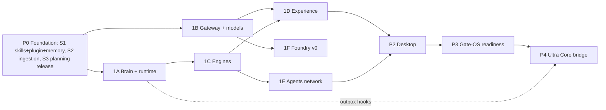

# ULTRA AI — LIVING TO-DO BOARD

**Maintained by:** A00 Lead Orchestrator · **Source of truth for status.** Update after every task report.
**Status words (one per task):** `IDEA` → `SPEC` → `STUB` → `WORKING` → `VERIFIED` (evidence link required). Checkbox is ticked **only** at `VERIFIED`.
**Gate markers:** 🔒 = needs a Question Card answer (see `ULTRA_AI_SUPER_PROMPT.md` App. A). **R2** tasks are blocking.
**Estimates** in the chart are planning estimates (agent-parallel work with human gates); recalibrate after P0.

## 0. Roadmap chart

## 1. Task distribution by phase

## 2. Dependency map

---

## P0 — FOUNDATION (owner steps 1–3)

### P0a — Before the planning tag (additions only)
- [x] **P0-01** Verify facts F1–F10 against the live repo; log deviations · A01 · `VERIFIED` — evidence: F1-F11 re-checked on live HEAD 1aa16b6 (brain-stack/memory/planning/facts/repo-state.yaml)
- [ ] **P0-02** Baseline manifest + `git bundle` backup · A01 · `WORKING` · 🔒 R2 (tag push) — evidence: local tag baseline/pre-planning-20261109 + baseline/baseline.sha256 done; push of the tag awaits the R2 card
- [x] **P0-03** Issue gate cards G-0.1 … G-0.6 · A00 · `VERIFIED` — evidence: G-0.1…G-0.6 answered 2026-11-09 (brain-stack/memory/planning/decisions/ledger.md); G-1.9 raised
- [x] **P0-04** Author the 33 skills (App. D) and lint frontmatter · A02 · `VERIFIED` — evidence: 33 skills, infrastructure/automation/lint_skills.py = 0 problems
- [ ] **P0-05** Build plugin `ultra-ai-builder`; install in a clean sandbox · A02 · `WORKING` (verify manifest format online first) — evidence: plugin built; guard.sh tested; clean-sandbox install and manifest-format check still UNVERIFIED
- [x] **P0-06** Memory Bank scaffold + glossary (Hermes agent vs Hermes monitoring, etc.) · A01 · `VERIFIED` — evidence: memory bank scaffold, glossary, YAML parses
- [ ] **P0-07** Ingest 113 `.md` files into facts / skills / diagrams per `DOC_CONVERSION_MAP.csv` (incl. the 25 `unclassified`) · A01 · `WORKING` — evidence: 113/113 files indexed; stages: 27 done (139 KB) + 2 partial (41 KB) + 84 mechanical (967 KB, script extracts in brain-stack/memory/planning/extracts/, NOT reads) + 0 pending; 119 legacy facts; ADR-0009
- [ ] **P0-07b** Agent read of the mechanical-extract files (priority: ux, product-STALE-RISK, code-docs, history, business) and conversion to facts/skills · A01 · `IDEA` — backlog; does not block the planning tag (ADR-0009)
- [x] **P0-08** Extract and syntax-validate all 117 Mermaid blocks; graph JSON for each · A01 · `VERIFIED` — evidence: 117/117 extracted (116 valid, 1 invalid kept); 84 graph JSON files; brain-stack/memory/diagrams/registry.json
- [ ] **P0-09** Contradiction ledger (phases, ports, versions, "100% complete" claims) · A01+A03 · `WORKING` — evidence: 35 rows with citations in brain-stack/memory/planning/contradictions.md (C-001…C-035); some rows marked verify
- [ ] **P0-10** ADR-0001…0010 (layout, licence, naming, Hermes core, supervisor, data policy, engine policy, desktop, Gate-OS contract, outbox) · A03 · `WORKING` — evidence: ADR-0001..0007 written (PROPOSED until their gates are answered)
- [ ] **P0-11** Legal matrix review, `THIRD_PARTY.md`, SBOM template · A04 · `WORKING` — evidence: legal/licence_matrix.yaml (20 rows) + THIRD_PARTY.md placeholder; SBOM template pending
- [ ] **P0-12** Orphan recovery plan for the 5 gitlinks (record SHAs, mirror plan) · A04+A01 · `WORKING` — evidence: 5 pins recorded (external-integrations/_PINS.md); all 5 upstreams verified public with pinned SHA = tip (git ls-remote 2026-11-09); licences read (Biome GPL-3.0!); infrastructure/automation/mirror_gitlinks.sh dry-run OK; execution awaits owner `gh` login
- [ ] **P0-13** Commit additions on `release/planning-study` · A00 · `WORKING` — evidence: additive commits on release/planning-study (local)
- [ ] **P0-14** Independent `verify-additive` + `verify-tag` run · A14 · `IDEA`
- [ ] **P0-15** Publish pre-release + assets (manifest, tarball, bundle, notes) · A00 · `IDEA` 🔒 R2 G-0.2

### P0b — After the tag (normal commits on `v2` branch)
- [ ] **P0-16** Commit `package-lock.json`; make CI `npm ci` green · A05 · `WORKING` — evidence: root cause: package-lock.json was git-ignored (.gitignore:138); removed; lockfile committed (780 KB); `npm ci --ignore-scripts` from a clean tree = 1376 packages in 36 s; real CI run and Prisma postinstall still UNVERIFIED (branch v2/foundation, not merged)
- [ ] **P0-17** Add `LICENSE` per G-0.3; replace over-claiming README sections; fix clone URL · A15 · `WORKING` 🔒 — evidence: LICENSE (Apache-2.0 text), NOTICE, package.json licence fields (7 files incl. wsl-ai-stack ISC), new README with status table, old README archived at docs/archive/README.v0.1.0.md (branch v2/foundation, R1: not merged until the owner confirms)
- [ ] **P0-18** Archive stale `.github/copilot-instructions.md` (`git mv` to archive) and write a correct one · A15 · `IDEA` 🔒 R2
- [ ] **P0-19** Sentinel rename (copy; old stack kept with deprecation note) · A09 · `WORKING` 🔒 G-0.4 — evidence: monitoring/sentinel created (renamed copy, YAML/JSON parse OK, script syntax OK, 0 'hermes' left) + deprecation note in infrastructure/monitoring/legacy-hermes/README.md; the /hermes web page rename is still pending
- [ ] **P0-20** "Gata-OS" → "Gate-OS" in all *new* docs; legacy fixed via archive+replace · A15 · `WORKING` — evidence: new README uses Gate-OS; legacy files containing 'Gata-OS' untouched until archive-and-replace
- [ ] **P0-21** Run the documented 306 API tests and Prisma migrations on a networked host · A14 · `IDEA`
- [ ] **P0-22** Build allowlist that excludes Skales (BSL 1.1) and any `PENDING` licence · A04 · `WORKING` — evidence: infrastructure/automation/licence-gate.mjs + `npm run licence:gate` + CI job; passes on 34 build-surface files, fails when a Dockerfile references external-integrations/skales (negative test); PENDING licences are not enforced yet

---

## P1 — PLATFORM CORE (owner item 2)

### P1A — Brain (Hermes Agent) and runtime supervisor · A05, A06
- [ ] **P1A-01** Spike: Hermes Agent embed modes (CLI, gateway, any HTTP/OpenAI-compatible API) on Linux, WSL2 and native Windows (experimental) · `IDEA`
- [ ] **P1A-02** `brain` package: process manager, health, config merge (`~/.hermes/config.yaml` custom provider → platform gateway) · `IDEA`
- [ ] **P1A-03** Memory service: Memory Bank ↔ Hermes memory bridge (pointers), FTS5 index, optional pgvector · `IDEA`
- [ ] **P1A-04** Skill registry: import/export agentskills.io format, versioning, signing, scopes · `IDEA`
- [ ] **P1A-05** MCP hub exposing platform tools to Hermes/OpenClaw · `IDEA`
- [ ] **P1A-06** Engine manifest schema (id, pinned version, checksum, licence row, ports, health, data dirs) · `IDEA`
- [ ] **P1A-07** Supervisor: install/start/stop/update, non-root, loopback-only by default · `IDEA`
- [ ] **P1A-08** Single-origin reverse proxy + SSO (JWT) + CSP so engines are used *inside* the platform · `IDEA`
- [ ] **P1A-09** Port registry and conflict resolver (4000, 20128, 20129, 18789, 11434, 5678, 7860, 8080, 3000 …) · `IDEA`
- [ ] **P1A-10** Secrets vault abstraction (OS keychain / env), no secrets in git · `IDEA`
- [ ] **P1A-11** Health and metrics to Sentinel (Prometheus/Grafana) · `IDEA`
- [ ] **P1A-12** Signed, hash-chained event outbox (hooks for Ultra Core; no keys held by platform) · A13 · `IDEA`

### P1B — Model gateway and models · A07
- [ ] **P1B-01** Adapter port (`generate`, `stream`, `embed`, `toolCall`) + conformance tests · `IDEA`
- [ ] **P1B-02** Adapters: OpenAI, Anthropic, Ollama, generic OpenAI-compatible · `IDEA`
- [ ] **P1B-03** Adapters: **DeepSeek** (V4-Pro, V4-Flash, `reasoning_effort`), **Z.ai GLM** (5 / 5.1 / 5.2), **Moonshot Kimi** (K2.6 / K3) · `IDEA`
- [ ] **P1B-04** **Manus** connector (closed service, user API key, treated as an *agent provider*); evaluate **OpenManus** (MIT) as the open agent framework · A08 · `IDEA`
- [ ] **P1B-05** Routing engine: quality/cost/latency/hybrid, ordered fallback, circuit breaker, trace schema · `IDEA`
- [ ] **P1B-06** Data-classification policy engine, region/residency tags, consent prompts · `IDEA` 🔒 G-1.5 R2
- [ ] **P1B-07** Model catalog (single source of truth): licence, context, modality, hardware fit, region · `IDEA`
- [ ] **P1B-08** 9router as upstream (port 20128); OAuth-subscription pooling disabled by default · `IDEA` 🔒 G-1.6 R2
- [ ] **P1B-09** Usage/cost metering → event outbox · `IDEA`
- [ ] **P1B-10** Routing evaluation harness with golden prompts · A14 · `IDEA`

### P1C — Embedded engines (no leaving the platform, no manual installs) · A08
- [ ] **P1C-01** **Ollama** adapter: model pull, hardware probe, GGUF import · `IDEA`
- [ ] **P1C-02** **OpenClaw** sidecar (gateway :18789, Node ≥ 22): channel pairing UI, skills sync with Hermes · `IDEA`
- [ ] **P1C-03** **9router** sidecar · `IDEA`
- [ ] **P1C-04** **Open WebUI** sidecar, branding kept, wired to Hermes · `IDEA` 🔒 G-1.4 R2
- [ ] **P1C-05** **Langflow** sidecar (default flow builder) · `IDEA` 🔒 G-1.1
- [ ] **P1C-06** **Dify** sidecar, single-tenant per install, logo kept · `IDEA` 🔒 G-1.3 R2
- [ ] **P1C-07** **n8n** adapter: detect/connect a *user-installed* instance; never bundled · `IDEA` 🔒 G-1.2 R2
- [ ] **P1C-08** **OpenHands** sidecar (MIT core only; `enterprise/` excluded) · `IDEA`
- [ ] **P1C-09** `WorkflowEngine` port + one automation API across Langflow / Dify / n8n · `IDEA`
- [ ] **P1C-10** Engine conformance suite; CI fails if an engine's licence row is not `APPROVED` · A04+A14 · `IDEA`

### P1D — Experience (chat, automation, 3D, ZeroAI) · A09
- [ ] **P1D-01** Console shell (Next.js), Arabic RTL + English, design tokens · `IDEA`
- [ ] **P1D-02** Chat hub: Hermes through embedded Open WebUI + native quick-chat · `IDEA` 🔒 G-1.8
- [ ] **P1D-03** Automation hub: unified view of Langflow / Dify / n8n flows · `IDEA`
- [ ] **P1D-04** **3D Control Center v0 — Brain:** memory nodes, skill nodes, brain regions; 2D/table fallback · `IDEA`
- [ ] **P1D-05** **3D — Agents network:** live status, tasks, edges · `IDEA`
- [ ] **P1D-06** **3D — Engines/ports map** · `IDEA`
- [ ] **P1D-07** **ZeroAI adaptive interface:** capability catalog, UI-spec JSON Schema, validator, renderer, sandbox, manual override, reversible history · `IDEA`
- [ ] **P1D-08** Profiles from personas: businessman dashboard, video designer · `IDEA`
- [ ] **P1D-09** Accessibility audit (WCAG 2.2 AA), `prefers-reduced-motion` · A14 · `IDEA`

### P1E — Agents network · A06, A08
- [ ] **P1E-01** Agent registry: Hermes agents, OpenClaw, OpenHands workers, OpenManus-based, Dify/Langflow apps · `IDEA`
- [ ] **P1E-02** Task bus and protocols (MCP; evaluate ACP and A2A) · `IDEA`
- [ ] **P1E-03** Delegation policies, approvals (human in the loop), budgets · `IDEA`
- [ ] **P1E-04** Audit log and replay · `IDEA`
- [ ] **P1E-05** Map existing 32-persona Studio to the dev-time crew; keep it out of the product API · A03 · `IDEA`

### P1F — Model Foundry v0 (the "model-making" idea, DeepSeek-inspired) · A11
- [ ] **P1F-01** Foundry ADR: stages, artifacts, hardware tiers (honest limits: no GPU in the sandbox) · `IDEA` 🔒 G-1.7
- [ ] **P1F-02** Dataset pipeline with per-dataset licence tracking · `IDEA`
- [ ] **P1F-03** SFT/LoRA recipe, runnable on a GPU host · `IDEA` (`UNVERIFIED` until executed)
- [ ] **P1F-04** Distillation recipe; teacher outputs only where provider ToS permit (A04 sign-off) · `IDEA` 🔒 R2
- [ ] **P1F-05** Speculative-decoding draft models using DeepSeek **DeepSpec** (MIT) · `IDEA`
- [ ] **P1F-06** Evaluate → quantize (GGUF) → register in catalog → serve via Ollama · `IDEA`
- [ ] **P1F-07** Model cards + licence-inheritance check (derived model ⇒ base-model licence) · A04 · `IDEA`

---

## P2 — DESKTOP APP, LINUX AND WINDOWS (owner item 3) · A10
- [ ] **P2-01** Decision records for G-2.1 (shell) and G-2.2 (Devin-like workspace) · A03 · 🔒
- [ ] **P2-02** Shell skeleton + sidecar launcher, tray, update channel · `IDEA`
- [ ] **P2-03** Linux: `.deb` + AppImage; Windows: installer + code-signing plan · `IDEA`
- [ ] **P2-04** Windows path for Hermes: managed WSL2 (native flagged experimental) · `IDEA`
- [ ] **P2-05** First-run wizard: hardware probe, model suggestions, engine opt-ins with licence screens · `IDEA`
- [ ] **P2-06** Embedded OpenHands workspace (agentic coding, Devin-style) · `IDEA`
- [ ] **P2-07** *If chosen:* **Ultra Studio** — Code-OSS build, Open VSX registry, Microsoft branding/telemetry/Marketplace endpoints removed · `IDEA`
- [ ] **P2-08** `platform/platform/apps/desktop-ui-ui`: reuse as config model or archive (it has no real shell) · `IDEA` 🔒 R2 (touches baseline)
- [ ] **P2-09** E2E tests on Linux and Windows (AR/EN) · A14 · `IDEA`
- [ ] **P2-10** Release candidate with notices and SBOM · A04 · `IDEA`

---

## P3 — GATE-OS READINESS (owner item 4; integration points only) · A12
- [ ] **P3-01** `/v1` contract (profiles, environments, AI intents, adaptive-UI events, capability scopes) in OpenAPI 3.1 + JSON Schema · `IDEA` 🔒 G-3.1
- [ ] **P3-02** Map the seven environments (Everyday, Gaming, Dev, Design, Media, Security, Business) to AI profiles and adaptive-UI presets · `IDEA`
- [ ] **P3-03** Gate-OS adapter + mock orchestrator + contract tests · `IDEA`
- [ ] **P3-04** `.deb` packaging, systemd units, AppArmor profiles (use the owner's Gate-OS packaging/security skills) · `IDEA`
- [ ] **P3-05** Offline-first behaviour and resource budget per environment · `IDEA`
- [ ] **P3-06** Local-socket auth, JWT scopes, audit · A14 · `IDEA`
- [ ] **P3-07** Handover document for the Gate-OS repository (**no changes inside Gate-OS**) · A15 · `IDEA`

---

## P4 — ULTRA CORE BRIDGE (owner item 1; deferred beyond readiness) · A13
- [ ] **P4-01** Obtain the Ultra Core interface from the owner (public information not found) · A00 · 🔒 G-4.1 R2
- [ ] **P4-02** Event schema v1 (usage, contribution, provenance), canonical JSON, Ed25519 signing, hash chain · `IDEA`
- [ ] **P4-03** Outbox + exporter port + offline queue · `IDEA`
- [ ] **P4-04** Ultra Core connector (mock) + contract tests · `IDEA`
- [ ] **P4-05** Legal gate: written opinion before any token/crypto feature · A04 · 🔒 G-4.2 R2
- [ ] **P4-06** Re-scope legacy `platform/backend/distributed` (device mesh first; no privacy-by-chunking claim) · A03 · `IDEA`

---

## 4. Build-prompt v1.0 — WP↔S-phase mapping (adopted 2026-11-11)

`ULTRA_AI_BUILD_PROMPT.md` (authoritative spec, WPs WP-0…WP-12) is merged into the S-phase roadmap per owner decision. WP items become tasks inside their S-phase commits; each S-phase gets one named commit.

| S-phase | Work packages | Focus |
|---|---|---|
| S4a — Migration & foundation | WP-0 (+ re-produce missing `v2/foundation` fixes: package-lock, `monitoring/sentinel`, port fixes, test baseline) | `infrastructure/automation/` tools, `layout-map.yaml`, `moves.tsv`, verify-moves/verify-rewrites, full-layout migration |
| S4b — Platform core v1 | WP-1 (outbox), WP-2 (supervisor+engines WP-6 manifests), WP-3 (gateway) | signed event outbox, runtime supervisor, model gateway |
| S5 — Brain & experience | WP-5 (Hermes bridge), WP-4 (adaptive UI), WP-7 (console+3D), WP-8 (agents network) | brain bridge spike, ZeroAI UI, console, agent registry |
| S6 — Engines & foundry | WP-6 (engine adapters), WP-9 (Model Foundry v0) | engine sidecars, workflow port, foundry pipeline |
| S7 — Desktop | WP-10 | Tauri 2 shell, installers, first-run wizard |
| S8 — External readiness | WP-11 (Gate-OS), WP-12 (Ultra Core bridge) | `/v1` contract, signed outbox exporter |

Errata in the build prompt (tag `baseline/pre-planning-20261111`, `v0.2.0-planning` already pushed, `v2/foundation` absent) is recorded in its final section. G-1.9 answered: **Hermes brain + OpenClaw engine**.

---

## Decision ledger (filled by A00 as the owner answers)
| Gate | Date | Choice | Rationale | Evidence |
|---|---|---|---|---|
| G-0.1 | 2026-11-09 | Hermes Agent + Claude Code (hybrid) | shared SKILL.md format | brain-stack/memory/planning/decisions/ledger.md |
| G-0.2 | 2026-11-09 | `v0.2.0-planning` | recommended default | brain-stack/memory/planning/decisions/ledger.md |
| G-0.3 | 2026-11-09 | Apache-2.0 | patent grant; matrix-compatible | ADR-0008 |
| G-0.4 | 2026-11-09 | Rename monitoring to Sentinel | name clash with Hermes Agent | ADR-0002 |
| G-0.5 | 2026-11-09 | New `platform/` tree beside legacy | legacy stays buildable | ADR-0001 |
| G-0.6 | 2026-11-09 | Mirror into Ultra-Cube + `.gitmodules` after the tag | content recoverable, SHAs = tips | external-integrations/_PINS.md |
