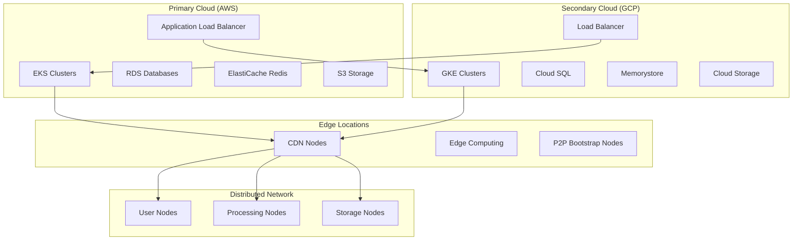
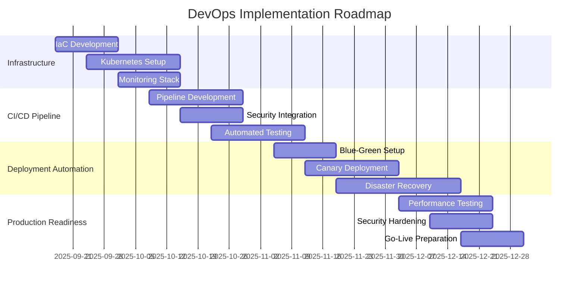

# 🚀 Deployment Infrastructure & DevOps Strategy - Ultra AI Platform

## 🎯 Overview

Comprehensive DevOps and deployment infrastructure strategy for Ultra AI Platform, focusing on automated deployment pipelines, infrastructure as code, container orchestration, and multi-environment management for distributed AI systems.

## 🏗️ Infrastructure Architecture

### Multi-Cloud Deployment Strategy



### Environment Strategy

| Environment | Purpose | Infrastructure | Deployment Frequency | Data |
|-------------|---------|---------------|--------------------|------|
| **Development** | Feature development | Single cluster, shared DB | Continuous (on push) | Synthetic/Test data |
| **Staging** | Integration testing | Production-like, smaller scale | Daily builds | Anonymized production data |
| **UAT** | User acceptance testing | Production replica | Weekly releases | Curated test datasets |
| **Production** | Live system | Multi-region, HA setup | Planned releases | Live user data |
| **Disaster Recovery** | Backup production | Cross-region replica | Weekly sync | Production backup |

## 🔧 Infrastructure as Code

### Terraform Configuration

#### **Core Infrastructure Module**

```hcl
# terraform/modules/ultra-ai-core/main.tf
terraform {
  required_version = ">= 1.5"
  required_providers {
    aws = {
      source  = "hashicorp/aws"
      version = "~> 5.0"
    }
    kubernetes = {
      source  = "hashicorp/kubernetes"
      version = "~> 2.23"
    }
    helm = {
      source  = "hashicorp/helm"
      version = "~> 2.11"
    }
  }
}

# EKS Cluster
module "eks" {
  source = "terraform-aws-modules/eks/aws"
  
  cluster_name    = var.cluster_name
  cluster_version = var.kubernetes_version
  
  vpc_id     = module.vpc.vpc_id
  subnet_ids = module.vpc.private_subnets
  
  # Managed Node Groups
  eks_managed_node_groups = {
    main = {
      min_size     = var.node_group_min_size
      max_size     = var.node_group_max_size
      desired_size = var.node_group_desired_size
      
      instance_types = ["m6i.large", "m6i.xlarge"]
      capacity_type  = "SPOT"
      
      k8s_labels = {
        Environment = var.environment
        NodeType    = "main"
      }
      
      taints = []
    }
    
    ai_processing = {
      min_size     = 1
      max_size     = 20
      desired_size = 3
      
      instance_types = ["g4dn.xlarge", "g4dn.2xlarge"]
      capacity_type  = "ON_DEMAND"
      
      k8s_labels = {
        Environment = var.environment
        NodeType    = "ai-processing"
        GPU         = "nvidia-t4"
      }
      
      taints = [
        {
          key    = "nvidia.com/gpu"
          value  = "true"
          effect = "NO_SCHEDULE"
        }
      ]
    }
  }
  
  # Cluster Security Group Rules
  cluster_security_group_additional_rules = {
    ingress_nodes_ephemeral_ports_tcp = {
      description                = "Node groups to cluster API"
      protocol                   = "tcp"
      from_port                  = 1025
      to_port                    = 65535
      type                       = "ingress"
      source_node_security_group = true
    }
  }
  
  # Node Security Group Rules
  node_security_group_additional_rules = {
    ingress_self_all = {
      description = "Node to node all ports/protocols"
      protocol    = "-1"
      from_port   = 0
      to_port     = 0
      type        = "ingress"
      self        = true
    }
    
    ingress_cluster_all = {
      description                   = "Cluster to node all ports/protocols"
      protocol                      = "-1"
      from_port                     = 0
      to_port                       = 0
      type                          = "ingress"
      source_cluster_security_group = true
    }
  }
  
  tags = {
    Environment = var.environment
    Terraform   = "true"
    Project     = "ultra-ai"
  }
}

# RDS Database Cluster
module "rds" {
  source = "terraform-aws-modules/rds-aurora/aws"
  
  name           = "${var.cluster_name}-aurora"
  engine         = "aurora-postgresql"
  engine_version = "14.9"
  instance_class = "db.r6g.large"
  instances = {
    1 = {}
    2 = {}
  }
  
  vpc_id  = module.vpc.vpc_id
  subnets = module.vpc.database_subnets
  
  storage_encrypted   = true
  apply_immediately   = true
  monitoring_interval = 10
  
  enabled_cloudwatch_logs_exports = ["postgresql"]
  
  backup_retention_period = 30
  preferred_backup_window = "03:00-04:00"
  preferred_maintenance_window = "sun:04:00-sun:05:00"
  
  tags = {
    Environment = var.environment
    Terraform   = "true"
    Project     = "ultra-ai"
  }
}

# ElastiCache Redis Cluster
resource "aws_elasticache_replication_group" "main" {
  replication_group_id       = "${var.cluster_name}-redis"
  description                = "Redis cluster for Ultra AI Platform"
  
  node_type                  = "cache.r6g.large"
  port                       = 6379
  parameter_group_name       = "default.redis7"
  
  num_cache_clusters         = 3
  automatic_failover_enabled = true
  multi_az_enabled          = true
  
  subnet_group_name = aws_elasticache_subnet_group.main.name
  security_group_ids = [aws_security_group.redis.id]
  
  at_rest_encryption_enabled = true
  transit_encryption_enabled = true
  
  tags = {
    Environment = var.environment
    Terraform   = "true"
    Project     = "ultra-ai"
  }
}
```

#### **Application Deployment Module**

```hcl
# terraform/modules/ultra-ai-app/main.tf

# Helm Release for Ultra AI Application
resource "helm_release" "ultra_ai" {
  name       = "ultra-ai"
  repository = var.helm_repository
  chart      = "ultra-ai"
  version    = var.app_version
  namespace  = kubernetes_namespace.ultra_ai.metadata[0].name
  
  # Values for the Helm chart
  values = [
    templatefile("${path.module}/values.yaml.tpl", {
      environment     = var.environment
      image_tag      = var.image_tag
      replica_count  = var.replica_count
      
      # Database configuration
      db_host     = var.database_host
      db_name     = var.database_name
      db_username = var.database_username
      
      # Redis configuration
      redis_host = var.redis_host
      redis_port = var.redis_port
      
      # AI processing configuration
      ai_processing_nodes = var.ai_processing_nodes
      model_registry_url  = var.model_registry_url
      
      # Network configuration
      p2p_bootstrap_nodes = var.p2p_bootstrap_nodes
      network_key        = var.network_key
      
      # Monitoring configuration
      prometheus_enabled = true
      grafana_enabled   = true
      jaeger_enabled    = true
    })
  ]
  
  # Dependencies
  depends_on = [
    kubernetes_namespace.ultra_ai,
    kubernetes_secret.app_secrets
  ]
}

# Kubernetes Namespace
resource "kubernetes_namespace" "ultra_ai" {
  metadata {
    name = "ultra-ai-${var.environment}"
    
    labels = {
      environment = var.environment
      project     = "ultra-ai"
      managed-by  = "terraform"
    }
  }
}

# Application Secrets
resource "kubernetes_secret" "app_secrets" {
  metadata {
    name      = "ultra-ai-secrets"
    namespace = kubernetes_namespace.ultra_ai.metadata[0].name
  }
  
  data = {
    database-password = var.database_password
    redis-password   = var.redis_password
    jwt-secret       = var.jwt_secret
    encryption-key   = var.encryption_key
    blockchain-private-key = var.blockchain_private_key
  }
  
  type = "Opaque"
}
```

### Kubernetes Manifests

#### **Application Deployment**

```yaml
# control/templates/kubernetes/deployments/api-gateway.yaml
apiVersion: apps/v1
kind: Deployment
metadata:
  name: ultra-ai-api-gateway
  namespace: ultra-ai
  labels:
    app: ultra-ai-api-gateway
    version: v1.0.0
spec:
  replicas: 3
  strategy:
    type: RollingUpdate
    rollingUpdate:
      maxUnavailable: 1
      maxSurge: 1
  selector:
    matchLabels:
      app: ultra-ai-api-gateway
  template:
    metadata:
      labels:
        app: ultra-ai-api-gateway
        version: v1.0.0
      annotations:
        prometheus.io/scrape: "true"
        prometheus.io/port: "3000"
        prometheus.io/path: "/metrics"
    spec:
      containers:
      - name: api-gateway
        image: ultra-ai/api-gateway:${IMAGE_TAG}
        ports:
        - containerPort: 3000
          name: http
        - containerPort: 3001
          name: metrics
        env:
        - name: NODE_ENV
          value: "production"
        - name: PORT
          value: "3000"
        - name: DATABASE_URL
          valueFrom:
            secretKeyRef:
              name: ultra-ai-secrets
              key: database-url
        - name: REDIS_URL
          valueFrom:
            secretKeyRef:
              name: ultra-ai-secrets
              key: redis-url
        - name: JWT_SECRET
          valueFrom:
            secretKeyRef:
              name: ultra-ai-secrets
              key: jwt-secret
        resources:
          requests:
            memory: "256Mi"
            cpu: "250m"
          limits:
            memory: "512Mi"
            cpu: "500m"
        livenessProbe:
          httpGet:
            path: /health
            port: 3000
          initialDelaySeconds: 30
          periodSeconds: 10
          timeoutSeconds: 5
          failureThreshold: 3
        readinessProbe:
          httpGet:
            path: /ready
            port: 3000
          initialDelaySeconds: 5
          periodSeconds: 5
          timeoutSeconds: 3
          failureThreshold: 3
        securityContext:
          allowPrivilegeEscalation: false
          runAsNonRoot: true
          runAsUser: 1000
          capabilities:
            drop:
            - ALL
            add:
            - NET_BIND_SERVICE
      serviceAccountName: ultra-ai-api-gateway
      securityContext:
        fsGroup: 1000
        runAsGroup: 1000
        runAsUser: 1000
---
apiVersion: v1
kind: Service
metadata:
  name: ultra-ai-api-gateway-service
  namespace: ultra-ai
  labels:
    app: ultra-ai-api-gateway
spec:
  selector:
    app: ultra-ai-api-gateway
  ports:
  - name: http
    port: 80
    targetPort: 3000
    protocol: TCP
  type: ClusterIP
```

#### **AI Processing Deployment**

```yaml
# control/templates/kubernetes/deployments/ai-processor.yaml
apiVersion: apps/v1
kind: Deployment
metadata:
  name: ultra-ai-processor
  namespace: ultra-ai
  labels:
    app: ultra-ai-processor
    component: ai-processing
spec:
  replicas: 2
  selector:
    matchLabels:
      app: ultra-ai-processor
  template:
    metadata:
      labels:
        app: ultra-ai-processor
        component: ai-processing
    spec:
      nodeSelector:
        NodeType: ai-processing
      tolerations:
      - key: nvidia.com/gpu
        value: "true"
        effect: NoSchedule
      containers:
      - name: ai-processor
        image: ultra-ai/ai-processor:${IMAGE_TAG}
        ports:
        - containerPort: 8000
          name: http
        env:
        - name: CUDA_VISIBLE_DEVICES
          value: "0"
        - name: MODEL_CACHE_DIR
          value: "/models"
        - name: BATCH_SIZE
          value: "4"
        - name: MAX_SEQUENCE_LENGTH
          value: "2048"
        resources:
          requests:
            nvidia.com/gpu: 1
            memory: "8Gi"
            cpu: "2"
          limits:
            nvidia.com/gpu: 1
            memory: "16Gi"
            cpu: "4"
        volumeMounts:
        - name: model-storage
          mountPath: /models
        - name: shm
          mountPath: /dev/shm
        livenessProbe:
          httpGet:
            path: /health
            port: 8000
          initialDelaySeconds: 60
          periodSeconds: 30
          timeoutSeconds: 10
          failureThreshold: 3
        readinessProbe:
          httpGet:
            path: /ready
            port: 8000
          initialDelaySeconds: 30
          periodSeconds: 10
          timeoutSeconds: 5
          failureThreshold: 3
      volumes:
      - name: model-storage
        persistentVolumeClaim:
          claimName: model-storage-pvc
      - name: shm
        emptyDir:
          medium: Memory
          sizeLimit: 2Gi
```

## 🔄 CI/CD Pipeline

### GitLab CI/CD Configuration

#### **Complete Pipeline**

```yaml
# .gitlab-ci.yml
stages:
  - validate
  - build
  - test
  - security
  - deploy-dev
  - deploy-staging
  - deploy-production

variables:
  DOCKER_REGISTRY: "registry.gitlab.com/ultra-ai/platform"
  KUBERNETES_VERSION: "1.28"
  HELM_VERSION: "3.12"

# Template for common before_script
.before_script_template: &before_script_template
  - docker login -u $CI_REGISTRY_USER -p $CI_REGISTRY_PASSWORD $CI_REGISTRY
  - apk add --no-cache curl
  - curl -LO "https://dl.k8s.io/release/v${KUBERNETES_VERSION}/bin/linux/amd64/kubectl"
  - chmod +x kubectl && mv kubectl /usr/local/bin/

# Validation Stage
validate:terraform:
  stage: validate
  image: hashicorp/terraform:1.5
  script:
    - cd terraform
    - terraform init -backend=false
    - terraform validate
    - terraform fmt -check=true
  rules:
    - if: '$CI_PIPELINE_SOURCE == "merge_request_event"'
    - if: '$CI_COMMIT_BRANCH == "main"'

validate:kubernetes:
  stage: validate
  image: alpine/k8s:1.28.0
  script:
    - find k8s -name "*.yaml" -exec kubectl apply --dry-run=client --validate=true -f {} \;
  rules:
    - if: '$CI_PIPELINE_SOURCE == "merge_request_event"'
    - if: '$CI_COMMIT_BRANCH == "main"'

# Build Stage
build:api-gateway:
  stage: build
  image: docker:24.0
  services:
    - docker:24.0-dind
  before_script: *before_script_template
  script:
    - cd services/api-gateway
    - docker build -t $DOCKER_REGISTRY/api-gateway:$CI_COMMIT_SHA .
    - docker build -t $DOCKER_REGISTRY/api-gateway:latest .
    - docker push $DOCKER_REGISTRY/api-gateway:$CI_COMMIT_SHA
    - docker push $DOCKER_REGISTRY/api-gateway:latest
  rules:
    - if: '$CI_COMMIT_BRANCH == "main"'
    - if: '$CI_PIPELINE_SOURCE == "merge_request_event"'

build:ai-processor:
  stage: build
  image: docker:24.0
  services:
    - docker:24.0-dind
  before_script: *before_script_template
  script:
    - cd services/ai-processor
    - docker build -t $DOCKER_REGISTRY/ai-processor:$CI_COMMIT_SHA .
    - docker build -t $DOCKER_REGISTRY/ai-processor:latest .
    - docker push $DOCKER_REGISTRY/ai-processor:$CI_COMMIT_SHA
    - docker push $DOCKER_REGISTRY/ai-processor:latest
  rules:
    - if: '$CI_COMMIT_BRANCH == "main"'
    - if: '$CI_PIPELINE_SOURCE == "merge_request_event"'

# Test Stage
test:unit:
  stage: test
  image: node:18-alpine
  script:
    - npm install
    - npm run test:unit
    - npm run test:coverage
  coverage: '/Statements.*?(\d+(?:\.\d+)?)%/'
  artifacts:
    reports:
      coverage_report:
        coverage_format: cobertura
        path: coverage/cobertura-coverage.xml
    paths:
      - coverage/
    expire_in: 1 week
  rules:
    - if: '$CI_PIPELINE_SOURCE == "merge_request_event"'
    - if: '$CI_COMMIT_BRANCH == "main"'

test:integration:
  stage: test
  image: docker:24.0
  services:
    - docker:24.0-dind
    - postgres:14
    - redis:7
  variables:
    POSTGRES_DB: test_db
    POSTGRES_USER: test_user
    POSTGRES_PASSWORD: test_pass
    REDIS_URL: redis://redis:6379
  before_script: *before_script_template
  script:
    - docker-compose -f docker-compose.test.yml up --build --abort-on-container-exit
    - docker-compose -f docker-compose.test.yml down
  artifacts:
    reports:
      junit: test-results/*.xml
    paths:
      - test-results/
    expire_in: 1 week
  rules:
    - if: '$CI_COMMIT_BRANCH == "main"'

# Security Stage
security:container-scan:
  stage: security
  image: 
    name: aquasec/trivy:latest
    entrypoint: [""]
  script:
    - trivy image --format template --template "@contrib/gitlab.tpl" 
        --output gl-container-scanning-report.json 
        $DOCKER_REGISTRY/api-gateway:$CI_COMMIT_SHA
    - trivy image --format template --template "@contrib/gitlab.tpl" 
        --output gl-container-scanning-ai-processor.json 
        $DOCKER_REGISTRY/ai-processor:$CI_COMMIT_SHA
  artifacts:
    reports:
      container_scanning: 
        - gl-container-scanning-report.json
        - gl-container-scanning-ai-processor.json
  rules:
    - if: '$CI_COMMIT_BRANCH == "main"'

security:sast:
  stage: security
  image: returntocorp/semgrep:latest
  script:
    - semgrep --config=auto --json --output=gl-sast-report.json .
  artifacts:
    reports:
      sast: gl-sast-report.json
  rules:
    - if: '$CI_PIPELINE_SOURCE == "merge_request_event"'
    - if: '$CI_COMMIT_BRANCH == "main"'

# Development Deployment
deploy:development:
  stage: deploy-dev
  image: alpine/helm:3.12.0
  environment:
    name: development
    url: https://dev.ultra-ai.com
  before_script: *before_script_template
  script:
    - kubectl config use-context $KUBE_CONTEXT_DEV
    - helm upgrade --install ultra-ai-dev ./helm/ultra-ai 
        --namespace ultra-ai-dev 
        --create-namespace
        --set image.tag=$CI_COMMIT_SHA
        --set environment=development
        --set ingress.host=dev.ultra-ai.com
        --values helm/ultra-ai/values-dev.yaml
  rules:
    - if: '$CI_COMMIT_BRANCH == "develop"'
    - if: '$CI_PIPELINE_SOURCE == "merge_request_event"'

# Staging Deployment
deploy:staging:
  stage: deploy-staging
  image: alpine/helm:3.12.0
  environment:
    name: staging
    url: https://staging.ultra-ai.com
  before_script: *before_script_template
  script:
    - kubectl config use-context $KUBE_CONTEXT_STAGING
    - helm upgrade --install ultra-ai-staging ./helm/ultra-ai 
        --namespace ultra-ai-staging 
        --create-namespace
        --set image.tag=$CI_COMMIT_SHA
        --set environment=staging
        --set ingress.host=staging.ultra-ai.com
        --values helm/ultra-ai/values-staging.yaml
  rules:
    - if: '$CI_COMMIT_BRANCH == "main"'
  when: manual

# Production Deployment
deploy:production:
  stage: deploy-production
  image: alpine/helm:3.12.0
  environment:
    name: production
    url: https://ultra-ai.com
  before_script: *before_script_template
  script:
    - kubectl config use-context $KUBE_CONTEXT_PROD
    - helm upgrade --install ultra-ai ./helm/ultra-ai 
        --namespace ultra-ai-prod 
        --create-namespace
        --set image.tag=$CI_COMMIT_SHA
        --set environment=production
        --set ingress.host=ultra-ai.com
        --values helm/ultra-ai/values-prod.yaml
        --timeout 10m
        --wait
  rules:
    - if: '$CI_COMMIT_TAG =~ /^v\d+\.\d+\.\d+$/'
  when: manual
  only:
    - tags
```

### Deployment Automation Scripts

#### **Blue-Green Deployment Script**

```bash
#!/bin/bash
# infrastructure/automation/blue-green-deploy.sh

set -euo pipefail

# Configuration
NAMESPACE=${1:-ultra-ai-prod}
NEW_VERSION=${2:-latest}
SERVICE_NAME="ultra-ai"
HEALTH_CHECK_URL="/health"
TIMEOUT=300

echo "🚀 Starting Blue-Green Deployment for ${SERVICE_NAME}"
echo "   Namespace: ${NAMESPACE}"
echo "   New Version: ${NEW_VERSION}"

# Function to check deployment health
check_deployment_health() {
    local deployment_name=$1
    local timeout=$2
    
    echo "⏳ Waiting for deployment ${deployment_name} to be ready..."
    
    if kubectl wait --for=condition=available \
        --timeout=${timeout}s \
        deployment/${deployment_name} \
        -n ${NAMESPACE}; then
        echo "✅ Deployment ${deployment_name} is ready"
        return 0
    else
        echo "❌ Deployment ${deployment_name} failed to become ready"
        return 1
    fi
}

# Function to run health checks
run_health_checks() {
    local service_url=$1
    local max_attempts=10
    local attempt=1
    
    echo "🔍 Running health checks against ${service_url}"
    
    while [ $attempt -le $max_attempts ]; do
        if curl -f -s "${service_url}${HEALTH_CHECK_URL}" > /dev/null; then
            echo "✅ Health check passed (attempt ${attempt}/${max_attempts})"
            return 0
        else
            echo "⚠️  Health check failed (attempt ${attempt}/${max_attempts})"
            sleep 10
            ((attempt++))
        fi
    done
    
    echo "❌ Health checks failed after ${max_attempts} attempts"
    return 1
}

# Get current deployment
CURRENT_DEPLOYMENT=$(kubectl get deployment -l app=${SERVICE_NAME} -n ${NAMESPACE} -o jsonpath='{.items[0].metadata.name}' 2>/dev/null || echo "")

if [ -z "$CURRENT_DEPLOYMENT" ]; then
    echo "📝 No existing deployment found. Performing initial deployment..."
    GREEN_DEPLOYMENT="${SERVICE_NAME}-green"
else
    echo "📝 Current deployment: ${CURRENT_DEPLOYMENT}"
    
    # Determine which color to deploy to
    if [[ $CURRENT_DEPLOYMENT == *"blue"* ]]; then
        GREEN_DEPLOYMENT="${SERVICE_NAME}-green"
        BLUE_DEPLOYMENT=$CURRENT_DEPLOYMENT
    else
        GREEN_DEPLOYMENT="${SERVICE_NAME}-blue"
        BLUE_DEPLOYMENT=$CURRENT_DEPLOYMENT
    fi
fi

echo "🔄 Deploying to: ${GREEN_DEPLOYMENT}"

# Deploy new version (Green)
echo "📦 Deploying new version to ${GREEN_DEPLOYMENT}..."
helm upgrade --install ${GREEN_DEPLOYMENT} ./helm/ultra-ai \
    --namespace ${NAMESPACE} \
    --set image.tag=${NEW_VERSION} \
    --set fullnameOverride=${GREEN_DEPLOYMENT} \
    --set service.name=${GREEN_DEPLOYMENT}-service \
    --values helm/ultra-ai/values-prod.yaml \
    --timeout 10m \
    --wait

# Check deployment health
if ! check_deployment_health ${GREEN_DEPLOYMENT} ${TIMEOUT}; then
    echo "❌ New deployment failed health checks. Rolling back..."
    kubectl delete deployment ${GREEN_DEPLOYMENT} -n ${NAMESPACE}
    exit 1
fi

# Get service URL for health checks
SERVICE_URL="http://$(kubectl get service ${GREEN_DEPLOYMENT}-service -n ${NAMESPACE} -o jsonpath='{.status.loadBalancer.ingress[0].hostname}')"

# Run health checks against new deployment
if ! run_health_checks ${SERVICE_URL}; then
    echo "❌ New deployment failed health checks. Rolling back..."
    kubectl delete deployment ${GREEN_DEPLOYMENT} -n ${NAMESPACE}
    exit 1
fi

# Switch traffic to new deployment
echo "🔀 Switching traffic to new deployment..."
kubectl patch service ${SERVICE_NAME}-service -n ${NAMESPACE} \
    --type='json' \
    -p='[{"op": "replace", "path": "/spec/selector/app", "value": "'${GREEN_DEPLOYMENT}'"}]'

# Wait for traffic switch
sleep 30

# Final health check
if ! run_health_checks "https://ultra-ai.com"; then
    echo "❌ Production health checks failed. Rolling back traffic..."
    if [ -n "$BLUE_DEPLOYMENT" ]; then
        kubectl patch service ${SERVICE_NAME}-service -n ${NAMESPACE} \
            --type='json' \
            -p='[{"op": "replace", "path": "/spec/selector/app", "value": "'${BLUE_DEPLOYMENT}'"}]'
    fi
    exit 1
fi

# Clean up old deployment
if [ -n "$BLUE_DEPLOYMENT" ]; then
    echo "🧹 Cleaning up old deployment: ${BLUE_DEPLOYMENT}"
    kubectl delete deployment ${BLUE_DEPLOYMENT} -n ${NAMESPACE}
    kubectl delete service ${BLUE_DEPLOYMENT}-service -n ${NAMESPACE}
fi

echo "🎉 Blue-Green deployment completed successfully!"
echo "   Active deployment: ${GREEN_DEPLOYMENT}"
echo "   Version: ${NEW_VERSION}"
```

## 📊 Monitoring & Observability

### Prometheus Configuration

#### **Monitoring Stack**

```yaml
# monitoring/prometheus-config.yaml
global:
  scrape_interval: 15s
  evaluation_interval: 15s

rule_files:
  - "/etc/prometheus/rules/*.yml"

alerting:
  alertmanagers:
    - static_configs:
        - targets:
          - alertmanager:9093

scrape_configs:
  # Kubernetes API Server
  - job_name: 'kubernetes-apiservers'
    kubernetes_sd_configs:
    - role: endpoints
    scheme: https
    tls_config:
      ca_file: /var/run/secrets/kubernetes.io/serviceaccount/ca.crt
    bearer_token_file: /var/run/secrets/kubernetes.io/serviceaccount/token
    relabel_configs:
    - source_labels: [__meta_kubernetes_namespace, __meta_kubernetes_service_name, __meta_kubernetes_endpoint_port_name]
      action: keep
      regex: default;kubernetes;https

  # Ultra AI Application Metrics
  - job_name: 'ultra-ai-api-gateway'
    kubernetes_sd_configs:
    - role: pod
    relabel_configs:
    - source_labels: [__meta_kubernetes_pod_annotation_prometheus_io_scrape]
      action: keep
      regex: true
    - source_labels: [__meta_kubernetes_pod_annotation_prometheus_io_path]
      action: replace
      target_label: __metrics_path__
      regex: (.+)
    - source_labels: [__address__, __meta_kubernetes_pod_annotation_prometheus_io_port]
      action: replace
      regex: ([^:]+)(?::\d+)?;(\d+)
      replacement: $1:$2
      target_label: __address__
    - action: labelmap
      regex: __meta_kubernetes_pod_label_(.+)
    - source_labels: [__meta_kubernetes_namespace]
      action: replace
      target_label: kubernetes_namespace
    - source_labels: [__meta_kubernetes_pod_name]
      action: replace
      target_label: kubernetes_pod_name

  # AI Processing Metrics
  - job_name: 'ultra-ai-processor'
    kubernetes_sd_configs:
    - role: pod
    relabel_configs:
    - source_labels: [__meta_kubernetes_pod_label_app]
      action: keep
      regex: ultra-ai-processor
    - source_labels: [__meta_kubernetes_pod_annotation_prometheus_io_scrape]
      action: keep
      regex: true
    - source_labels: [__meta_kubernetes_pod_annotation_prometheus_io_path]
      action: replace
      target_label: __metrics_path__
      regex: (.+)
    - source_labels: [__address__, __meta_kubernetes_pod_annotation_prometheus_io_port]
      action: replace
      regex: ([^:]+)(?::\d+)?;(\d+)
      replacement: $1:$2
      target_label: __address__

  # Node Exporter
  - job_name: 'node-exporter'
    kubernetes_sd_configs:
    - role: node
    relabel_configs:
    - action: labelmap
      regex: __meta_kubernetes_node_label_(.+)
    - target_label: __address__
      replacement: kubernetes.default.svc:443
    - source_labels: [__meta_kubernetes_node_name]
      regex: (.+)
      target_label: __metrics_path__
      replacement: /api/v1/nodes/${1}/proxy/metrics

  # Network P2P Metrics
  - job_name: 'ultra-ai-network'
    static_configs:
    - targets: ['network-monitor:8080']
    metrics_path: /metrics
    scrape_interval: 30s
```

### Grafana Dashboards

#### **Executive Dashboard Configuration**

```json
{
  "dashboard": {
    "id": null,
    "title": "Ultra AI Platform - Executive Overview",
    "tags": ["ultra-ai", "executive"],
    "timezone": "browser",
    "panels": [
      {
        "id": 1,
        "title": "System Health Score",
        "type": "stat",
        "targets": [
          {
            "expr": "avg((up{job=~\"ultra-ai.*\"}) * 100)",
            "legendFormat": "Health Score"
          }
        ],
        "fieldConfig": {
          "defaults": {
            "color": {
              "mode": "thresholds"
            },
            "thresholds": {
              "steps": [
                {"color": "red", "value": 0},
                {"color": "yellow", "value": 95},
                {"color": "green", "value": 99}
              ]
            },
            "unit": "percent"
          }
        },
        "gridPos": {"h": 8, "w": 6, "x": 0, "y": 0}
      },
      {
        "id": 2,
        "title": "Active Users",
        "type": "stat",
        "targets": [
          {
            "expr": "sum(ultra_ai_active_users)",
            "legendFormat": "Active Users"
          }
        ],
        "gridPos": {"h": 8, "w": 6, "x": 6, "y": 0}
      },
      {
        "id": 3,
        "title": "Request Rate",
        "type": "graph",
        "targets": [
          {
            "expr": "sum(rate(http_requests_total{job=\"ultra-ai-api-gateway\"}[5m]))",
            "legendFormat": "Requests/sec"
          }
        ],
        "gridPos": {"h": 8, "w": 12, "x": 12, "y": 0}
      },
      {
        "id": 4,
        "title": "Response Time Distribution",
        "type": "heatmap",
        "targets": [
          {
            "expr": "sum(rate(http_request_duration_seconds_bucket{job=\"ultra-ai-api-gateway\"}[5m])) by (le)",
            "legendFormat": "{{ le }}"
          }
        ],
        "gridPos": {"h": 8, "w": 24, "x": 0, "y": 8}
      }
    ],
    "time": {
      "from": "now-1h",
      "to": "now"
    },
    "refresh": "30s"
  }
}
```

## 🔐 Security & Compliance

### Security Scanning Pipeline

#### **Multi-layer Security Scanning**

```yaml
# .github/workflows/security-scan.yml
name: Security Scanning

on:
  push:
    branches: [main, develop]
  pull_request:
    branches: [main]
  schedule:
    - cron: '0 2 * * *'  # Daily at 2 AM

jobs:
  dependency-scan:
    runs-on: ubuntu-latest
    steps:
    - uses: actions/checkout@v4
    
    - name: Run Snyk to check for vulnerabilities
      uses: snyk/actions/node@master
      env:
        SNYK_TOKEN: ${{ secrets.SNYK_TOKEN }}
      with:
        args: --severity-threshold=high
    
    - name: Upload Snyk results
      uses: github/codeql-action/upload-sarif@v2
      if: always()
      with:
        sarif_file: snyk.sarif

  container-scan:
    runs-on: ubuntu-latest
    steps:
    - uses: actions/checkout@v4
    
    - name: Build Docker images
      run: |
        docker build -t ultra-ai/api-gateway:latest ./services/api-gateway
        docker build -t ultra-ai/ai-processor:latest ./services/ai-processor
    
    - name: Run Trivy vulnerability scanner
      uses: aquasecurity/trivy-action@master
      with:
        image-ref: 'ultra-ai/api-gateway:latest'
        format: 'sarif'
        output: 'trivy-results.sarif'
    
    - name: Upload Trivy scan results
      uses: github/codeql-action/upload-sarif@v2
      with:
        sarif_file: 'trivy-results.sarif'

  infrastructure-scan:
    runs-on: ubuntu-latest
    steps:
    - uses: actions/checkout@v4
    
    - name: Run Checkov
      uses: bridgecrewio/checkov-action@master
      with:
        directory: terraform/
        framework: terraform
        output_format: sarif
        output_file_path: checkov.sarif
    
    - name: Upload Checkov results
      uses: github/codeql-action/upload-sarif@v2
      with:
        sarif_file: checkov.sarif

  secrets-scan:
    runs-on: ubuntu-latest
    steps:
    - uses: actions/checkout@v4
      with:
        fetch-depth: 0
    
    - name: GitLeaks Scan
      uses: gitleaks/gitleaks-action@v2
      env:
        GITHUB_TOKEN: ${{ secrets.GITHUB_TOKEN }}
```

## 🎯 Deployment Strategy Roadmap

### Implementation Timeline



### Success Metrics

| Phase | Metric | Target | Timeline |
|-------|--------|--------|----------|
| **Infrastructure** | Infrastructure as Code Coverage | 100% | Month 1 |
| **CI/CD** | Deployment Frequency | Multiple per day | Month 2 |
| **Automation** | Mean Time to Recovery | <30 minutes | Month 3 |
| **Production** | Deployment Success Rate | >99% | Month 4 |

This comprehensive deployment infrastructure and DevOps strategy ensures reliable, scalable, and secure deployment of Ultra AI Platform with full automation and monitoring capabilities.