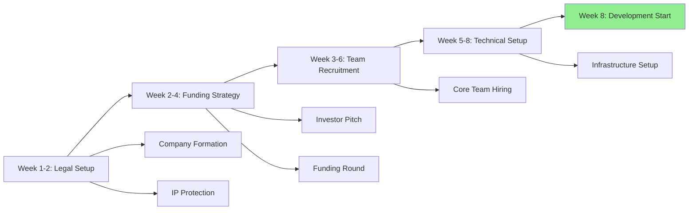
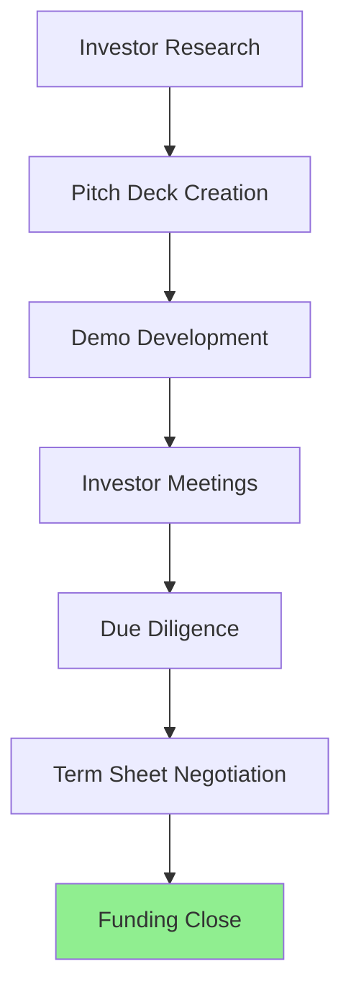
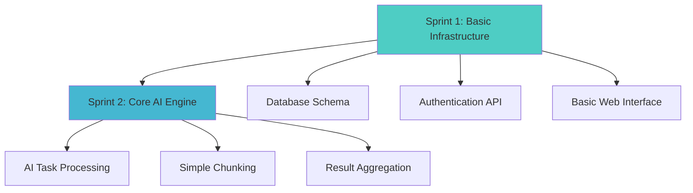
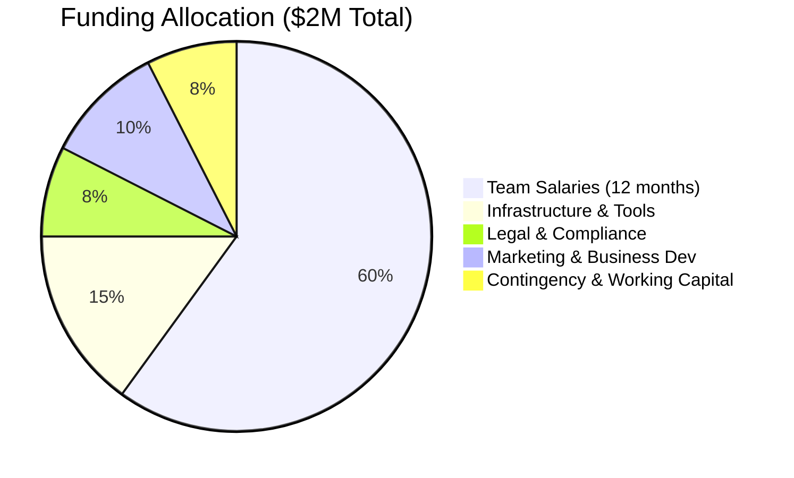
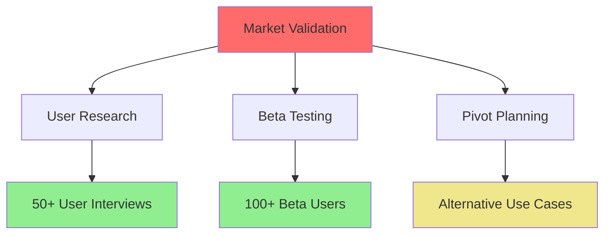
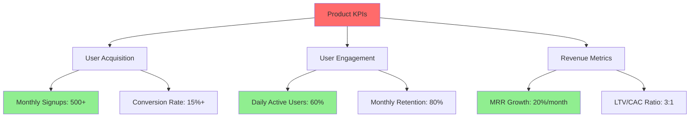

# 🚀 Implementation Readiness Plan - Ultra AI Platform

## 📋 Executive Summary

This document provides the comprehensive next-step action plan to transition Ultra AI Platform from idea stage to active development. It includes immediate actions, resource requirements, and detailed implementation roadmap with specific deliverables and timelines.

## 🎯 Phase 0: Pre-Development Foundation (Weeks 1-8)

### Critical Path Activities



### Week-by-Week Implementation Plan

#### **Weeks 1-2: Legal Foundation & Company Structure**

| Task | Owner | Deadline | Status | Success Criteria |
|------|-------|----------|--------|------------------|
| **Company Incorporation** | Founder | Day 3 | 🔄 | Legal entity established |
| **IP Strategy & Patents** | Legal Counsel | Day 10 | 🔄 | Patent applications filed |
| **Trademark Registration** | Legal Counsel | Day 7 | 🔄 | "Ultra AI" trademark secured |
| **Corporate Bank Account** | Founder | Day 5 | 🔄 | Business banking operational |
| **Initial Compliance Setup** | Legal Counsel | Day 14 | 🔄 | Basic regulatory compliance |

**Budget Required**: $25,000 - $40,000

#### **Weeks 2-4: Funding Strategy Execution**



**Funding Targets:**
- **Seed Round**: $1.5M - $2.5M
- **Target Investors**: AI-focused VCs, crypto funds, angel investors
- **Valuation Goal**: $8M - $12M pre-money

**Key Materials Needed:**
- [ ] 15-slide investor pitch deck
- [ ] Technical demo (basic concept proof)
- [ ] Financial projections (3-year model)
- [ ] Market analysis summary
- [ ] Competitive landscape analysis
- [ ] Team profiles and hiring plan

#### **Weeks 3-6: Core Team Assembly**

**Priority Hiring Sequence:**

| Role | Week | Salary Range | Critical Skills |
|------|------|--------------|----------------|
| **CTO/Technical Lead** | Week 3 | $180K-220K | Distributed systems, AI/ML, 10+ years |
| **Senior Backend Engineer** | Week 4 | $140K-160K | Node.js, Python, blockchain |
| **AI/ML Engineer** | Week 4 | $150K-180K | TensorFlow, NLP, distributed ML |
| **Frontend Engineer** | Week 5 | $120K-140K | React, TypeScript, Web3 |
| **DevOps Engineer** | Week 5 | $130K-150K | Kubernetes, AWS, security |
| **Product Manager** | Week 6 | $140K-160K | Technical PM, AI products |

**Recruitment Strategy:**
- Use specialized tech recruiters
- Target specific companies (ex-FAANG, AI startups, crypto companies)
- Offer competitive equity packages (0.5% - 3% per role)
- Remote-first hiring for global talent access

#### **Weeks 5-8: Technical Infrastructure Setup**

**Development Environment Setup:**

```typescript
interface DevelopmentSetup {
  infrastructure: {
    cloud: 'AWS' | 'GCP' | 'Azure';
    regions: ['us-east-1', 'eu-west-1', 'ap-southeast-1'];
    services: ['EKS', 'RDS', 'ElastiCache', 'S3'];
    monitoring: ['Datadog', 'New Relic', 'Sentry'];
  };
  
  development: {
    versionControl: 'GitHub Enterprise';
    ci_cd: 'GitHub Actions';
    containerization: 'Docker + Kubernetes';
    testing: 'Jest + Cypress + K6';
  };
  
  security: {
    secrets: 'HashiCorp Vault';
    scanning: 'Snyk + SonarQube';
    compliance: 'SOC 2 Type 1 prep';
  };
  
  collaboration: {
    communication: 'Slack + Discord';
    projectManagement: 'Linear + Notion';
    documentation: 'GitBook + Confluence';
  };
}
```

**Infrastructure Cost Estimation:**
- **Development Environment**: $5K/month
- **Staging Environment**: $3K/month
- **Production (Initial)**: $8K/month
- **Tools & Licenses**: $2K/month
- **Total Monthly**: $18K ($216K annually)

---

## 🏗️ Phase 1: Proof of Concept Development (Weeks 9-20)

### Sprint-by-Sprint Breakdown

#### **Sprint 1-2 (Weeks 9-12): Core Foundation**



**Sprint 1 Deliverables:**
- [ ] PostgreSQL database with user management
- [ ] JWT-based authentication system
- [ ] Basic React frontend with login/dashboard
- [ ] RESTful API foundation (Node.js/Express)
- [ ] Docker containerization
- [ ] CI/CD pipeline setup

**Sprint 2 Deliverables:**
- [ ] Basic AI task processor (using OpenAI API initially)
- [ ] Simple data chunking algorithm
- [ ] Task queue system (Redis-based)
- [ ] Result aggregation logic
- [ ] Basic encryption for data in transit

#### **Sprint 3-4 (Weeks 13-16): Distributed Processing MVP**

**Key Features:**
- [ ] P2P node communication (WebRTC)
- [ ] Advanced chunking with privacy protection
- [ ] Node registration and discovery
- [ ] Basic reputation system
- [ ] Simple reward calculation

**Technical Validation Goals:**
- Process 100 concurrent tasks
- 3-node distributed network
- <500ms average response time
- Zero data leakage between nodes

#### **Sprint 5-6 (Weeks 17-20): Security & Optimization**

**Security Implementation:**
- [ ] End-to-end encryption
- [ ] Zero-knowledge proof implementation
- [ ] Security audit (third-party)
- [ ] Penetration testing
- [ ] Compliance framework setup

**Performance Optimization:**
- [ ] Load testing (1000+ concurrent users)
- [ ] Database optimization
- [ ] Caching layer implementation
- [ ] API response time optimization

---

## 💰 Detailed Financial Planning

### Funding Strategy & Requirements

#### **Pre-Seed/Seed Funding Breakdown**



#### **Monthly Burn Rate Analysis**

| Category | Month 1-3 | Month 4-6 | Month 7-9 | Month 10-12 |
|----------|-----------|-----------|-----------|-------------|
| **Salaries** | $85K | $120K | $140K | $160K |
| **Infrastructure** | $15K | $25K | $35K | $45K |
| **Marketing** | $5K | $10K | $20K | $30K |
| **Operations** | $10K | $15K | $20K | $25K |
| **Total Monthly** | $115K | $170K | $215K | $260K |

**Runway Calculation:**
- With $2M funding: 12-15 months runway
- Break-even target: Month 18-24
- Next funding round: Month 12-15 ($8M-12M Series A)

### Revenue Model Validation

#### **Early Revenue Streams (Months 6-12)**

| Revenue Source | Month 6 | Month 9 | Month 12 | Growth Rate |
|----------------|---------|---------|----------|-------------|
| **Beta Subscriptions** | $2K | $15K | $50K | 150%/quarter |
| **API Usage** | $1K | $8K | $25K | 200%/quarter |
| **Enterprise Pilots** | $0 | $10K | $30K | 100%/quarter |
| **Total Monthly** | $3K | $33K | $105K | 170%/quarter |

---

## 🎯 Risk Mitigation & Contingency Planning

### Technical Risk Assessment

#### **High-Priority Technical Risks**

| Risk | Probability | Impact | Mitigation Strategy | Timeline |
|------|-------------|--------|-------------------|----------|
| **Distributed System Complexity** | High | Critical | Build simple MVP first, gradual complexity | Weeks 9-20 |
| **Scalability Issues** | Medium | High | Load testing, architecture review | Week 16+ |
| **Security Vulnerabilities** | Medium | Critical | Security audits, expert advisors | Week 18+ |
| **AI Model Integration** | Low | Medium | Multiple provider support | Week 12+ |
| **Blockchain Integration** | Medium | Medium | Phased rollout, testnet first | Week 24+ |

#### **Business Risk Mitigation**



### Contingency Plans

#### **Scenario 1: Funding Shortfall**
- **Trigger**: Unable to raise full $2M
- **Response**: Reduce team size, extend timeline, focus on core features
- **Minimum Viable Budget**: $1.2M for 18-month runway

#### **Scenario 2: Technical Complexity Issues**
- **Trigger**: Distributed processing proves too complex
- **Response**: Fallback to hybrid cloud-distributed model
- **Timeline Impact**: 2-3 month delay

#### **Scenario 3: Market Competition**
- **Trigger**: Major competitor launches similar product
- **Response**: Accelerate unique features (privacy, rewards)
- **Differentiation Focus**: Privacy-first, user ownership

---

## 📊 Success Metrics & Validation Framework

### Development Milestones

#### **Month 3 Targets (End of Sprint 2)**
- [ ] **Technical**: Basic AI processing working
- [ ] **Team**: 6 core team members hired
- [ ] **Product**: MVP demo available
- [ ] **Business**: Seed funding secured
- [ ] **Users**: 10 internal test users

#### **Month 6 Targets (End of Sprint 4)**
- [ ] **Technical**: 3-node distributed network functional
- [ ] **Product**: Beta version with basic features
- [ ] **Users**: 50 beta testers recruited
- [ ] **Revenue**: First paying customers
- [ ] **Security**: Initial security audit passed

#### **Month 9 Targets (Pre-Launch)**
- [ ] **Technical**: Security audit completed
- [ ] **Product**: Production-ready version
- [ ] **Users**: 200+ beta users
- [ ] **Revenue**: $25K+ MRR
- [ ] **Team**: 12+ team members

#### **Month 12 Targets (Post-Launch)**
- [ ] **Users**: 2,000+ active users
- [ ] **Revenue**: $100K+ MRR
- [ ] **Network**: 500+ active nodes
- [ ] **Funding**: Series A preparation
- [ ] **Market**: Clear product-market fit

### Key Performance Indicators (KPIs)



---

## 🚀 Immediate Action Items (Next 30 Days)

### Week 1 Priority Actions

#### **Day 1-3: Legal & Business Setup**
- [ ] **Incorporate company** (Delaware C-Corp recommended)
- [ ] **Open business bank account**
- [ ] **Set up basic accounting** (QuickBooks/Xero)
- [ ] **Register domain and basic web presence**

#### **Day 4-7: Team & Advisors**
- [ ] **Recruit technical co-founder/CTO** (if not already identified)
- [ ] **Identify 3-5 technical advisors** (AI/ML, blockchain, security)
- [ ] **Begin recruiter relationships**
- [ ] **Set up equity/compensation framework**

### Week 2-3: Funding Preparation

#### **Critical Deliverables**
- [ ] **Complete investor pitch deck** (15 slides)
- [ ] **Build simple technical demo** (48-hour hackathon style)
- [ ] **Prepare financial projections** (detailed 3-year model)
- [ ] **Create investor target list** (50+ qualified investors)

### Week 4: Infrastructure & Development Setup

#### **Technical Foundation**
- [ ] **Set up development environment** (GitHub, AWS, monitoring)
- [ ] **Create basic project structure** (monorepo with microservices)
- [ ] **Implement CI/CD pipeline**
- [ ] **Set up project management tools** (Linear, Notion)

---

## 🎭 Team Recruitment Strategy

### Technical Leadership Requirements

#### **CTO/Technical Lead Profile**
```typescript
interface CTORequirements {
  experience: {
    years: 10;
    domains: ['distributed systems', 'AI/ML', 'blockchain'];
    previousRoles: ['technical lead', 'architect', 'founding engineer'];
  };
  
  skills: {
    technical: ['system design', 'team leadership', 'product development'];
    leadership: ['team building', 'technical vision', 'execution'];
    business: ['fundraising support', 'investor communication'];
  };
  
  compensation: {
    salary: '$180K-220K';
    equity: '2-5%';
    benefits: 'full package';
  };
}
```

### Hiring Timeline & Strategy

#### **Months 1-3: Core Team**
- **CTO** → **Senior Backend Engineer** → **AI/ML Engineer** → **Frontend Engineer** → **DevOps Engineer** → **Product Manager**

#### **Months 4-6: Growth Team**
- **Additional Engineers** (2-3) → **Security Engineer** → **UX Designer** → **Community Manager**

#### **Months 7-12: Scale Team**
- **Engineering Managers** → **Sales/Business Development** → **Customer Success** → **Additional Specialists**

---

## 🏆 Definition of Success

### 12-Month Success Criteria

#### **Technical Milestones**
- [ ] Distributed AI processing working reliably
- [ ] Security audit passed with zero critical issues
- [ ] 1000+ concurrent users supported
- [ ] Sub-200ms average response time
- [ ] 99.9% uptime achieved

#### **Business Milestones**
- [ ] $100K+ monthly recurring revenue
- [ ] 2000+ active users
- [ ] Product-market fit validated
- [ ] Series A funding secured ($8M+)
- [ ] Team of 15+ employees

#### **Market Milestones**
- [ ] Clear competitive differentiation established
- [ ] Strong user community built (5000+ members)
- [ ] Industry recognition/awards
- [ ] Strategic partnerships formed
- [ ] International expansion begun

**This plan transforms Ultra AI Platform from idea to execution-ready startup with clear next steps, detailed milestones, and comprehensive risk mitigation. Ready for immediate implementation! 🚀**

---

*Next Action: Execute Week 1 Priority Actions and begin team assembly.*