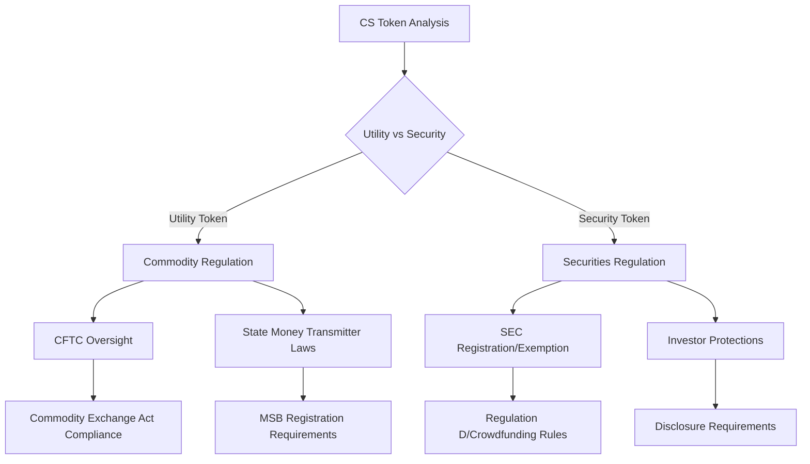
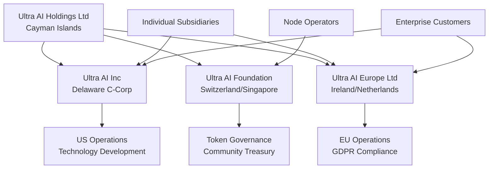
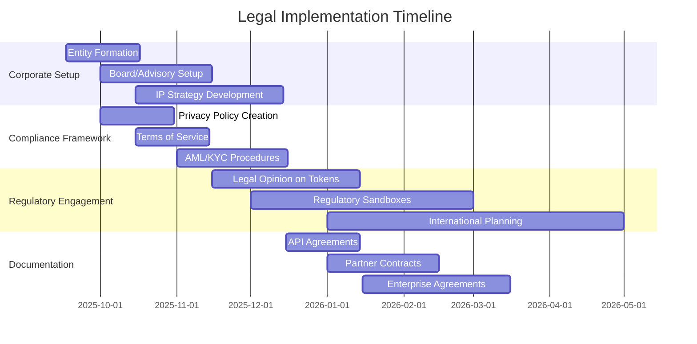

# ⚖️ Legal & Compliance Framework - Ultra AI Platform

## 🎯 Overview

Comprehensive legal and compliance strategy for Ultra AI Platform, addressing the unique challenges of a distributed AI platform with blockchain rewards, international operations, and multi-jurisdictional compliance requirements.

## 📋 Regulatory Landscape Analysis

### AI Regulation Compliance

#### **European Union - AI Act**
- **Classification**: Ultra AI likely qualifies as "General Purpose AI System"
- **Requirements**: 
  - Risk assessment and mitigation systems
  - Data governance and management systems  
  - Technical documentation and record-keeping
  - Transparency and user information requirements
- **Timeline**: Full compliance required by 2026

#### **United States - NIST AI Risk Management Framework**
- **Voluntary Standards**: Adopt NIST AI RMF 1.0 guidelines
- **State Regulations**: Monitor California SB-1001, New York SAFE-AI Act
- **Federal Oversight**: Compliance with FTC, CFPB guidelines

#### **Other Jurisdictions**
- **Canada**: AIDA (Artificial Intelligence and Data Act) compliance
- **UK**: AI White Paper principles and ICO guidance
- **Singapore**: Model AI Governance Framework
- **China**: AI Recommendation Management Provisions

### Blockchain & Cryptocurrency Compliance

#### **Token Classification Framework**



#### **Regulatory Strategy**
1. **Legal Opinion**: Obtain formal legal analysis of CS token status
2. **Regulatory Sandboxes**: Participate in FinCEN, CFTC innovation programs
3. **Compliance Program**: Implement robust AML/KYC procedures
4. **Geographic Restrictions**: Limit access in uncertain jurisdictions

## 🏢 Corporate Structure & Governance

### Recommended Corporate Structure



### Governance Framework
- **Board of Directors**: Independent directors with AI, blockchain, regulatory expertise
- **Advisory Board**: Technical advisors, regulatory experts, industry leaders
- **Community Governance**: Token holder voting for protocol changes
- **Compliance Committee**: Ongoing regulatory monitoring and adaptation

## 📄 Legal Documentation Suite

### User Agreements

#### **Terms of Service Template**

```markdown
# Ultra AI Platform Terms of Service

## 1. Service Description
- Natural language AI processing platform
- Distributed network participation
- CS token reward system
- API and integration services

## 2. Acceptable Use Policy
- Prohibited content: illegal, harmful, infringing
- Rate limiting and fair use guidelines
- Network participation requirements
- Security and privacy obligations

## 3. Intellectual Property
- User content ownership and licensing
- Platform IP protection
- Open source component acknowledgments
- DMCA takedown procedures

## 4. Token Economics
- CS token functionality and utility
- Reward distribution mechanisms
- Tax implications and user responsibility
- Wallet and security requirements

## 5. Privacy and Data Protection
- Data processing lawful basis
- User rights under GDPR/CCPA
- Cross-border data transfer safeguards
- Retention and deletion policies

## 6. Limitation of Liability
- Service availability disclaimers
- AI output accuracy limitations
- Network performance variables
- Token value volatility

## 7. Dispute Resolution
- Governing law and jurisdiction
- Arbitration procedures
- Class action waivers
- Regulatory complaint processes
```

#### **Privacy Policy Framework**

```yaml
privacy_policy_structure:
  data_collection:
    personal_data:
      - account_information
      - usage_analytics
      - payment_data
      - communication_records
    
    technical_data:
      - ip_addresses
      - device_information
      - performance_metrics
      - error_logs
  
  processing_purposes:
    service_delivery:
      - ai_processing
      - user_authentication
      - network_coordination
      - reward_distribution
    
    business_operations:
      - customer_support
      - fraud_prevention
      - legal_compliance
      - service_improvement
  
  legal_basis:
    consent: "Explicit consent for marketing communications"
    contract: "Processing necessary for service delivery"
    legitimate_interest: "Security and fraud prevention"
    legal_obligation: "Regulatory compliance requirements"
  
  user_rights:
    access: "Right to access personal data"
    rectification: "Right to correct inaccurate data"
    erasure: "Right to deletion (right to be forgotten)"
    portability: "Right to data portability"
    objection: "Right to object to processing"
    restriction: "Right to restrict processing"
```

### Developer & Partner Agreements

#### **API License Agreement**
- Usage rights and restrictions
- Rate limiting and fair use policies
- Developer responsibilities and warranties
- IP licensing and attribution requirements

#### **Node Operator Agreement**
- Network participation terms
- Computing resource contribution requirements
- Reward calculation and distribution
- Security and compliance obligations

#### **Enterprise License Agreement**
- Service level agreements (SLAs)
- Data processing agreements (DPAs)
- Customization and integration terms
- Support and maintenance provisions

## 🛡️ Compliance Implementation

### Data Protection Compliance (GDPR/CCPA)

#### **Privacy by Design Implementation**

```typescript
interface PrivacyByDesignFramework {
  dataMinimization: {
    collection: "Collect only necessary data for specific purposes";
    processing: "Process only what's required for service delivery";
    retention: "Retain data only as long as necessary";
  };
  
  consentManagement: {
    explicit: "Clear, affirmative consent for data processing";
    granular: "Separate consent for different processing purposes";
    withdrawable: "Easy consent withdrawal mechanisms";
  };
  
  technicalMeasures: {
    encryption: "End-to-end encryption for all data transmission";
    pseudonymization: "Data pseudonymization where possible";
    accessControls: "Role-based access to personal data";
  };
  
  organizationalMeasures: {
    dpoAppointment: "Data Protection Officer designation";
    impactAssessments: "Privacy Impact Assessments for new features";
    breachNotification: "72-hour breach notification procedures";
  };
}
```

#### **Cross-Border Data Transfer Framework**
- **Adequacy Decisions**: Use countries with EU adequacy status where possible
- **Standard Contractual Clauses**: Implement EU SCCs for third country transfers
- **Binding Corporate Rules**: Develop BCRs for intra-group transfers
- **Certification Mechanisms**: Pursue relevant privacy certifications

### Financial Services Compliance

#### **Anti-Money Laundering (AML) Program**

```yaml
aml_program:
  customer_due_diligence:
    identity_verification:
      - government_issued_id
      - proof_of_address
      - biometric_verification
      - sanctions_screening
    
    ongoing_monitoring:
      - transaction_monitoring
      - suspicious_activity_reporting
      - periodic_risk_assessment
      - enhanced_due_diligence
  
  record_keeping:
    transaction_records: "5 years minimum retention"
    identity_records: "5 years after account closure"
    sar_records: "5 years from filing date"
    compliance_records: "Ongoing maintenance"
  
  reporting_requirements:
    suspicious_activity: "SAR filing within 30 days"
    currency_transactions: "CTR for transactions >$10,000"
    cross_border: "FBAR for foreign accounts"
    beneficial_ownership: "CDD for legal entity customers"
```

#### **Know Your Customer (KYC) Implementation**
- Identity verification procedures
- Risk-based customer classification
- Enhanced due diligence for high-risk customers
- Ongoing monitoring and periodic review

## ⚖️ Intellectual Property Strategy

### Patent Portfolio Development

#### **Core Technology Patents**
1. **Distributed AI Processing Method**: Novel approach to chunking and distributing AI workloads
2. **Reward Calculation Algorithm**: Fair compensation mechanism for network contributors  
3. **Privacy-Preserving Data Aggregation**: Secure result compilation without data exposure
4. **Natural Language Interface System**: Conversational AI configuration and tool selection

#### **Patent Filing Strategy**
- **Priority Markets**: US, EU, China, Japan, South Korea
- **Filing Timeline**: Provisional applications within 6 months of development
- **Prior Art Analysis**: Comprehensive patent landscape review
- **Freedom to Operate**: Clear IP analysis before product features

### Trademark Protection
- **Core Marks**: "Ultra AI", "CS Token", distinctive logos
- **Service Marks**: Platform services and features
- **Domain Portfolio**: Comprehensive domain registration strategy
- **International Registration**: Madrid Protocol for global protection

### Open Source Strategy
- **Dual Licensing**: Open source core with commercial enterprise features
- **Community Contributions**: Clear contributor license agreements
- **Third-Party Components**: License compliance and attribution
- **Patent Grants**: Defensive patent grants for open source components

## 🌍 International Expansion Legal Framework

### Market Entry Legal Requirements

| Jurisdiction | Entity Type | Key Requirements | Timeline |
|-------------|------------|-----------------|----------|
| **United States** | Delaware C-Corp | SEC/CFTC compliance, state registrations | 3-6 months |
| **European Union** | Irish/Dutch Ltd | GDPR compliance, AI Act readiness | 6-9 months |
| **United Kingdom** | UK Ltd | ICO registration, FCA guidance | 3-4 months |
| **Singapore** | Singapore Pte Ltd | MAS fintech sandbox, PDPA compliance | 4-6 months |
| **Canada** | Federal Corp | PIPEDA compliance, CSA guidance | 3-5 months |

### Regulatory Engagement Strategy
- **Early Engagement**: Proactive communication with regulators
- **Industry Associations**: Participation in AI and blockchain industry groups
- **Regulatory Sandboxes**: Application to innovation programs where available
- **Expert Advisory**: Ongoing consultation with regulatory counsel

## 📊 Compliance Monitoring & Reporting

### Compliance Dashboard

```typescript
interface ComplianceMetrics {
  dataProtection: {
    gdprCompliance: number;        // Compliance score 0-100
    breachIncidents: number;       // Count of data breaches
    sarRequests: number;           // Subject access requests
    consentWithdrawals: number;    // Consent withdrawals processed
  };
  
  financialCompliance: {
    amlReports: number;            // SAR reports filed
    sanctionsScreening: number;    // Daily screening checks
    transactionMonitoring: number; // Flagged transactions
    regulatoryFiling: boolean;     // Timely filing status
  };
  
  aiGovernance: {
    riskAssessments: number;       // Completed risk assessments
    biasAudits: number;           // Algorithm bias evaluations
    transparencyReports: number;   // Published transparency reports
    ethicalReviews: number;        // Ethics committee reviews
  };
}
```

### Legal Risk Management

#### **Risk Assessment Matrix**

| Risk Category | Probability | Impact | Mitigation Priority | Action Required |
|---------------|-------------|--------|-------------------|-----------------|
| **AI Regulation Changes** | High | High | Critical | Monitor legislation, adapt compliance |
| **Token Classification** | Medium | High | Critical | Legal opinion, regulatory clarity |
| **Data Breach** | Medium | High | Critical | Enhanced security, incident response |
| **IP Infringement** | Medium | Medium | High | FTO analysis, patent monitoring |
| **Tax Law Changes** | Medium | Medium | Medium | Tax advisor consultation |

## 🚀 Implementation Roadmap

### Legal Milestone Timeline



### Budget Allocation (Year 1)

| Legal Category | Budget Range | Key Activities |
|----------------|-------------|----------------|
| **Corporate Formation** | $25K-$50K | Entity setup, governance structure |
| **Regulatory Compliance** | $100K-$200K | Legal opinions, compliance programs |
| **IP Protection** | $75K-$150K | Patent filing, trademark registration |
| **Documentation** | $50K-$100K | Agreements, policies, procedures |
| **Ongoing Counsel** | $200K-$400K | Regular legal support, regulatory monitoring |
| **Total** | **$450K-$900K** | Comprehensive legal foundation |

This legal and compliance framework provides Ultra AI Platform with the robust foundation needed to operate legally and ethically across multiple jurisdictions while maintaining regulatory compliance and protecting stakeholder interests.