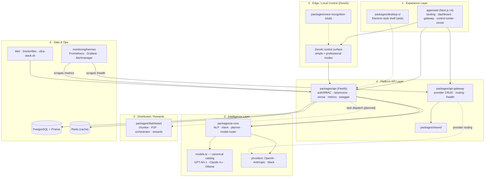

# Ultra AI — Master Architecture & Plan

**Status:** Authoritative. Supersedes the conflicting status claims scattered across
`docs/` (see §8 Reconciliation). Last updated 2026-10-31.

This document is the single source of truth for what Ultra AI **actually is today**,
how its layers fit together, and what the plan forward is. It is written from a
ground-truth read of the code (not the aspirational docs): every "✅ real" claim
below was verified against source in `packages/*` and `apps/web`, and the full
build/test suite (**409 tests, 20/20 turbo tasks green**).

---

## 1. What Ultra AI is

Ultra AI is a **Turborepo / npm-workspaces monorepo** that implements an AI
platform with four ambitions, in descending order of how real they are today:

1. **A working AI API + gateway** — Fastify API with auth/RBAC, a canonical model
   catalog, and a provider gateway with failover. **This is real and tested.**
2. **A local-first assistant surface (ZeroAI)** — a dual simple/operator web UI
   that routes prompts, runs workflows, and shows traces. **Real, demo-grade, no auth yet.**
3. **A distributed processing network** — P2P chunking/orchestration with reward
   accounting. **Substantive code, not wired into the API task path yet.**
4. **A blockchain reward layer** — off-chain reward math exists; **no deployed
   contract.** Aspirational.

The monitoring layer (**Hermes**) and the unified full-system launcher
(`scripts/ultra-stack.sh`) were added recently and are real.

---

## 2. Layer model

Ultra AI is best understood as **six horizontal layers**. The arrows show the
real runtime call path (solid = implemented, dashed = planned/not wired).



### Layer responsibilities & ground-truth status

| Layer | Package(s) | Real? | LOC (src) | Notes |
|-------|-----------|-------|-----------|-------|
| 1 Experience | `apps/web` | ✅ real | ~1.8k | 5 pages + API proxy routes; now has global nav + live health strip |
| 1 Experience | `packages/desktop-ui` | 🟡 stub | 255 | EventEmitter shell, `ControlPanel`/`SystemTray`; **no real window yet** |
| 2 Edge/ZeroAI | in `apps/web` + `packages/api` | ✅ demo | — | dual-mode surface; JSON state file; **no auth** |
| 2 Edge/Voice | `packages/voice-recognition` | 🟡 stub | 227 | types + skeletons only |
| 3 Intelligence | `packages/ai-core` | ✅ real | 468 | upgraded catalog, 3 providers, router w/ task affinity |
| 4 API | `packages/api` | ✅ real | 10.7k | 44 src files, 16 test files, Fastify + Prisma + RBAC |
| 4 Gateway | `packages/api-gateway` | ✅ real | 655 | provider CRUD + health HTTP server |
| 4 Shared | `packages/shared` | ✅ seed | 1 | shared types placeholder |
| 5 Distributed | `packages/distributed` | 🟡 real-but-unwired | 1.0k | chunker, P2P, orchestrator, rewards; not behind API yet |
| 5 Memory-opt | `packages/memory-optimizer` | 🟡 stub | 268 | GC/optimizer skeletons |
| 6 Monitoring | `monitoring/hermes` | ✅ real | — | Prometheus+Grafana+Alertmanager+node-exporter |
| 6 Ops | `k8s/`, `scripts/ultra-stack.sh` | ✅ real | — | manifests validated (not cluster-deployed); launcher boots full stack |

**Dependency graph (verified from package.json):**
`api → ai-core`; `api-gateway → shared`; `desktop-ui → shared + control-center`;
`control-center/voice/memory → shared`; `distributed` and `ai-core` have no internal deps.

---

## 3. Canonical runtime (the "run everything together" model)

The `wsl-ai-stack` idea — several projects running together as one system — is
implemented as **`scripts/ultra-stack.sh`**, which boots every layer in
dependency order with health gates:

```
Postgres (:5432) → API (:4000) → Gateway (:20129) → Web (:3000)
                                   └─ optional: Hermes → Grafana (:3001) / Prometheus (:9090)
```

```bash
./scripts/ultra-stack.sh up --with-hermes   # full system + monitoring
./scripts/ultra-stack.sh status             # health board
./scripts/ultra-stack.sh smoke              # 8/8 MVP smoke tests
./scripts/ultra-stack.sh down               # stop everything
```

Canonical ports are fixed: **API 4000, Gateway 20129, Web 3000, Grafana 3001,
Prometheus 9090.** (This resolves the 4000-vs-5555 drift — see §8.)

---

## 4. Model catalog (single source of truth)

`packages/ai-core/src/models.ts` is now the only place model ids live, killing the
drift the docs repeatedly flagged:

- **OpenAI:** `gpt-5`, `gpt-5-mini`, `gpt-4.1`, `gpt-4.1-mini`, `gpt-4o`, `gpt-4o-mini`
- **Anthropic:** `claude-opus-4.1`, `claude-sonnet-4.5`, `claude-haiku-4.5`
  (friendly ids auto-resolve to dated API ids via `resolveAnthropicModel`)
- **Ollama (local):** `llama3.1`, `mistral`, `codellama`
- **Default:** `gpt-5-mini`; task affinity maps summarize/translate/analyze/generate/respond
  to cost/quality-appropriate models.

---

## 5. Monitoring: Hermes

Hermes is the observability layer. Two parts:

1. **`monitoring/hermes/`** — the infra stack (Prometheus scrapes the API's 40+
   prom-client metrics + gateway health + host metrics; Grafana auto-provisions
   the "Ultra-AI Overview" dashboard; Alertmanager routes alerts).
2. **In-app Hermes UI** (`apps/web/app/hermes`) — a native monitoring page inside
   the platform so operators don't have to leave the app to see service health,
   latency, alerts, and a jump-off to Grafana. Linked from the global nav and
   surfaced in the desktop shell.

Hermes adds **zero runtime coupling** — it scrapes endpoints the app already
exposes and can start/stop independently.

---

## 6. Integration map (imported sub-projects)

The platform is designed to absorb external projects behind the gateway
abstraction rather than hard-depend on them:

| External | Role | Status |
|----------|------|--------|
| OpenClaw | routing/control plane for ZeroAI | 🟡 bridge scripts |
| n8n | workflow automation backbone | 🟡 proxy endpoints |
| Ollama | local model inference | 🟡 provider slot in catalog |
| Grafana/Prometheus | monitoring (Hermes) | ✅ real |
| Gata-OS | hypothetical external OS | ⛔ mock only |
| JARVIS / QuantMind / Kimi / etc. | optional adapters surfaced in dashboard | 🟡 catalog entries |

Principle: **adapters, not core dependencies.** Each integration is optional and
sits behind the gateway or ZeroAI routing layer.

---

## 7. Plan forward (reconciled, 3-phase)

The scattered 12-/17-/30-phase schemes are collapsed into the **3-phase model**
the planning docs landed on, re-grounded against real code:

### Phase 1 — Core Infrastructure (make the real parts production-grade)
- Wire ZeroAI to Postgres (replace JSON state file) + add auth.
- Finish provider routing modes (quality/cost/latency/hybrid) in the gateway.
- Real `/api/system/status` everywhere (done in web) + Hermes UI (this cycle).
- CI (GitHub Actions: install → type-check → test → build).

### Phase 2 — Distributed Network (wire the parked power)
- Put `packages/distributed` behind the API task path (chunk → dispatch → aggregate).
- Redis-backed task queue; node health + failover; consensus hardening.
- Load/perf validation against the documented targets (<500ms p95, 1000+ concurrent).

### Phase 3 — Advanced Features (hardening + reach)
- Security pass (OWASP, pen-test, MFA/SSO), GDPR/CCPA residency.
- Desktop app (Electron) wrapping the web surface + Hermes.
- Blockchain: deploy the reward contract or formally descope to off-chain.

---

## 8. Reconciliation of doc conflicts

The old docs contradict each other. Resolved positions:

| Conflict | Resolution |
|----------|-----------|
| "100% complete" vs open critical work | **Not complete.** Real: api/ai-core/gateway/web/monitoring. Stub: desktop-ui, voice, memory-optimizer. Unwired: distributed. |
| Phase count (12 / 17 / 30 / 3) | **3-phase model** (§7) is canonical. |
| Test totals (104 / 191 / 306…) | **409 tests** pass today (verified): api 306, distributed 55, api-gateway 45, ai-core 3. |
| API port 4000 vs 5555 | **4000** everywhere (k8s + Dockerfile already updated). |
| Postgres 15 vs 16 | **15** (pinned in compose + k8s). |
| `packages/web` vs `apps/web` | **`apps/web`** is the real path. |
| Blockchain "done" vs stub | **Off-chain only.** No deployed contract. |
| Missing `PROJECT_PHASES_AND_STATUS.md` | Superseded by **this** document. |

---

## 9. Quick reference

| Thing | Value |
|-------|-------|
| Package manager | npm workspaces + Turbo |
| Node | ≥20 (host v22) |
| API | Fastify, :4000, `/health` `/metrics` `/api-docs` `/ai/process` |
| Gateway | :20129, provider CRUD + `/health` |
| Web | Next.js 14, :3000 |
| Monitoring | Grafana :3001, Prometheus :9090 |
| DB | PostgreSQL 15 + Prisma (embedded binaries locally, see BUILD_PLAN.md) |
| Full-system launcher | `scripts/ultra-stack.sh` |
| Smoke tests | `scripts/smoke-test.sh` (8/8) |
| Verified health | 409 tests, 20/20 turbo tasks green |
