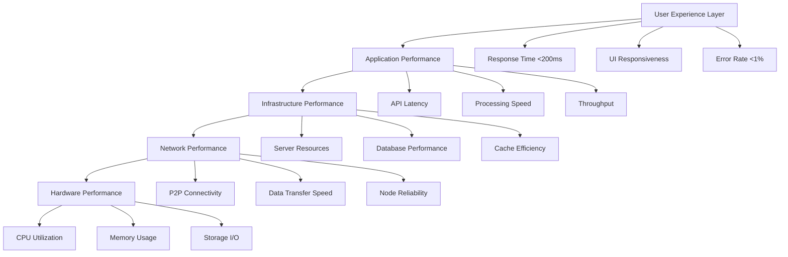
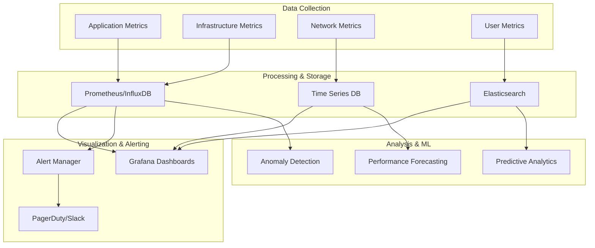
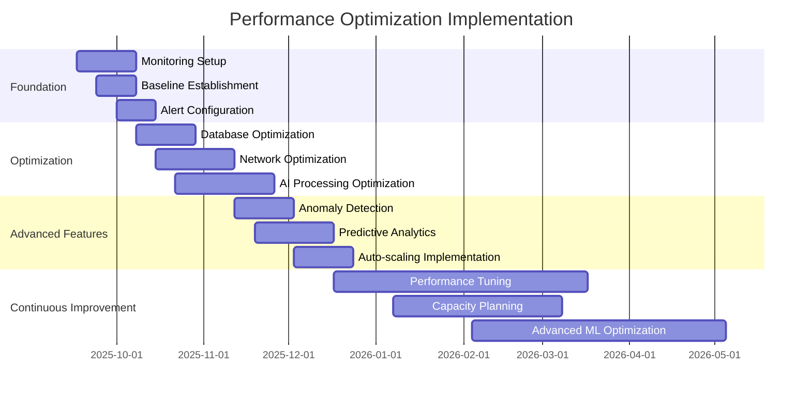

# 📈 Performance Optimization & Monitoring Strategy - Ultra AI Platform

## 🎯 Overview

Comprehensive performance optimization and monitoring strategy for Ultra AI Platform, focusing on distributed system performance, AI processing efficiency, network reliability, and user experience optimization.

## 🏗️ Performance Architecture

### System Performance Hierarchy



### Performance Targets

| Metric Category | Target | Critical Threshold | Monitoring Frequency |
|-----------------|--------|--------------------|---------------------|
| **Response Time** | <200ms average | <500ms p95 | Real-time |
| **Availability** | 99.9% uptime | 99.5% minimum | Continuous |
| **Throughput** | 1000+ TPS | 500 TPS minimum | Real-time |
| **Error Rate** | <1% | <5% critical | Real-time |
| **Network Latency** | <100ms p50 | <300ms p95 | Real-time |
| **AI Processing** | <5s per task | <15s maximum | Per request |

## 🔧 Performance Optimization Strategies

### AI Processing Optimization

#### **Model Performance Tuning**

```python
# AI Performance Optimization Framework
class AIPerformanceOptimizer:
    def __init__(self):
        self.model_cache = {}
        self.performance_metrics = {}
        self.optimization_strategies = {
            'batching': self.optimize_batching,
            'caching': self.optimize_caching,
            'quantization': self.optimize_quantization,
            'pruning': self.optimize_pruning
        }
    
    async def optimize_model_performance(self, model_id: str, workload: dict):
        """
        Optimize AI model performance based on workload characteristics
        """
        # Analyze workload patterns
        workload_analysis = await self.analyze_workload(workload)
        
        # Apply optimization strategies
        optimizations = []
        
        if workload_analysis['batch_potential'] > 0.7:
            optimizations.append('batching')
        
        if workload_analysis['repetitive_queries'] > 0.5:
            optimizations.append('caching')
        
        if workload_analysis['latency_critical']:
            optimizations.append('quantization')
        
        # Execute optimizations
        for strategy in optimizations:
            await self.optimization_strategies[strategy](model_id, workload_analysis)
        
        return {
            'optimizations_applied': optimizations,
            'expected_performance_gain': self.calculate_performance_gain(optimizations),
            'estimated_latency_reduction': self.estimate_latency_reduction(optimizations)
        }
    
    async def optimize_batching(self, model_id: str, analysis: dict):
        """Dynamic batch size optimization"""
        optimal_batch_size = self.calculate_optimal_batch_size(
            model_id, 
            analysis['average_request_size'],
            analysis['memory_constraints']
        )
        
        await self.update_model_config(model_id, {
            'batch_size': optimal_batch_size,
            'batching_timeout': analysis['latency_tolerance']
        })
    
    async def optimize_caching(self, model_id: str, analysis: dict):
        """Intelligent response caching"""
        cache_strategy = {
            'ttl': analysis['data_freshness_requirement'],
            'size_limit': analysis['cache_memory_budget'],
            'eviction_policy': 'lru' if analysis['access_pattern'] == 'temporal' else 'lfu'
        }
        
        await self.configure_cache(model_id, cache_strategy)
```

#### **Distributed Processing Optimization**

```typescript
// Distributed Processing Performance Manager
interface ProcessingOptimization {
  taskPartitioning: {
    strategy: 'semantic' | 'size-based' | 'complexity-based';
    chunkSize: number;
    parallelism: number;
  };
  
  nodeSelection: {
    criteria: 'performance' | 'latency' | 'cost' | 'reliability';
    blacklistThreshold: number;
    preferredRegions: string[];
  };
  
  loadBalancing: {
    algorithm: 'round-robin' | 'weighted' | 'performance-based';
    weights: Record<string, number>;
    healthCheckInterval: number;
  };
}

class DistributedProcessingOptimizer {
  private nodePerformanceHistory: Map<string, PerformanceMetrics[]>;
  private taskComplexityAnalyzer: TaskComplexityAnalyzer;
  
  async optimizeTaskDistribution(task: ProcessingTask): Promise<OptimizedDistribution> {
    // Analyze task complexity
    const complexity = await this.taskComplexityAnalyzer.analyze(task);
    
    // Select optimal nodes based on current performance
    const availableNodes = await this.getAvailableNodes();
    const optimalNodes = this.selectOptimalNodes(availableNodes, complexity);
    
    // Partition task for optimal performance
    const partitions = await this.partitionTask(task, optimalNodes.length, complexity);
    
    // Create distribution plan
    return {
      partitions,
      nodeAssignments: this.assignPartitionsToNodes(partitions, optimalNodes),
      estimatedCompletionTime: this.estimateCompletionTime(partitions, optimalNodes),
      fallbackPlan: this.createFallbackPlan(partitions, availableNodes)
    };
  }
  
  private selectOptimalNodes(nodes: NetworkNode[], complexity: TaskComplexity): NetworkNode[] {
    return nodes
      .filter(node => this.isNodeSuitable(node, complexity))
      .sort((a, b) => this.calculateNodeScore(b, complexity) - this.calculateNodeScore(a, complexity))
      .slice(0, this.calculateOptimalNodeCount(complexity));
  }
  
  private calculateNodeScore(node: NetworkNode, complexity: TaskComplexity): number {
    const performanceHistory = this.nodePerformanceHistory.get(node.id) || [];
    const recentPerformance = performanceHistory.slice(-10); // Last 10 tasks
    
    if (recentPerformance.length === 0) return 0.5; // Default score for new nodes
    
    const averagePerformance = recentPerformance.reduce((sum, metric) => {
      return sum + (
        metric.completionTime * 0.4 +
        metric.reliability * 0.3 +
        metric.resourceUtilization * 0.2 +
        metric.communicationLatency * 0.1
      );
    }, 0) / recentPerformance.length;
    
    // Adjust score based on task complexity requirements
    const complexityBonus = this.calculateComplexityBonus(node, complexity);
    
    return Math.min(1.0, averagePerformance + complexityBonus);
  }
}
```

### Network Performance Optimization

#### **P2P Network Optimization**

```yaml
network_optimization:
  connection_management:
    max_connections_per_node: 50
    connection_timeout: 30000ms
    heartbeat_interval: 10000ms
    reconnection_strategy: "exponential_backoff"
    
  routing_optimization:
    protocol: "kademlia_based"
    routing_table_size: 160
    lookup_parallelism: 3
    refresh_interval: 300000ms
    
  bandwidth_optimization:
    compression: "lz4"
    chunk_size_adaptation: true
    dynamic_quality_adjustment: true
    congestion_control: "bbr"
    
  latency_optimization:
    edge_caching: true
    predictive_prefetching: true
    connection_pooling: true
    multiplexing: true
```

### Database Performance Optimization

#### **Query Optimization Strategy**

```sql
-- Performance-optimized database schema with indexing strategy

-- Core indexes for frequent queries
CREATE INDEX CONCURRENTLY idx_tasks_user_status 
    ON tasks(user_id, status) 
    WHERE status IN ('pending', 'processing');

CREATE INDEX CONCURRENTLY idx_tasks_created_at_desc 
    ON tasks(created_at DESC);

CREATE INDEX CONCURRENTLY idx_network_nodes_performance 
    ON network_nodes(status, reputation_score DESC, last_seen DESC)
    WHERE status = 'active';

-- Partitioning for large tables
CREATE TABLE tasks_partitioned (LIKE tasks) PARTITION BY RANGE (created_at);

-- Monthly partitions for task history
CREATE TABLE tasks_2025_09 PARTITION OF tasks_partitioned
    FOR VALUES FROM ('2025-09-01') TO ('2025-10-01');

-- Connection pooling configuration
-- PgBouncer configuration for connection efficiency
```

## 📊 Comprehensive Monitoring Framework

### Monitoring Stack Architecture



### Key Performance Indicators (KPIs)

#### **System Health Metrics**

```typescript
interface SystemHealthMetrics {
  application: {
    responseTime: {
      p50: number;
      p95: number;
      p99: number;
    };
    throughput: {
      requestsPerSecond: number;
      tasksPerSecond: number;
      networkEvents: number;
    };
    errors: {
      errorRate: number;
      criticalErrors: number;
      userFacingErrors: number;
    };
  };
  
  infrastructure: {
    cpu: {
      utilization: number;
      loadAverage: number[];
      throttling: number;
    };
    memory: {
      utilization: number;
      available: number;
      swapUsage: number;
    };
    storage: {
      utilization: number;
      iops: number;
      latency: number;
    };
    network: {
      bandwidth: number;
      packetLoss: number;
      latency: number;
    };
  };
  
  distributed_network: {
    activeNodes: number;
    networkHealth: number;
    consensusTime: number;
    dataIntegrity: number;
  };
  
  ai_processing: {
    averageProcessingTime: number;
    modelAccuracy: number;
    resourceUtilization: number;
    cacheHitRate: number;
  };
}
```

### Real-Time Monitoring Dashboard

#### **Executive Dashboard**

```yaml
executive_dashboard:
  overview_metrics:
    - active_users: "Current active users"
    - system_health: "Overall system health score"
    - revenue_impact: "Revenue affected by performance"
    - user_satisfaction: "Real-time satisfaction score"
  
  performance_indicators:
    - availability: "99.9% target"
    - response_time: "<200ms target"
    - error_rate: "<1% target"
    - throughput: "1000+ TPS target"
  
  business_metrics:
    - task_completion_rate: "Successful task completion"
    - network_growth: "Node count growth"
    - user_retention: "User retention metrics"
    - cs_token_distribution: "Reward distribution efficiency"
```

#### **Technical Operations Dashboard**

```yaml
technical_dashboard:
  system_performance:
    - cpu_utilization: "Per service CPU usage"
    - memory_usage: "Memory consumption patterns"
    - database_performance: "Query performance metrics"
    - cache_efficiency: "Cache hit/miss ratios"
  
  network_health:
    - node_distribution: "Geographic node distribution"
    - network_latency: "P2P communication latency"
    - data_transfer_efficiency: "Throughput optimization"
    - consensus_performance: "Network consensus timing"
  
  ai_processing:
    - model_performance: "AI model response times"
    - processing_queue: "Task queue depth"
    - resource_allocation: "Compute resource usage"
    - accuracy_metrics: "Model accuracy tracking"
```

### Automated Alerting System

#### **Alert Severity Levels**

```typescript
enum AlertSeverity {
  INFO = 'info',
  WARNING = 'warning',
  CRITICAL = 'critical',
  EMERGENCY = 'emergency'
}

interface AlertRule {
  name: string;
  severity: AlertSeverity;
  condition: string;
  threshold: number;
  duration: string;
  escalation: EscalationPolicy;
  runbook: string;
}

const performanceAlerts: AlertRule[] = [
  {
    name: 'High Response Time',
    severity: AlertSeverity.WARNING,
    condition: 'avg_response_time > 500ms',
    threshold: 500,
    duration: '5m',
    escalation: 'tech-team',
    runbook: 'https://docs.ultra-ai.com/runbooks/high-response-time'
  },
  {
    name: 'System Overload',
    severity: AlertSeverity.CRITICAL,
    condition: 'cpu_utilization > 80% AND memory_utilization > 85%',
    threshold: 80,
    duration: '2m',
    escalation: 'oncall-engineer',
    runbook: 'https://docs.ultra-ai.com/runbooks/system-overload'
  },
  {
    name: 'Network Partition',
    severity: AlertSeverity.EMERGENCY,
    condition: 'active_nodes < 50% of expected',
    threshold: 50,
    duration: '1m',
    escalation: 'emergency-response',
    runbook: 'https://docs.ultra-ai.com/runbooks/network-partition'
  }
];
```

## 🔮 Predictive Performance Analytics

### Machine Learning for Performance Optimization

#### **Anomaly Detection System**

```python
# Performance Anomaly Detection
import numpy as np
from sklearn.ensemble import IsolationForest
from sklearn.preprocessing import StandardScaler

class PerformanceAnomalyDetector:
    def __init__(self):
        self.models = {}
        self.scalers = {}
        self.baseline_metrics = {}
    
    def train_anomaly_detection(self, service_name: str, historical_data: np.ndarray):
        """Train anomaly detection model for a specific service"""
        # Normalize the data
        scaler = StandardScaler()
        normalized_data = scaler.fit_transform(historical_data)
        
        # Train isolation forest
        model = IsolationForest(
            contamination=0.1,  # Expect 10% anomalies
            random_state=42,
            n_estimators=100
        )
        model.fit(normalized_data)
        
        # Store model and scaler
        self.models[service_name] = model
        self.scalers[service_name] = scaler
        
        # Calculate baseline metrics
        self.baseline_metrics[service_name] = {
            'mean': np.mean(historical_data, axis=0),
            'std': np.std(historical_data, axis=0),
            'percentiles': np.percentile(historical_data, [50, 95, 99], axis=0)
        }
    
    def detect_anomalies(self, service_name: str, current_metrics: np.ndarray) -> dict:
        """Detect performance anomalies in real-time metrics"""
        if service_name not in self.models:
            return {'error': 'No trained model for service'}
        
        model = self.models[service_name]
        scaler = self.scalers[service_name]
        baseline = self.baseline_metrics[service_name]
        
        # Normalize current metrics
        normalized_metrics = scaler.transform(current_metrics.reshape(1, -1))
        
        # Predict anomaly
        anomaly_score = model.decision_function(normalized_metrics)[0]
        is_anomaly = model.predict(normalized_metrics)[0] == -1
        
        # Calculate severity
        severity = self.calculate_anomaly_severity(current_metrics, baseline)
        
        return {
            'is_anomaly': is_anomaly,
            'anomaly_score': anomaly_score,
            'severity': severity,
            'affected_metrics': self.identify_affected_metrics(current_metrics, baseline),
            'recommended_actions': self.suggest_actions(current_metrics, baseline)
        }
    
    def calculate_anomaly_severity(self, metrics: np.ndarray, baseline: dict) -> str:
        """Calculate the severity of detected anomalies"""
        deviations = np.abs(metrics - baseline['mean']) / baseline['std']
        max_deviation = np.max(deviations)
        
        if max_deviation > 5:
            return 'critical'
        elif max_deviation > 3:
            return 'high'
        elif max_deviation > 2:
            return 'medium'
        else:
            return 'low'
```

### Performance Forecasting

#### **Capacity Planning Model**

```python
# Capacity Planning and Performance Forecasting
class CapacityPlanningModel:
    def __init__(self):
        self.demand_forecaster = None
        self.resource_optimizer = None
    
    def forecast_resource_needs(self, historical_usage: dict, forecast_horizon: int) -> dict:
        """Forecast resource needs based on historical usage patterns"""
        
        # Analyze usage trends
        trends = self.analyze_usage_trends(historical_usage)
        
        # Forecast demand
        demand_forecast = self.forecast_demand(historical_usage, forecast_horizon)
        
        # Calculate resource requirements
        resource_forecast = self.calculate_resource_requirements(demand_forecast, trends)
        
        # Optimize resource allocation
        optimized_allocation = self.optimize_resource_allocation(resource_forecast)
        
        return {
            'forecast_horizon_days': forecast_horizon,
            'predicted_demand': demand_forecast,
            'resource_requirements': resource_forecast,
            'optimized_allocation': optimized_allocation,
            'cost_estimation': self.estimate_costs(optimized_allocation),
            'scaling_recommendations': self.generate_scaling_recommendations(optimized_allocation)
        }
    
    def generate_scaling_recommendations(self, allocation: dict) -> list:
        """Generate actionable scaling recommendations"""
        recommendations = []
        
        for resource_type, requirements in allocation.items():
            current_capacity = requirements['current']
            predicted_need = requirements['predicted']
            
            if predicted_need > current_capacity * 0.8:  # 80% threshold
                urgency = 'high' if predicted_need > current_capacity else 'medium'
                recommendations.append({
                    'resource': resource_type,
                    'action': 'scale_up',
                    'urgency': urgency,
                    'timeline': '1-2 weeks' if urgency == 'high' else '1 month',
                    'estimated_increase': f"{((predicted_need / current_capacity) - 1) * 100:.1f}%"
                })
        
        return recommendations
```

## 🎯 Performance Optimization Roadmap

### Implementation Timeline



### Success Metrics

| Phase | Metric | Target | Timeline |
|-------|--------|--------|----------|
| **Baseline** | Monitoring Coverage | 95% of services | Month 1 |
| **Optimization** | Response Time Improvement | 30% reduction | Month 3 |
| **Advanced** | Anomaly Detection Accuracy | 95% accuracy | Month 6 |
| **Mature** | Predictive Scaling Accuracy | 90% accuracy | Month 9 |

This comprehensive performance optimization and monitoring strategy ensures Ultra AI Platform maintains high performance, reliability, and user satisfaction while scaling efficiently across distributed infrastructure.