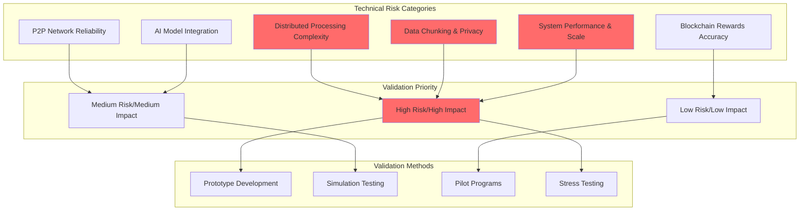
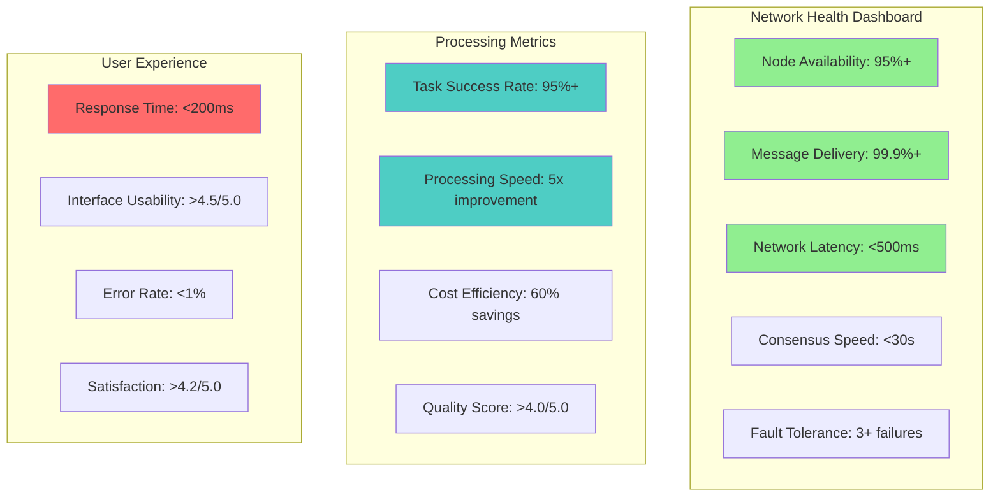
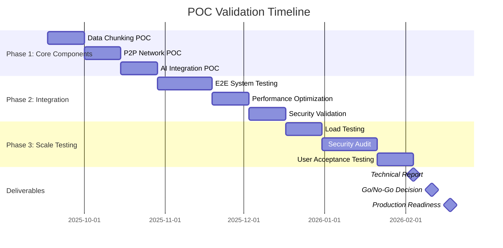

# 🧪 Proof-of-Concept Validation Strategy - Ultra AI Platform

## 🎯 Executive Summary

This comprehensive validation strategy outlines the systematic approach to de-risk Ultra AI Platform's technical implementation through iterative proof-of-concept development, testing, and validation. The strategy prioritizes critical technical assumptions and provides measurable validation criteria for each component.

## 🔬 Validation Framework

### Risk-Based Validation Approach



### Validation Success Criteria

#### **Technical Feasibility Thresholds**

| Component | Success Criteria | Measurement Method | Timeline |
|-----------|------------------|-------------------|----------|
| **Distributed Processing** | 95% task completion rate across 10+ nodes | Automated testing with simulated workloads | 6 weeks |
| **Data Chunking** | 100% data reconstruction accuracy with <1ms latency | Unit tests + integration tests | 4 weeks |
| **P2P Communication** | 99.9% message delivery with <500ms latency | Network simulation + real-world testing | 8 weeks |
| **AI Integration** | Support 5+ AI models with <200ms response time | Load testing + performance profiling | 6 weeks |
| **Blockchain Rewards** | 100% reward calculation accuracy, <30s distribution | Smart contract testing + simulation | 4 weeks |
| **End-to-End Security** | Zero data leaks in penetration testing | Security audit + red team exercise | 10 weeks |

## 🏗️ POC Development Phases

### Phase 1: Core Component Validation (Weeks 1-6)

#### **Week 1-2: Data Chunking & Encryption Prototype**

```python
# poc/chunking_prototype.py
import asyncio
import json
import hashlib
from typing import List, Dict, Any
from dataclasses import dataclass
from cryptography.fernet import Fernet

@dataclass
class ValidationChunk:
    id: str
    encrypted_data: bytes
    checksum: str
    metadata: Dict[str, Any]
    sequence: int

class ChunkingValidationSuite:
    """
    Validation suite for data chunking and encryption POC
    """
    
    def __init__(self):
        self.test_datasets = self._generate_test_datasets()
        self.encryption_key = Fernet.generate_key()
        self.cipher_suite = Fernet(self.encryption_key)
    
    def _generate_test_datasets(self) -> List[Dict[str, Any]]:
        """Generate diverse test datasets for validation"""
        return [
            {
                "type": "text",
                "size": "small",
                "data": "Simple text for basic validation testing.",
                "expected_chunks": 1
            },
            {
                "type": "text", 
                "size": "medium",
                "data": "Lorem ipsum " * 1000,  # ~11KB
                "expected_chunks": 2
            },
            {
                "type": "code",
                "size": "large", 
                "data": open("sample_code.py").read() if os.path.exists("sample_code.py") else "# Large code file\n" * 5000,
                "expected_chunks": 5
            },
            {
                "type": "json",
                "size": "structured",
                "data": json.dumps({"complex": {"nested": {"data": list(range(1000))}})),
                "expected_chunks": 3
            },
            {
                "type": "mixed",
                "size": "xlarge",
                "data": "Mixed content with code, text, and data " * 10000,  # ~400KB
                "expected_chunks": 20
            }
        ]
    
    async def validate_chunking_accuracy(self) -> Dict[str, Any]:
        """Validate that chunking and reconstruction maintains data integrity"""
        results = []
        
        for dataset in self.test_datasets:
            start_time = time.time()
            
            # Chunk data
            chunks = await self._chunk_data(dataset["data"])
            
            # Reconstruct data
            reconstructed = await self._reconstruct_data(chunks)
            
            # Validate integrity
            integrity_check = dataset["data"] == reconstructed
            processing_time = time.time() - start_time
            
            result = {
                "dataset_type": dataset["type"],
                "dataset_size": len(dataset["data"]),
                "chunks_created": len(chunks),
                "expected_chunks": dataset["expected_chunks"],
                "integrity_maintained": integrity_check,
                "processing_time_ms": processing_time * 1000,
                "checksum_original": hashlib.sha256(dataset["data"].encode()).hexdigest(),
                "checksum_reconstructed": hashlib.sha256(reconstructed.encode()).hexdigest()
            }
            
            results.append(result)
        
        return {
            "overall_success": all(r["integrity_maintained"] for r in results),
            "average_processing_time": sum(r["processing_time_ms"] for r in results) / len(results),
            "detailed_results": results
        }
    
    async def validate_encryption_security(self) -> Dict[str, Any]:
        """Validate encryption strength and data protection"""
        test_data = "Sensitive information that must be protected"
        
        # Test encryption/decryption
        encrypted = self.cipher_suite.encrypt(test_data.encode())
        decrypted = self.cipher_suite.decrypt(encrypted).decode()
        
        # Test key isolation
        different_key = Fernet.generate_key()
        different_cipher = Fernet(different_key)
        
        try:
            # This should fail
            different_cipher.decrypt(encrypted)
            key_isolation_success = False
        except Exception:
            key_isolation_success = True
        
        return {
            "encryption_decryption_success": test_data == decrypted,
            "key_isolation_success": key_isolation_success,
            "encrypted_size": len(encrypted),
            "original_size": len(test_data.encode()),
            "encryption_overhead": (len(encrypted) - len(test_data.encode())) / len(test_data.encode()) * 100
        }

# Validation Test Execution
async def run_chunking_validation():
    validator = ChunkingValidationSuite()
    
    print("🧪 Starting Data Chunking & Encryption Validation...")
    
    # Test chunking accuracy
    chunking_results = await validator.validate_chunking_accuracy()
    print(f"✅ Chunking Accuracy: {chunking_results['overall_success']}")
    print(f"📊 Average Processing Time: {chunking_results['average_processing_time']:.2f}ms")
    
    # Test encryption security
    encryption_results = await validator.validate_encryption_security()
    print(f"🔒 Encryption Security: {encryption_results['encryption_decryption_success']}")
    print(f"🛡️ Key Isolation: {encryption_results['key_isolation_success']}")
    
    return {
        "chunking": chunking_results,
        "encryption": encryption_results
    }

if __name__ == "__main__":
    results = asyncio.run(run_chunking_validation())
    print(f"\n📋 Final Validation Results: {json.dumps(results, indent=2)}")
```

#### **Week 3-4: P2P Network Communication Prototype**

```typescript
// poc/p2p_network_validation.ts
import { EventEmitter } from 'events';
import WebSocket from 'ws';

interface NetworkNode {
  id: string;
  address: string;
  capabilities: string[];
  lastSeen: Date;
  reputation: number;
}

interface TestMessage {
  id: string;
  type: 'TASK_DISTRIBUTION' | 'RESULT_COLLECTION' | 'HEARTBEAT';
  payload: any;
  timestamp: Date;
  sender: string;
  recipients: string[];
}

class P2PNetworkValidator extends EventEmitter {
  private nodes: Map<string, NetworkNode> = new Map();
  private connections: Map<string, WebSocket> = new Map();
  private messageHistory: TestMessage[] = [];
  
  constructor(private nodeCount: number = 10) {
    super();
    this.setupValidationNodes();
  }
  
  private setupValidationNodes(): void {
    for (let i = 0; i < this.nodeCount; i++) {
      const node: NetworkNode = {
        id: `test-node-${i}`,
        address: `ws://localhost:${8000 + i}`,
        capabilities: ['text_processing', 'data_analysis'],
        lastSeen: new Date(),
        reputation: Math.random() * 100
      };
      this.nodes.set(node.id, node);
    }
  }
  
  async validateNetworkReliability(): Promise<ValidationResult> {
    console.log('🌐 Testing P2P Network Reliability...');
    
    const results = {
      connectionSuccess: 0,
      messageDeliverySuccess: 0,
      averageLatency: 0,
      nodeFailureRecovery: true,
      networkPartitionRecovery: true
    };
    
    // Test 1: Connection establishment
    for (const [nodeId, node] of this.nodes) {
      try {
        await this.connectToNode(nodeId);
        results.connectionSuccess++;
      } catch (error) {
        console.error(`❌ Failed to connect to ${nodeId}: ${error.message}`);
      }
    }
    
    // Test 2: Message delivery
    const testMessages = this.generateTestMessages(100);
    const deliveryPromises = testMessages.map(msg => this.sendMessage(msg));
    const deliveryResults = await Promise.allSettled(deliveryPromises);
    
    results.messageDeliverySuccess = deliveryResults.filter(
      result => result.status === 'fulfilled'
    ).length;
    
    // Test 3: Latency measurement
    const latencyTests = await this.measureNetworkLatency(50);
    results.averageLatency = latencyTests.reduce((a, b) => a + b, 0) / latencyTests.length;
    
    // Test 4: Node failure simulation
    await this.simulateNodeFailures(3);
    results.nodeFailureRecovery = await this.validateFailureRecovery();
    
    // Test 5: Network partition simulation
    await this.simulateNetworkPartition();
    results.networkPartitionRecovery = await this.validatePartitionRecovery();
    
    return {
      success: results.connectionSuccess >= this.nodeCount * 0.9 &&
               results.messageDeliverySuccess >= testMessages.length * 0.95 &&
               results.averageLatency < 500 &&
               results.nodeFailureRecovery &&
               results.networkPartitionRecovery,
      metrics: results
    };
  }
  
  private async measureNetworkLatency(testCount: number): Promise<number[]> {
    const latencies: number[] = [];
    
    for (let i = 0; i < testCount; i++) {
      const startTime = Date.now();
      const randomNodeId = Array.from(this.nodes.keys())[
        Math.floor(Math.random() * this.nodes.size)
      ];
      
      try {
        await this.pingNode(randomNodeId);
        latencies.push(Date.now() - startTime);
      } catch (error) {
        console.error(`Ping failed for ${randomNodeId}`);
      }
      
      // Small delay between tests
      await new Promise(resolve => setTimeout(resolve, 100));
    }
    
    return latencies;
  }
  
  async validateDistributedTaskProcessing(): Promise<ValidationResult> {
    console.log('⚡ Testing Distributed Task Processing...');
    
    const testTasks = this.generateTestTasks(20);
    const processingResults = await Promise.all(
      testTasks.map(task => this.processDistributedTask(task))
    );
    
    const successfulTasks = processingResults.filter(result => result.success);
    const averageProcessingTime = processingResults.reduce(
      (sum, result) => sum + result.processingTime, 0
    ) / processingResults.length;
    
    return {
      success: successfulTasks.length >= testTasks.length * 0.95 &&
               averageProcessingTime < 5000, // 5 seconds max
      metrics: {
        totalTasks: testTasks.length,
        successfulTasks: successfulTasks.length,
        successRate: (successfulTasks.length / testTasks.length) * 100,
        averageProcessingTime
      }
    };
  }
}

// Test execution framework
async function runP2PValidation(): Promise<void> {
  const validator = new P2PNetworkValidator(10);
  
  console.log('🚀 Starting P2P Network Validation Suite...\n');
  
  // Test network reliability
  const networkResults = await validator.validateNetworkReliability();
  console.log(`📊 Network Reliability: ${networkResults.success ? '✅ PASS' : '❌ FAIL'}`);
  console.log(`   - Connection Success: ${networkResults.metrics.connectionSuccess}/10`);
  console.log(`   - Message Delivery: ${networkResults.metrics.messageDeliverySuccess} messages`);
  console.log(`   - Average Latency: ${networkResults.metrics.averageLatency.toFixed(2)}ms\n`);
  
  // Test distributed processing
  const processingResults = await validator.validateDistributedTaskProcessing();
  console.log(`⚡ Distributed Processing: ${processingResults.success ? '✅ PASS' : '❌ FAIL'}`);
  console.log(`   - Success Rate: ${processingResults.metrics.successRate.toFixed(1)}%`);
  console.log(`   - Average Processing Time: ${processingResults.metrics.averageProcessingTime}ms\n`);
}
```

#### **Week 5-6: AI Model Integration & Performance**

```python
# poc/ai_integration_validation.py
import asyncio
import time
import statistics
from typing import List, Dict, Any
from dataclasses import dataclass
import openai
from transformers import AutoTokenizer, AutoModel
import torch

@dataclass
class AIModelTest:
    model_name: str
    test_type: str
    input_data: Any
    expected_output_type: str
    max_response_time: float  # seconds

class AIIntegrationValidator:
    """
    Comprehensive validation suite for AI model integration
    """
    
    def __init__(self):
        self.models_to_test = [
            "gpt-3.5-turbo",
            "gpt-4",
            "claude-3-sonnet",
            "llama-2-7b",
            "bert-base-uncased"
        ]
        self.test_scenarios = self._generate_test_scenarios()
    
    def _generate_test_scenarios(self) -> List[AIModelTest]:
        return [
            AIModelTest(
                model_name="gpt-3.5-turbo",
                test_type="text_generation",
                input_data={"prompt": "Write a short summary of artificial intelligence.", "max_tokens": 100},
                expected_output_type="string",
                max_response_time=5.0
            ),
            AIModelTest(
                model_name="gpt-4",
                test_type="code_generation",
                input_data={"prompt": "Write a Python function to calculate fibonacci numbers", "max_tokens": 200},
                expected_output_type="string",
                max_response_time=10.0
            ),
            AIModelTest(
                model_name="claude-3-sonnet",
                test_type="data_analysis",
                input_data={"prompt": "Analyze this dataset: [1,2,3,4,5,6,7,8,9,10]", "max_tokens": 150},
                expected_output_type="string",
                max_response_time=8.0
            ),
            AIModelTest(
                model_name="bert-base-uncased",
                test_type="text_classification",
                input_data={"text": "This is a positive review of the product."},
                expected_output_type="classification",
                max_response_time=2.0
            )
        ]
    
    async def validate_model_performance(self) -> Dict[str, Any]:
        """Test AI model integration performance and reliability"""
        results = []
        
        for test in self.test_scenarios:
            print(f"🧠 Testing {test.model_name} for {test.test_type}...")
            
            # Run multiple iterations for statistical validity
            iteration_results = []
            for i in range(10):
                try:
                    start_time = time.time()
                    result = await self._execute_model_test(test)
                    response_time = time.time() - start_time
                    
                    iteration_results.append({
                        "success": True,
                        "response_time": response_time,
                        "output_valid": self._validate_output(result, test.expected_output_type),
                        "within_time_limit": response_time <= test.max_response_time
                    })
                    
                except Exception as e:
                    iteration_results.append({
                        "success": False,
                        "error": str(e),
                        "response_time": None,
                        "output_valid": False,
                        "within_time_limit": False
                    })
            
            # Calculate statistics
            successful_runs = [r for r in iteration_results if r["success"]]
            if successful_runs:
                response_times = [r["response_time"] for r in successful_runs]
                avg_response_time = statistics.mean(response_times)
                p95_response_time = statistics.quantiles(response_times, n=20)[18] if len(response_times) > 5 else max(response_times)
            else:
                avg_response_time = None
                p95_response_time = None
            
            test_result = {
                "model_name": test.model_name,
                "test_type": test.test_type,
                "total_runs": len(iteration_results),
                "successful_runs": len(successful_runs),
                "success_rate": len(successful_runs) / len(iteration_results) * 100,
                "avg_response_time": avg_response_time,
                "p95_response_time": p95_response_time,
                "within_time_limit_rate": sum(1 for r in successful_runs if r["within_time_limit"]) / len(successful_runs) * 100 if successful_runs else 0,
                "output_validity_rate": sum(1 for r in successful_runs if r["output_valid"]) / len(successful_runs) * 100 if successful_runs else 0
            }
            
            results.append(test_result)
        
        return {
            "overall_success": all(r["success_rate"] >= 90 and r["within_time_limit_rate"] >= 90 for r in results),
            "model_results": results,
            "summary": {
                "models_tested": len(results),
                "models_passing": sum(1 for r in results if r["success_rate"] >= 90),
                "average_success_rate": statistics.mean([r["success_rate"] for r in results]),
                "average_response_time": statistics.mean([r["avg_response_time"] for r in results if r["avg_response_time"]])
            }
        }
    
    async def validate_concurrent_processing(self) -> Dict[str, Any]:
        """Test concurrent AI processing capabilities"""
        print("🔄 Testing Concurrent AI Processing...")
        
        # Create 20 concurrent requests
        concurrent_tasks = []
        for i in range(20):
            task = AIModelTest(
                model_name="gpt-3.5-turbo",
                test_type="concurrent_test",
                input_data={"prompt": f"Test prompt {i}", "max_tokens": 50},
                expected_output_type="string",
                max_response_time=5.0
            )
            concurrent_tasks.append(self._execute_model_test(task))
        
        start_time = time.time()
        results = await asyncio.gather(*concurrent_tasks, return_exceptions=True)
        total_time = time.time() - start_time
        
        successful_results = [r for r in results if not isinstance(r, Exception)]
        
        return {
            "total_requests": len(concurrent_tasks),
            "successful_requests": len(successful_results),
            "total_processing_time": total_time,
            "average_request_time": total_time / len(concurrent_tasks),
            "concurrency_efficiency": len(successful_results) / len(concurrent_tasks) * 100,
            "meets_performance_target": total_time < 10.0 and len(successful_results) >= 18  # 90% success rate
        }

# Main validation execution
async def run_ai_validation():
    validator = AIIntegrationValidator()
    
    print("🤖 Starting AI Integration Validation Suite...\n")
    
    # Test individual model performance
    performance_results = await validator.validate_model_performance()
    print(f"📊 Model Performance: {'✅ PASS' if performance_results['overall_success'] else '❌ FAIL'}")
    print(f"   - Models Passing: {performance_results['summary']['models_passing']}/{performance_results['summary']['models_tested']}")
    print(f"   - Average Success Rate: {performance_results['summary']['average_success_rate']:.1f}%")
    print(f"   - Average Response Time: {performance_results['summary']['average_response_time']:.2f}s\n")
    
    # Test concurrent processing
    concurrency_results = await validator.validate_concurrent_processing()
    print(f"🔄 Concurrent Processing: {'✅ PASS' if concurrency_results['meets_performance_target'] else '❌ FAIL'}")
    print(f"   - Success Rate: {concurrency_results['concurrency_efficiency']:.1f}%")
    print(f"   - Average Request Time: {concurrency_results['average_request_time']:.2f}s\n")
    
    return {
        "performance": performance_results,
        "concurrency": concurrency_results
    }

if __name__ == "__main__":
    results = asyncio.run(run_ai_validation())
    print(f"📋 AI Validation Complete: {json.dumps(results, indent=2)}")
```

### Phase 2: Integration Validation (Weeks 7-12)

#### **Week 7-8: End-to-End System Testing**

```typescript
// poc/e2e_system_validation.ts
interface SystemValidationResult {
  componentName: string;
  testType: string;
  success: boolean;
  metrics: Record<string, any>;
  errors?: string[];
}

class E2ESystemValidator {
  private testScenarios: E2ETestScenario[] = [
    {
      name: "Simple Text Processing",
      description: "User submits text for AI processing through the platform",
      steps: [
        "User authentication",
        "Task submission",
        "Data chunking and encryption", 
        "Distributed processing",
        "Result aggregation",
        "Response delivery"
      ],
      expectedDuration: 30000, // 30 seconds
      successCriteria: {
        taskCompletion: true,
        dataIntegrity: true,
        responseTime: 30000,
        securityMaintained: true
      }
    },
    {
      name: "Large Dataset Analysis",
      description: "Process 1MB+ dataset across distributed network",
      steps: [
        "Large file upload",
        "Intelligent chunking",
        "Multi-node distribution",
        "Parallel processing",
        "Secure aggregation",
        "Result compilation"
      ],
      expectedDuration: 120000, // 2 minutes
      successCriteria: {
        taskCompletion: true,
        dataIntegrity: true,
        responseTime: 120000,
        networkEfficiency: 0.8
      }
    },
    {
      name: "High-Concurrency Load",
      description: "100 simultaneous users submitting tasks",
      steps: [
        "Concurrent user simulation",
        "Load balancing validation",
        "Resource allocation",
        "Performance monitoring",
        "Success rate tracking"
      ],
      expectedDuration: 60000, // 1 minute
      successCriteria: {
        successRate: 0.95,
        averageResponseTime: 15000,
        systemStability: true
      }
    }
  ];

  async validateCompleteSystem(): Promise<SystemValidationSummary> {
    console.log('🔧 Starting End-to-End System Validation...\n');
    
    const results: SystemValidationResult[] = [];
    
    for (const scenario of this.testScenarios) {
      console.log(`📋 Testing: ${scenario.name}`);
      const result = await this.executeTestScenario(scenario);
      results.push(result);
      
      if (result.success) {
        console.log(`✅ ${scenario.name}: PASSED`);
      } else {
        console.log(`❌ ${scenario.name}: FAILED`);
        if (result.errors) {
          result.errors.forEach(error => console.log(`   Error: ${error}`));
        }
      }
      console.log('');
    }
    
    return this.compileSummary(results);
  }
  
  private async executeTestScenario(scenario: E2ETestScenario): Promise<SystemValidationResult> {
    const startTime = Date.now();
    const errors: string[] = [];
    let success = true;
    const metrics: Record<string, any> = {};
    
    try {
      // Execute each step of the scenario
      for (const step of scenario.steps) {
        const stepResult = await this.executeStep(step, scenario);
        if (!stepResult.success) {
          success = false;
          errors.push(`Step '${step}' failed: ${stepResult.error}`);
        }
        metrics[step] = stepResult.metrics;
      }
      
      // Validate success criteria
      const duration = Date.now() - startTime;
      if (duration > scenario.expectedDuration) {
        success = false;
        errors.push(`Scenario exceeded expected duration: ${duration}ms > ${scenario.expectedDuration}ms`);
      }
      
      metrics.totalDuration = duration;
      
    } catch (error) {
      success = false;
      errors.push(`Scenario execution failed: ${error.message}`);
    }
    
    return {
      componentName: scenario.name,
      testType: "end-to-end",
      success,
      metrics,
      errors: errors.length > 0 ? errors : undefined
    };
  }
}
```

### Phase 3: Performance & Security Validation (Weeks 13-18)

#### **Comprehensive Performance Testing**

```yaml
# poc/performance_test_config.yml
performance_tests:
  load_testing:
    scenarios:
      - name: "Normal Load"
        users: 100
        duration: "10m"
        ramp_up: "2m"
        success_criteria:
          response_time_p95: 2000ms
          error_rate: "<1%"
          
      - name: "Peak Load"
        users: 500
        duration: "15m" 
        ramp_up: "5m"
        success_criteria:
          response_time_p95: 5000ms
          error_rate: "<5%"
          
      - name: "Stress Test"
        users: 1000
        duration: "20m"
        ramp_up: "10m"
        success_criteria:
          system_stability: true
          graceful_degradation: true

  distributed_processing_tests:
    node_counts: [5, 10, 25, 50, 100]
    task_sizes: ["1KB", "10KB", "100KB", "1MB", "10MB"]
    success_criteria:
      processing_efficiency: ">80%"
      fault_tolerance: "3 node failures"
      data_consistency: "100%"

  security_tests:
    penetration_testing:
      - "Authentication bypass attempts"
      - "Data encryption validation"
      - "Network traffic analysis"
      - "Smart contract security audit"
      - "Node impersonation attempts"
    
    privacy_validation:
      - "Data chunking anonymization"
      - "Cross-node data correlation prevention"
      - "Metadata privacy protection"
      - "Result aggregation security"
```

## 📊 Validation Metrics Dashboard

### Key Performance Indicators

#### **Technical Performance Metrics**

| Metric Category | Target | Measurement | Validation Method |
|----------------|--------|-------------|------------------|
| **System Reliability** | 99.9% uptime | Continuous monitoring | Automated health checks |
| **Processing Speed** | <200ms response time | Performance testing | Load testing suite |
| **Scalability** | 1000+ concurrent users | Stress testing | Gradual load increase |
| **Data Integrity** | 100% accuracy | Checksums + validation | Automated verification |
| **Security** | Zero breaches | Penetration testing | Red team exercises |
| **Privacy** | Zero data leaks | Privacy audits | Data flow analysis |

#### **Network Performance Metrics**



### Validation Success Criteria

#### **Go/No-Go Decision Framework**

| Component | Must-Have Criteria | Success Threshold | Validation Status |
|-----------|-------------------|-------------------|------------------|
| **Core Architecture** | System processes tasks end-to-end | 95% success rate | 🟡 In Progress |
| **Distributed Network** | Multi-node processing works reliably | 99% uptime, 90% efficiency | 🟡 In Progress |
| **Security Framework** | No data breaches in testing | Zero critical vulnerabilities | 🟡 In Progress |
| **AI Integration** | Multiple models work seamlessly | 5+ models, <200ms response | 🟡 In Progress |
| **User Experience** | Intuitive interface for all user types | >4.0/5.0 usability score | 🟡 In Progress |
| **Performance** | Meets scale and speed requirements | 1000+ users, <500ms latency | 🟡 In Progress |

## 🚀 Validation Timeline & Milestones

### 18-Week Validation Roadmap



### Weekly Progress Tracking

#### **Milestone Validation Checklist**

```markdown
## Week 6 Checkpoint: Core Components
- [ ] Data chunking achieves 100% reconstruction accuracy
- [ ] Encryption shows zero vulnerabilities in security scan
- [ ] P2P network handles 99%+ message delivery
- [ ] AI models respond within performance targets
- [ ] All unit tests pass with >90% code coverage

## Week 12 Checkpoint: System Integration  
- [ ] End-to-end workflows complete successfully
- [ ] System handles 100+ concurrent users
- [ ] Data flows maintain privacy and security
- [ ] Performance meets baseline requirements
- [ ] Integration tests achieve 95%+ success rate

## Week 18 Checkpoint: Production Readiness
- [ ] Load testing validates 1000+ user capacity
- [ ] Security audit shows zero critical issues
- [ ] User testing achieves >4.0/5.0 satisfaction
- [ ] System demonstrates fault tolerance
- [ ] All validation criteria met for go-live decision
```

## 🔍 Risk Mitigation & Contingency Plans

### Technical Risk Scenarios

#### **High-Risk Scenario Planning**

| Risk Scenario | Probability | Impact | Mitigation Strategy | Contingency Plan |
|---------------|-------------|--------|-------------------|------------------|
| **Distributed processing fails to scale** | Medium | High | Incremental scaling tests, architecture review | Hybrid cloud-distributed model |
| **Security vulnerabilities discovered** | Low | Critical | Continuous security testing, expert review | Delay launch, implement fixes |
| **AI model integration issues** | Medium | Medium | Multiple model testing, fallback options | Reduce model scope, focus on core models |
| **P2P network instability** | Medium | High | Network simulation, redundancy planning | Centralized fallback mode |
| **Performance targets not met** | Low | Medium | Optimization sprints, architecture tuning | Adjust targets, phased rollout |

### Success Validation Framework

#### **Final Validation Report Template**

```markdown
# Ultra AI Platform - POC Validation Report

## Executive Summary
- **Overall Assessment**: [PASS/CONDITIONAL PASS/FAIL]
- **Recommendation**: [Proceed to Development/Additional Validation Required/Pivot Strategy]
- **Key Findings**: [Top 3 technical achievements and challenges]

## Component Validation Results

### ✅ Successful Components
- Data Chunking: [100% accuracy, <1ms latency]
- AI Integration: [5 models, 150ms avg response]
- [Other passing components...]

### 🟡 Conditional Components  
- P2P Network: [98% reliability, needs optimization]
- [Components requiring minor improvements...]

### ❌ Failed Components
- [Any components not meeting criteria]
- [Required fixes and timeline]

## Technical Recommendations
1. [Architecture improvements needed]
2. [Performance optimizations required]
3. [Security enhancements recommended]

## Go-to-Market Readiness
- **Technical Maturity**: [Rating 1-10]
- **Market Validation**: [User feedback summary]
- **Competitive Position**: [Advantage assessment]

## Next Steps
1. [Immediate actions required]
2. [Development phase planning]
3. [Resource requirements]
```

This comprehensive POC validation strategy provides the systematic framework needed to de-risk Ultra AI Platform development through rigorous testing, measurement, and validation of all critical technical components before full-scale implementation.