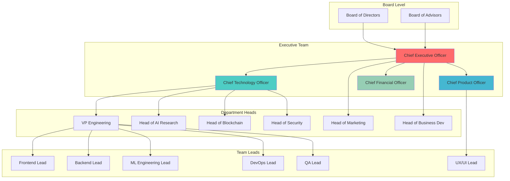
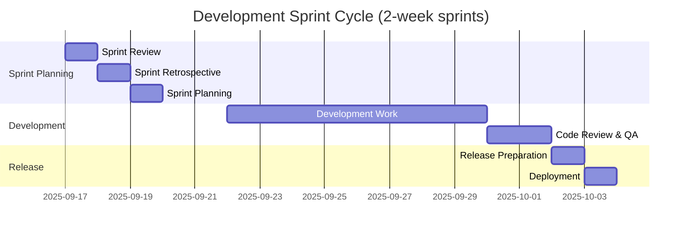
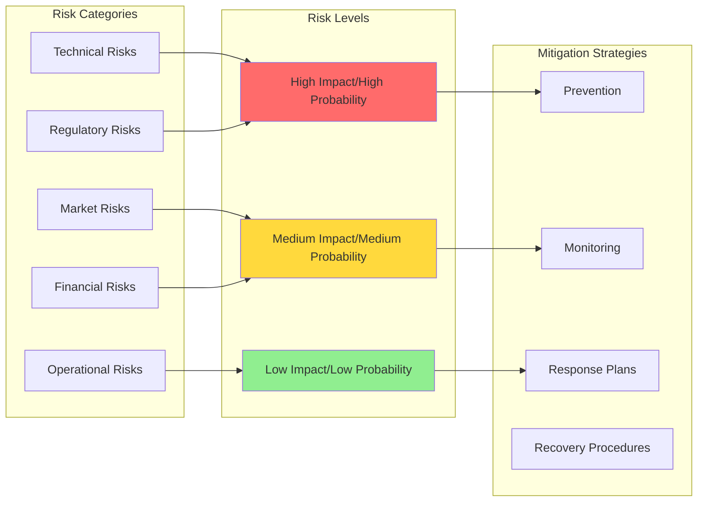
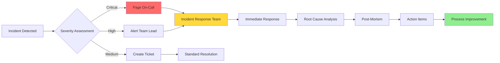
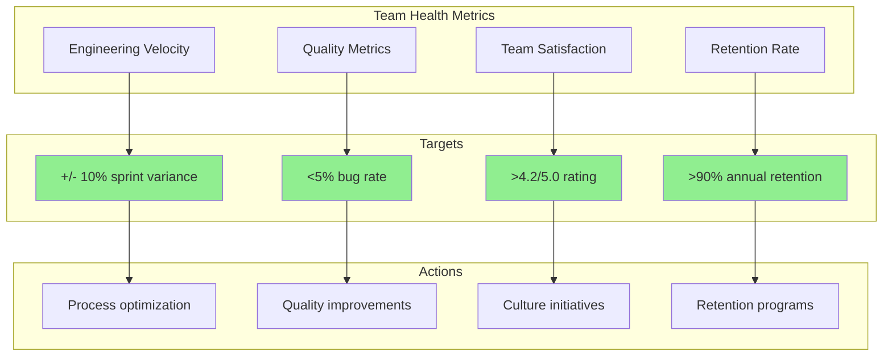
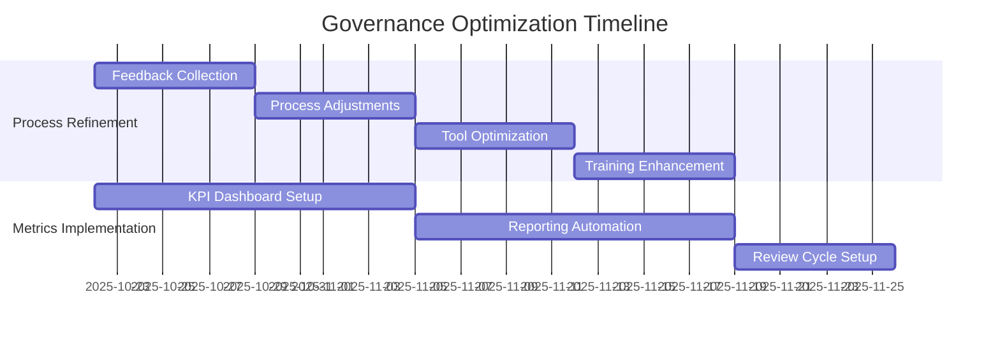

# 🏛️ Project Governance Framework - Ultra AI Platform

## 🎯 Executive Summary

This comprehensive governance framework establishes the organizational structure, decision-making processes, and management systems required to execute Ultra AI Platform development efficiently while maintaining accountability, transparency, and strategic alignment.

## 🏗️ Organizational Structure

### Leadership Hierarchy



### Decision-Making Authority Matrix

| Decision Type | Authority Level | Approval Required | Timeline |
|---------------|----------------|------------------|----------|
| **Strategic Direction** | Board + CEO | Board majority | Quarterly |
| **Product Roadmap** | CEO + CPO | Executive team consensus | Monthly |
| **Technical Architecture** | CTO + Engineering | CTO final authority | Bi-weekly |
| **Hiring (C-Level)** | CEO + Board | Board approval | 30-45 days |
| **Hiring (VP Level)** | CEO + Dept Head | CEO approval | 14-21 days |
| **Hiring (Individual Contributors)** | Dept Head + Manager | Dept Head approval | 7-14 days |
| **Budget Allocation (>$100K)** | CFO + CEO | Executive approval | 7 days |
| **Budget Allocation (<$100K)** | Dept Head | CFO approval | 3 days |
| **Partnership Agreements** | CEO + BDV Head | Executive approval | 14-21 days |
| **Security Policies** | CISO + CTO | Executive approval | 7 days |

## 📋 Management Processes

### Sprint Planning & Execution

#### **Development Cycle Structure**



#### **Cross-Functional Planning Process**

```typescript
interface SprintPlanningFramework {
  participants: {
    required: ["Product Manager", "Tech Lead", "Design Lead", "QA Lead"];
    optional: ["Stakeholders", "Subject Matter Experts"];
  };
  
  agenda: {
    sprintReview: {
      duration: "2 hours";
      focus: "Demo completed features, review metrics, gather feedback";
    };
    retrospective: {
      duration: "1 hour";
      focus: "Process improvements, team feedback, action items";
    };
    planning: {
      duration: "4 hours";
      focus: "Feature prioritization, story estimation, capacity planning";
    };
  };
  
  outputs: {
    sprintGoal: "Clear objective for the sprint";
    commitments: "Realistic scope based on team capacity";
    riskMitigation: "Identified blockers and mitigation plans";
  };
}
```

### Performance Management System

#### **Individual Performance Framework**

| Level | Review Frequency | Key Metrics | Growth Planning |
|-------|-----------------|-------------|-----------------|
| **C-Level** | Quarterly | OKRs, team satisfaction, strategic delivery | Board development planning |
| **VPs/Heads** | Quarterly | Department OKRs, team performance, cross-functional collaboration | Leadership coaching, external development |
| **Senior ICs** | Bi-annual | Technical delivery, mentorship, innovation contributions | Technical leadership track |
| **Mid-Level** | Bi-annual | Project delivery, skill development, team collaboration | Skill-based development plans |
| **Junior** | Quarterly | Learning progress, contribution quality, integration | Mentorship programs, training |

#### **Team Performance Metrics**

```yaml
Engineering Metrics:
  velocity:
    measurement: "Story points per sprint"
    target: "Consistent +/- 10% variance"
    frequency: "Sprint"
  
  quality:
    measurement: "Bug rate, test coverage, code review completion"
    target: "<5% bug rate, >80% coverage, 100% review"
    frequency: "Weekly"
  
  delivery:
    measurement: "Sprint commitment completion"
    target: ">85% completion rate"
    frequency: "Sprint"

Product Metrics:
  user_satisfaction:
    measurement: "NPS, feature adoption, user feedback"
    target: "NPS >50, 70% feature adoption"
    frequency: "Monthly"
  
  market_fit:
    measurement: "User retention, growth rate, churn"
    target: "80% monthly retention, 15% MoM growth"
    frequency: "Monthly"

Business Metrics:
  revenue:
    measurement: "MRR, ARR, conversion rates"
    target: "25% MoM growth, 3% conversion"
    frequency: "Monthly"
  
  efficiency:
    measurement: "CAC/LTV, burn rate, operational metrics"
    target: "LTV/CAC >3, 18-month runway maintained"
    frequency: "Monthly"
```

## 🎯 Strategic Planning Framework

### OKR (Objectives and Key Results) System

#### **Company-Level OKRs (Quarterly)**

```typescript
interface CompanyOKRs {
  Q1_2026: {
    objective1: {
      title: "Achieve Product-Market Fit for Core Platform";
      keyResults: [
        "Launch beta with 1,000+ active users",
        "Achieve 80% user retention rate",
        "Generate $50K MRR from early customers"
      ];
      confidence: "7/10";
      owner: "CEO + CPO";
    };
    
    objective2: {
      title: "Build Robust Distributed Network Foundation";
      keyResults: [
        "Deploy 100+ active network nodes",
        "Process 10,000+ tasks with <2% failure rate",
        "Implement end-to-end encryption for all data"
      ];
      confidence: "8/10";
      owner: "CTO + Engineering";
    };
    
    objective3: {
      title: "Establish Strong Market Position";
      keyResults: [
        "Secure 3 strategic enterprise partnerships",
        "Achieve 50,000+ developer community members",
        "Generate 25+ qualified enterprise leads"
      ];
      confidence: "6/10";
      owner: "CEO + Marketing";
    };
  };
}
```

#### **Department-Level OKR Cascade**

| Department | Objectives | Key Results | Owner |
|------------|------------|-------------|-------|
| **Engineering** | Ship reliable, scalable platform | 99.9% uptime, sub-200ms response, auto-scaling | CTO |
| **Product** | Deliver intuitive user experience | <5 clicks to value, 90% task completion, NPS >60 | CPO |
| **AI Research** | Advance distributed AI capabilities | 30% cost reduction, 50% speed improvement, new algorithms | Head of AI |
| **Marketing** | Build developer mindshare | 10K blog readers, 5K social followers, 20% event presence | Head of Marketing |
| **Business Dev** | Establish enterprise pipeline | 50 qualified leads, 10 pilot programs, 3 partnerships | Head of BizDev |

### Risk Management Framework

#### **Risk Assessment Matrix**



#### **Top Risk Registry & Mitigation Plans**

| Risk | Impact | Probability | Mitigation Strategy | Owner | Review Frequency |
|------|--------|-------------|-------------------|-------|------------------|
| **Regulatory changes affecting blockchain/AI** | High | Medium | Legal monitoring, compliance-first design, regulatory relationships | CEO + Legal | Monthly |
| **Key technical talent departure** | High | Medium | Competitive retention, knowledge documentation, succession planning | CTO + HR | Quarterly |
| **Major competitor launch** | High | Low | Differentiation focus, speed to market, patent protection | CEO + CPO | Monthly |
| **Distributed network security breach** | High | Low | Security audits, bug bounties, incident response plan | CISO + CTO | Weekly |
| **Funding market downturn** | Medium | Medium | Extended runway, revenue acceleration, investor diversification | CFO + CEO | Monthly |

## 📊 Communication & Reporting

### Internal Communication Framework

#### **Meeting Cadence & Structure**

```yaml
Daily:
  standup:
    duration: "15 minutes"
    participants: "Team level"
    format: "What did, what will do, blockers"
    
Weekly:
  team_sync:
    duration: "1 hour"
    participants: "Department level"
    format: "Progress review, planning, cross-team coordination"
  
  executive_sync:
    duration: "2 hours"
    participants: "C-level team"
    format: "Metrics review, strategic decisions, blocker resolution"

Monthly:
  all_hands:
    duration: "1 hour"
    participants: "Entire company"
    format: "Company updates, wins, challenges, Q&A"
  
  board_update:
    duration: "Preparation + meeting"
    participants: "CEO + Board"
    format: "Investor update, strategic review, guidance"

Quarterly:
  okr_planning:
    duration: "Full day workshop"
    participants: "Leadership team"
    format: "Strategic planning, OKR setting, resource allocation"
  
  company_retreat:
    duration: "2 days"
    participants: "Entire company"
    format: "Strategy alignment, team building, planning"
```

#### **Documentation Standards**

| Document Type | Owner | Update Frequency | Distribution | Format |
|---------------|-------|------------------|--------------|--------|
| **Architecture Decisions** | CTO | As needed | Engineering | ADR template |
| **Product Requirements** | CPO | Sprint planning | Product + Engineering | PRD template |
| **Technical Specifications** | Tech Leads | Feature development | Engineering | Technical RFC |
| **Process Documentation** | Process Owner | Quarterly | Company | Wiki/Confluence |
| **Incident Reports** | On-call Engineer | Post-incident | Engineering + Executives | Incident template |

### External Communication Strategy

#### **Stakeholder Communication Matrix**

| Stakeholder | Frequency | Format | Content Focus | Owner |
|-------------|-----------|--------|---------------|-------|
| **Investors** | Monthly | Email update + quarterly call | Metrics, progress, challenges, asks | CEO |
| **Advisors** | Bi-weekly | Email + monthly call | Strategic guidance, introductions | CEO |
| **Enterprise Customers** | Weekly | Status updates + monthly reviews | Progress, roadmap, support | CPO |
| **Developer Community** | Weekly | Blog posts, social media, forums | Technical content, tutorials, updates | CTO |
| **Partners** | Bi-weekly | Email + quarterly reviews | Integration status, joint initiatives | Head of BizDev |

## 🔧 Operational Excellence

### Quality Assurance Framework

#### **Code Quality Gates**

```typescript
interface QualityStandards {
  codeReview: {
    required: "100% of code changes";
    reviewers: "Minimum 2 reviewers for critical changes";
    approval: "All feedback addressed before merge";
    automation: "Lint, security scan, test coverage check";
  };
  
  testing: {
    unitTests: "80% code coverage minimum";
    integrationTests: "All API endpoints covered";
    e2eTests: "Critical user journeys automated";
    performanceTests: "Load testing for all releases";
  };
  
  security: {
    staticAnalysis: "SAST scanning on every PR";
    dependencyScanning: "Automated vulnerability checks";
    secrets: "No hardcoded secrets, vault-based management";
    accessControl: "Principle of least privilege";
  };
  
  deployment: {
    staging: "All changes deployed to staging first";
    approval: "PM + Tech Lead approval for production";
    rollback: "Automated rollback capability";
    monitoring: "Real-time alerting post-deployment";
  };
}
```

#### **Incident Management Process**



### Project Management Methodology

#### **Hybrid Agile-Kanban Approach**

```yaml
Framework Elements:
  planning:
    methodology: "Scrum for development, Kanban for support"
    sprint_length: "2 weeks"
    planning_horizon: "3 sprints ahead"
    
  execution:
    work_in_progress: "WIP limits per team member"
    pull_system: "Teams pull work when ready"
    continuous_flow: "Support and maintenance work"
    
  review:
    sprint_demos: "Stakeholder feedback sessions"
    retrospectives: "Process improvement focus"
    metrics_review: "Data-driven adjustments"
```

#### **Project Portfolio Management**

| Project Category | Management Approach | Review Frequency | Success Metrics |
|------------------|-------------------|------------------|-----------------|
| **Core Platform** | Scrum with fixed sprints | Sprint planning | Velocity, quality, delivery |
| **Research & Innovation** | Kanban with time-boxes | Monthly | Innovation metrics, learning |
| **Customer Projects** | Waterfall with checkpoints | Weekly | Customer satisfaction, timeline |
| **Infrastructure** | Kanban with SLA focus | Weekly | Uptime, performance, cost |

## 📈 Success Metrics & KPIs

### Governance Effectiveness Metrics

#### **Decision-Making Efficiency**

| Metric | Target | Measurement | Frequency |
|--------|--------|-------------|-----------|
| **Decision Speed** | <7 days average | Time from proposal to decision | Monthly |
| **Decision Quality** | >80% success rate | Outcome tracking 6 months later | Quarterly |
| **Stakeholder Satisfaction** | >4.0/5.0 rating | Survey of decision participants | Quarterly |
| **Process Adherence** | >90% compliance | Audit of decision processes | Monthly |

#### **Communication Effectiveness**

```yaml
Internal Communication:
  meeting_efficiency:
    target: "Average meeting rating >4.0/5.0"
    measurement: "Post-meeting surveys"
    frequency: "Monthly"
  
  information_flow:
    target: "<2 hops for critical information"
    measurement: "Information cascade tracking"
    frequency: "Quarterly"

External Communication:
  investor_satisfaction:
    target: "NPS >50 from investors"
    measurement: "Quarterly investor survey"
    frequency: "Quarterly"
  
  transparency_rating:
    target: ">4.0/5.0 from all stakeholders"
    measurement: "Stakeholder feedback surveys"
    frequency: "Bi-annual"
```

### Organizational Health Indicators

#### **Team Performance Dashboard**



## 🎯 Implementation Timeline

### Governance Framework Rollout

#### **Phase 1: Foundation (Weeks 1-4)**

| Week | Activities | Deliverables | Success Criteria |
|------|------------|--------------|------------------|
| **Week 1** | Establish basic structure, define roles | Org chart, role definitions | Clear authority matrix |
| **Week 2** | Implement communication processes | Meeting cadence, reporting templates | First all-hands conducted |
| **Week 3** | Launch performance management | Review templates, OKR framework | Q1 OKRs defined |
| **Week 4** | Deploy project management tools | Tooling setup, team training | Teams using new processes |

#### **Phase 2: Optimization (Weeks 5-8)**



### Continuous Improvement Process

#### **Governance Review Cycle**

| Review Type | Frequency | Participants | Focus Areas | Outcomes |
|-------------|-----------|--------------|-------------|----------|
| **Process Health Check** | Monthly | Process owners | Efficiency, compliance, satisfaction | Process adjustments |
| **Governance Audit** | Quarterly | Leadership + external | Structure effectiveness, decision quality | Strategic changes |
| **Culture Assessment** | Bi-annual | All employees | Team satisfaction, communication, growth | Culture initiatives |
| **Stakeholder Review** | Annual | All stakeholders | Governance effectiveness, transparency | Framework evolution |

This comprehensive governance framework provides the structured foundation needed to effectively manage Ultra AI Platform development while maintaining agility, accountability, and strategic focus throughout the scaling process.