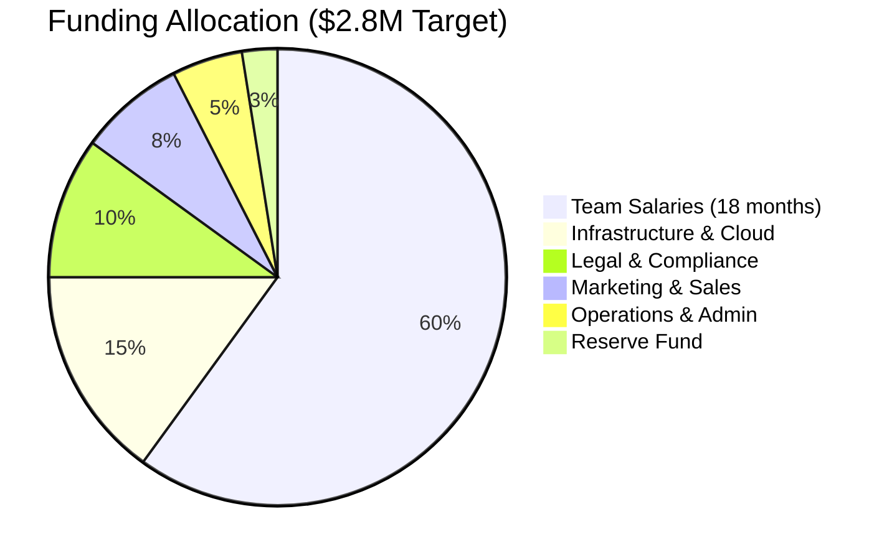
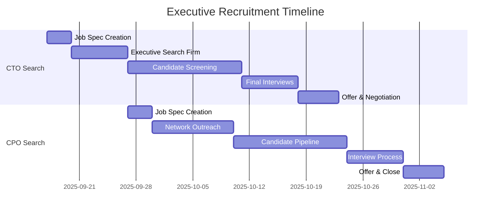
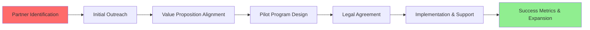
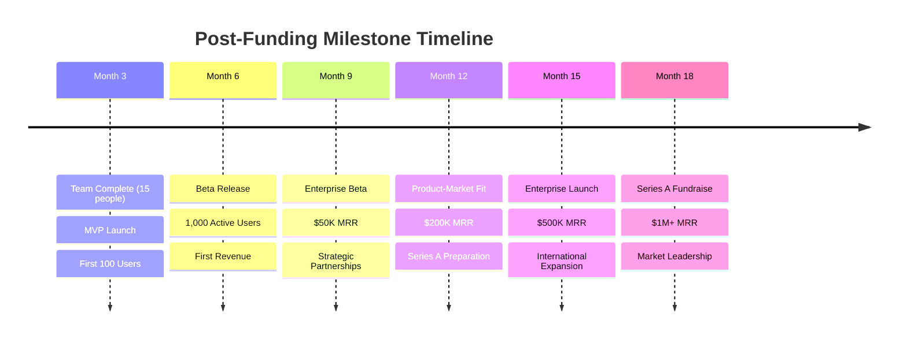

# 💰 Resource Acquisition Strategy - Ultra AI Platform

## 🎯 Executive Summary

Comprehensive strategy for securing the $2.5M-$3.5M seed funding, recruiting world-class talent, and establishing strategic partnerships needed to execute Ultra AI Platform development successfully.

## 💼 Investment Strategy

### Funding Requirements Breakdown



### Target Investor Profile

#### **Tier 1: Lead Investors ($1M - $1.5M)**
- **AI/ML Focused VCs**: Andreessen Horowitz (a16z), GV (Google Ventures), Intel Capital
- **Blockchain VCs**: Paradigm, Polychain Capital, CoinFund
- **Distributed Computing**: Protocol Labs, ConsenSys Ventures

#### **Tier 2: Strategic Angels ($100K - $500K)**
- **AI Industry Leaders**: Ex-OpenAI, DeepMind, Anthropic executives
- **Blockchain Pioneers**: Ethereum Foundation members, DeFi protocol founders
- **Enterprise Software**: Ex-Salesforce, Microsoft, Google Cloud executives

#### **Tier 3: Sector Experts ($25K - $100K)**
- **Academic Researchers**: ML professors, distributed systems experts
- **Technical Advisors**: Senior engineers from FAANG companies
- **Regulatory Experts**: Former SEC, CFTC officials for compliance guidance

### Investor Pitch Deck (15 Slides)

#### **Slide Structure & Key Messages**

```typescript
interface PitchDeckStructure {
  slides: [
    {
      title: "Cover Slide";
      content: "Ultra AI Platform - Democratizing AI Through Distributed Processing";
      duration: "30 seconds";
    },
    {
      title: "Problem Statement";
      content: "AI processing monopolized by Big Tech, barriers to innovation";
      keyStats: ["$150B AI market dominated by 5 companies", "87% of AI researchers lack computing resources"];
    },
    {
      title: "Solution Overview";
      content: "Distributed AI platform with natural language interface + blockchain rewards";
      demo: "Live processing demonstration";
    },
    {
      title: "Market Opportunity";
      content: "$47B distributed computing market + $23B AI-as-a-Service";
      growth: "42% CAGR through 2028";
    },
    {
      title: "Technology Architecture";
      content: "P2P network, privacy-first design, smart contract rewards";
      differentiators: ["End-to-end encryption", "Semantic chunking", "Reputation-based rewards"];
    },
    {
      title: "Business Model";
      content: "SaaS subscriptions + transaction fees + premium features";
      revenue: ["$29/month individual", "$199/month team", "2.5% network fees"];
    },
    {
      title: "Go-to-Market Strategy";
      content: "Developers → SMBs → Enterprise";
      channels: ["Developer community", "Partner integrations", "Direct sales"];
    },
    {
      title: "Competitive Landscape";
      content: "vs. AWS/GCP/Azure and decentralized competitors";
      advantages: ["Natural language interface", "Cost efficiency", "Privacy protection"];
    },
    {
      title: "Traction & Validation";
      content: "Technical POC + early user interest";
      metrics: ["3,000+ waitlist signups", "15+ enterprise inquiries", "Technical feasibility proven"];
    },
    {
      title: "Team & Advisors";
      content: "World-class AI, blockchain, and distributed systems expertise";
      credentials: "Previous exits, top-tier experience, domain expertise";
    },
    {
      title: "Financial Projections";
      content: "Path to $50M ARR by Year 3";
      milestones: ["$1M ARR by Month 18", "$10M ARR by Month 30", "$50M ARR by Month 42"];
    },
    {
      title: "Funding & Use of Funds";
      content: "$2.8M for 18-month runway to Series A";
      allocation: "60% team, 15% infrastructure, 10% legal, 15% growth";
    },
    {
      title: "Roadmap & Milestones";
      content: "Prototype → Beta → Enterprise launch";
      timeline: "6 months to beta, 12 months to enterprise-ready";
    },
    {
      title: "Investment Terms";
      content: "Series Seed, 18-month runway, proven team";
      valuation: "$12M-$15M pre-money valuation";
    },
    {
      title: "Call to Action";
      content: "Join us in democratizing AI access globally";
      nextSteps: "Due diligence, product demo, term sheet discussion";
    }
  ];
}
```

### Investment Memorandum Template

```markdown
# Ultra AI Platform - Investment Memorandum

## Investment Highlights

1. **Massive Market Opportunity**: $70B+ addressable market combining distributed computing and AI-as-a-Service
2. **Unique Value Proposition**: First natural language distributed AI platform with privacy-first design
3. **Strong Technical Foundation**: Proven algorithms, experienced team, validated architecture
4. **Clear Monetization Strategy**: Multiple revenue streams with strong unit economics
5. **Regulatory Advantage**: Proactive compliance approach for blockchain/AI intersection

## Key Investment Metrics

| Metric | Year 1 | Year 2 | Year 3 |
|--------|--------|--------|--------|
| **Revenue** | $1.2M | $8.5M | $35M |
| **Gross Margin** | 75% | 82% | 85% |
| **Monthly Growth** | 15% | 12% | 8% |
| **CAC/LTV Ratio** | 1:5 | 1:7 | 1:10 |
| **Team Size** | 15 | 45 | 85 |

## Risk Assessment & Mitigation

### Technical Risks
- **Risk**: Distributed processing complexity
- **Mitigation**: Proven P2P protocols, incremental rollout, expert advisors

### Market Risks
- **Risk**: Big Tech competition
- **Mitigation**: Privacy differentiation, developer-first approach, network effects

### Regulatory Risks
- **Risk**: Blockchain/AI compliance uncertainty
- **Mitigation**: Proactive legal counsel, regulatory sandboxes, compliance-first design

### Execution Risks
- **Risk**: Talent acquisition in competitive market
- **Mitigation**: Competitive packages, equity upside, mission-driven culture
```

## 👥 Team Recruitment Strategy

### Critical Hires (First 90 Days)

#### **C-Level Executives**

```typescript
interface ExecutiveHires {
  cto: {
    profile: "15+ years distributed systems experience";
    background: "Ex-FAANG senior engineering leadership";
    compensation: "$250K base + 2-4% equity";
    timeline: "Weeks 2-6";
    sources: ["Executive search firms", "Network referrals", "Conference speaking"];
  };
  
  cpo: {
    profile: "10+ years AI/ML product leadership";
    background: "Ex-OpenAI, Anthropic, or similar";
    compensation: "$200K base + 1-3% equity";
    timeline: "Weeks 4-8";
    sources: ["AI community", "Product leader networks", "Venture partner referrals"];
  };
  
  cfo: {
    profile: "High-growth SaaS + blockchain experience";
    background: "Series A-C experience, public company background";
    compensation: "$180K base + 0.5-1.5% equity";
    timeline: "Weeks 8-12";
    sources: ["CFO networks", "VC referrals", "Financial recruiting firms"];
  };
}
```

#### **Technical Leadership Team**

| Role | Profile | Compensation | Timeline | Key Responsibilities |
|------|---------|--------------|----------|---------------------|
| **Lead AI Engineer** | PhD ML/AI, 8+ years | $180K + 1-2% equity | Weeks 3-7 | AI model integration, research direction |
| **Lead Blockchain Engineer** | 5+ years DeFi/Web3 | $160K + 1-2% equity | Weeks 4-8 | Smart contracts, tokenomics, security |
| **DevOps/Infrastructure Lead** | K8s expert, cloud-native | $150K + 0.5-1% equity | Weeks 2-6 | Scalable infrastructure, monitoring |
| **Security Engineer** | Crypto + distributed systems | $170K + 0.5-1% equity | Weeks 6-10 | Privacy, encryption, threat modeling |
| **Frontend Lead** | React/TypeScript expert | $140K + 0.5-1% equity | Weeks 5-9 | User interface, developer experience |

### Recruitment Process & Timeline

#### **Phase 1: Executive Search (Weeks 1-8)**



#### **Recruitment Channel Strategy**

1. **Executive Search Firms**
   - **Technology**: Heidrick & Struggles, Egon Zehnder
   - **Blockchain**: Proof of Search, CryptoRecruit
   - **AI/ML**: Riviera Partners, Gradient Ventures

2. **Network & Referrals**
   - **Investor Networks**: Leverage VC partner connections
   - **Advisory Board**: Tap into advisor networks
   - **Alumni Networks**: University and company alumni groups

3. **Industry Events & Communities**
   - **AI Conferences**: NeurIPS, ICML, ICLR
   - **Blockchain Events**: ETHGlobal, Consensus, DevCon
   - **Developer Communities**: GitHub, Stack Overflow, Reddit

### Compensation Framework

#### **Equity Distribution Strategy**

```typescript
interface EquityAllocation {
  founders: {
    percentage: "60-70%";
    vesting: "4 years, 1-year cliff";
  };
  
  employees: {
    percentage: "15-20%";
    allocation: {
      executives: "8-12%";
      senior: "3-5%";
      mid: "1-2%";
      junior: "0.1-0.5%";
    };
  };
  
  advisors: {
    percentage: "2-4%";
    vesting: "2 years, quarterly";
  };
  
  optionPool: {
    percentage: "8-12%";
    reserved: "Future hires, performance bonuses";
  };
}
```

## 🤝 Strategic Partnerships

### Technology Partners

#### **Cloud Infrastructure Partners**
- **AWS**: Startup credits, technical support, co-marketing
- **Google Cloud**: AI/ML credits, enterprise introductions
- **Microsoft Azure**: Blockchain services, developer tools

#### **AI/ML Platform Integrations**
- **OpenAI**: API partnerships, integration support
- **Hugging Face**: Model marketplace, community access
- **LangChain**: Framework integration, joint development

#### **Blockchain Infrastructure**
- **Ethereum Foundation**: Grants, technical guidance
- **IPFS/Protocol Labs**: Storage solutions, network effects
- **Chainlink**: Oracle services, data feeds

### Business Development Pipeline

#### **Enterprise Pilot Program**

| Company Type | Target Partners | Value Proposition | Timeline |
|--------------|----------------|------------------|----------|
| **AI Startups** | 50+ companies | Cost-effective AI processing | Months 3-6 |
| **Research Institutions** | 25+ universities | Academic collaboration, grants | Months 4-8 |
| **Enterprise** | 10+ Fortune 500 | Privacy-compliant AI solutions | Months 6-12 |
| **Government** | 5+ agencies | Secure distributed processing | Months 9-15 |

### Partnership Development Process



## 📊 Investor Relations & Communication

### Investor Update Template

```markdown
# Ultra AI Platform - Monthly Investor Update

## Key Metrics Dashboard

| Metric | Current Month | Previous Month | % Change |
|--------|---------------|----------------|----------|
| **Monthly Recurring Revenue** | $X | $Y | Z% |
| **Active Users** | X | Y | Z% |
| **Network Nodes** | X | Y | Z% |
| **Processing Tasks/Month** | X | Y | Z% |
| **Team Size** | X | Y | Z |

## Highlights & Achievements
- [Key wins and milestones achieved]
- [Major product releases or features]
- [Strategic partnerships or customers]

## Challenges & Solutions
- [Current obstacles and mitigation strategies]
- [Resource needs and timeline adjustments]

## Financial Summary
- [Revenue performance vs. projections]
- [Burn rate and runway analysis]
- [Upcoming funding needs]

## Team Updates
- [New hires and departures]
- [Organizational changes]
- [Team development initiatives]

## Next Month Priorities
- [Top 3-5 focus areas]
- [Key deliverables and deadlines]
- [Support needed from investors]

## Ask from Investors
- [Specific help requests: intros, expertise, feedback]
```

### Investor Advisory Structure

#### **Board Composition (Post-Seed)**
- **2 Founder Representatives**
- **2 Investor Representatives** (Lead investors)
- **1 Independent Director** (Industry expert)

#### **Advisory Board Structure**
- **Technical Advisor**: Distributed systems expert
- **AI Advisor**: Former OpenAI/Anthropic executive
- **Blockchain Advisor**: DeFi protocol founder
- **Regulatory Advisor**: Former government official
- **Business Advisor**: Enterprise SaaS veteran

## 🎯 Success Metrics & Milestones

### Funding Success Criteria

#### **Seed Round Targets**
- **Amount**: $2.5M - $3.5M raised
- **Timeline**: 3-4 months from start
- **Valuation**: $12M - $18M pre-money
- **Investor Quality**: Tier 1 lead + strategic angels
- **Terms**: Standard Series Seed documents

#### **Post-Funding Milestones (18 Months)**



### Risk Management & Contingency Plans

#### **Funding Scenarios**

| Scenario | Probability | Amount | Strategy Adjustment |
|----------|-------------|--------|-------------------|
| **Oversubscribed** | 20% | $4M+ | Accelerated hiring, expanded scope |
| **Target Met** | 60% | $2.5-3.5M | Execute current plan |
| **Undersubscribed** | 15% | $1.5-2.5M | Focus on core features, lean team |
| **Funding Fail** | 5% | <$1M | Bootstrap, consulting revenue, pivot |

#### **Market Response Strategies**

- **Strong Competition**: Focus on privacy/decentralization advantages
- **Slow Adoption**: Pivot to enterprise-first strategy
- **Technical Challenges**: Bring in additional expertise, extend timeline
- **Regulatory Issues**: Engage compliance experts, modify approach

## 📞 Next Actions (Week 1)

### Immediate Priorities

1. **Finalize Investment Terms** (Day 1-3)
   - Set valuation range and funding target
   - Prepare term sheet template
   - Engage securities attorney

2. **Create Investor Materials** (Day 2-7)
   - Complete pitch deck design
   - Develop financial model
   - Prepare demo environment

3. **Begin Executive Search** (Day 3-10)
   - Engage executive search firms
   - Create detailed job specifications
   - Activate network for referrals

4. **Legal Structure Setup** (Day 1-5)
   - Incorporate entity (Delaware C-Corp)
   - Set up cap table management
   - Establish employee option pool

5. **Initial Investor Outreach** (Day 7-14)
   - Target list of 50+ investors
   - Warm introductions through network
   - Schedule first investor meetings

This comprehensive resource acquisition strategy provides the detailed roadmap for securing the funding, talent, and partnerships necessary to successfully execute Ultra AI Platform development and achieve market leadership in the distributed AI space.