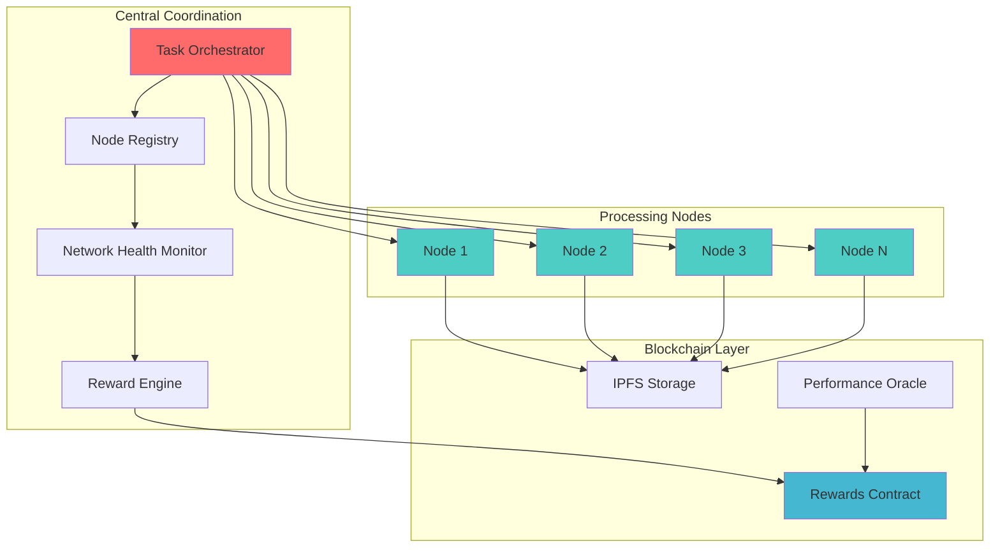
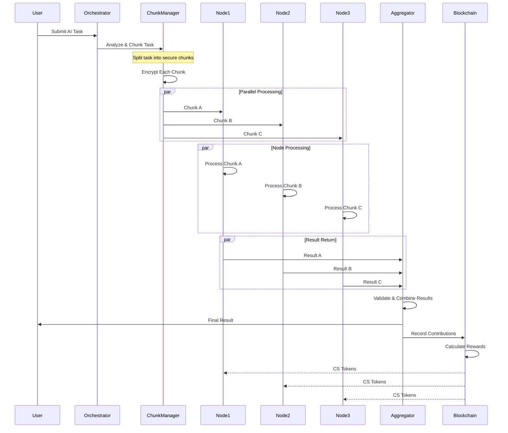
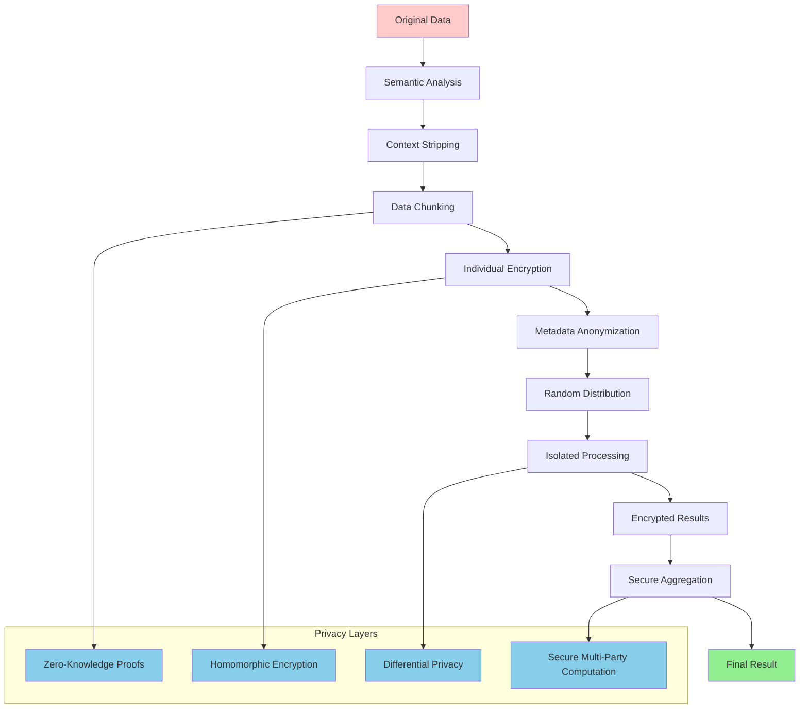
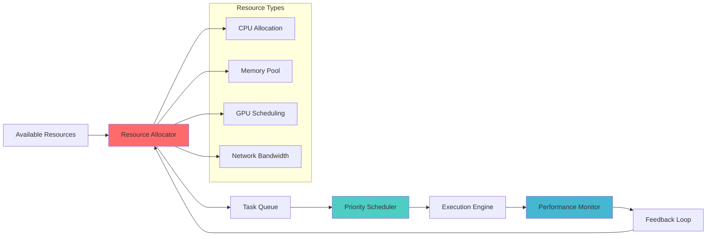
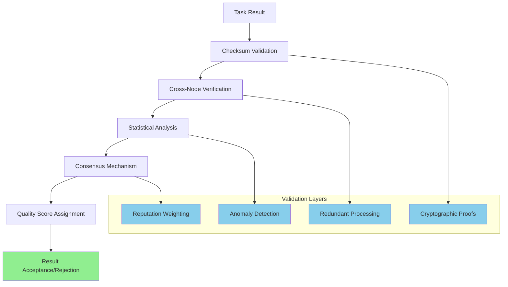
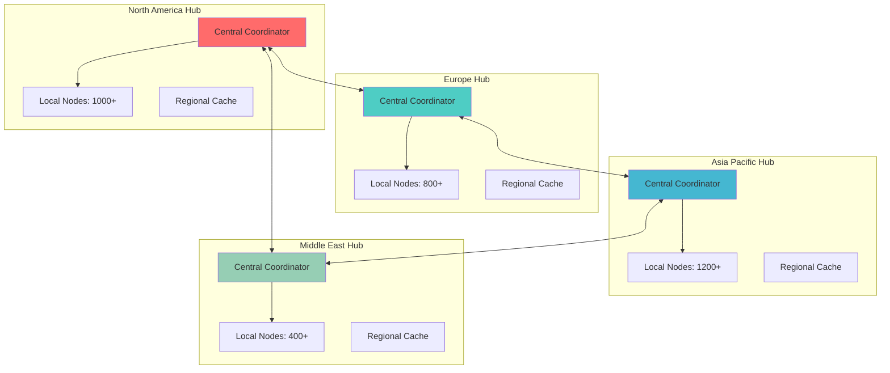

# 🌐 Distributed Processing Architecture - Ultra AI Platform

## 🎯 Overview

The distributed processing system is the core innovation of Ultra AI Platform. It leverages a volunteer user network to provide computational resources while ensuring privacy, security, and fair compensation through blockchain-based rewards.

## 🏗️ Architecture Components

### 1. Network Topology



### 2. Task Distribution Flow



## 🔒 Security & Privacy Model

### 1. Data Chunking Strategy

**Intelligent Chunking Algorithm**:

```typescript
interface ChunkingStrategy {
  type: 'semantic' | 'random' | 'functional';
  minChunkSize: number;
  maxChunkSize: number;
  overlapPercentage: number;
  redundancyFactor: number;
}

class SecureChunker {
  async chunkTask(task: AITask, strategy: ChunkingStrategy): Promise<Chunk[]> {
    const chunks = await this.analyzeAndSplit(task, strategy);
    return this.encryptChunks(chunks);
  }
  
  private async analyzeAndSplit(task: AITask, strategy: ChunkingStrategy): Promise<RawChunk[]> {
    switch (strategy.type) {
      case 'semantic':
        return this.semanticChunking(task);
      case 'random':
        return this.randomChunking(task);
      case 'functional':
        return this.functionalChunking(task);
    }
  }
  
  private async encryptChunks(chunks: RawChunk[]): Promise<Chunk[]> {
    return chunks.map(chunk => ({
      id: generateUniqueId(),
      data: encrypt(chunk.data, generateChunkKey()),
      metadata: this.sanitizeMetadata(chunk.metadata),
      checksum: calculateChecksum(chunk.data)
    }));
  }
}
```

### 2. Privacy Protection Layers



## 🖥️ Node Architecture

### 1. Processing Node Components

```typescript
interface ProcessingNode {
  id: string;
  capabilities: NodeCapabilities;
  resources: ResourceMetrics;
  reputation: ReputationScore;
  earnings: EarningsHistory;
}

interface NodeCapabilities {
  cpuCores: number;
  ramGB: number;
  storageGB: number;
  gpuAvailable: boolean;
  networkBandwidth: number;
  supportedModels: string[];
  specializations: string[];
}

class NodeManager {
  private nodeMetrics: ResourceMonitor;
  private taskProcessor: TaskProcessor;
  private communicationLayer: P2PConnection;
  
  async initialize(): Promise<void> {
    await this.registerWithNetwork();
    await this.startHealthReporting();
    await this.beginTaskListening();
  }
  
  async processChunk(chunk: EncryptedChunk): Promise<ProcessingResult> {
    const decryptedChunk = await this.secureDecrypt(chunk);
    const result = await this.taskProcessor.process(decryptedChunk);
    return this.encryptResult(result);
  }
}
```

### 2. Resource Management

**Dynamic Resource Allocation**:



## 💰 Rewards & Incentive System

### 1. Contribution Measurement

**Performance Metrics**:

```typescript
interface ContributionMetrics {
  tasksCompleted: number;
  averageProcessingTime: number;
  accuracyScore: number;
  uptimePercentage: number;
  networkContribution: number;
  uniqueCapabilities: string[];
}

class RewardCalculator {
  calculateReward(metrics: ContributionMetrics, taskComplexity: TaskComplexity): number {
    const baseReward = this.getBaseReward(taskComplexity);
    const performanceMultiplier = this.calculatePerformanceMultiplier(metrics);
    const bonusModifiers = this.calculateBonuses(metrics);
    
    return baseReward * performanceMultiplier * bonusModifiers;
  }
  
  private calculatePerformanceMultiplier(metrics: ContributionMetrics): number {
    const speedFactor = Math.min(metrics.averageProcessingTime / BASELINE_TIME, 2.0);
    const qualityFactor = metrics.accuracyScore / 100;
    const reliabilityFactor = metrics.uptimePercentage / 100;
    
    return (speedFactor * qualityFactor * reliabilityFactor);
  }
}
```

### 2. Smart Contract Architecture

**Ethereum Smart Contract for Rewards**:

```solidity
pragma solidity ^0.8.19;

contract UltraAIRewards {
    mapping(address => uint256) public nodeReputations;
    mapping(address => uint256) public nodeEarnings;
    mapping(bytes32 => TaskRecord) public taskRecords;
    
    struct TaskRecord {
        bytes32 taskId;
        address[] contributors;
        uint256[] contributions;
        uint256 totalReward;
        uint256 timestamp;
        bool distributed;
    }
    
    event RewardDistributed(
        bytes32 indexed taskId,
        address indexed node,
        uint256 reward,
        uint256 reputation
    );
    
    function distributeRewards(
        bytes32 taskId,
        address[] memory contributors,
        uint256[] memory contributions,
        uint256[] memory qualityScores
    ) external onlyOracle {
        require(contributors.length == contributions.length, "Invalid input");
        require(!taskRecords[taskId].distributed, "Already distributed");
        
        uint256 totalContribution = 0;
        for (uint i = 0; i < contributions.length; i++) {
            totalContribution += contributions[i];
        }
        
        for (uint i = 0; i < contributors.length; i++) {
            uint256 nodeReward = calculateNodeReward(
                contributions[i],
                totalContribution,
                qualityScores[i]
            );
            
            nodeEarnings[contributors[i]] += nodeReward;
            updateReputation(contributors[i], qualityScores[i]);
            
            emit RewardDistributed(taskId, contributors[i], nodeReward, nodeReputations[contributors[i]]);
        }
        
        taskRecords[taskId].distributed = true;
    }
}
```

## 🔄 Network Coordination

### 1. Task Orchestration

**Intelligent Task Distribution**:

```typescript
class TaskOrchestrator {
  private nodeRegistry: NodeRegistry;
  private loadBalancer: LoadBalancer;
  private qualityAssurance: QualityAssurance;
  
  async distributeTask(task: AITask): Promise<TaskExecution> {
    // 1. Analyze task requirements
    const requirements = await this.analyzeTaskRequirements(task);
    
    // 2. Select optimal nodes
    const selectedNodes = await this.selectOptimalNodes(requirements);
    
    // 3. Create execution plan
    const executionPlan = await this.createExecutionPlan(task, selectedNodes);
    
    // 4. Distribute chunks
    const execution = await this.executeDistributedTask(executionPlan);
    
    return execution;
  }
  
  private async selectOptimalNodes(requirements: TaskRequirements): Promise<ProcessingNode[]> {
    const availableNodes = await this.nodeRegistry.getAvailableNodes();
    
    return this.loadBalancer.selectNodes(availableNodes, {
      requiredCapabilities: requirements.capabilities,
      minimumReputation: requirements.minReputation,
      geographicDistribution: true,
      redundancyFactor: 1.5
    });
  }
}
```

### 2. Quality Assurance

**Multi-Layer Validation**:



## 📊 Performance Optimization

### 1. Network Efficiency

**Adaptive Load Balancing**:

```typescript
class AdaptiveLoadBalancer {
  private nodePerformanceHistory: Map<string, PerformanceHistory>;
  private networkLatencyMatrix: LatencyMatrix;
  
  async optimizeTaskDistribution(
    task: AITask,
    availableNodes: ProcessingNode[]
  ): Promise<OptimizedDistribution> {
    const predictions = await this.predictNodePerformance(availableNodes, task);
    const latencyConsiderations = await this.analyzeNetworkLatency(availableNodes);
    const costOptimization = await this.calculateCostEfficiency(availableNodes);
    
    return this.createOptimalDistribution({
      performancePredictions: predictions,
      latencyMatrix: latencyConsiderations,
      costEfficiency: costOptimization,
      redundancyRequirements: task.redundancyLevel
    });
  }
  
  private async predictNodePerformance(
    nodes: ProcessingNode[],
    task: AITask
  ): Promise<PerformancePrediction[]> {
    return nodes.map(node => ({
      nodeId: node.id,
      expectedProcessingTime: this.predictProcessingTime(node, task),
      reliabilityScore: this.calculateReliabilityScore(node),
      qualityPrediction: this.predictQualityScore(node, task)
    }));
  }
}
```

### 2. Caching & Optimization

**Intelligent Caching Strategy**:

```typescript
interface CacheStrategy {
  level: 'node' | 'network' | 'global';
  ttl: number;
  invalidationRules: string[];
  compressionEnabled: boolean;
}

class DistributedCache {
  private localCache: LRUCache;
  private networkCache: IPFSCache;
  private cacheStrategy: CacheStrategy;
  
  async getCachedResult(taskSignature: string): Promise<CachedResult | null> {
    // 1. Check local cache first
    const localResult = await this.localCache.get(taskSignature);
    if (localResult && !this.isExpired(localResult)) {
      return localResult;
    }
    
    // 2. Check distributed network cache
    const networkResult = await this.networkCache.get(taskSignature);
    if (networkResult && this.validateCacheEntry(networkResult)) {
      await this.localCache.set(taskSignature, networkResult);
      return networkResult;
    }
    
    return null;
  }
}
```

## 🌍 Global Network Topology

### 1. Geographic Distribution

**Multi-Region Architecture**:



### 2. Fault Tolerance

**Network Resilience Mechanisms**:

- **Redundant Processing**: Each critical task processed by 3+ nodes
- **Consensus Mechanisms**: Byzantine fault tolerance for result validation
- **Automatic Failover**: Seamless switching to backup nodes
- **Self-Healing Network**: Automatic detection and isolation of faulty nodes

## 📈 Scalability Planning

### Network Growth Projection

| Timeframe | Expected Nodes | Processing Capacity | Geographic Coverage |
|-----------|----------------|-------------------|-------------------|
| **Month 6** | 1,000 | 10,000 tasks/hour | 3 regions |
| **Month 12** | 5,000 | 100,000 tasks/hour | 5 regions |
| **Month 18** | 15,000 | 500,000 tasks/hour | 8 regions |
| **Month 24** | 50,000 | 2,000,000 tasks/hour | Global |

### Performance Targets

- **Network Latency**: < 100ms between any two nodes
- **Task Completion**: 95% of tasks completed within SLA
- **Network Uptime**: 99.9% availability
- **Reward Distribution**: < 1 hour delay for payments

---

**Next Documents**: [API Design](./api-design.md) | [Integration Patterns](./integration-patterns.md)