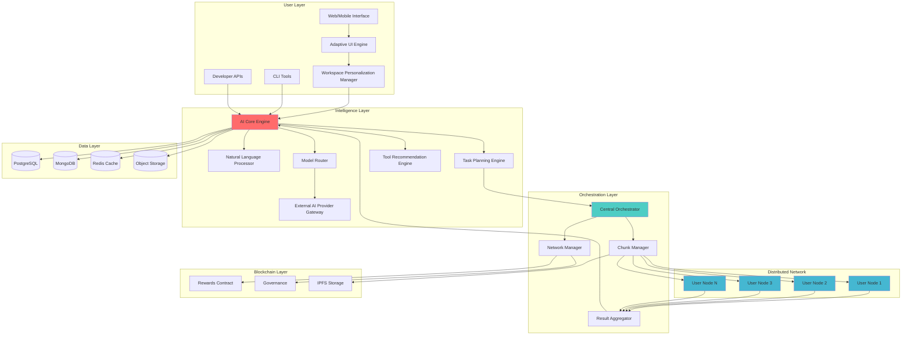
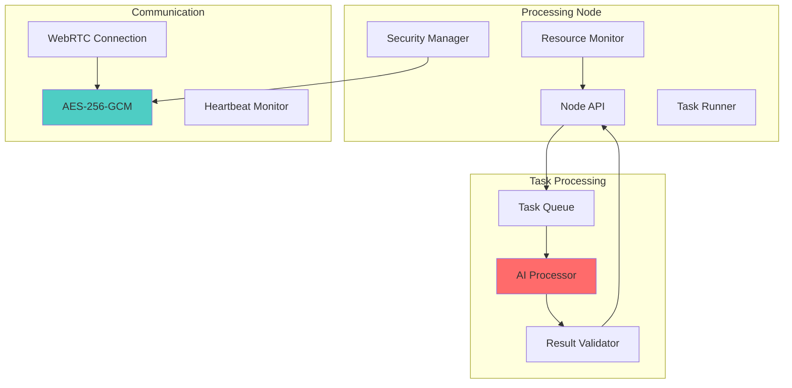
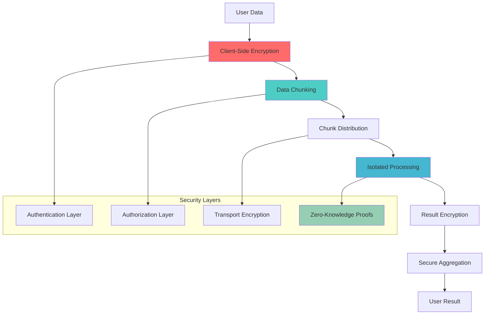
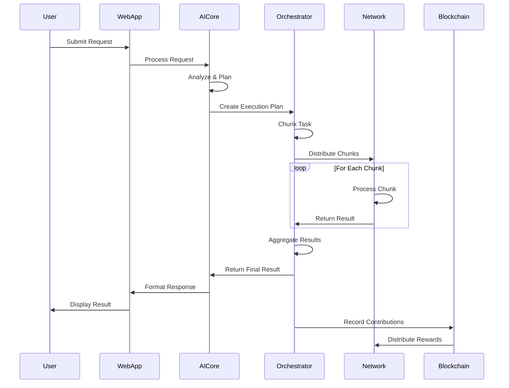
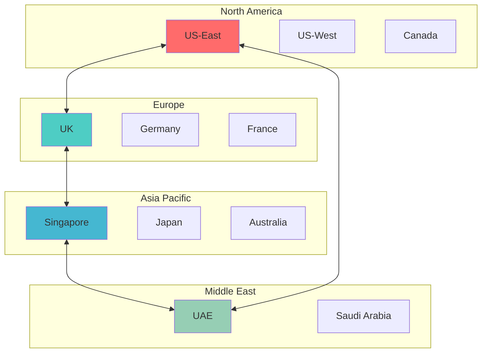

# 🏗️ System Architecture - Ultra AI Platform

## 🎯 Overview

Ultra AI Platform employs a revolutionary hybrid architecture combining centralized intelligence with distributed processing. This design ensures optimal performance, privacy protection, and cost efficiency while maintaining scalability and security.

## 🏛️ High-Level Architecture



## 🧠 Core Components

### 1. AI Core Engine

**Purpose**: Central intelligence hub that processes user requests and coordinates AI operations.

**Responsibilities**:
- Natural language understanding and intent recognition
- Task decomposition and planning
- Model selection and routing
- Multi-provider API orchestration with fallback
- Tool recommendation based on user domain and behavior
- Response generation and formatting

### Adaptive Interface Subsystem

**Purpose**: Build and evolve a personalized interface for each user profile while preserving user control.

**Capabilities**:
- Role-aware workspace generation (for example: video designer, developer, researcher)
- Interaction telemetry interpretation to optimize layout and shortcuts
- Manual customization support with pinned user preferences
- Safe rollback to previous workspace versions

```typescript
interface AdaptiveWorkspaceProfile {
  userId: string;
  role: 'video-designer' | 'developer' | 'researcher' | 'marketer' | 'custom';
  preferredTools: string[];
  layout: {
    sections: string[];
    pinnedWidgets: string[];
    density: 'compact' | 'balanced' | 'spacious';
  };
  adaptation: {
    enabled: boolean;
    lastUpdatedAt: string;
    confidence: number;
  };
  manualOverrides: Record<string, unknown>;
}
```

### Multi-Provider Model Gateway

**Purpose**: Connect Ultra AI to internal/external AI models and select the best provider per task.

```typescript
interface ModelGatewayPolicy {
  providers: Array<'openai' | 'anthropic' | 'local' | 'custom'>;
  routingMode: 'quality-first' | 'cost-first' | 'latency-first' | 'hybrid';
  fallbackOrder: string[];
  healthCheckIntervalMs: number;
  rateLimitBudgetPerUser: number;
}
```

**Technology Stack**:
- **Runtime**: Node.js with TypeScript
- **ML Framework**: TensorFlow.js, PyTorch (via Python bridge)
- **NLP**: Transformers.js, LangChain
- **Deployment**: Kubernetes pods with auto-scaling

```typescript
interface AICoreConfig {
  models: {
    primary: string;
    fallback: string[];
    specialization: Record<string, string>;
  };
  processing: {
    maxConcurrentTasks: number;
    timeoutMs: number;
    retryAttempts: number;
  };
  routing: {
    loadBalancing: 'round-robin' | 'weighted' | 'performance';
    healthCheckInterval: number;
  };
}
```

### 2. Distributed Processing Network

**Purpose**: Volunteer user network that provides computational resources for AI tasks.

**Architecture**:


**Node Requirements**:
- **Minimum**: 4GB RAM, 2 CPU cores, 10GB storage
- **Recommended**: 8GB RAM, 4 CPU cores, 50GB storage
- **Network**: Stable internet connection (10 Mbps+)

### 3. Security & Privacy Architecture

**Multi-Layer Security Model**:



## 🔧 Technical Specifications

### 1. API Architecture

**RESTful API Design**:
```yaml
endpoints:
  authentication:
    - POST /auth/login
    - POST /auth/refresh
    - DELETE /auth/logout
  
  ai:
    - POST /ai/chat
    - POST /ai/tasks
    - GET /ai/tasks/{id}
    - POST /ai/models/custom
  
  network:
    - GET /network/status
    - POST /network/join
    - GET /network/rewards
  
  user:
    - GET /user/profile
    - PUT /user/preferences
    - GET /user/activity
```

**GraphQL Schema**:
```graphql
type User {
  id: ID!
  email: String!
  preferences: UserPreferences!
  wallet: Wallet!
  contributions: [Contribution!]!
}

type Task {
  id: ID!
  type: TaskType!
  status: TaskStatus!
  chunks: [Chunk!]!
  result: String
  createdAt: DateTime!
}

type NetworkNode {
  id: ID!
  status: NodeStatus!
  performance: PerformanceMetrics!
  rewards: Float!
}
```

### 2. Data Flow Architecture



### 3. Performance Specifications

| Component | Target Metrics |
|-----------|---------------|
| **API Response Time** | < 200ms (95th percentile) |
| **Task Processing** | < 30 seconds (standard task) |
| **Network Latency** | < 100ms (node communication) |
| **Availability** | 99.9% uptime |
| **Throughput** | 1000+ concurrent tasks |
| **Scalability** | Linear scaling to 10,000+ nodes |

### 4. Deployment Architecture

**Kubernetes Configuration**:
```yaml
apiVersion: apps/v1
kind: Deployment
metadata:
  name: ultra-ai-core
spec:
  replicas: 3
  selector:
    matchLabels:
      app: ultra-ai-core
  template:
    metadata:
      labels:
        app: ultra-ai-core
    spec:
      containers:
      - name: ai-core
        image: ultra-ai/core:latest
        resources:
          requests:
            memory: "2Gi"
            cpu: "1000m"
          limits:
            memory: "4Gi"
            cpu: "2000m"
        env:
        - name: NODE_ENV
          value: "production"
        - name: DATABASE_URL
          valueFrom:
            secretKeyRef:
              name: db-secret
              key: url
```

## 🌐 Integration Patterns

### 1. Gata-OS Integration

**Secure API Bridge**:
```typescript
interface GataOSIntegration {
  authenticate(credentials: GataOSCredentials): Promise<AuthToken>;
  syncUserPreferences(userId: string): Promise<UserPreferences>;
  syncWorkspaces(userId: string): Promise<Workspace[]>;
  pushNotifications(notification: Notification): Promise<void>;
  requestSystemResources(request: ResourceRequest): Promise<ResourceAllocation>;
}
```

### 2. Third-Party AI Services

**Multi-Provider Support**:
```typescript
interface AIProvider {
  name: string;
  models: string[];
  endpoint: string;
  rateLimits: RateLimit;
  
  processRequest(request: AIRequest): Promise<AIResponse>;
  validateResponse(response: AIResponse): boolean;
  calculateCost(request: AIRequest): number;
}

class ProviderManager {
  private providers: Map<string, AIProvider> = new Map();
  
  async routeRequest(request: AIRequest): Promise<AIResponse> {
    const provider = this.selectOptimalProvider(request);
    return provider.processRequest(request);
  }
  
  private selectOptimalProvider(request: AIRequest): AIProvider {
    // Load balancing logic based on:
    // - Provider availability
    // - Model capabilities
    // - Cost optimization
    // - Performance metrics
  }
}
```

## 📊 Monitoring & Observability

### 1. Metrics Collection

**Key Performance Indicators**:
- Request latency (p50, p95, p99)
- Task success rate
- Network node availability
- Reward distribution accuracy
- Security incidents

**Monitoring Stack**:
- **Metrics**: Prometheus + Grafana
- **Logging**: ELK Stack (Elasticsearch, Logstash, Kibana)
- **Tracing**: Jaeger for distributed tracing
- **Alerts**: PagerDuty integration

### 2. Health Checks

```typescript
interface HealthCheck {
  component: string;
  status: 'healthy' | 'degraded' | 'unhealthy';
  lastCheck: Date;
  responseTime: number;
  details?: Record<string, any>;
}

class HealthMonitor {
  async checkSystemHealth(): Promise<HealthCheck[]> {
    return Promise.all([
      this.checkAICore(),
      this.checkDatabase(),
      this.checkNetwork(),
      this.checkBlockchain()
    ]);
  }
}
```

## 🚀 Scalability Strategy

### 1. Horizontal Scaling

**Auto-scaling Configuration**:
- **CPU Threshold**: Scale up at 70% CPU usage
- **Memory Threshold**: Scale up at 80% memory usage
- **Network Load**: Scale up at 1000+ concurrent connections
- **Response Time**: Scale up when p95 > 500ms

### 2. Geographic Distribution

**Multi-Region Deployment**:


## 📋 Implementation Phases

### Phase 1: Core Infrastructure (Months 1-3)
- ✅ Basic AI Core with single-provider support
- ✅ User authentication and management
- ✅ RESTful API foundation
- ✅ PostgreSQL database setup
- ✅ Basic web interface

### Phase 2: Distributed Network (Months 4-8)
- 🔄 Node network implementation
- 🔄 Task chunking and distribution
- 🔄 WebRTC communication layer
- 🔄 Basic reward system
- 🔄 Security implementation

### Phase 3: Advanced Features (Months 9-12)
- ⏳ Multi-provider AI routing
- ⏳ Gata-OS integration
- ⏳ Advanced analytics
- ⏳ Mobile applications
- ⏳ Enterprise features

---

**Next Documents**: [Distributed Processing Architecture](./distributed-processing.md) | [API Design](./api-design.md)