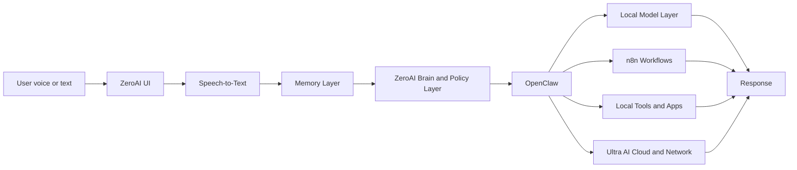

# ZeroAI and Ultra AI Integration Architecture

## Overview

ZeroAI is the local, WSL-based assistant layer that runs on the user's device.
Ultra AI is the broader network platform that provides distributed services, shared data flows, and remote escalation when local execution is not enough.

The combined system is designed around a clear edge-first rule:

- ZeroAI receives the user input first.
- ZeroAI resolves the request locally when possible.
- OpenClaw decides whether a task should stay local, invoke a local model, trigger a workflow, or escalate to Ultra AI.
- Ultra AI handles network-scale processing, cloud services, and distributed execution.

## Combined Flow

## Layer Responsibilities

| Layer | Responsibility | Primary Scope |
| --- | --- | --- |
| ZeroAI UI | Local control surface for the assistant | WSL device |
| Speech-to-Text | Convert speech to text locally | WSL device |
| Memory Layer | Store conversation state, preferences, and task history | Local-first with optional sync |
| Brain and Policy | Decide the next action and routing path | Local device |
| OpenClaw | Route requests to a local model, workflow, tool, or Ultra AI | Control plane |
| Local Model Layer | Run Ollama by default and AirLLM later for heavier workloads | Local inference |
| n8n | Execute repeatable automations and orchestration | Workflow backbone |
| Local Tools and Apps | Open files, launch apps, run local utilities | Device actions |
| Ultra AI Cloud and Network | Distributed and shared capabilities beyond the device | Network platform |

## Routing Rules

1. Use local execution first when the task is private, simple, or device-bound.
2. Use a local model when the task needs reasoning, generation, or summarization but does not require remote scale.
3. Use n8n when the task is a repeatable workflow or a chain of system actions.
4. Escalate to Ultra AI when the task requires distributed compute, shared services, or cloud-connected features.
5. Never bypass OpenClaw for direct model selection in the final system design.

## UI Model Options

ZeroAI should support one of two local UI strategies:

- Open WebUI as the primary local model interface.
- LocalAI as the local model serving and interface path when a lighter or more embedded option is preferred.

The final implementation can keep both documented, but the user-facing experience must stay under the ZeroAI control surface.

## Versioning Intent

- Ultra AI remains the network-platform release line.
- ZeroAI remains the local assistant release line.
- A merged documentation line will describe how the two systems evolve together.

This document is the source of truth for the edge-cloud relationship until implementation starts.
