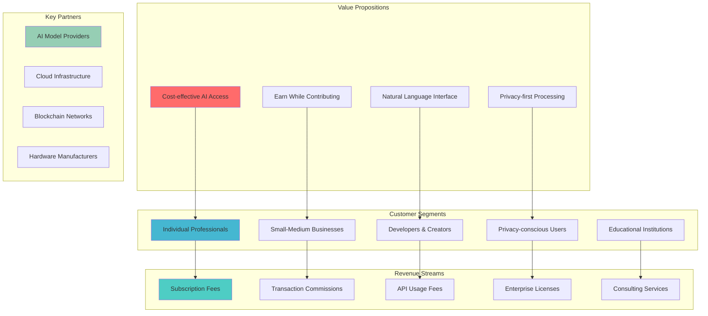
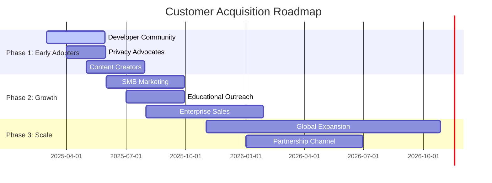
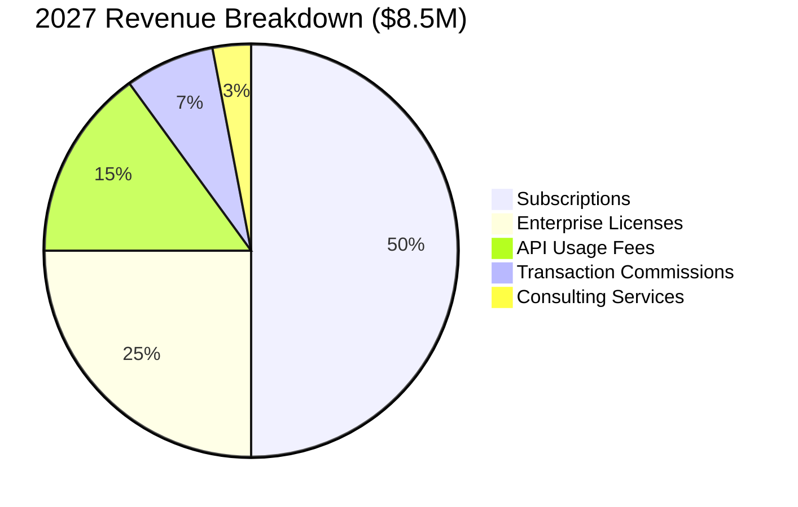
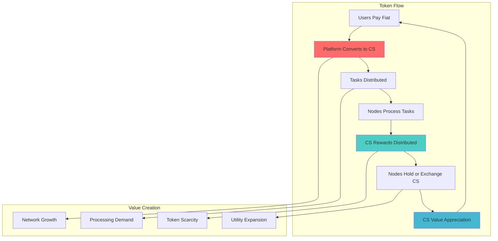
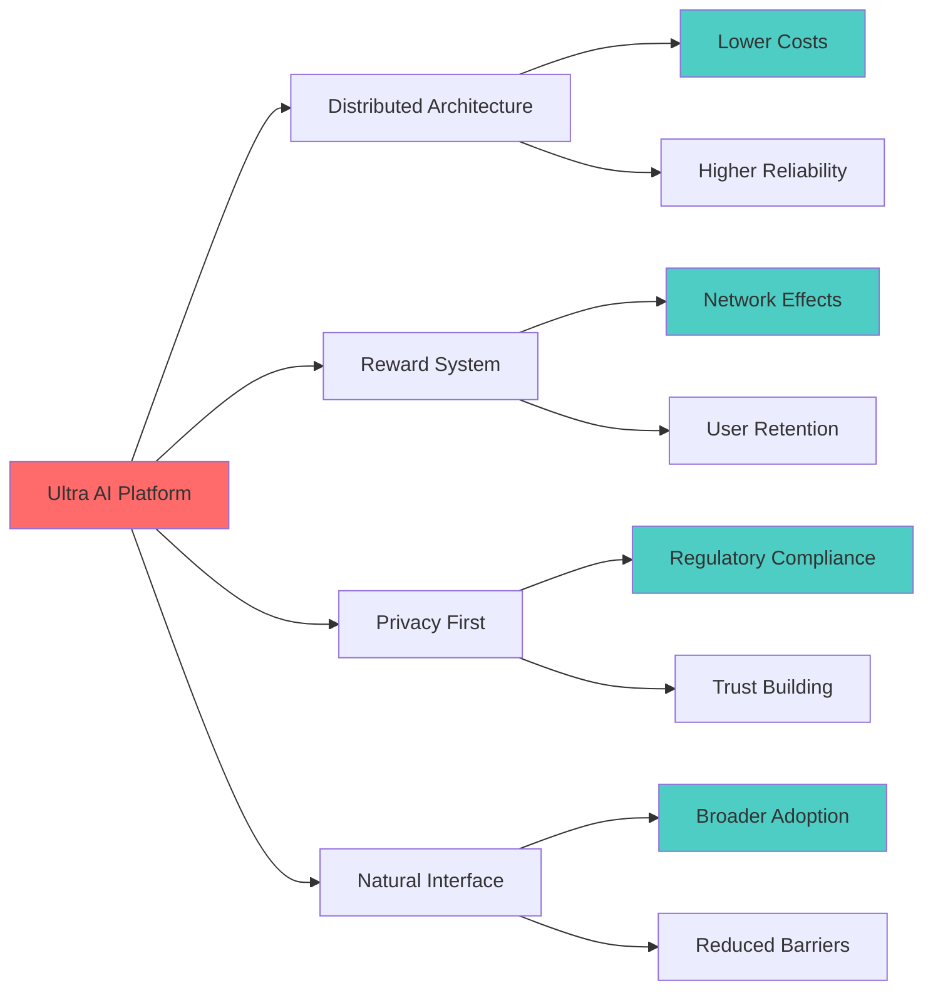
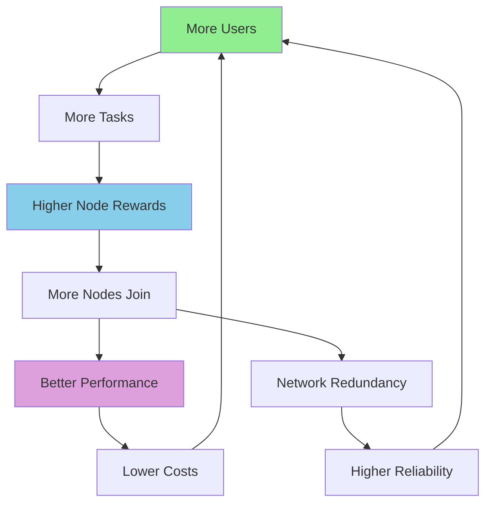

# 💼 Business Model - Ultra AI Platform

## 🎯 Executive Summary

Ultra AI Platform introduces a revolutionary business model combining AI-as-a-Service with decentralized computing and blockchain-based incentives. Our unique approach creates multiple revenue streams while providing users with cost-effective AI solutions and earning opportunities.

## 🏢 Business Model Canvas



## 💰 Revenue Model

### 1. Primary Revenue Streams

#### **Subscription Tiers**

| Tier | Price | Target Audience | Features |
|------|-------|----------------|----------|
| **Free** | $0/month | Individual Users | 100 tasks/month, Basic AI models |
| **Professional** | $29/month | Professionals | 2,000 tasks/month, Advanced models |
| **Business** | $99/month | Small Teams | 10,000 tasks/month, Team features |
| **Enterprise** | $299/month | Large Organizations | Unlimited tasks, Custom models |
| **Developer** | $49/month | Developers | API access, Custom integrations |

#### **Usage-Based Pricing**

```typescript
interface PricingModel {
  baseSubscription: number;
  additionalTasks: {
    simple: 0.01;     // $0.01 per task
    complex: 0.05;    // $0.05 per task
    premium: 0.10;    // $0.10 per task
  };
  apiCalls: {
    standard: 0.001;  // $0.001 per API call
    premium: 0.005;   // $0.005 per premium API call
  };
  dataProcessing: 0.02; // $0.02 per GB processed
}
```

### 2. Secondary Revenue Streams

#### **Network Economics**

- **Transaction Fees**: 2.5% commission on internal CS token transactions
- **Marketplace Commission**: 15% on AI model sales in the platform marketplace
- **Data Insights**: $0.10 per anonymized data point for research
- **Consulting Services**: $150-300/hour for implementation and optimization

#### **Partnership Revenue**

- **White-label Licensing**: $10,000-50,000 per enterprise license
- **Integration Partnerships**: Revenue sharing with major platforms
- **Hardware Partnerships**: Commission on recommended computing hardware

## 🎯 Customer Acquisition Strategy

### 1. Go-to-Market Timeline



### 2. Customer Acquisition Channels

#### **Digital Marketing**

- **Content Marketing**: Technical blogs, AI tutorials, privacy guides
- **SEO Strategy**: Target "decentralized AI", "privacy-first AI", "AI rewards"
- **Social Media**: Twitter, LinkedIn, Reddit (r/MachineLearning, r/privacy)
- **Influencer Partnerships**: AI researchers, privacy advocates, tech YouTubers

#### **Community Building**

- **Developer Program**: Early access, documentation, sample projects
- **Bug Bounty Program**: Security research rewards
- **Ambassador Program**: Community leaders promoting the platform
- **Open Source Initiatives**: Contributing to AI and blockchain projects

#### **Enterprise Sales**

```typescript
interface SalesStrategy {
  approach: 'consultative';
  cycle: '3-6 months';
  team: {
    salesReps: 5;
    solutionEngineers: 3;
    customerSuccess: 4;
  };
  channels: [
    'direct sales',
    'partner referrals',
    'conference networking',
    'webinar series'
  ];
}
```

## 📊 Financial Projections

### 1. 5-Year Revenue Forecast

| Year | Users | Revenue | Growth Rate |
|------|-------|---------|-------------|
| **2025** | 10,000 | $500K | - |
| **2026** | 50,000 | $2.5M | 400% |
| **2027** | 150,000 | $8.5M | 240% |
| **2028** | 400,000 | $25M | 194% |
| **2029** | 1,000,000 | $65M | 160% |

### 2. Revenue Composition Projection



### 3. Unit Economics

#### **Customer Acquisition Cost (CAC)**

| Segment | CAC | Payback Period | LTV/CAC Ratio |
|---------|-----|----------------|---------------|
| **Individual** | $25 | 2 months | 8:1 |
| **Professional** | $75 | 3 months | 12:1 |
| **Business** | $200 | 2 months | 15:1 |
| **Enterprise** | $2,000 | 6 months | 20:1 |

#### **Customer Lifetime Value (LTV)**

```typescript
interface LTVCalculation {
  individualUser: {
    averageRevenue: 15;      // $15/month
    churnRate: 0.05;         // 5% monthly
    ltv: 200;                // $200 LTV
  };
  businessUser: {
    averageRevenue: 150;     // $150/month
    churnRate: 0.02;         // 2% monthly
    ltv: 3000;               // $3,000 LTV
  };
  enterpriseUser: {
    averageRevenue: 1500;    // $1,500/month
    churnRate: 0.01;         // 1% monthly
    ltv: 40000;              // $40,000 LTV
  };
}
```

## 🔄 Network Economics & Token Model

### 1. CS Token Ecosystem



### 2. Token Economics

#### **Token Distribution**

- **Network Rewards**: 40% (400M CS tokens)
- **Platform Development**: 25% (250M CS tokens)
- **Team & Advisors**: 15% (150M CS tokens)
- **Community Incentives**: 10% (100M CS tokens)
- **Strategic Reserves**: 10% (100M CS tokens)

#### **Reward Mechanism**

```solidity
// Simplified reward calculation
function calculateReward(
    uint256 taskComplexity,
    uint256 processingTime,
    uint256 qualityScore,
    uint256 nodeReputation
) public pure returns (uint256) {
    uint256 baseReward = taskComplexity * BASE_RATE;
    uint256 speedBonus = baseReward * SPEED_MULTIPLIER / processingTime;
    uint256 qualityBonus = baseReward * qualityScore / 100;
    uint256 reputationBonus = baseReward * nodeReputation / 1000;
    
    return baseReward + speedBonus + qualityBonus + reputationBonus;
}
```

## 🏆 Competitive Positioning

### 1. Unique Value Propositions

#### **For Individual Users**

- **Cost Savings**: 60-80% cheaper than traditional AI services
- **Privacy Protection**: Data never stored in centralized servers
- **Earning Opportunity**: Generate passive income through contribution
- **Natural Interface**: No technical expertise required

#### **For Businesses**

- **Scalable Costs**: Pay only for actual usage
- **Data Sovereignty**: Full control over sensitive business data
- **Custom Solutions**: Tailored AI models for specific use cases
- **Compliance Ready**: Built-in privacy and security controls

#### **For Developers**

- **Open Ecosystem**: Contribute models and earn revenue
- **Flexible APIs**: Easy integration with existing systems
- **No Vendor Lock-in**: Portable AI solutions
- **Community Support**: Active developer community

### 2. Competitive Advantages



## 📈 Growth Strategy

### 1. Network Effects Strategy

#### **Virtuous Growth Cycle**



### 2. Partnership Strategy

#### **Strategic Partnerships**

- **AI Research Labs**: Collaborate on cutting-edge models
- **Cloud Providers**: Hybrid deployment options
- **Hardware Vendors**: Optimized computing solutions
- **Enterprise Software**: Integration partnerships
- **Educational Institutions**: Research and development collaborations

#### **Channel Partners**

- **System Integrators**: Implementation and consulting services
- **Reseller Network**: Geographic expansion
- **Technology Partners**: Complementary solution providers

## 🎯 Success Metrics & KPIs

### 1. Business Metrics

| Category | Metric | Target (Year 2) |
|----------|--------|-----------------|
| **Growth** | Monthly Active Users | 50,000 |
| **Revenue** | Annual Recurring Revenue | $2.5M |
| **Efficiency** | Customer Acquisition Cost | <$100 |
| **Retention** | Monthly Churn Rate | <3% |
| **Network** | Active Processing Nodes | 5,000 |

### 2. Network Health Metrics

- **Node Utilization Rate**: 70%+
- **Task Completion Rate**: 98%+
- **Average Response Time**: <200ms
- **Network Uptime**: 99.9%+
- **Token Velocity**: 0.5-1.0 monthly

## 🔮 Future Opportunities

### 1. Product Extensions

- **Ultra AI Assistant**: Personalized AI companions
- **Enterprise AI Platform**: White-label solutions
- **AI Model Marketplace**: Third-party model integration
- **IoT Integration**: Edge AI processing
- **Specialized Verticals**: Healthcare, finance, education

### 2. Market Expansion

- **Geographic**: Asia-Pacific, Latin America, Africa
- **Vertical**: Healthcare, legal, creative industries
- **Demographic**: Students, researchers, small businesses
- **Use Cases**: Real-time translation, content creation, data analysis

---

**Next Documents**: [Go-to-Market Strategy](./go-to-market.md) | [Financial Projections](./financial-projections.md)