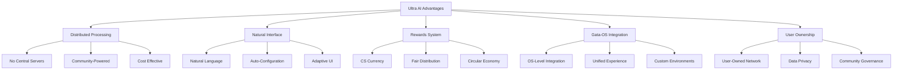
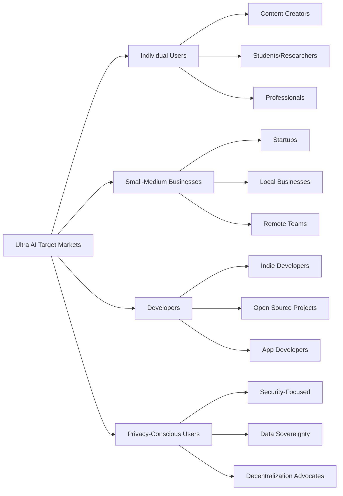

# 🏆 Competitive Analysis - Ultra AI Platform

## 📊 Market Overview

The AI platform market is rapidly evolving with several major players. Understanding our competitive landscape is crucial for positioning Ultra AI Platform effectively.

## 🔍 Direct Competitors

### 1. **OpenAI Platform (ChatGPT Plus/Enterprise)**

**Strengths:**
- Market leader with strong brand recognition
- Advanced language models (GPT-4, GPT-4 Turbo)
- Large developer ecosystem
- Enterprise integrations

**Weaknesses:**
- Centralized architecture (single point of failure)
- High costs for enterprise usage
- Limited customization options
- No distributed processing
- No user rewards system

**Market Position:** Dominant leader, 100M+ users

---

### 2. **Anthropic (Claude)**

**Strengths:**
- Focus on AI safety and ethics
- Strong reasoning capabilities
- Context length advantages
- Enterprise features

**Weaknesses:**
- Smaller market share
- Limited integration ecosystem
- Centralized infrastructure
- No distributed or decentralized features

**Market Position:** Growing challenger, 10M+ users

---

### 3. **Google Bard/Gemini**

**Strengths:**
- Integration with Google ecosystem
- Real-time information access
- Free tier availability
- Strong technical backing

**Weaknesses:**
- Late to market
- Privacy concerns
- Centralized architecture
- Limited enterprise adoption

**Market Position:** Tech giant challenger, 50M+ users

---

### 4. **Microsoft Copilot**

**Strengths:**
- Deep integration with Microsoft products
- Enterprise-focused features
- Strong developer tools
- Office 365 integration

**Weaknesses:**
- Limited to Microsoft ecosystem
- Centralized processing
- High enterprise costs
- No user-owned network

**Market Position:** Enterprise-focused, 30M+ users

## 🚀 Indirect Competitors

### Distributed Computing Platforms
- **Golem Network**: Distributed computing but not AI-focused
- **iExec**: Decentralized cloud computing
- **Akash Network**: Decentralized cloud infrastructure

### AI Development Platforms
- **Hugging Face**: Model sharing and deployment
- **Replicate**: API for AI models
- **Modal**: Cloud functions for AI

## 💎 Ultra AI Competitive Advantages

### 🌟 **Unique Differentiators**

### 1. **Revolutionary Architecture**
- **Decentralized Processing**: Unlike all competitors who rely on centralized servers
- **User-Powered Network**: Community contributes and benefits
- **No Single Point of Failure**: Distributed resilience

### 2. **Economic Innovation**
- **CS Rewards System**: Users earn while contributing
- **Lower Operational Costs**: No massive server farms
- **Sustainable Model**: Community-driven economics

### 3. **Superior User Experience**
- **Natural Conversation**: No need to learn complex prompts
- **Adaptive Interface**: Personalizes to user needs
- **Gata-OS Integration**: Seamless OS-level experience

## 📈 Market Positioning Strategy

### 🎯 **Target Market Segments**

### **Positioning Statement**
> "Ultra AI is the first community-owned AI platform that democratizes artificial intelligence through distributed processing, natural interaction, and fair rewards - making advanced AI accessible, affordable, and community-driven."

## 🛡️ Competitive Defense Strategy

### **Short-term (6-12 months)**
1. **Build Strong Community**: Early adopter program with attractive rewards
2. **Prove Technical Feasibility**: Demonstrate distributed processing works
3. **Create Switching Costs**: Integrate deeply with user workflows

### **Medium-term (1-2 years)**
1. **Network Effects**: More users = better performance and rewards
2. **Ecosystem Development**: Third-party integrations and tools
3. **Brand Building**: Establish as the "people's AI platform"

### **Long-term (2+ years)**
1. **Global Presence**: Expand to underserved markets
2. **Innovation Leadership**: Continue pushing distributed AI boundaries
3. **Community Governance**: Transition to community-owned platform

## 📊 Competitive Analysis Matrix

| Feature | Ultra AI | OpenAI | Anthropic | Google | Microsoft |
|---------|----------|---------|-----------|---------|-----------|
| **Architecture** | Distributed | Centralized | Centralized | Centralized | Centralized |
| **User Rewards** | ✅ CS Currency | ❌ | ❌ | ❌ | ❌ |
| **Natural Interface** | ✅ Adaptive | ⚠️ Limited | ⚠️ Limited | ⚠️ Limited | ⚠️ Limited |
| **Privacy** | ✅ Distributed | ⚠️ Centralized | ⚠️ Centralized | ❌ Data Mining | ⚠️ Enterprise |
| **Cost** | 💰 Low (Community) | 💰💰💰 High | 💰💰 Medium | 💰 Low (Limited) | 💰💰💰 High |
| **Customization** | ✅ Full | ⚠️ Limited | ⚠️ Limited | ❌ Minimal | ⚠️ Limited |
| **Enterprise** | 🔄 Planned | ✅ Strong | ✅ Growing | ⚠️ Limited | ✅ Strong |
| **Developer Tools** | 🔄 Planned | ✅ Excellent | ⚠️ Good | ⚠️ Good | ✅ Excellent |

## 🎯 Go-to-Market Differentiation

### **Primary Messages**
1. **"AI by the people, for the people"** - Community-owned alternative
2. **"Earn while you use"** - Unique rewards system
3. **"Privacy by design"** - Distributed processing protects data
4. **"Naturally intelligent"** - No complex prompts needed

### **Target Early Adopters**
- Blockchain and crypto enthusiasts
- Privacy advocates and digital rights supporters
- Open source developers and contributors
- Small businesses seeking cost-effective AI
- Users frustrated with big tech platforms

## 🔮 Future Competitive Threats

### **Potential Responses from Competitors**
1. **Price Wars**: Big tech could subsidize AI services
2. **Acquisition Attempts**: Try to buy Ultra AI or key team members
3. **Feature Copying**: Attempt to replicate distributed model
4. **Regulatory Pressure**: Use influence to create unfavorable regulations

### **Mitigation Strategies**
1. **Community Ownership**: Make acquisition difficult through decentralization
2. **Patent Protection**: Secure key innovations where possible
3. **Regulatory Engagement**: Advocate for fair competition policies
4. **Technical Moats**: Maintain innovation advantage through R&D

---

**Analysis Date**: September 17, 2025  
**Next Review**: October 17, 2025  
**Analyst**: Ultra Cube Tech Strategic Team
