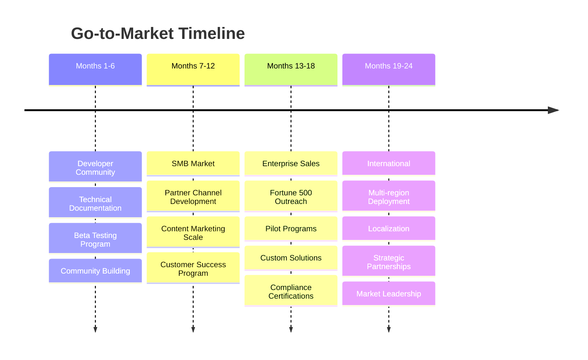
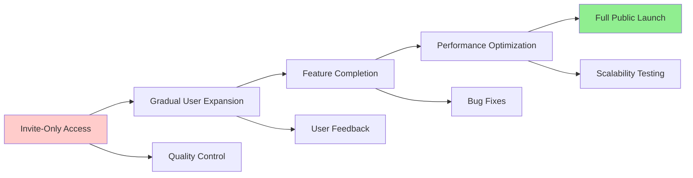
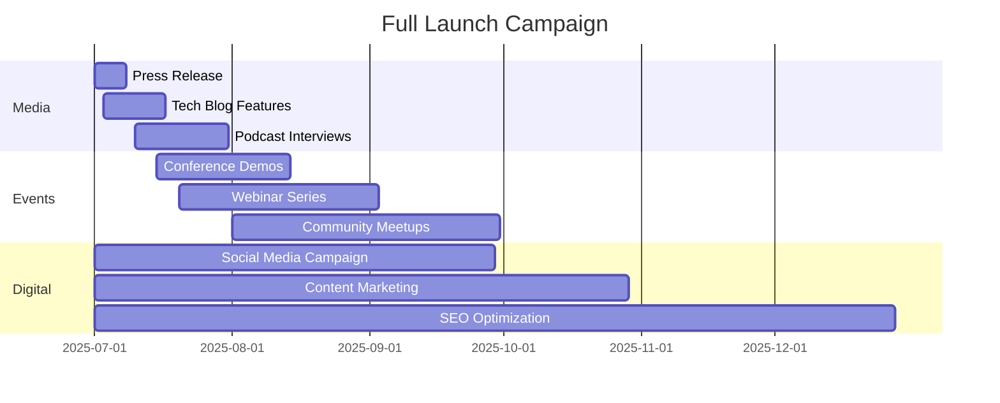
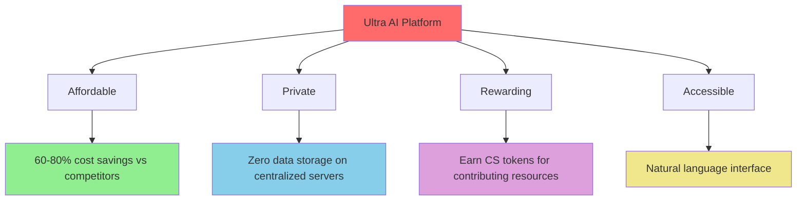
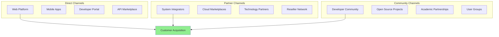
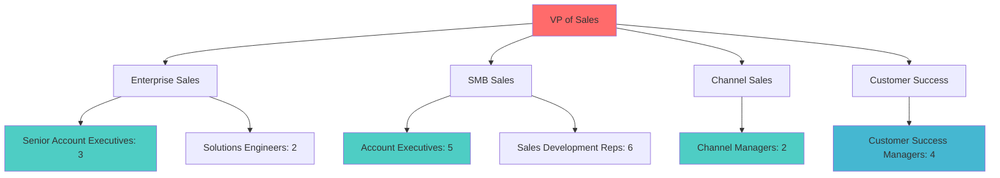
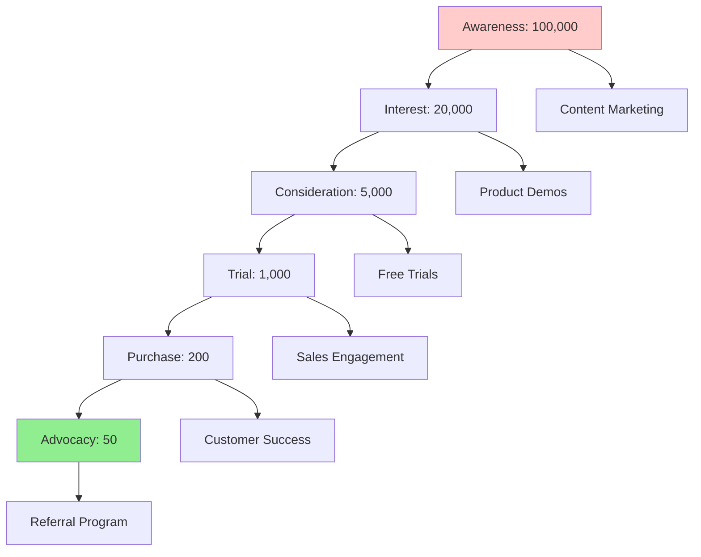
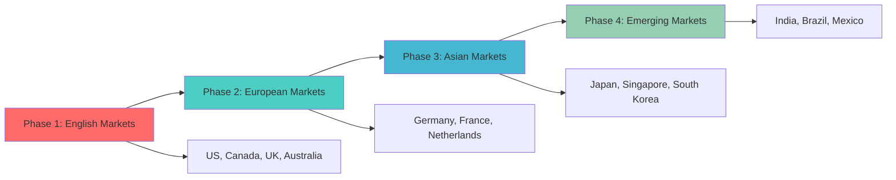

# 🚀 Go-to-Market Strategy - Ultra AI Platform

## 🎯 Market Entry Strategy

### 1. Phased Market Approach



### 2. Market Segmentation & Targeting

#### **Primary Target: Developer & Tech-Savvy Users**

**Profile**:
- Software developers, data scientists, AI researchers
- Early adopters of new technologies
- Privacy-conscious professionals
- Blockchain and cryptocurrency enthusiasts

**Value Proposition**:
- Access to cutting-edge AI models
- Earn rewards for contributing compute power
- Full control over data and privacy
- Developer-friendly APIs and tools

**Go-to-Market Tactics**:
- GitHub community engagement
- Technical blog posts and tutorials
- Developer conference presence
- Open source project contributions

## 📊 Customer Segmentation Strategy

### 1. Segment Profiles & Strategies

```mermaid
graph TB
    subgraph "Individual Professionals"
        A1[Content Creators]
        A2[Freelancers]
        A3[Students/Researchers]
        A4[Privacy Advocates]
    end
    
    subgraph "Small-Medium Business"
        B1[Startups]
        B2[Digital Agencies]
        B3[Consulting Firms]
        B4[E-commerce]
    end
    
    subgraph "Enterprise"
        C1[Fortune 500]
        C2[Government]
        C3[Healthcare]
        C4[Financial Services]
    end
    
    subgraph "Developers"
        D1[AI/ML Engineers]
        D2[App Developers]
        D3[Platform Builders]
        D4[Research Teams]
    end
    
    A1 --> E[Cost-Effective AI Tools]
    B1 --> F[Scalable AI Solutions]
    C1 --> G[Enterprise AI Platform]
    D1 --> H[Developer Tools & APIs]
    
    style A1 fill:#ff6b6b
    style B1 fill:#4ecdc4
    style C1 fill:#45b7d1
    style D1 fill:#96ceb4
```



### 2. Detailed Segment Analysis

#### **Segment 1: Individual Professionals (40% of initial focus)**

| Aspect | Details |
|--------|---------|
| **Size** | 50M+ knowledge workers globally |
| **Pain Points** | High AI subscription costs, limited customization |
| **Budget** | $20-100/month for productivity tools |
| **Decision Factors** | Cost, ease of use, privacy |
| **Acquisition Strategy** | Content marketing, social media, referrals |
| **Success Metrics** | User activation rate, monthly retention |

#### **Segment 2: Small-Medium Businesses (35% of initial focus)**

| Aspect | Details |
|--------|---------|
| **Size** | 400M+ SMBs worldwide |
| **Pain Points** | Enterprise-level costs, technical complexity |
| **Budget** | $500-5,000/month for business tools |
| **Decision Factors** | ROI, scalability, support quality |
| **Acquisition Strategy** | Partner channels, case studies, trials |
| **Success Metrics** | Customer acquisition cost, lifetime value |

## 🎪 Launch Strategy

### 1. Pre-Launch Phase (Months 1-3)

#### **Community Building**
```typescript
interface PreLaunchStrategy {
  community: {
    discord: "Ultra AI Developers";
    telegram: "Ultra AI Community";
    reddit: "r/UltraAI";
    twitter: "@UltraAI_Platform";
  };
  
  content: {
    techBlog: "Weekly AI & Blockchain insights";
    documentation: "Comprehensive developer guides";
    tutorials: "Step-by-step implementation guides";
    webinars: "Monthly technical deep-dives";
  };
  
  partnerships: {
    aiResearch: "Collaboration with AI labs";
    blockchainProjects: "Integration partnerships";
    developerTools: "IDE and framework integrations";
    cloudProviders: "Infrastructure partnerships";
  };
}
```

#### **Beta Testing Program**

- **Developer Beta**: 500 early developer accounts
- **Business Beta**: 50 SMB pilot programs
- **Feedback Collection**: Structured feedback loops
- **Product Iteration**: Weekly updates based on feedback

### 2. Soft Launch Phase (Months 4-6)

#### **Limited Public Availability**



**Launch Metrics**:
- **User Growth**: 100 new users/week
- **Task Processing**: 10,000 tasks/day
- **Network Nodes**: 200 active contributors
- **User Satisfaction**: NPS >40

### 3. Full Launch Phase (Months 7-9)

#### **Public Release Campaign**

**Marketing Channels**:
- **Tech Media**: TechCrunch, VentureBeat, Ars Technica
- **Social Media**: Twitter, LinkedIn, Reddit campaigns
- **Influencer Partnerships**: AI researchers, tech YouTubers
- **Conference Presence**: AI conferences, blockchain events

**Launch Timeline**:


## 📱 Marketing Mix Strategy

### 1. Product Strategy

#### **Core Product Features**
- Natural language AI interface
- Distributed processing network
- Blockchain reward system
- Privacy-first architecture

#### **Product Positioning**


### 2. Pricing Strategy

#### **Market Penetration Pricing**
- **Freemium Model**: Generous free tier to drive adoption
- **Competitive Pricing**: 40-60% below major competitors
- **Value-Based Pricing**: Enterprise tiers based on value delivered

#### **Dynamic Pricing Model**
```typescript
interface PricingStrategy {
  market: 'penetration';
  model: 'freemium';
  
  tiers: {
    free: {
      price: 0;
      limitations: ['100 tasks/month', 'basic models only'];
      purpose: 'user acquisition';
    };
    
    professional: {
      price: 29;
      competitorPrice: 50;
      discount: '42% savings';
      features: ['2000 tasks/month', 'advanced models'];
    };
    
    enterprise: {
      price: 'custom';
      model: 'value-based';
      factors: ['usage volume', 'custom features', 'SLA requirements'];
    };
  };
}
```

### 3. Distribution Strategy

#### **Multi-Channel Approach**



#### **Channel Strategy by Segment**

| Segment | Primary Channel | Secondary Channel | Channel Mix |
|---------|----------------|-------------------|-------------|
| **Developers** | Developer Portal (60%) | Community (40%) | Direct + Community |
| **SMB** | Web Platform (50%) | Partners (50%) | Balanced |
| **Enterprise** | Direct Sales (70%) | Partners (30%) | Sales-led |
| **Individual** | Web Platform (80%) | Referrals (20%) | Self-service |

### 4. Promotion Strategy

#### **Content Marketing Strategy**

```typescript
interface ContentStrategy {
  blog: {
    frequency: "3 posts/week";
    topics: [
      "AI democratization",
      "Privacy in AI",
      "Blockchain technology",
      "Distributed computing",
      "User success stories"
    ];
    seoTargets: [
      "decentralized AI",
      "privacy-first AI",
      "AI rewards platform",
      "distributed AI processing"
    ];
  };
  
  socialMedia: {
    twitter: "Daily updates, tech news, community highlights";
    linkedin: "B2B content, thought leadership, partnerships";
    youtube: "Technical tutorials, product demos, interviews";
    reddit: "Community engagement, AMA sessions";
  };
  
  developer: {
    documentation: "Comprehensive API docs and guides";
    github: "Open source tools and sample projects";
    conferences: "Speaking engagements and booth presence";
    hackathons: "Sponsorship and challenge creation";
  };
}
```

#### **Influencer & Partnership Marketing**

**Key Influencer Categories**:
- AI researchers and academics
- Privacy advocates and cybersecurity experts
- Blockchain developers and enthusiasts
- Tech YouTubers and podcast hosts

**Partnership Types**:
- **Technology Integrations**: IDE plugins, cloud platform integrations
- **Co-marketing**: Joint webinars, content collaborations
- **Channel Partnerships**: Reseller and referral programs
- **Strategic Alliances**: Major cloud providers, enterprise software vendors

## 🎯 Sales Strategy

### 1. Sales Organization

#### **Sales Team Structure**



#### **Sales Process & Methodology**

**Enterprise Sales Process**:
1. **Lead Qualification** (BANT criteria)
2. **Discovery Call** (pain points, technical requirements)
3. **Technical Demo** (customized to use case)
4. **Pilot Program** (30-day proof of concept)
5. **Commercial Negotiation** (pricing, terms, SLA)
6. **Implementation** (technical integration)
7. **Success Measurement** (ROI validation)

### 2. Customer Acquisition Funnel



**Conversion Metrics**:
- **Awareness to Interest**: 20%
- **Interest to Consideration**: 25%
- **Consideration to Trial**: 20%
- **Trial to Purchase**: 20%
- **Purchase to Advocacy**: 25%

## 📊 Performance Metrics & KPIs

### 1. Marketing Metrics

| Category | Metric | Target (Month 12) |
|----------|--------|-------------------|
| **Awareness** | Brand Search Volume | 50,000/month |
| **Traffic** | Website Visitors | 100,000/month |
| **Conversion** | Signup Rate | 8% |
| **Engagement** | Monthly Active Users | 25,000 |
| **Viral** | Referral Rate | 15% |

### 2. Sales Metrics

| Category | Metric | Target (Month 12) |
|----------|--------|-------------------|
| **Pipeline** | Qualified Leads | 500/month |
| **Conversion** | Lead to Customer | 10% |
| **Revenue** | Monthly Recurring Revenue | $200K |
| **Growth** | Month-over-Month Growth | 15% |
| **Efficiency** | Sales Cycle Length | 45 days (SMB) |

### 3. Customer Success Metrics

| Category | Metric | Target |
|----------|--------|---------|
| **Retention** | Monthly Churn Rate | <3% |
| **Satisfaction** | Net Promoter Score | >50 |
| **Expansion** | Revenue Growth Rate | 120% |
| **Support** | First Response Time | <2 hours |
| **Adoption** | Feature Adoption Rate | >70% |

## 🌍 Geographic Expansion Strategy

### 1. Market Entry Sequence



### 2. Localization Strategy

#### **Market-Specific Adaptations**

**Europe (GDPR Focus)**:
- Enhanced privacy features
- GDPR compliance certification
- Local data processing options
- Partnerships with European cloud providers

**Asia-Pacific (Mobile-First)**:
- Mobile-optimized interface
- Local language support
- Regional payment methods
- Cultural customization

**Emerging Markets (Cost-Conscious)**:
- Lower-cost tiers
- Local currency support
- Bandwidth optimization
- Educational partnerships

## 🚀 Launch Execution Plan

### 1. 90-Day Launch Sprint

#### **Days 1-30: Foundation**
- [ ] Finalize product features
- [ ] Complete security audits
- [ ] Launch developer documentation
- [ ] Begin PR and media outreach
- [ ] Start beta user onboarding

#### **Days 31-60: Momentum**
- [ ] Execute soft launch
- [ ] Begin content marketing campaign
- [ ] Launch referral program
- [ ] Start partnership negotiations
- [ ] Implement user feedback

#### **Days 61-90: Scale**
- [ ] Full public launch
- [ ] Scale marketing campaigns
- [ ] Activate sales team
- [ ] Launch customer success program
- [ ] Begin international expansion planning

### 2. Success Criteria

**Launch Success Metrics**:
- **Users**: 5,000 registered users in first 90 days
- **Revenue**: $50K MRR by end of launch period
- **Network**: 500 active processing nodes
- **Press**: 20+ major media mentions
- **Community**: 2,000 active community members

---

**Next Documents**: [Financial Projections](./financial-projections.md) | [Competitive Analysis](./competitive-analysis.md)