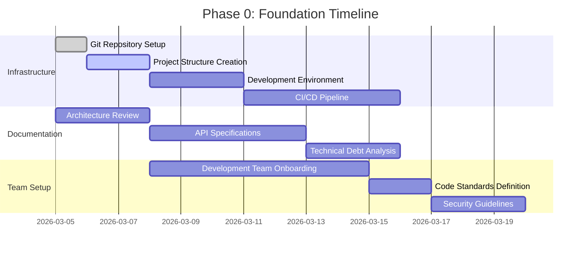
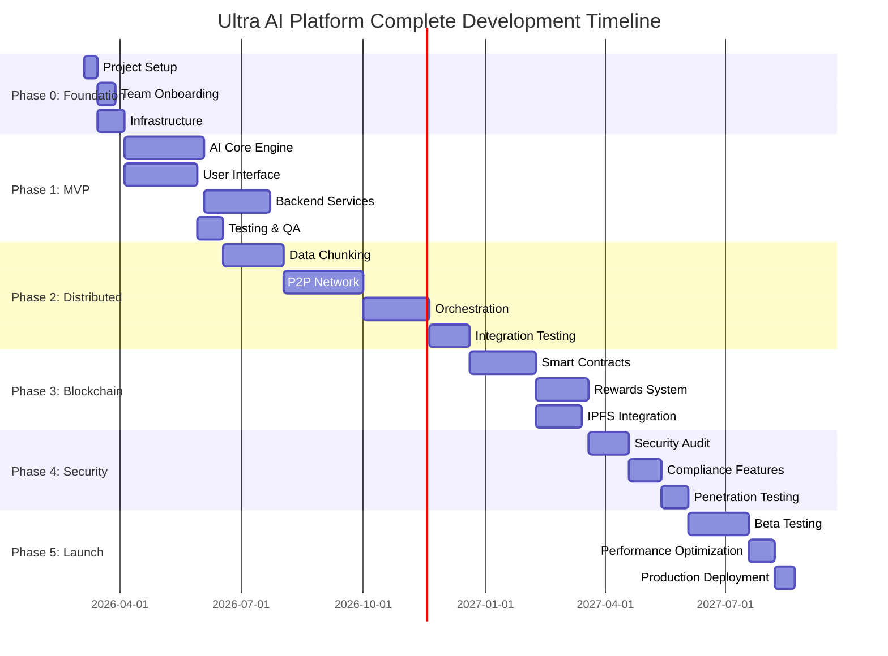

# Ultra AI Platform - Development Roadmap

**Last Updated**: July 1, 2026

This roadmap tracks the three-phase program for Ultra AI and ZeroAI. For the authoritative phase/status table, see [PROJECT_PHASES_AND_STATUS.md](PROJECT_PHASES_AND_STATUS.md).

## Roadmap at a Glance

| Phase | Focus | Outcome |
|---|---|---|
| Phase 1 | Core Infrastructure | Local-first platform foundation, ZeroAI control surface, API and docs alignment |
| Phase 2 | Distributed Network | Workflow orchestration, voice, memory, routing, and distributed boundary control |
| Phase 3 | Advanced Features | Production hardening, validation, observability, and release readiness |

## Phase 1 Workstream

- Keep the ZeroAI UI, API, and WSL helper scripts aligned.
- Maintain the architecture docs as the canonical edge/cloud boundary reference.
- Finish consolidating planning and status documents into `docs/planning/`.

## Phase 2 Workstream

- Expand workflow visibility and execution telemetry.
- Strengthen local memory, voice, and routing behavior.
- Tighten the handoff between ZeroAI local execution and Ultra AI escalation.

## Phase 3 Workstream

- Produce a final production readiness checklist.
- Add release gates for workflow execution, voice, and routing changes.
- Reconcile older phase reports with the current three-phase model.

## Near-Term Priorities

1. Keep the documentation hierarchy consistent after the root-doc migration.
2. Finish the remaining planning-doc cleanup under `docs/planning/`.
3. Add operational validation and readiness detail for the ZeroAI runtime paths.
# Ultra AI Platform - Development Roadmap

> **Creation Date**: March 5, 2026  
> **Status**: In Progress  
> **Current Phase**: Phase 0 - Foundation & Setup

---

## 🎯 Overview

This document provides a detailed roadmap for developing Ultra AI Platform from concept to full production, with clear definitions for each phase, required deliverables, and Git commits.

---

## 🔴 Identified Critical Points

### 1. **Critical Technical Points**

#### ⚠️ **A. Distributed System Compatibility**
- **Problem**: No clear mechanism to ensure version compatibility between different nodes
- **Proposed Solution**: Implement strict versioning system with backward compatibility
- **Priority**: 🔴 Critical

#### ⚠️ **B. Data Chunking Security**
- **Problem**: Risk of inferring original data through chunk pattern analysis
- **Proposed Solution**: Add noise and multi-layer encryption with randomization
- **Priority**: 🔴 Critical

#### ⚠️ **C. Node Failure Handling**
- **Problem**: No clear mechanism for task redistribution on node failure
- **Proposed Solution**: Redundancy system with health checks and automatic failover
- **Priority**: 🔴 Critical

#### ⚠️ **D. Gata-OS Integration**
- **Problem**: Gata-OS is a hypothetical system that doesn't currently exist
- **Proposed Solution**: Create Mock API for development and testing
- **Priority**: 🟡 Medium

#### ⚠️ **E. Scalability Concerns**
- **Problem**: Unclear how to handle 100,000+ nodes in the network
- **Proposed Solution**: Implement Sharding and Clustering for nodes
- **Priority**: 🟠 High

### 2. **Legal & Regulatory Critical Points**

#### ⚠️ **F. Crypto Regulatory Compliance**
- **Problem**: CS token may require special licenses in some countries
- **Proposed Solution**: Legal consultation and compliant rewards model design
- **Priority**: 🔴 Critical

#### ⚠️ **G. Data Privacy (GDPR, CCPA)**
- **Problem**: Distributed data processing may conflict with data protection laws
- **Proposed Solution**: Add data residency controls and right to deletion
- **Priority**: 🔴 Critical

### 3. **Business & Market Critical Points**

#### ⚠️ **H. Initial User Acquisition**
- **Problem**: Network needs sufficient nodes to be effective (chicken-egg problem)
- **Proposed Solution**: Strong incentive program for early users
- **Priority**: 🟠 High

#### ⚠️ **I. Competition from Big Tech**
- **Problem**: Companies like OpenAI, Google, Anthropic have massive resources
- **Proposed Solution**: Focus on privacy and lower cost as competitive advantage
- **Priority**: 🟡 Medium

## 🧩 ZeroAI and Ultra AI Integration Track

ZeroAI is the local WSL assistant layer.
Ultra AI is the larger distributed platform.
This track makes sure both systems evolve together instead of competing with each other.

### Integration Principles

- ZeroAI is the first user entry point on the device.
- Ultra AI is the escalation and network platform.
- OpenClaw remains the routing and control plane.
- n8n remains the workflow backbone.
- Open WebUI and LocalAI stay documented as local UI options for evaluation.
- AirLLM remains an optimization lane for later resource reduction.

### Gap Closure Backlog

#### ZeroAI Local Gaps

- Speech-to-text implementation and evaluation.
- Local memory store for conversation, task history, and preferences.
- Local UI and control surface.
- Agent router and policy engine.
- Tool registry and execution wrappers.
- OpenClaw bridge scripts.
- Workflow visibility and confirmation flows.

#### Ultra AI Shared Gaps

- Distributed version compatibility rules.
- Node failure handling and task redistribution.
- Data chunking security hardening.
- GDPR and CCPA alignment for the edge-cloud model.
- Crypto and token compliance documentation.
- Multi-region deployment strategy.
- Load testing and distributed benchmarking.
- Monitoring, alerting, and disaster recovery.

### Proposed Version Line

| Release Line | Scope | Purpose |
|---|---|---|
| ZeroAI v0.1.0 | Local assistant foundation | First WSL-based device assistant baseline |
| Ultra AI v2.0.0 | Network platform baseline | Broader distributed platform with shared services |
| Integrated v2-zeroai-integrated | Combined documentation line | Single reference for local-plus-network architecture |

### Initial Delivery Milestones

1. ZeroAI architecture and UI documents stabilized.
2. STT and memory design selected and documented.
3. OpenClaw, Ollama, n8n, and local tools wired in the roadmap.
4. Ultra AI docs updated to show ZeroAI as the local entry point.
5. Open WebUI and LocalAI evaluated for the first UI implementation.
6. All previously documented gaps assigned to a phase owner.

---

## 📋 Phased Implementation Plan

### 🏁 **Phase 0: Foundation & Setup**
**Duration**: 8-10 weeks  
**Status**: 🔄 Starting

#### Main Objectives:
1. Setup development infrastructure
2. Form core team
3. Create project structure
4. Setup development environment

#### Required Deliverables:



#### Detailed Task List:

##### **Week 1: Project Initialization**

**Git Commits Plan:**
1. `git commit -m "chore: initialize project structure and monorepo setup"`
2. `git commit -m "docs: update README with current development status"`
3. `git commit -m "chore: add .gitignore and .editorconfig"`
4. `git commit -m "chore: setup development environment configuration"`
5. `git commit -m "docs: create CONTRIBUTING.md and CODE_OF_CONDUCT.md"`

**Tasks:**
- [ ] Create basic project structure (Monorepo structure)
- [ ] Setup package.json with basic dependencies
- [ ] Create Docker configurations
- [ ] Setup ESLint, Prettier, Husky
- [ ] Create GitHub Actions for CI/CD

##### **Week 2: Core Architecture Setup**

**Git Commits Plan:**
1. `git commit -m "feat(core): add core AI engine base structure"`
2. `git commit -m "feat(core): implement request routing system"`
3. `git commit -m "feat(core): add logging and monitoring setup"`
4. `git commit -m "test(core): add unit tests for core components"`
5. `git commit -m "docs(architecture): update system architecture diagrams"`

**Tasks:**
- [ ] Create Core AI Engine skeleton
- [ ] Add Logging system (Winston/Pino)
- [ ] Add Monitoring system (Prometheus/Grafana)
- [ ] Create API Gateway structure
- [ ] Setup Database schemas (PostgreSQL + MongoDB)

##### **Week 3-4: API Foundation**

**Git Commits Plan:**
1. `git commit -m "feat(api): implement REST API endpoints structure"`
2. `git commit -m "feat(api): add authentication system (JWT)"`
3. `git commit -m "feat(api): implement rate limiting and security middleware"`
4. `git commit -m "feat(api): add API documentation (OpenAPI/Swagger)"`
5. `git commit -m "test(api): add integration tests for API endpoints"`

**Tasks:**
- [ ] Create REST API endpoints
- [ ] Implement Authentication/Authorization system
- [ ] Add Rate Limiting
- [ ] Create API Documentation
- [ ] Add Input Validation

---

### 🎯 **Phase 1: MVP Core Development**
**Duration**: 12-16 weeks  
**Status**: ⏳ Upcoming

#### Objectives:
1. Build basic AI Core Engine
2. Implement user authentication system
3. Create adaptive user interface with manual customization mode
4. Implement simple processing system (not distributed yet)
5. Implement external AI provider API gateway and model routing policy

#### Required Deliverables:

```typescript
// Expected MVP Features
interface MVPFeatures {
  authentication: {
    signup: boolean;
    login: boolean;
    oauth: boolean; // Google, GitHub
    jwtTokens: boolean;
  };
  
  aiCore: {
    naturalLanguageProcessing: boolean;
    intentRecognition: boolean;
    taskRouting: boolean;
    basicModels: ['gpt-3.5-turbo', 'claude-instant'];
  };
  
  userInterface: {
    webApp: boolean; // React + Next.js
    mobileResponsive: boolean;
    basicDashboard: boolean;
    taskHistory: boolean;
    adaptiveWorkspace: boolean;
    manualCustomization: boolean;
  };
  
  processing: {
    syncProcessing: boolean;
    asyncProcessing: boolean;
    resultCaching: boolean;
    queueSystem: boolean; // Bull/BullMQ
  };

  modelGateway: {
    externalProviders: ['openai', 'anthropic'];
    fallbackRouting: boolean;
    providerHealthChecks: boolean;
  };
}
```

#### Git Commits Structure:

**Week 5-8: AI Core Engine**
```bash
# Week 5
git commit -m "feat(ai): implement NLP processor with language detection"
git commit -m "feat(ai): add intent recognition system"
git commit -m "feat(ai): integrate OpenAI API wrapper"
git commit -m "test(ai): add comprehensive tests for NLP processor"

# Week 6
git commit -m "feat(ai): implement task planning engine"
git commit -m "feat(ai): add model router with load balancing"
git commit -m "feat(ai): implement response generator"
git commit -m "refactor(ai): optimize AI core performance"

# Week 7
git commit -m "feat(ai): add caching layer for AI responses"
git commit -m "feat(ai): implement error handling and retry logic"
git commit -m "feat(ai): add bilingual support (Arabic/English)"
git commit -m "docs(ai): document AI core architecture and APIs"

# Week 8
git commit -m "feat(ai): add streaming response support"
git commit -m "test(ai): add integration tests for AI workflows"
git commit -m "perf(ai): optimize memory usage and response time"
git commit -m "chore(ai): add performance benchmarks"
```

**Week 9-12: User Interface**
```bash
# Week 9
git commit -m "feat(ui): initialize Next.js app with TypeScript"
git commit -m "feat(ui): implement design system and component library"
git commit -m "feat(ui): add authentication pages (login/signup)"
git commit -m "style(ui): implement responsive layouts with Tailwind"

# Week 10
git commit -m "feat(ui): create main chat interface"
git commit -m "feat(ui): implement real-time message updates"
git commit -m "feat(ui): add user dashboard and profile"
git commit -m "feat(ui): implement task history and management"
git commit -m "feat(ui): add adaptive workspace generator by user role"

# Week 11
git commit -m "feat(ui): add settings and preferences"
git commit -m "feat(ui): implement dark/light theme toggle"
git commit -m "feat(ui): add bilingual UI (Arabic/English)"
git commit -m "a11y(ui): improve accessibility features"
git commit -m "feat(ui): add manual workspace customization and pinned layout"

# Week 12
git commit -m "feat(ui): add loading states and error boundaries"
git commit -m "test(ui): add Cypress E2E tests"
git commit -m "perf(ui): optimize bundle size and lazy loading"
git commit -m "docs(ui): add component documentation (Storybook)"
```

**Week 13-16: Backend Services**
```bash
# Week 13
git commit -m "feat(backend): implement user management service"
git commit -m "feat(backend): add PostgreSQL models and migrations"
git commit -m "feat(backend): implement session management"
git commit -m "security(backend): add SQL injection prevention"
git commit -m "feat(ai): add external model gateway (OpenAI/Anthropic adapters)"

# Week 14
git commit -m "feat(backend): implement task queue with Bull"
git commit -m "feat(backend): add Redis caching layer"
git commit -m "feat(backend): implement rate limiting per user"
git commit -m "feat(backend): add request/response logging"
git commit -m "feat(ai): implement provider fallback routing and health checks"

# Week 15
git commit -m "feat(backend): implement file upload system (S3)"
git commit -m "feat(backend): add email notification service"
git commit -m "feat(backend): implement webhook system"
git commit -m "security(backend): add XSS and CSRF protection"

# Week 16
git commit -m "test(backend): add comp comprehensive integration tests"
git commit -m "perf(backend): optimize database queries"
git commit -m "docs(backend): generate API documentation"
git commit -m "chore(backend): prepare for production deployment"
```

---

### 🌐 **Phase 2: Distributed Network Implementation**
**Duration**: 16-20 weeks  
**Status**: ⏳ Upcoming

#### Objectives:
1. Implement basic distribution system
2. Create data chunking system
3. Implement P2P network
4. Add end-to-end encryption

#### Key Planned Commits:

```bash
# Data Chunking System
git commit -m "feat(distributed): implement data chunking algorithm"
git commit -m "feat(distributed): add encryption layer for chunks"
git commit -m "feat(distributed): implement chunk metadata management"
git commit -m "security(distributed): add data obfuscation techniques"
git commit -m "test(distributed): validate chunk reconstruction accuracy"

# P2P Network
git commit -m "feat(p2p): implement WebRTC peer connection system"
git commit -m "feat(p2p): add peer discovery mechanism"
git commit -m "feat(p2p): implement signaling server"
git commit -m "feat(p2p): add peer health monitoring"
git commit -m "feat(p2p): implement NAT traversal (STUN/TURN)"

# Node Network Management
git commit -m "feat(network): implement node registry service"
git commit -m "feat(network): add node capacity assessment"
git commit -m "feat(network): implement task distribution algorithm"
git commit -m "feat(network): add failover and redundancy"
git commit -m "security(network): implement node authentication"

# Task Orchestration
git commit -m "feat(orchestrator): implement task orchestration engine"
git commit -m "feat(orchestrator): add task scheduling system"
git commit -m "feat(orchestrator): implement result aggregation"
git commit -m "feat(orchestrator): add consensus mechanism"
git commit -m "perf(orchestrator): optimize parallel processing"
```

---

### ⛓️ **Phase 3: Blockchain & Rewards System**
**Duration**: 12-14 weeks  
**Status**: ⏳ Upcoming

#### Objectives:
1. Implement Smart Contracts
2. Create CS token
3. Implement rewards system
4. Add Governance system

#### Key Commits:

```bash
# Smart Contracts
git commit -m "feat(blockchain): create CS token smart contract (ERC-20)"
git commit -m "feat(blockchain): implement rewards distribution contract"
git commit -m "feat(blockchain): add staking mechanism"
git commit -m "security(blockchain): add smart contract security audits"
git commit -m "test(blockchain): add comprehensive contract tests"

# Blockchain Integration
git commit -m "feat(web3): integrate Web3.js with platform"
git commit -m "feat(web3): implement wallet connection (MetaMask)"
git commit -m "feat(web3): add transaction monitoring"
git commit -m "feat(web3): implement gas optimization"

# Rewards System
git commit -m "feat(rewards): implement contribution tracking"
git commit -m "feat(rewards): add reward calculation algorithm"
git commit -m "feat(rewards): implement automatic distribution"
git commit -m "feat(rewards): add reward history and analytics"

# IPFS Integration
git commit -m "feat(storage): integrate IPFS for distributed storage"
git commit -m "feat(storage): implement content addressing"
git commit -m "feat(storage): add pinning service integration"
```

---

### 🔒 **Phase 4: Security & Compliance**
**Duration**: 8-10 weeks  
**Status**: ⏳ Upcoming

#### Objectives:
1. Implement Security Audits
2. Add Compliance features
3. Implement Advanced encryption
4. Add Penetration testing

#### Key Commits:

```bash
# Security Hardening
git commit -m "security: implement end-to-end encryption"
git commit -m "security: add multi-factor authentication (MFA)"
git commit -m "security: implement data residency controls"
git commit -m "security: add security headers and CSP"
git commit -m "security: implement audit logging"

# Compliance
git commit -m "feat(compliance): add GDPR compliance features"
git commit -m "feat(compliance): implement data deletion workflow"
git commit -m "feat(compliance): add consent management"
git commit -m "feat(compliance): implement data export functionality"
git commit -m "docs(compliance): add privacy policy and terms"

# Advanced Protection
git commit -m "security: implement DDoS protection"
git commit -m "security: add intrusion detection system"
git commit -m "security: implement anomaly detection"
git commit -m "security: add automated security scanning"
```

---

### 🚀 **Phase 5: Production Launch**
**Duration**: 6-8 weeks  
**Status**: ⏳ Upcoming

#### Objectives:
1. Implement Production infrastructure
2. Perform Performance optimization
3. Implement Monitoring & Alerting
4. Launch Beta testing

---

## 📂 Proposed Project Structure

```
Ultra-AI/
├── .github/
│   ├── workflows/               # CI/CD workflows
│   ├── ISSUE_TEMPLATE/
│   └── PULL_REQUEST_TEMPLATE.md
├── apps/
│   ├── web/                     # Next.js web application
│   │   ├── src/
│   │   │   ├── app/
│   │   │   ├── components/
│   │   │   ├── lib/
│   │   │   └── styles/
│   │   ├── public/
│   │   ├── tests/
│   │   └── package.json
│   ├── mobile/                  # React Native (future)
│   └── cli/                     # CLI tool
├── packages/
│   ├── ai-core/                 # AI engine core
│   │   ├── src/
│   │   │   ├── nlp/
│   │   │   ├── planning/
│   │   │   ├── routing/
│   │   │   └── models/
│   │   └── tests/
│   ├── distributed/             # Distributed processing
│   │   ├── src/
│   │   │   ├── chunking/
│   │   │   ├── p2p/
│   │   │   ├── orchestration/
│   │   │   └── aggregation/
│   │   └── tests/
│   ├── blockchain/              # Blockchain & rewards
│   │   ├── contracts/
│   │   ├── src/
│   │   └── tests/
│   ├── api/                     # API services
│   │   ├── src/
│   │   │   ├── controllers/
│   │   │   ├── services/
│   │   │   ├── middleware/
│   │   │   └── models/
│   │   └── tests/
│   └── shared/                  # Shared utilities
│       ├── types/
│       ├── utils/
│       └── constants/
├── services/
│   ├── auth-service/           # Authentication microservice
│   ├── task-service/           # Task management
│   ├── user-service/           # User management
│   └── notification-service/   # Notifications
├── infrastructure/
│   ├── docker/
│   │   ├── Dockerfile.web
│   │   ├── Dockerfile.api
│   │   └── Dockerfile.worker
│   ├── kubernetes/
│   │   ├── base/
│   │   └── overlays/
│   └── terraform/              # Infrastructure as Code
├── infrastructure/automation/
│   ├── setup.sh
│   ├── deploy.sh
│   └── migrate.sh
├── docs/                       # Documentation (existing)
├── tests/
│   ├── e2e/
│   ├── integration/
│   └── performance/
├── .gitignore
├── .eslintrc.js
├── .prettierrc
├── docker-compose.yml
├── package.json                # Root package (monorepo)
├── tsconfig.json
├── turbo.json                  # Turborepo config
├── README.md
└── DEVELOPMENT_ROADMAP.md      # This file
```

---

## 🔧 Technical Requirements

### Development Environment

```yaml
# .tool-versions
nodejs: 20.11.0
python: 3.11.0
postgresql: 15.5
redis: 7.2.0
docker: 24.0.0
kubernetes: 1.28.0
```

### Required Tools

```bash
# Development Tools
- Node.js 20+
- Python 3.11+
- Docker & Docker Compose
- Kubernetes (k3s or minikube)
- Git
- VS Code / WebStorm
- Postman / Insomnia

# Build Tools
- Turborepo
- Webpack / Vite
- TypeScript 5.3+
- ESLint
- Prettier

# Testing Tools
- Jest
- Cypress
- Playwright
- k6 (load testing)

# Monitoring Tools
- Prometheus
- Grafana
- Sentry
- ELK Stack
```

---

## ⚡ Git Strategy & Branching

### Branch Structure

```
master/main          → Production-ready code
├── develop          → Main development branch
│   ├── feature/*    → New features
│   ├── bugfix/*     → Bug fixes
│   ├── hotfix/*     → Production hotfixes
│   └── release/*    → Release preparations
```

### Commit Convention

```bash
# Format: <type>(<scope>): <subject>

# Types:
feat     # New feature
fix      # Bug fix
docs     # Documentation changes
style    # Code style changes (formatting)
refactor # Code refactoring
perf     # Performance improvements
test     # Adding/updating tests
chore    # Maintenance tasks
security # Security improvements
ci       # CI/CD changes

# Examples:
git commit -m "feat(ai): add Arabic NLP support"
git commit -m "fix(auth): resolve JWT expiration bug"
git commit -m "docs(api): update API documentation"
git commit -m "security(distributed): implement chunk encryption"
git commit -m "perf(db): optimize query performance"
```

### Semantic Versioning

```
MAJOR.MINOR.PATCH

1.0.0   → Initial release
1.1.0   → New features (backward compatible)
1.1.1   → Bug fixes
2.0.0   → Breaking changes
```

---

## 📊 Success Metrics

### Phase 0 Success Criteria
- [ ] Project structure created and documented
- [ ] Development environment fully configured
- [ ] CI/CD pipeline operational
- [ ] All team members onboarded
- [ ] Code standards documented and enforced

### Phase 1 Success Criteria
- [ ] MVP deployed to staging
- [ ] 100+ test users successfully onboarded
- [ ] API response time < 200ms (95th percentile)
- [ ] Test coverage > 80%
- [ ] Zero critical security vulnerabilities

### Phase 2 Success Criteria
- [ ] 50+ active nodes in test network
- [ ] 99% chunk reconstruction accuracy
- [ ] Distributed processing operational
- [ ] P2P network stable with < 2% packet loss
- [ ] Node failover tested and validated

### Phase 3 Success Criteria
- [ ] Smart contracts audited and deployed
- [ ] CS token trading on test network
- [ ] Rewards distribution automated
- [ ] 1000+ CS tokens distributed to beta users
- [ ] Zero smart contract vulnerabilities

---

## 🚨 Risk Management Plan

### Technical Risks

| Risk | Impact | Probability | Mitigation |
|------|--------|-------------|------------|
| Distributed system complexity | High | High | Iterative development, extensive testing |
| Node network reliability | High | Medium | Redundancy, failover mechanisms |
| Blockchain scalability | Medium | Medium | Layer 2 solutions, optimized contracts |
| Security breaches | High | Low | Security audits,penetration testing |
| Performance degradation | Medium | Medium | Continuous monitoring, optimization |

### Business Risks

| Risk | Impact | Probability | Mitigation |
|------|--------|-------------|------------|
| Regulatory compliance | High | Medium | Legal consultation, compliance features |
| User adoption challenges | High | High | Strong incentive program, marketing |
| Competition from big tech | High | Medium | Focus on privacy and cost advantages |
| Funding shortfall | High | Low | Milestone-based fundraising |

---

## 📅 Unified Timeline



---

## 🎯 Immediate Next Steps

### This Week (Week 1):

1. **✅ Setup Git Repository**
   ```bash
   git init
   git add .
   git commit -m "chore: initialize Ultra AI Platform project"
   git branch develop
   git checkout develop
   ```

2. **✅ Create Project Structure**
   - Create basic folders
   - Add package.json
   - Setup TypeScript configs
   - Add Docker configurations

3. **✅ Setup Development Environment**
   - Install dependencies
   - Setup ESLint and Prettier
   - Setup Husky for pre-commit hooks
   - Create docker-compose for databases

4. **✅ Create CI/CD Pipeline**
   - Add GitHub Actions
   - Setup automated testing
   - Setup code quality checks
   - Add deployment scripts

5. **✅ Document Development Standards**
   - Create CONTRIBUTING.md
   - Create CODE_OF_CONDUCT.md
   - Document code style standards
   - Add templates for Issues and PRs

---

## 📞 Communication & Support

### Communication Channels
- **GitHub Issues**: Bug reports, feature requests
- **GitHub Discussions**: General discussions, Q&A
- **Discord/Slack**: Team communication (to be set up)
- **Email**: support@ucubetech.com

### Documentation
- **Technical Docs**: `/docs/architecture/`
- **API Docs**: Auto-generated from code
- **User Guides**: `/docs/user-guides/` (to be created)
- **Developer Guides**: `/docs/developer-guides/` (to be created)

---

## 📝 Closing Notes

This plan is subject to modification and improvement based on:
- Learning from experience and development
- Team and user feedback
- Market and technology changes
- Resource and funding availability

**Last Updated**: March 5, 2026  
**Maintained by**: Ultra Cube Tech Team  
**Version**: 1.0.0

---

**🚀 Let's Start Building!**
