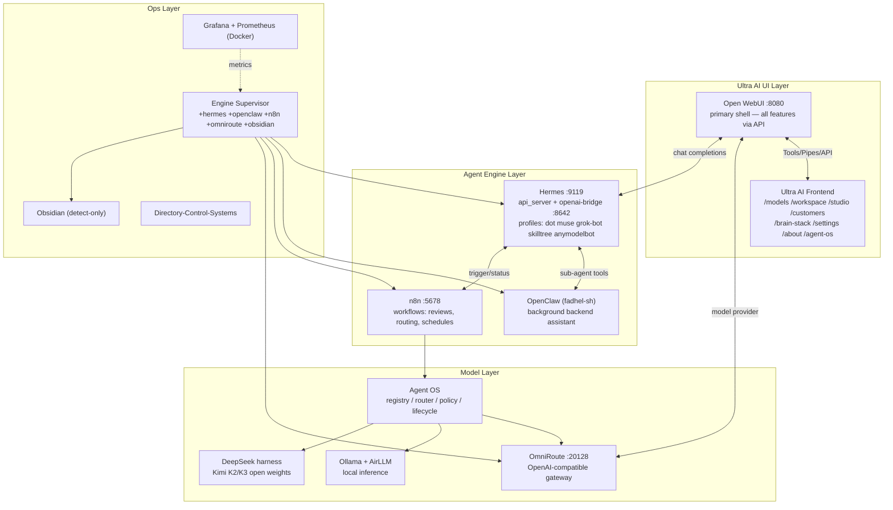

# Ultra-AI — Master Execution Plan v3.0

> **Status:** APPROVED — registered 2026-11-19.
> **Branch:** `release/planning-study` @ `Ultra-Cube/Ultra-AI` (182 commits ahead of master). Per-phase feature branches `feat/pN-*` merged back.
> **Execution mode:** 8-hour continuous autonomous run; questions at start only; heartbeat report every 30 min to `docs/audit/heartbeat/`; commit per phase.
> **Source-of-truth inputs:** `docs/MASTER_AGENT_PROMPT.md` (v1.0/v2.0), `docs/planning/PLAN_RECONCILIATION_2026-11.md`, `brain-stack/workflows/ULTRA_AI_TODO.md`, `brain-stack/memory/ops/status.md`, `docs/spikes/hermes-*.md`, `docs/adr/ADR-003`, `docs/adr/ADR-004`, `docs/v2/legal-licensing.md`, `docs/v2/technical-spec.md`, `docs/v2/master-plan.md`, `docs/OPEN_WEBUI_INTEGRATION.md`, `docs/UPSTREAM_INTEGRATION_INVENTORY.md`, all `docs/phases/`, all `docs/planning/`, all Mermaid diagrams in `docs/` and `brain-stack/memory/diagrams/`.

---

## 0. Requirements Inventory (R1–R36 — nothing dropped)

| ID | Requirement | Phase |
|----|-------------|-------|
| R1 | Review ALL changes on `release/planning-study`; verify files updated & correct | P1 |
| R2 | Review path tree; comment on issues | P1 |
| R3 | Verify all original Brain-Stack skills exist | P1 |
| R4 | Verify prior plans/diagrams applied or reconciled | P0 |
| R5 | Hermes = primary agent engine (NousResearch/hermes-agent, open source, customized) | P2 |
| R6 | Open WebUI = primary UI shell; ALL features ported via API | P2 |
| R7 | External apps separate, upstream-updated, controlled via dashboard API only | P2 |
| R8 | OpenClaw = background backend assistant (private `fadhel-sh/OpenClaw`), powered by Hermes | P2 |
| R9 | Agent teams via Hermes+OpenClaw+n8n: Dot (ongoing), Muse (personal), Grok Bot (AI teams), SkillTree (per-dept), AnyModelBot (background review) | P2 |
| R10 | Agent OS = full model control (install/select/route/version/govern) | P3 |
| R11 | Model families: LLM, LCM, LAM, MoE, VLM, SLM, MLM, SAM — dashboard-editable, n8n-wired | P3 |
| R12 | 8 platform skills: RAG, Agents, LLMOps, Evals, Fine-tuning, Guardrails, AI Agent, Agentic AI | P4 |
| R13 | ArtCraft / Craft-Anything reverse-engineering skill merged for self-extension | P4 |
| R14 | New models: DeepSeek harness (offline open-source), Kimi K2/K3 open-weight | P3 |
| R15 | Brand: dark-gray cube + orange circuit lines, Ultra-Zone-inspired, Kombai skill | P5 |
| R16 | Dark gray + orange across ALL pages; redesign incomplete pages; `/settings` | P5 |
| R17 | `copy.txt` → apply-copyright.mjs generates Kombai-style ASCII banner w/ Ultra Cube data | P5 |
| R18 | `/about`: dev team (ultra-zone.ucubetech.com) + owner/supporter (ucubetech.com) + rights | P5 |
| R19 | `/brain-stack`: visual map + CRUD of every brain section | P5 |
| R20 | `/customers` gate: per-client/team customization, model+task selection, scheduled tasks, notes, detailed settings | P5 |
| R21 | `/models` gate + Agent OS routing/policy | P3+P5 |
| R22 | Directory-Control-Systems: complete + backend integration + fix possibly-corrupt README | P2 |
| R23 | Engine supervisor: add hermes/openclaw/n8n/omniroute/obsidian as real engines | P2 |
| R24 | Docker: Grafana + Prometheus (Docker confirmed working) | P2 |
| R25 | OmniRoute :20128 fix (`MODULE_NOT_FOUND ./db/omp` → build or upstream clone) | P2 |
| R26 | System installs: Obsidian (detect-only, proprietary), Ollama, AirLLM | P2 |
| R27 | Multi-agent prompt: auditor, git historian, researcher, UI designer, integration owner | P0 |
| R28 | Work distribution: research, plan, review, build, design, check, reports, dev-phase selection | all |
| R29 | 8-hour continuous run; upfront questions only; heartbeat every 30 min | all |
| R30 | Evaluate `kiri` (container building) — adopt if useful | P1 |
| R31 | LICENSE file → GitHub; third-party licence inventory | P6 |
| R32 | U1–U11 phases + all review/audit phases preserved & tracked | P0 |
| R33 | Complete project memory in brain-stack; all APIs ready for diagram review | P1 |
| R34 | Everything internal; OSS components allowed in advanced phases | P2+ |
| R35 | Branch review & selection; documented decision | P0.4 |
| R36 | English plan doc in docs/ + phase registration in AI memory | done |

---

## Phase Map & Gates

```
P0  Reconciliation & Baseline        → Gate G0
P1  Workflow Review & Verification   → Gate G1
P2  Integration Layer                → Gate G2
P3  Agent OS + Model Governance      → Gate G3
P4  Skills Layer                     → Gate G4
P5  Design & Brand                   → Gate G5
P6  Legal, Licensing & Release Prep  → Gate G6
```

---

## P0 — Reconciliation & Baseline

- **P0.1** Prior-plan inventory → `docs/audit/prior-plans-inventory.md` (every requirement/phase/diagram → DONE/PARTIAL/MISSING/CONFLICT → R-ID).
- **P0.2** Mermaid/diagram audit → `docs/audit/diagrams-audit.md` (extract + validate every block in `docs/` + `brain-stack/memory/diagrams/`).
- **P0.3** Conflict register → `docs/audit/conflict-register.md` + ADR-005+ where needed (Hermes-vs-OpenWebUI resolved; OmniRoute; DCS README; engine catalog; n8n SUL; Open WebUI branding clause).
- **P0.4** Branch review → `git log master..HEAD`, `git status`, bundle/zip imports; decision in `docs/audit/branch-decision.md` (default: continue `release/planning-study` + `feat/pN-*` branches).
- **P0.5** Master agent prompt → `brain-stack/prompts/ultra-ai-master-v3.md` (8 roles, evidence ladder IDEA→SPEC→STUB→WORKING→VERIFIED, `path:line` citations, failure table, heartbeat rules).
- **P0.6** Memory registration → `brain-stack/memory/planning/` phase entries P0–P6; update `ops/status.md` + `RESUME.md`.

## P1 — Workflow Review & Verification

- **P1.1** Git audit: per-commit review, broken imports, dead routes, TODOs, >5MB files, secrets scan.
- **P1.2** File-drift & path-tree audit → every `page.tsx`/`route.ts` → LIVE/MOCK/BROKEN.
- **P1.3** Skills audit: `.devin/skills/` (~2,269) vs `brain-stack/skills/CATALOG.md`.
- **P1.4** `npm run type-check && npm run lint && npm run test && npm run build` + HTTP route sweep + Docker sidecar status.
- **P1.5** OSS scan (R30/R34) → `docs/audit/oss-candidates.md` (kiri, aion-ui, web3ui, LiteLLM, Ollama, vLLM, Langfuse, n8n, Open WebUI, Hermes, OpenClaw, OmniRoute — adopt/defer/reject).
- **P1.6** Project memory build → complete `brain-stack/memory/` (architecture, decisions, phases, full API inventory).

## P2 — Integration Layer



- **P2.1** Open WebUI shell: :8080 verified, `/webui` proxy, OmniRoute + hermes-bridge as providers, Arabic locale, Ultra AI theme via custom CSS/JS (no rebrand — licence clause), Ultra AI APIs exposed as Tools/Functions.
- **P2.2** Port ALL built features into Open WebUI (Functions/Pipes/Tools/custom pages).
- **P2.3** Auth/SSO: `/login` + `app/_lib/webui-sso.ts` ↔ `WEBUI_AUTH`.
- **P2.4** Hermes: :9119 dashboard + api_server + hermes-openai-bridge :8642; plugin exposing Ultra AI state; design customization; engine-supervisor registration.
- **P2.5** OpenClaw: `gh auth status` → clone private `fadhel-sh/OpenClaw` → background service → Hermes sub-agent/backend → Open WebUI tool. Fallback documented if auth fails.
- **P2.6** n8n :5678 (SUL-compliant connect-only) + workflows: `dot-daily-review`, `muse-personal-tasks`, `grok-bot-team-coord`, `skilltree-dept-teams`, `anymodelbot-code-review`, `model-router`.
- **P2.7** OmniRoute fix: diagnose `./db/omp` in open-sse; `npm run build:backend`; else full upstream clone `diegosouzapw/OmniRoute` → `external/github-forks/`; verify :20128.
- **P2.8** Docker ops: Grafana + Prometheus + provisioning dashboards; `/api/apps` registration.
- **P2.9** System installs: Obsidian detect-only; Ollama + AirLLM install scripts (consent); `/api/apps`.
- **P2.10** Directory-Control-Systems: complete + backend wiring + README repair.
- **P2.11** Engine supervisor: catalog extended with hermes/openclaw/n8n/omniroute/obsidian; `/api/apps` live status.

## P3 — Agent OS + Model Governance

- **P3.1** `platform/services/agent-os/` — Model Registry, Agent Registry, Task Router, Policy Engine, Lifecycle Manager, Observability.
- **P3.2** Model families schema {LLM, LCM, LAM, MoE, VLM, SLM, MLM, SAM} + seed catalog + n8n model-router advanced steps.
- **P3.3** DeepSeek harness + Kimi K2/K3 open-weight — registered/installable/routable.
- **P3.4** APIs `/api/agent-os/{models,agents,tasks,policies}` + `/agent-os` UI (Models/Agents/Tasks/Policies/Observability tabs).

## P4 — Skills Layer

- **P4.1** 8 platform skills `brain-stack/skills/{rag,agents,llmops,evals,fine-tuning,guardrails,ai-agent,agentic-ai}/SKILL.md` + CATALOG + skill-registry + dashboard binding.
- **P4.2** ArtCraft/Craft-Anything reverse-engineering skill merged into `.devin/skills/` + `brain-stack/skills/` for project self-extension.
- **P4.3** skill-check/skill-audit on all new skills; `/brain-stack` Skills tab live.

## P5 — Design & Brand

- **P5.1** Kombai: dark-gray cube + orange circuit/electronic lines; refs ultra-zone.ucubetech.com + ucubetech.com; palette dark-gray+orange; favicon/app-icon/logo SVG/PNG.
- **P5.2** Page redesign sweep (dashboard flagged); new `/settings`; Kombai + aion-ui/web3ui patterns.
- **P5.3** `apply-copyright.mjs` → Kombai-style ASCII banner with Ultra Cube data.
- **P5.4** `/about`, `/brain-stack` (visual + CRUD), `/customers` (client/team gate: customization, model+task selection, schedules, notes, settings), `/models` (Agent OS wiring).

## P6 — Legal, Licensing & Release Prep

- **P6.1** Root `LICENSE` (proprietary, Ultra Cube Tech) + `docs/legal/THIRD_PARTY_NOTICES.md` from `docs/v2/legal-licensing.md` (Open WebUI BSD-3, n8n SUL, Hermes, OmniRoute, Ollama, ...).
- **P6.2** Docs sync: `ULTRA_AI_TODO.md`, `status.md`, `RESUME.md`, `plan-vs-reality.md`, README.
- **P6.3** Final verification: type-check/lint/test/build, HTTP sweep, Docker health, all `/api/*`, evidence ladder.

## Execution Model

- Multi-agent roster per `brain-stack/prompts/ultra-ai-master-v3.md`; parallel where independent (P3/P4/P5 after P2 core).
- Verification per phase: `npm run type-check && npm run lint && npm run test`; HTTP sweep for UI; Docker health for infra.
- No destructive ops; no secrets in git; disk check before large installs.

## Risks (pre-resolved)

| Risk | Mitigation |
|------|-----------|
| OpenClaw private repo access | `gh auth` check P0.4; deploy-key fallback; document if blocked |
| OmniRoute clone/build fail | `df -h` guard; `build:backend` first; upstream clone fallback |
| Open WebUI branding clause | No rebrand of Open WebUI; Ultra AI chrome on our pages only |
| n8n SUL licence | Connect-only sidecar; no bundling/hosting |
| Obsidian proprietary | Detect-only; never auto-install |
| Prior-plan drift/loss | P0 inventory is mandatory gate before code |
| Disk space | `df -h` before every large install/clone |
