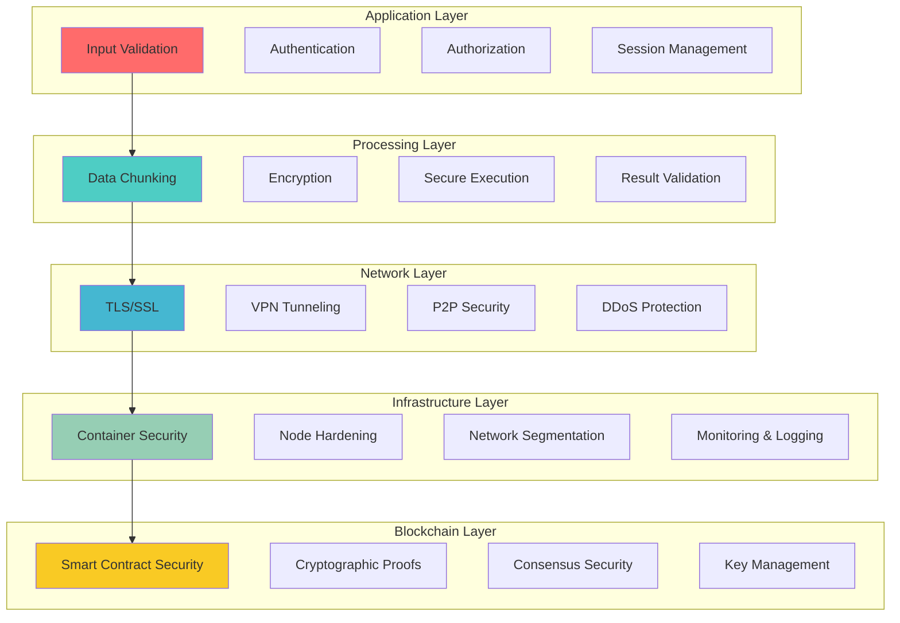
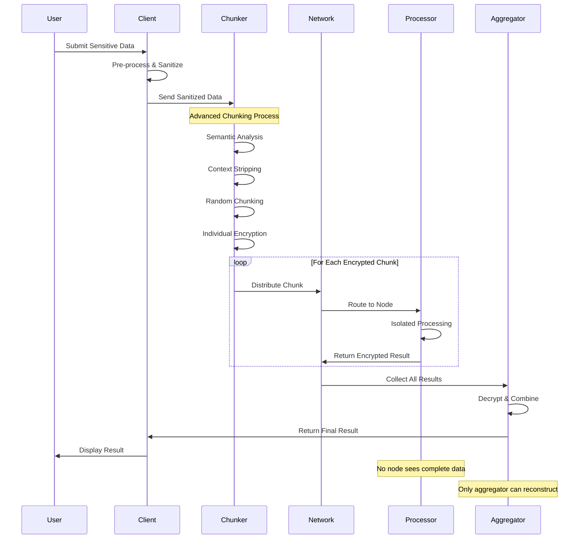
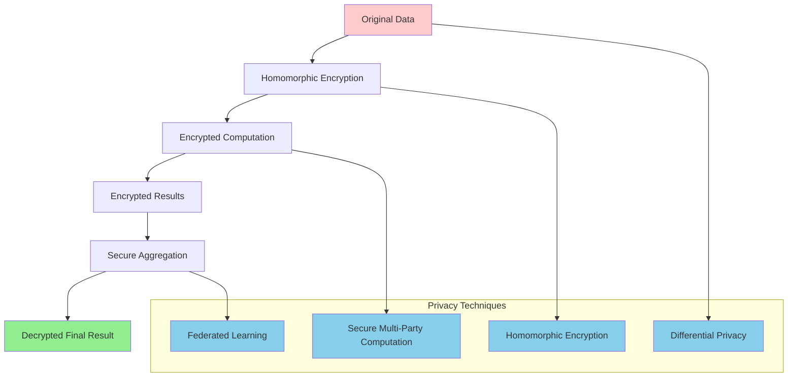
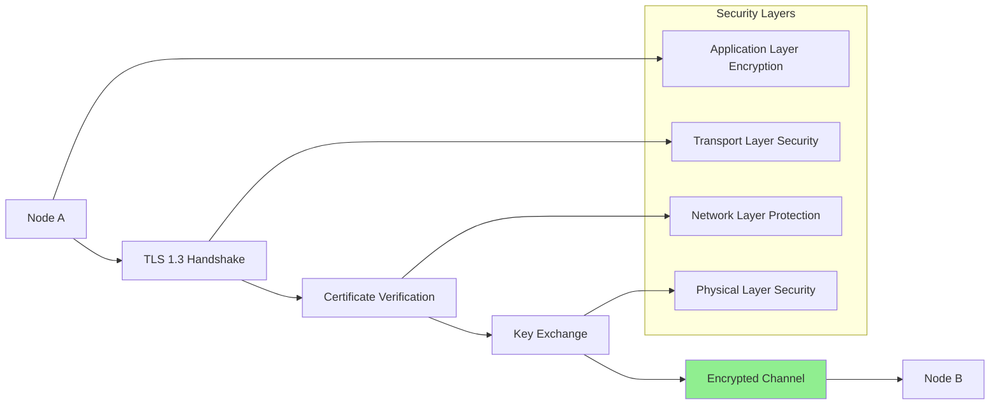
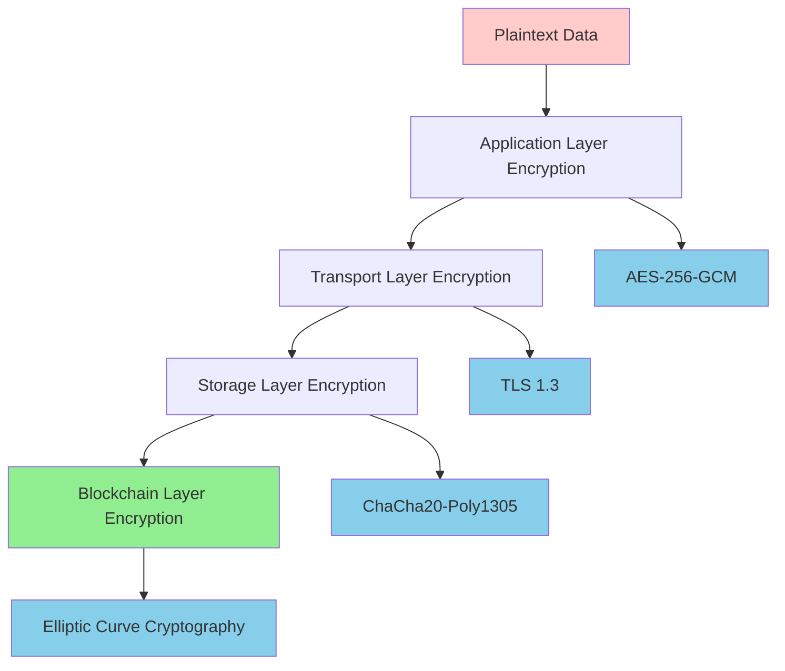
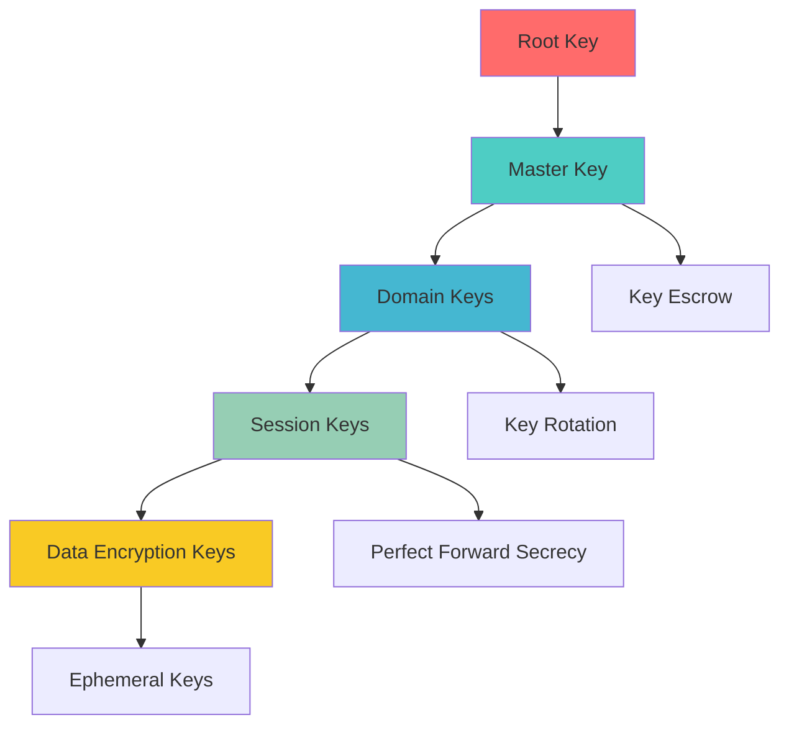
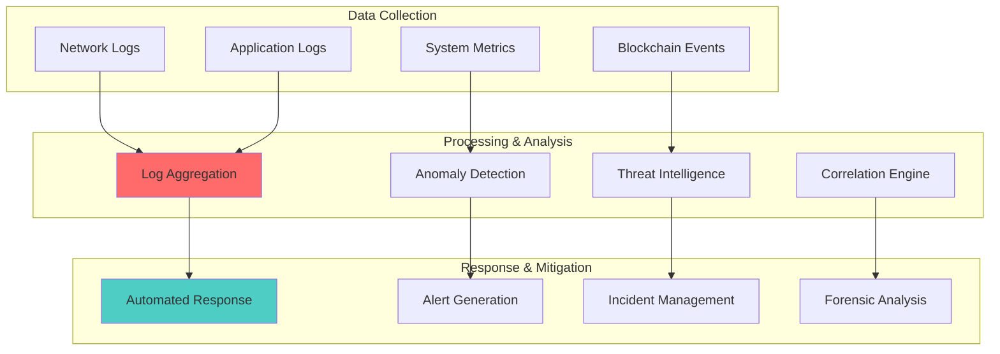

# 🔒 Security Framework - Ultra AI Platform

## 🎯 Overview

Ultra AI Platform implements a comprehensive, multi-layered security framework designed specifically for distributed AI processing. Our approach ensures data privacy, network integrity, and user protection while maintaining optimal performance and usability.

## 🏛️ Security Architecture

### 1. Defense in Depth Model



### 2. Security Principles

#### **Core Security Tenets**

1. **Zero Trust Architecture**: Never trust, always verify
2. **Privacy by Design**: Privacy protection built into every component
3. **Data Minimization**: Process only what's necessary
4. **Encryption Everywhere**: End-to-end encryption for all data
5. **Transparency**: Open source security components
6. **Resilience**: Fault-tolerant and self-healing systems

## 🔐 Data Protection & Privacy

### 1. Data Lifecycle Security



### 2. Advanced Chunking Strategy

#### **Multi-Layer Data Obfuscation**

```typescript
interface ChunkingConfiguration {
  strategies: {
    semantic: {
      enabled: true;
      contextStripping: true;
      sentenceBoundaryRespect: true;
      minimumChunkSize: 1024;
    };
    
    temporal: {
      enabled: true;
      randomDelay: true;
      sequenceObfuscation: true;
      batchProcessing: false;
    };
    
    cryptographic: {
      algorithm: 'AES-256-GCM';
      keyRotation: true;
      uniqueKeysPerChunk: true;
      zeroKnowledgeProofs: true;
    };
  };
}

class AdvancedChunker {
  async secureChunk(data: SensitiveData): Promise<SecureChunk[]> {
    // 1. Preprocess and sanitize
    const sanitized = await this.sanitizeData(data);
    
    // 2. Semantic analysis and context stripping
    const contextStripped = await this.stripContext(sanitized);
    
    // 3. Intelligent chunking
    const chunks = await this.createSemanticChunks(contextStripped);
    
    // 4. Individual encryption with unique keys
    const encryptedChunks = await this.encryptChunks(chunks);
    
    // 5. Add metadata obfuscation
    return this.obfuscateMetadata(encryptedChunks);
  }
  
  private async stripContext(data: SensitiveData): Promise<ProcessedData> {
    return {
      content: this.removeIdentifiers(data.content),
      metadata: this.anonymizeMetadata(data.metadata),
      structure: this.preserveStructure(data.structure)
    };
  }
}
```

### 3. Privacy Protection Mechanisms

#### **Zero-Knowledge Processing**



## 🛡️ Network Security

### 1. Distributed Network Protection

#### **Node Authentication & Authorization**

```typescript
interface NodeSecurity {
  authentication: {
    method: 'cryptographic-proof';
    keyType: 'ed25519';
    certificateAuthority: 'internal-ca';
    rotationPeriod: '30 days';
  };
  
  authorization: {
    rbac: true;
    capabilities: string[];
    reputation: number;
    stakingRequirement: number;
  };
  
  communication: {
    protocol: 'wss'; // WebSocket Secure
    encryption: 'tls-1.3';
    peerToPeer: true;
    onionRouting: true;
  };
}

class NodeSecurityManager {
  async authenticateNode(nodeId: string, proof: CryptographicProof): Promise<AuthResult> {
    // 1. Verify cryptographic proof
    const isValidProof = await this.verifyCryptographicProof(proof);
    if (!isValidProof) {
      throw new SecurityError('Invalid authentication proof');
    }
    
    // 2. Check node reputation
    const reputation = await this.getNodeReputation(nodeId);
    if (reputation < MINIMUM_REPUTATION_THRESHOLD) {
      throw new SecurityError('Insufficient node reputation');
    }
    
    // 3. Verify staking requirement
    const stake = await this.getNodeStake(nodeId);
    if (stake < MINIMUM_STAKE_REQUIREMENT) {
      throw new SecurityError('Insufficient stake for participation');
    }
    
    return this.generateAuthToken(nodeId);
  }
}
```

### 2. Communication Security

#### **Secure P2P Communication**



## 🔍 Threat Model & Risk Assessment

### 1. Threat Landscape Analysis

#### **Primary Threats**

| Threat Category | Risk Level | Impact | Likelihood | Mitigation Priority |
|----------------|------------|---------|------------|-------------------|
| **Data Breaches** | CRITICAL | High | Medium | 1 |
| **Node Compromise** | HIGH | Medium | High | 2 |
| **Network Attacks** | HIGH | High | Low | 3 |
| **Smart Contract Vulnerabilities** | HIGH | High | Low | 4 |
| **Insider Threats** | MEDIUM | Medium | Low | 5 |
| **Side-Channel Attacks** | MEDIUM | Low | Medium | 6 |

#### **Attack Vector Analysis**

```mermaid
graph TB
    subgraph "External Threats"
        A1[DDoS Attacks]
        A2[Network Intrusion]
        A3[Malicious Nodes]
        A4[Data Poisoning]
    end
    
    subgraph "Internal Threats"
        B1[Insider Compromise]
        B2[Privilege Escalation]
        B3[Data Exfiltration]
        B4[System Manipulation]
    end
    
    subgraph "Crypto Threats"
        C1[Key Compromise]
        C2[Cryptographic Attacks]
        C3[Quantum Computing]
        C4[Side-Channel Attacks]
    end
    
    A1 --> D[Network Layer Defense]
    A2 --> E[Intrusion Detection]
    A3 --> F[Node Reputation System]
    
    B1 --> G[Access Controls]
    B2 --> H[Privilege Management]
    
    C1 --> I[Key Rotation]
    C2 --> J[Quantum-Resistant Crypto]
    
    style D fill:#ff6b6b
    style E fill:#ff6b6b
    style F fill:#ff6b6b
    style G fill:#4ecdc4
    style H fill:#4ecdc4
    style I fill:#45b7d1
    style J fill:#45b7d1
```



### 2. Security Controls Matrix

#### **Control Implementation**

```typescript
interface SecurityControls {
  preventive: {
    authentication: ['multi-factor', 'biometric', 'hardware-tokens'];
    authorization: ['rbac', 'abac', 'zero-trust'];
    encryption: ['aes-256', 'rsa-4096', 'elliptic-curve'];
    inputValidation: ['sanitization', 'whitelist', 'type-checking'];
  };
  
  detective: {
    monitoring: ['siem', 'ids', 'behavioral-analysis'];
    logging: ['audit-trails', 'immutable-logs', 'blockchain-anchoring'];
    anomalyDetection: ['ml-based', 'statistical', 'rule-based'];
    vulnerability: ['automated-scanning', 'penetration-testing'];
  };
  
  corrective: {
    incidentResponse: ['automated-containment', 'forensics', 'recovery'];
    backup: ['encrypted-backups', 'geo-redundancy', 'point-in-time'];
    patchManagement: ['automated-updates', 'vulnerability-prioritization'];
  };
}
```

## 🔐 Cryptographic Implementation

### 1. Encryption Strategy

#### **Multi-Layer Encryption Architecture**



#### **Quantum-Resistant Cryptography**

```typescript
interface QuantumResistantCrypto {
  algorithms: {
    keyExchange: 'CRYSTALS-Kyber';
    digitalSignatures: 'CRYSTALS-Dilithium';
    hashFunctions: 'SHA-3';
    symmetricEncryption: 'AES-256' | 'ChaCha20';
  };
  
  implementation: {
    hybridApproach: true; // Classical + Post-quantum
    migrationStrategy: 'gradual-rollout';
    compatibility: 'backward-compatible';
    performance: 'optimized';
  };
}

class QuantumResistantSecurity {
  async generateKeyPair(): Promise<KeyPair> {
    // Generate both classical and post-quantum key pairs
    const classicalKeyPair = await this.generateECCKeyPair();
    const postQuantumKeyPair = await this.generateKyberKeyPair();
    
    return {
      classical: classicalKeyPair,
      postQuantum: postQuantumKeyPair,
      hybrid: this.combineKeyPairs(classicalKeyPair, postQuantumKeyPair)
    };
  }
}
```

### 2. Key Management

#### **Hierarchical Key Management System**



## 🛡️ Smart Contract Security

### 1. Smart Contract Audit Framework

#### **Security Audit Process**

```typescript
interface SmartContractSecurity {
  auditProcess: {
    phases: [
      'static-analysis',
      'dynamic-testing',
      'formal-verification',
      'manual-review',
      'bug-bounty'
    ];
    tools: [
      'mythril',
      'slither',
      'echidna',
      'manticore',
      'securify'
    ];
    standards: ['eip-170', 'eip-1967', 'eip-2535'];
  };
  
  securityPatterns: {
    accessControl: 'ownable-roles';
    upgradeability: 'proxy-pattern';
    reentrancy: 'checks-effects-interactions';
    overflow: 'safemath-library';
  };
}
```

#### **Secure Smart Contract Template**

```solidity
pragma solidity ^0.8.19;

import "@openzeppelin/contracts/security/ReentrancyGuard.sol";
import "@openzeppelin/contracts/access/AccessControl.sol";
import "@openzeppelin/contracts/security/Pausable.sol";

contract UltraAIRewards is ReentrancyGuard, AccessControl, Pausable {
    bytes32 public constant ORACLE_ROLE = keccak256("ORACLE_ROLE");
    bytes32 public constant ADMIN_ROLE = keccak256("ADMIN_ROLE");
    
    mapping(address => uint256) private nodeReputations;
    mapping(address => uint256) private nodeEarnings;
    mapping(bytes32 => TaskRecord) private taskRecords;
    
    struct TaskRecord {
        bytes32 taskId;
        address[] contributors;
        uint256[] contributions;
        uint256 totalReward;
        uint256 timestamp;
        bool distributed;
    }
    
    event RewardDistributed(
        bytes32 indexed taskId,
        address indexed node,
        uint256 reward,
        uint256 newReputation
    );
    
    modifier validTaskId(bytes32 taskId) {
        require(taskId != bytes32(0), "Invalid task ID");
        _;
    }
    
    modifier notAlreadyDistributed(bytes32 taskId) {
        require(!taskRecords[taskId].distributed, "Rewards already distributed");
        _;
    }
    
    function distributeRewards(
        bytes32 taskId,
        address[] calldata contributors,
        uint256[] calldata contributions,
        uint256[] calldata qualityScores
    ) 
        external 
        onlyRole(ORACLE_ROLE) 
        validTaskId(taskId)
        notAlreadyDistributed(taskId)
        nonReentrant
        whenNotPaused
    {
        require(
            contributors.length == contributions.length && 
            contributions.length == qualityScores.length,
            "Array length mismatch"
        );
        
        _distributeRewards(taskId, contributors, contributions, qualityScores);
    }
}
```

## 📊 Security Monitoring & Incident Response

### 1. Security Operations Center (SOC)

#### **Monitoring Architecture**



#### **Incident Response Playbook**

```typescript
interface IncidentResponse {
  severity: 'low' | 'medium' | 'high' | 'critical';
  
  phases: {
    preparation: {
      teamTraining: boolean;
      toolsReady: boolean;
      proceduresTested: boolean;
    };
    
    detection: {
      automatedMonitoring: boolean;
      alertTriggered: boolean;
      initialAssessment: string;
    };
    
    analysis: {
      scopeAssessment: string;
      impactAnalysis: string;
      rootCauseAnalysis: string;
    };
    
    containment: {
      immediateActions: string[];
      shortTermContainment: string[];
      longTermContainment: string[];
    };
    
    eradication: {
      threatRemoval: string[];
      vulnerabilityPatching: string[];
      systemHardening: string[];
    };
    
    recovery: {
      systemRestore: string[];
      monitoring: string[];
      validation: string[];
    };
    
    lessonsLearned: {
      documentation: string;
      processImprovement: string[];
      training: string[];
    };
  };
}
```

### 2. Continuous Security Assessment

#### **Security Metrics & KPIs**

| Category | Metric | Target | Current |
|----------|--------|---------|---------|
| **Availability** | System Uptime | 99.9% | TBD |
| **Integrity** | Data Corruption Rate | <0.01% | TBD |
| **Confidentiality** | Data Breach Incidents | 0 | TBD |
| **Compliance** | Audit Findings | <5 Low | TBD |
| **Response** | Mean Time to Detection | <5 minutes | TBD |
| **Recovery** | Mean Time to Recovery | <1 hour | TBD |

## 🌍 Compliance & Regulatory Framework

### 1. Global Compliance Matrix

| Regulation | Region | Status | Requirements |
|------------|--------|---------|-------------|
| **GDPR** | EU | Compliant | Data protection, user rights |
| **CCPA** | California | Compliant | Privacy disclosures, data rights |
| **SOC 2** | Global | In Progress | Security controls audit |
| **ISO 27001** | Global | Planned | Information security management |
| **HIPAA** | US | Conditional | Healthcare data protection |
| **PCI DSS** | Global | Planned | Payment card data security |

### 2. Privacy by Design Implementation

#### **Data Protection Principles**

```typescript
interface PrivacyByDesign {
  principles: {
    proactiveNotReactive: {
      implementation: 'threat-modeling';
      description: 'Anticipate and prevent privacy invasions';
    };
    
    privacyAsDefault: {
      implementation: 'default-encryption';
      description: 'Maximum privacy protection without action';
    };
    
    privacyEmbedded: {
      implementation: 'architecture-design';
      description: 'Privacy built into system design';
    };
    
    fullFunctionality: {
      implementation: 'positive-sum';
      description: 'All interests and objectives accommodated';
    };
    
    endToEndSecurity: {
      implementation: 'complete-lifecycle';
      description: 'Secure data throughout entire lifecycle';
    };
    
    visibilityTransparency: {
      implementation: 'audit-logs';
      description: 'All stakeholders can verify privacy claims';
    };
    
    respectUserPrivacy: {
      implementation: 'user-centric';
      description: 'User interests prioritized';
    };
  };
}
```

## 🔒 Security Implementation Roadmap

### Phase 1: Foundation Security (Months 1-3)

- [ ] Basic authentication and authorization
- [ ] Data encryption at rest and in transit
- [ ] Secure communication protocols
- [ ] Initial threat modeling
- [ ] Security monitoring setup

### Phase 2: Advanced Protection (Months 4-6)

- [ ] Zero-knowledge processing implementation
- [ ] Advanced chunking algorithms
- [ ] Smart contract security audit
- [ ] Penetration testing
- [ ] Incident response procedures

### Phase 3: Enterprise Security (Months 7-9)

- [ ] Compliance certifications (SOC 2, ISO 27001)
- [ ] Advanced threat detection
- [ ] Quantum-resistant cryptography
- [ ] Security automation
- [ ] Third-party security integrations

### Phase 4: Security Excellence (Months 10-12)

- [ ] Bug bounty program
- [ ] Continuous security assessment
- [ ] Advanced analytics and AI for security
- [ ] Security research and development
- [ ] Industry security leadership

---

**Next Documents**: [Privacy Policy](./privacy-policy.md) | [Compliance Requirements](./compliance.md)