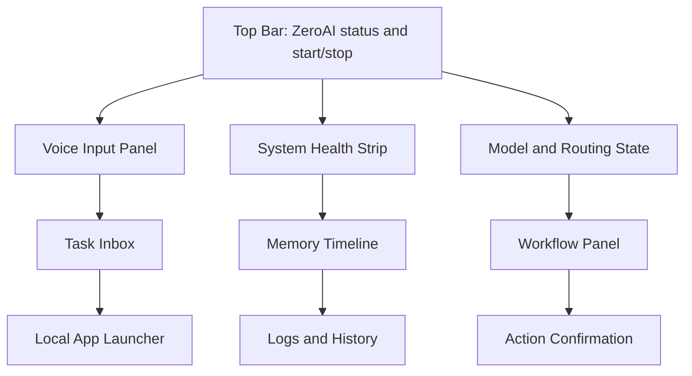

# ZeroAI UI Specification

## Purpose

ZeroAI needs a local interface that behaves like a control surface, not a generic chat window.
The UI is the place where the user starts ZeroAI, watches its state, confirms sensitive actions, and inspects the system before and after execution.

## Product Direction

- ZeroAI is the device-local assistant experience.
- Ultra AI is the larger network platform behind the scenes.
- The UI must make local-first operation obvious.
- The UI must make escalation to Ultra AI visible when it happens.

## Recommended UI Options

### Option A: Open WebUI-Based Shell

Best when the goal is fast delivery of a polished local model interface with minimal custom engineering.

- Pros: mature, familiar, good for local model chats, low setup friction.
- Cons: less tailored to ZeroAI orchestration, more generic assistant posture.

### Option B: LocalAI-Centered Runtime

Best when the goal is a tighter local inference and serving path with a lightweight operational footprint.

- Pros: compact, flexible, good for local serving.
- Cons: less opinionated UX out of the box, may require more UI work.

### Recommended Approach

Document both options, then choose one implementation path for the first stable release.
The UI should still expose the same ZeroAI control concepts regardless of backend choice.

## Screen Layout

## Core Panels

| Panel | Purpose |
| --- | --- |
| Status bar | Show whether ZeroAI, OpenClaw, Ollama, n8n, and tools are ready |
| Voice input | Capture user speech or text |
| Task inbox | Show incoming tasks and current assistant decisions |
| Memory timeline | Show conversations, preferences, and prior actions |
| Model and routing view | Show whether the task stayed local or escalated |
| Workflow panel | Show n8n workflow execution and outcomes |
| App launcher | Open local applications or utilities |
| Logs and history | Show execution logs and safety traces |
| Confirmation dialog | Ask for explicit approval for sensitive actions |

## Interaction Rules

1. The user should always see what ZeroAI is doing.
2. Local actions should be fast and transparent.
3. Any escalation to Ultra AI should be explicit in the UI.
4. Sensitive actions must require confirmation.
5. The UI should support offline mode where possible.

## UI Milestones

- Milestone 1: Minimal launcher with status and voice entry.
- Milestone 2: Task inbox, memory timeline, and routing visibility.
- Milestone 3: Workflow panel, tool execution, and confirmation flows.
- Milestone 4: Open WebUI or LocalAI integration and resource optimization.
