# 🗺️ User Journey Maps - Ultra AI Platform

## 🎯 Overview

User journey maps visualize the complete experience users have with Ultra AI Platform, from initial awareness through ongoing usage. These maps help identify pain points, opportunities, and moments that matter most to our users.

## 🧑‍💻 Journey Map: Alex Chen (Solo Developer)

### Journey Overview

**Goal**: Integrate AI capabilities into a startup's product quickly and cost-effectively

**Timeline**: 2 weeks from discovery to implementation

**Touchpoints**: Website, Documentation, API, Support


### Detailed Journey Stages

#### **Stage 1: Discovery (Days 1-2)**

| Phase | Actions | Thoughts | Emotions | Pain Points | Opportunities |
|-------|---------|----------|-----------|-------------|---------------|
| **Awareness** | Searches "distributed AI API" | "Need cheaper AI solution" | Frustrated with costs | High competitor pricing | SEO content about cost savings |
| **Interest** | Visits Ultra AI website | "This looks promising" | Curious, hopeful | Unclear pricing | Clear value proposition |
| **Research** | Reads technical docs | "Architecture makes sense" | Excited | Complex concepts | Interactive demos |

#### **Stage 2: Evaluation (Days 3-5)**

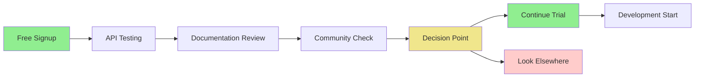

**Key Moments**:
- **First API Call Success**: Critical moment of validation
- **Documentation Quality**: Determines confidence level
- **Community Engagement**: Influences trust and adoption

#### **Stage 3: Integration (Days 6-10)**

**Activities**:
- Set up development environment
- Implement basic AI features
- Test with production data
- Optimize performance

**Critical Success Factors**:
- Clear error messages and debugging info
- Responsive community support
- Reliable performance
- Easy scaling options

#### **Stage 4: Growth & Advocacy (Days 11+)**

**Behaviors**:
- Monitors usage and costs
- Explores advanced features
- Provides feedback and contributions
- Recommends to other developers

---

## 👩‍💼 Journey Map: Sarah Williams (Marketing Manager)

### Journey Overview

**Goal**: Implement AI tools to improve marketing efficiency and ROI

**Timeline**: 1 month from exploration to team adoption

**Key Challenge**: Balancing technical capabilities with team usability


### Critical Moments & Emotions

#### **Moment 1: First Team Test**

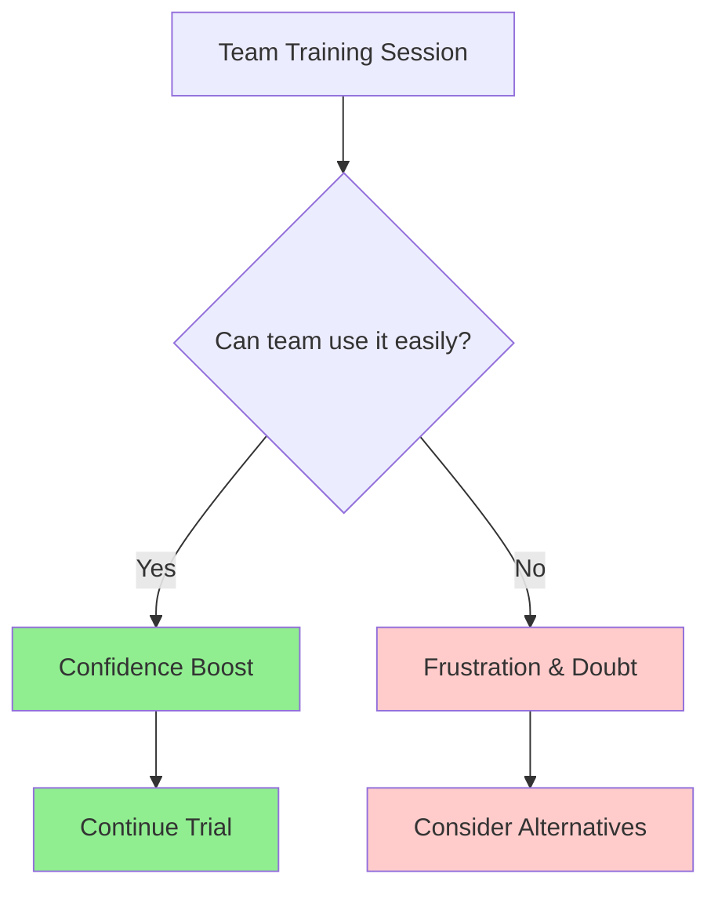

**Success Factors**:
- Intuitive interface requiring minimal training
- Clear templates and examples
- Immediate value demonstration
- Strong customer support

#### **Moment 2: ROI Calculation**

**Key Metrics Sarah Tracks**:
- Time saved per week
- Content quality improvements
- Campaign performance increases
- Cost per result reductions

---

## 🔬 Journey Map: Dr. Michael Rodriguez (Researcher)

### Journey Overview

**Goal**: Process sensitive research data while maintaining privacy and compliance

**Timeline**: 6 weeks from evaluation to full adoption

**Key Concerns**: Data security, compliance, and research integrity

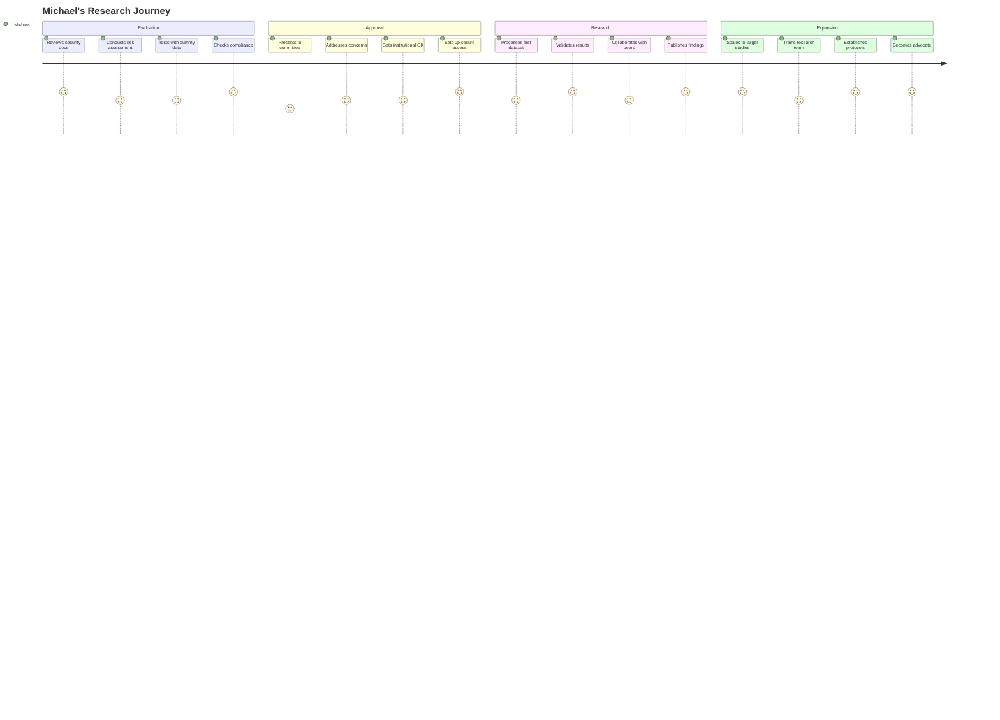

### Compliance Journey Deep-Dive

#### **Institutional Review Process**

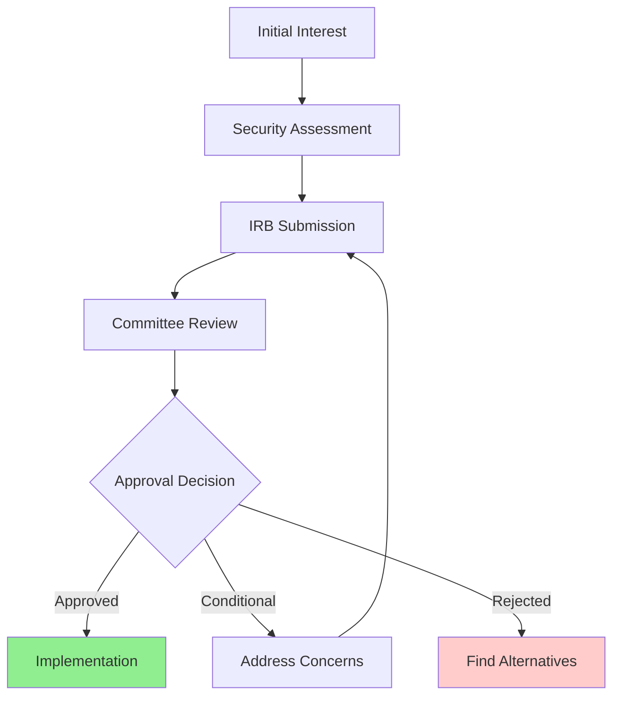

**Documentation Needed**:
- Comprehensive security whitepaper
- Compliance certifications
- Data processing agreements
- Audit reports and testimonials

---

## 🏢 Journey Map: Emma Thompson (Small Business Owner)

### Journey Overview

**Goal**: Offer AI-powered services to clients while managing costs

**Timeline**: 3 weeks from discovery to client delivery

**Key Driver**: Competitive advantage and cost management

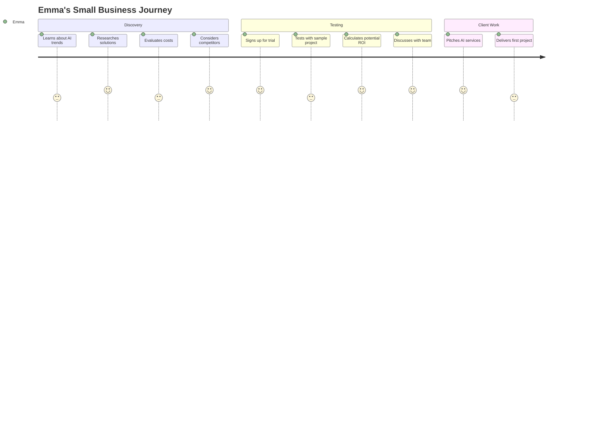

---

## 🎬 Journey Map: Omar Haddad (Video Designer)

### Journey Overview

**Goal**: Get a personalized video-design workspace that adapts to editing style and project type.

**Timeline**: 1 week from first onboarding to stable personalized setup.

**Key Need**: Fast access to relevant tools (timeline, asset panel, captioning, export presets) with optional manual control.

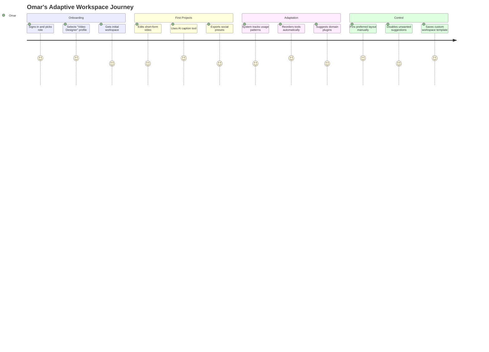

### Critical Product Requirements

* Workspace starts role-specific on first session.
* AI suggests tools based on usage and context, not generic defaults.
* User can manually override, pin, and lock interface elements.
* Every adaptation is reversible through workspace history.
      Measures client results  : 5: Emma
      Refines service offering : 4: Emma
    section Growth
      Expands AI services      : 5: Emma
      Trains more team members : 4: Emma
      Increases profit margins : 5: Emma
      Builds AI reputation     : 5: Emma
```

### Business Impact Timeline

#### **Revenue & Cost Analysis**

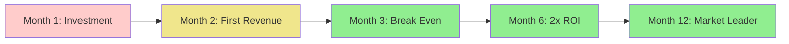

---

## 🔄 Cross-Journey Analysis

### 1. Common Pain Points Across All Journeys

| Pain Point | Alex | Sarah | Michael | Emma | Priority |
|------------|------|-------|---------|------|----------|
| **Complex Setup** | ⭐⭐⭐ | ⭐⭐⭐⭐ | ⭐⭐ | ⭐⭐⭐⭐ | HIGH |
| **Unclear Pricing** | ⭐⭐⭐⭐ | ⭐⭐⭐⭐ | ⭐⭐⭐ | ⭐⭐⭐⭐⭐ | HIGH |
| **Security Concerns** | ⭐⭐⭐ | ⭐⭐⭐ | ⭐⭐⭐⭐⭐ | ⭐⭐⭐ | HIGH |
| **Limited Support** | ⭐⭐⭐⭐ | ⭐⭐⭐⭐ | ⭐⭐⭐ | ⭐⭐⭐⭐ | MEDIUM |

### 2. Moments of Truth

#### **Critical Success Moments**

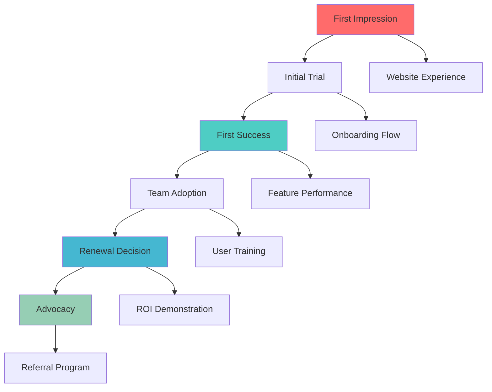

### 3. Emotional Journey Mapping

#### **Emotional Peaks and Valleys**

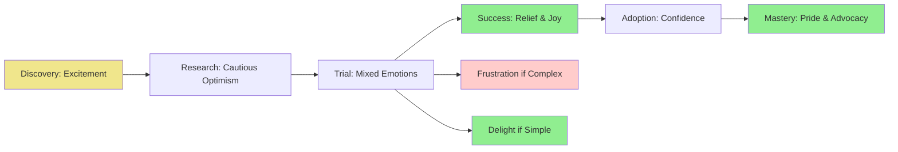

## 📊 Journey Optimization Strategies

### 1. Onboarding Improvements

#### **Progressive Disclosure Strategy**

```typescript
interface OnboardingFlow {
  beginner: {
    steps: ['welcome', 'quick-setup', 'first-task', 'results'];
    complexity: 'minimal';
    timeToValue: '5 minutes';
  };
  
  intermediate: {
    steps: ['welcome', 'feature-tour', 'integration-setup', 'team-invite'];
    complexity: 'moderate';
    timeToValue: '15 minutes';
  };
  
  advanced: {
    steps: ['welcome', 'api-setup', 'security-config', 'monitoring'];
    complexity: 'full';
    timeToValue: '30 minutes';
  };
}
```

### 2. Support Optimization

#### **Contextual Help System**

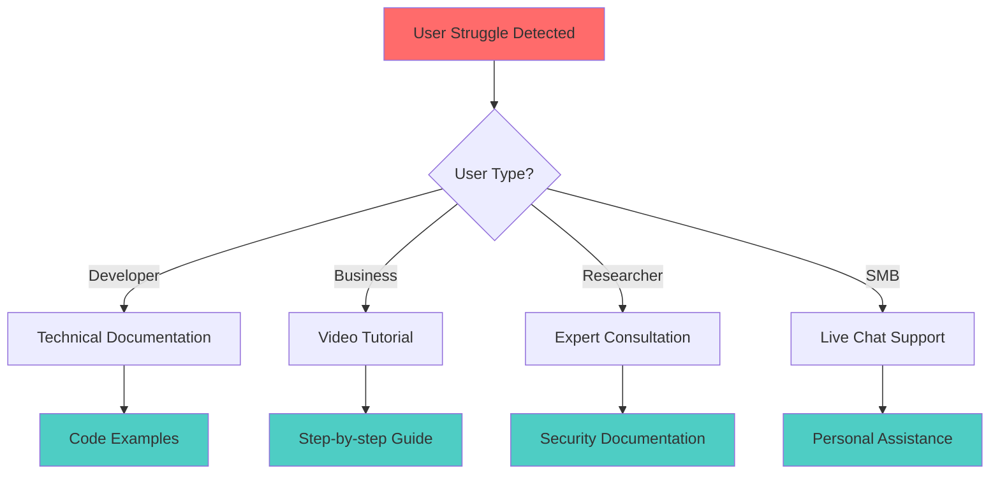

### 3. Success Metrics by Journey Stage

| Stage | Alex (Developer) | Sarah (Marketer) | Michael (Researcher) | Emma (Business) |
|-------|------------------|------------------|---------------------|-----------------|
| **Discovery** | Time to documentation | Content engagement | Security focus | Cost comparison |
| **Trial** | API calls per day | Feature adoption | Compliance check | ROI calculation |
| **Adoption** | Integration success | Team onboarding | Approval process | Client delivery |
| **Growth** | Usage expansion | Performance gains | Research output | Revenue increase |

## 🎯 Experience Design Principles

### 1. User-Centric Design Guidelines

#### **Progressive Complexity**

- Start simple, reveal complexity as needed
- Default to user's skill level
- Provide escape hatches for power users
- Maintain consistency across complexity levels

#### **Contextual Assistance**

- Right help at the right time
- Persona-specific guidance
- Just-in-time learning
- Proactive problem prevention

### 2. Cross-Journey Consistency

#### **Unified Design Language**

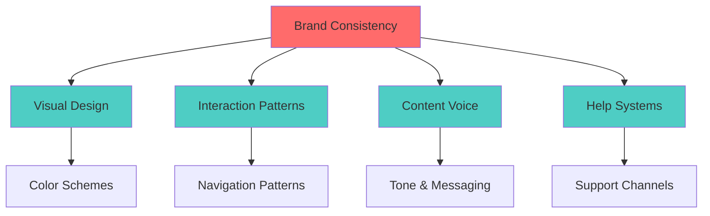

---

**Next Documents**: [Wireframes](./wireframes.md) | [Design System](./design-system.md)