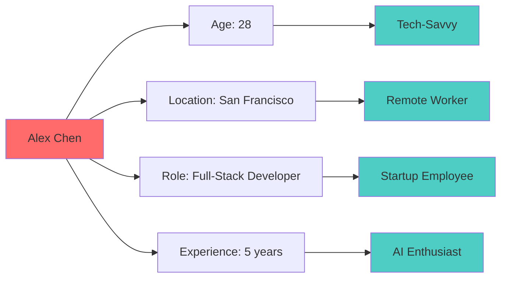
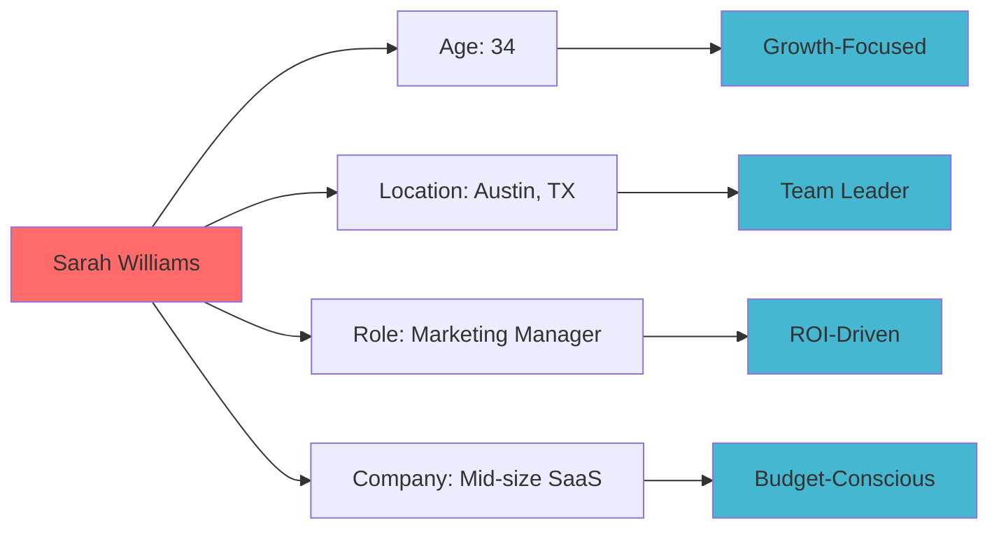
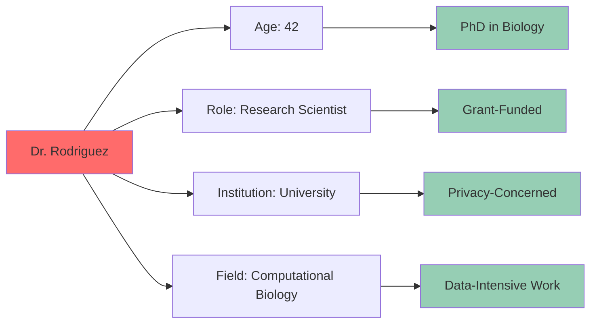
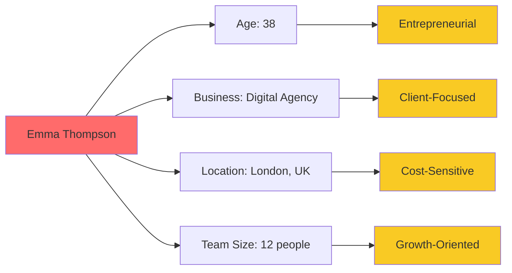
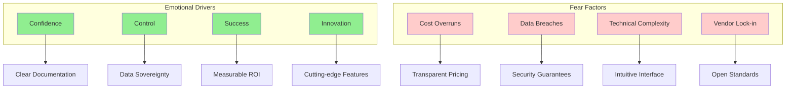
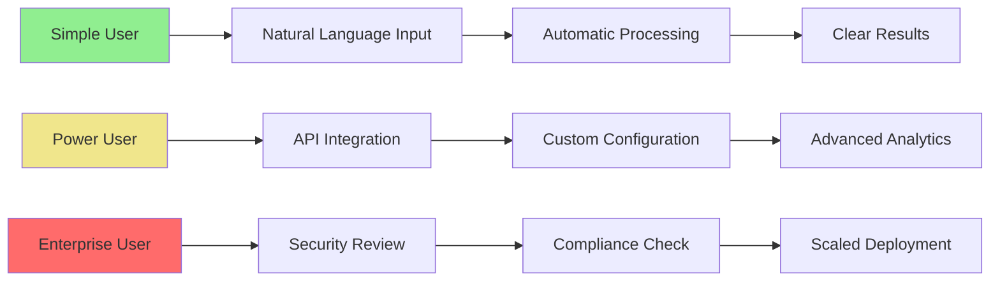
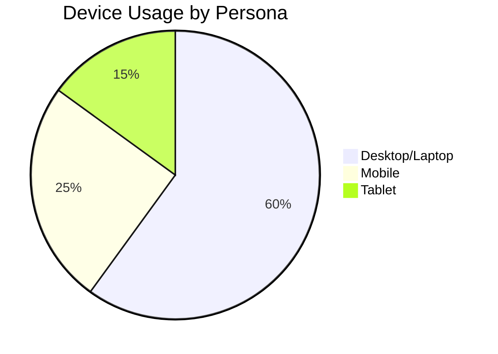
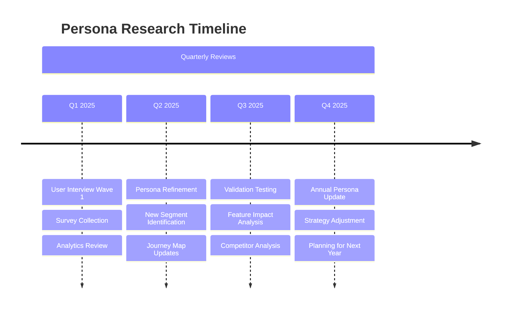

# 👥 User Personas - Ultra AI Platform

## 🎯 Overview

Understanding our users is fundamental to creating an exceptional Ultra AI Platform experience. These personas are based on market research, user interviews, and analysis of the AI platform landscape.

## 🧑‍💻 Primary Personas

### 1. **Alex Chen - The Solo Developer**



**Background**:
- Software developer at a Series A startup
- Works primarily on web applications and APIs
- Interested in integrating AI features into products
- Values efficiency, cost-effectiveness, and technical control

**Goals**:
- Build AI-powered features quickly and affordably
- Learn new AI technologies and techniques
- Reduce development time and costs
- Maintain control over data and algorithms

**Pain Points**:
- High costs of enterprise AI services
- Complex integration processes
- Limited customization options
- Vendor lock-in concerns

**Technology Comfort**: Expert

**Quote**: *"I want to build AI features without breaking the bank or getting locked into a single provider."*

---

### 2. **Sarah Williams - The Marketing Manager**



**Background**:
- Manages a team of 5 marketing professionals
- Responsible for content creation, analysis, and strategy
- Uses various marketing tools and platforms
- Limited technical background but AI-curious

**Goals**:
- Automate content creation and analysis
- Improve marketing campaign performance
- Reduce time spent on repetitive tasks
- Demonstrate clear ROI from AI investments

**Pain Points**:
- Overwhelming number of AI tool options
- Difficulty proving ROI of AI tools
- Technical complexity of AI implementations
- High subscription costs adding up

**Technology Comfort**: Intermediate

**Quote**: *"I need AI tools that my team can actually use without a computer science degree."*

---

### 3. **Dr. Michael Rodriguez - The Researcher**



**Background**:
- Research scientist at a major university
- Works with sensitive biological and medical data
- Collaborates with international research teams
- Strong focus on data privacy and security

**Goals**:
- Process large datasets with AI while maintaining privacy
- Collaborate with researchers globally
- Publish high-quality research
- Comply with institutional data policies

**Pain Points**:
- Data privacy regulations and restrictions
- High computational costs for research
- Limited access to cutting-edge AI models
- Complex compliance requirements

**Technology Comfort**: Advanced

**Quote**: *"I need powerful AI capabilities, but I can't compromise on data privacy and security."*

---

### 4. **Emma Thompson - The Small Business Owner**



**Background**:
- Owns a digital marketing agency
- Serves small to medium-sized clients
- Manages multiple projects simultaneously
- Always looking for competitive advantages

**Goals**:
- Offer AI-powered services to clients
- Increase operational efficiency
- Reduce costs while maintaining quality
- Stay competitive with larger agencies

**Pain Points**:
- Enterprise AI pricing out of reach
- Limited technical resources
- Time constraints for learning new tools
- Client demands for innovative solutions

**Technology Comfort**: Beginner to Intermediate

**Quote**: *"I want to offer AI services to my clients, but enterprise pricing is killing my margins."*

## 🎯 Secondary Personas

### 5. **James Park - The Enterprise Architect**

**Profile**: Senior technical leader at Fortune 500 company
**Key Needs**: Enterprise-grade security, compliance, scalability
**Decision Factors**: Risk management, total cost of ownership, vendor stability

### 6. **Lisa Zhang - The Student/Researcher**

**Profile**: Graduate student in computer science
**Key Needs**: Affordable access to AI tools, learning resources
**Decision Factors**: Cost, educational value, community support

### 7. **Carlos Martinez - The Privacy Advocate**

**Profile**: Cybersecurity consultant focused on privacy
**Key Needs**: Complete data control, transparency, security
**Decision Factors**: Privacy features, open source components, audit capabilities

## 🧠 User Needs Analysis

### 1. Functional Needs Matrix

| Persona | Primary Needs | Secondary Needs |
|---------|---------------|-----------------|
| **Alex (Developer)** | APIs, Documentation, Customization | Cost savings, Performance |
| **Sarah (Marketer)** | Ease of use, Templates, Analytics | ROI tracking, Team collaboration |
| **Michael (Researcher)** | Privacy, Security, Compliance | Performance, Collaboration |
| **Emma (Business Owner)** | Affordability, Simplicity, Results | Client features, Support |

### 2. Emotional Needs Mapping



## 🌟 Persona-Driven Feature Prioritization

### 1. Feature Importance by Persona

| Feature | Alex | Sarah | Michael | Emma | Priority |
|---------|------|-------|---------|------|----------|
| **Natural Language Interface** | ⭐⭐⭐ | ⭐⭐⭐⭐⭐ | ⭐⭐⭐ | ⭐⭐⭐⭐⭐ | HIGH |
| **Developer APIs** | ⭐⭐⭐⭐⭐ | ⭐⭐ | ⭐⭐⭐⭐ | ⭐⭐ | HIGH |
| **Privacy Protection** | ⭐⭐⭐ | ⭐⭐⭐ | ⭐⭐⭐⭐⭐ | ⭐⭐⭐ | HIGH |
| **Cost Optimization** | ⭐⭐⭐⭐ | ⭐⭐⭐⭐ | ⭐⭐⭐ | ⭐⭐⭐⭐⭐ | HIGH |
| **Reward System** | ⭐⭐⭐⭐ | ⭐⭐ | ⭐⭐ | ⭐⭐⭐ | MEDIUM |
| **Enterprise Features** | ⭐⭐ | ⭐⭐⭐ | ⭐⭐⭐⭐ | ⭐⭐ | MEDIUM |

### 2. User Journey Complexity



## 📱 Device & Context Usage

### 1. Usage Context Matrix

| Persona | Primary Device | Location | Time Constraint | Interruption Level |
|---------|----------------|----------|-----------------|-------------------|
| **Alex** | Laptop | Home Office | Flexible | Low |
| **Sarah** | Laptop/Tablet | Office/Travel | Moderate | Medium |
| **Michael** | Desktop/Laptop | Lab/Office | Extended | Low |
| **Emma** | Mobile/Laptop | Various | Limited | High |

### 2. Platform Preferences



## 🎨 Design Implications

### 1. Interface Design Principles

#### **For Developers (Alex)**
- Clean, technical interface with advanced controls
- Comprehensive documentation and code examples
- Keyboard shortcuts and efficient workflows
- Dark mode and customizable themes

#### **For Business Users (Sarah, Emma)**
- Guided workflows and templates
- Visual dashboards and reporting
- Collaborative features and sharing
- Mobile-responsive design

#### **For Researchers (Michael)**
- Security indicators and privacy controls
- Detailed audit logs and compliance features
- Collaboration tools with access controls
- Data export and integration capabilities

### 2. Content Strategy by Persona

```typescript
interface ContentStrategy {
  developer: {
    documentation: 'comprehensive-technical';
    examples: 'code-samples';
    communication: 'precise-factual';
    support: 'community-forums';
  };
  
  business: {
    documentation: 'step-by-step-guides';
    examples: 'use-case-scenarios';
    communication: 'benefit-focused';
    support: 'live-chat-help';
  };
  
  researcher: {
    documentation: 'detailed-methodology';
    examples: 'research-papers';
    communication: 'evidence-based';
    support: 'expert-consultation';
  };
  
  smallBusiness: {
    documentation: 'quick-start-guides';
    examples: 'success-stories';
    communication: 'roi-focused';
    support: 'personal-assistance';
  };
}
```

## 📊 Persona Validation & Testing

### 1. Validation Methods

- **User Interviews**: 50+ interviews across all persona types
- **Surveys**: Quantitative validation with 500+ responses
- **Analytics**: Behavioral data from beta users
- **A/B Testing**: Feature preference testing
- **Usability Testing**: Task completion analysis

### 2. Success Metrics by Persona

| Persona | Acquisition Metric | Engagement Metric | Retention Metric |
|---------|-------------------|-------------------|------------------|
| **Alex** | API registrations | Monthly API calls | 6-month retention |
| **Sarah** | Trial conversions | Feature adoption | Annual subscription renewal |
| **Michael** | University partnerships | Data processed | Research citations |
| **Emma** | SMB signups | Client projects | Revenue growth |

## 🔄 Persona Evolution Strategy

### 1. Continuous Research Plan



### 2. Emerging Personas

**Potential Future Personas**:
- **The AI Creator**: Users building and sharing AI models
- **The Compliance Officer**: Enterprise users focused on governance
- **The Educator**: Teachers and trainers using AI for education
- **The Creator**: Content creators and artists using AI tools

---

**Next Documents**: [User Journey Maps](./user-journeys.md) | [Wireframes](./wireframes.md)