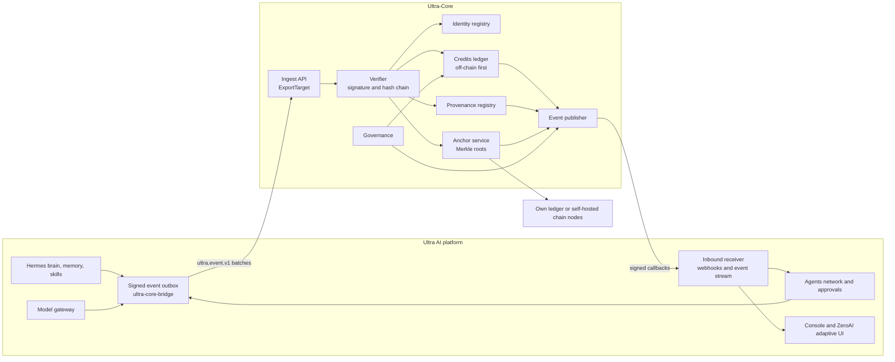
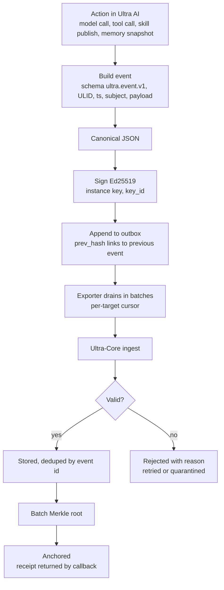
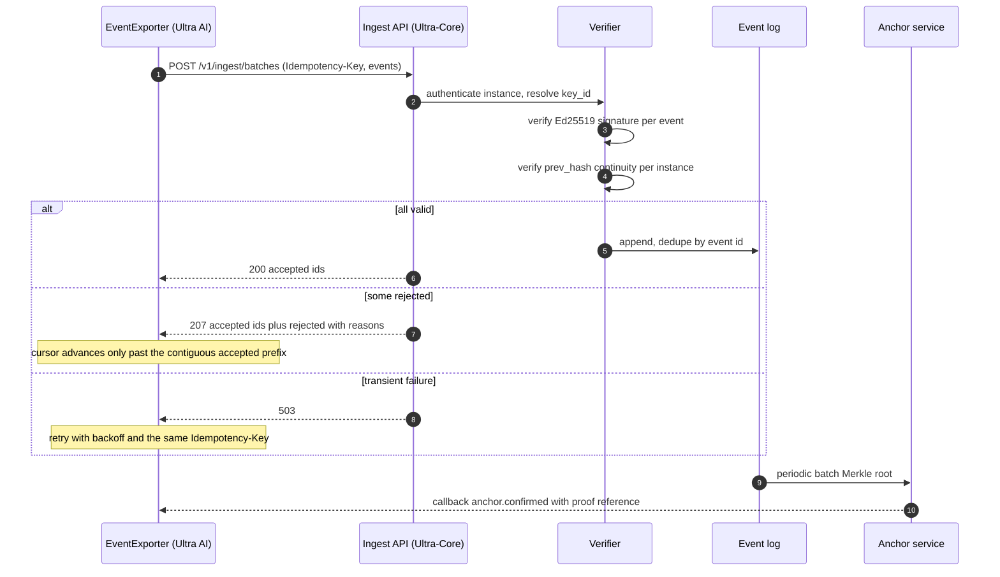
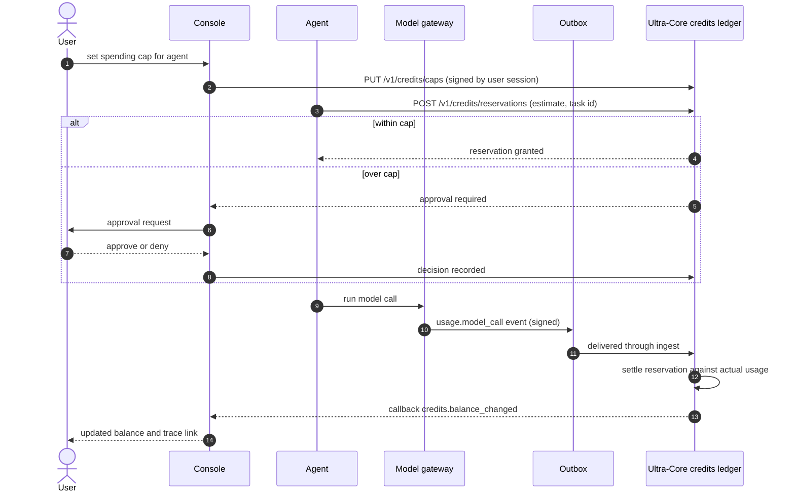
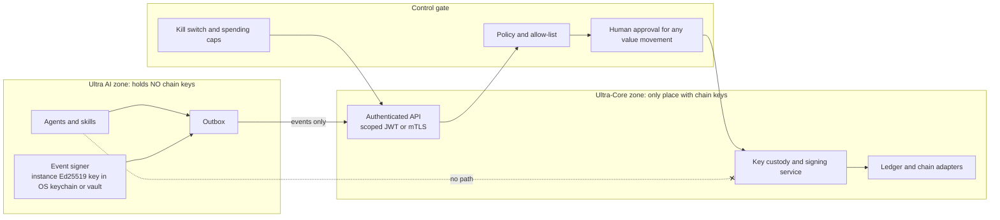
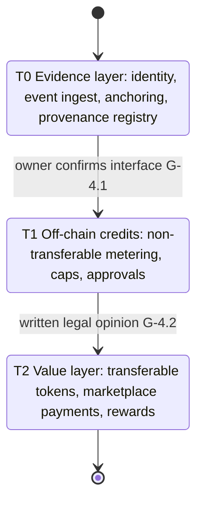
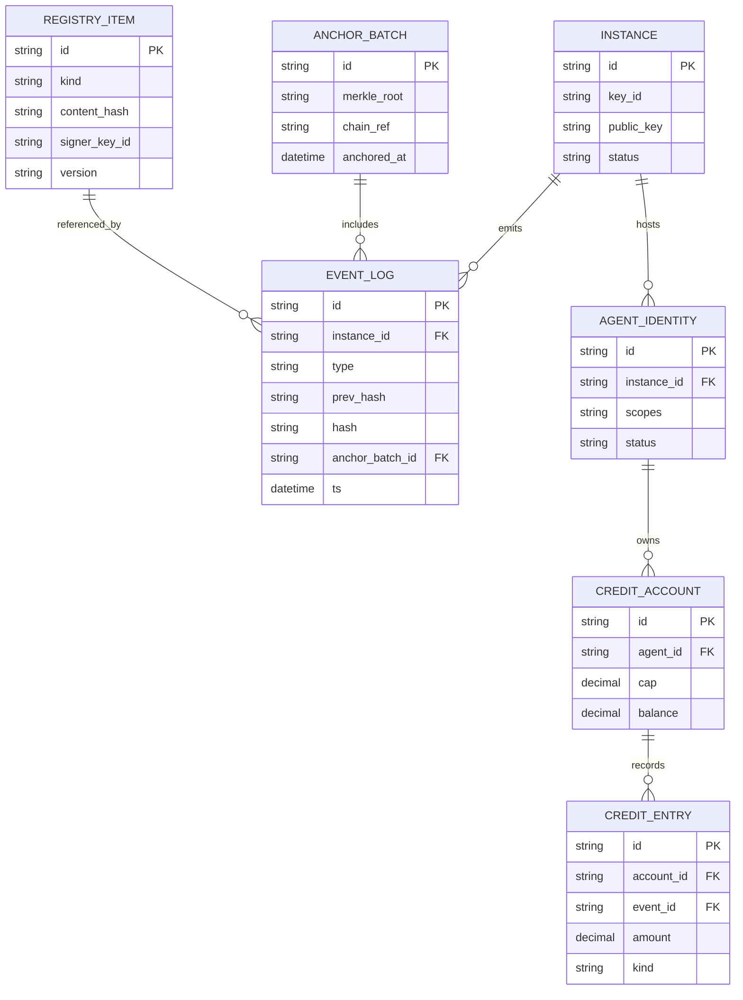
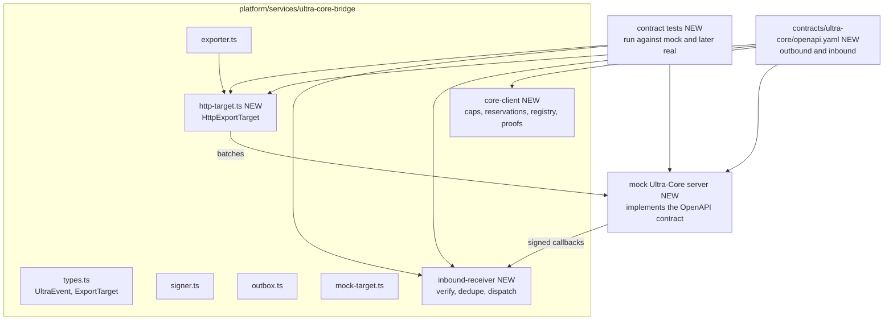

# Ultra Core integration environment (P4B)

Status: WORKING (mock-validated) — contract-first design implemented in `platform/services/ultra-core-bridge` + `contracts/ultra-core/`; no live Ultra-Core calls (QC-P4B-15 pending).
Scope: T0 evidence/provenance, T1 off-chain credits behind approvals, T2 BLOCKED by G-4.2.
Sources: `brain-stack/workflows/ULTRA_AI_TODO.md` P4B; `docs/v2/technical-spec.md` §14; `ultra-ai-blockchain-prompt.md` Appendix A.

## Diagram index

- A1 — System context: `brain-stack/memory/diagrams/blockchain_ultra-core-integration__1.mmd`
- A2 — Event lifecycle (outbound): `brain-stack/memory/diagrams/blockchain_ultra-core-integration__2.mmd`
- A3 — Ingest sequence (idempotent ExportTarget over HTTP — PROPOSED binding): `brain-stack/memory/diagrams/blockchain_ultra-core-integration__3.mmd`
- A4 — Metered task with credits and human approval (Tier 1): `brain-stack/memory/diagrams/blockchain_ultra-core-integration__4.mmd`
- A5 — Trust boundaries and key custody: `brain-stack/memory/diagrams/blockchain_ultra-core-integration__5.mmd`
- A6 — Rollout tiers and legal gate: `brain-stack/memory/diagrams/blockchain_ultra-core-integration__6.mmd`
- A7 — Ultra-Core ingest data model (SPEC): `brain-stack/memory/diagrams/blockchain_ultra-core-integration__7.mmd`
- A8 — Ultra AI side: modules to build for sending and receiving: `brain-stack/memory/diagrams/blockchain_ultra-core-integration__8.mmd`

Note: diagrams are SPEC. Items marked PROPOSED need an ADR before implementation. `provenance.approval` is PROPOSED.

## A1. System context

## A2. Event lifecycle (outbound)

## A3. Ingest sequence (idempotent ExportTarget over HTTP — PROPOSED binding)

## A4. Metered task with credits and human approval (Tier 1)

## A5. Trust boundaries and key custody

## A6. Rollout tiers and legal gate

## A7. Ultra-Core ingest data model (SPEC)

## A8. Ultra AI side: modules to build for sending and receiving

## A9. Event type to Ultra-Core capability map

| Event type (ultra.event.v1) | Emitted by | Ultra-Core capability | Tier |
|---|---|---|---|
| `usage.model_call` | model gateway | metering, credit settlement, audit anchoring | T0 anchor, T1 settle |
| `usage.tool_call` | agents network | audit anchoring, spending caps | T0 |
| `contribution.compute` | device mesh (re-scoped) | contribution record only; rewards disabled | T0 record, T2 reward |
| `provenance.skill_published` | skill registry | signed provenance registry | T0 |
| `provenance.memory_snapshot` | Memory Bank | content-hash anchoring | T0 |
| `provenance.approval` (PROPOSED) | approvals inbox | human-approval evidence | T0 |
| Inbound `credits.balance_changed` | Ultra-Core | update console and agent budgets | T1 |
| Inbound `anchor.confirmed` | Ultra-Core | attach proof to traces | T0 |
| Inbound `governance.policy_changed` | Ultra-Core | update gateway policy parameters, with timelock | T1 |
| Inbound `registry.item_revoked` | Ultra-Core | disable revoked skill or key | T0 |
