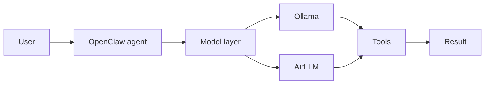

# AirLLM WSL Lane

## Purpose

AirLLM is the GPU memory-optimized inference lane for this stack.
It is the path we use when the assistant needs to run a very large model on the
local GPU without redesigning the rest of the assistant flow.

Repository reference:

- https://github.com/Fadhel-SH/Tools-GPU-AI_airllm

## Why it belongs here

- OpenClaw stays the control plane.
- AirLLM becomes a model execution lane behind the control plane.
- n8n stays visible for planning and tool routing.
- The same voice and shell bridges can route into AirLLM or Ollama depending on the selected model path.

## Current path



## WSL setup

```bash
cd /home/pc/ucube/project/Ultra-AI/wsl-ai-stack
bash ./scripts/setup-airllm.sh --setup
bash ./scripts/setup-airllm.sh --check
```

The setup script creates `runtime/airllm/.venv`, installs the runtime packages,
and checks whether this WSL host exposes `nvidia-smi`.

## Bridge command

```bash
bash ./scripts/airllm-bridge.sh "Explain the current WSL stack in one paragraph."
```

Useful flags:

- `AIRLLM_MODEL` sets the Hugging Face model ID.
- `AIRLLM_COMPRESSION` can be `none`, `4bit`, or `8bit` when supported.
- `AIRLLM_DRY_RUN=1` prints the routing parameters without loading a model.

## Model choice

- The current local default remains `ollama/gemma4:latest`.
- The Kimi track is registered in OpenClaw as `kimi-k2.5`.
- AirLLM is the large-model lane you enable when you want GPU-backed inference with the same assistant flow.

## Notes

- First-run model downloads can be large.
- Use a model that AirLLM supports on the current host before switching the bridge default to a larger target.
- Keep the tool and planner layers unchanged when swapping the model backend.