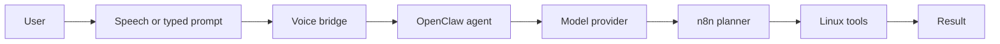
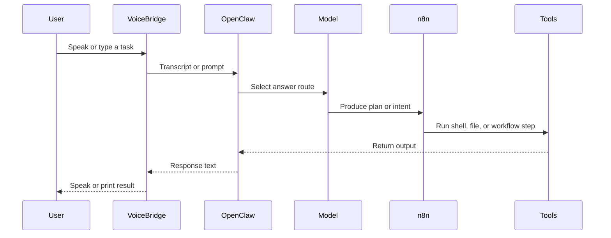

# Ultra AI Flow

## Main control flow

## Full execution path

## Layer contract

- OpenClaw is the assistant control plane.
- The model layer is swappable behind OpenClaw.
- n8n makes tool use visible and repeatable.
- Linux tools remain the execution surface.

## Current WSL path

1. Text or WAV enters the voice bridge.
2. The bridge transcribes with PocketSphinx or forwards typed text.
3. OpenClaw routes the request to the configured model alias.
4. n8n can receive the plan and trigger shell work.
5. The result returns to the console or TTS.

## Sample commands

- `bash ./scripts/openclaw-bridge.sh "..."`
- `bash ./scripts/voice-bridge.sh --sample --speak-response`
- `bash ./scripts/setup-n8n.sh --start`
- `bash ./scripts/setup-voice.sh --setup`

## Notes

- WSL in this environment does not expose a live microphone device yet.
- The reusable WAV sample is the first reliable voice path for this host.
- The Kimi alias is available once the matching provider profile is ready.