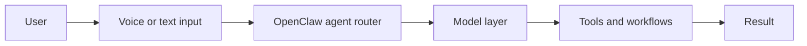
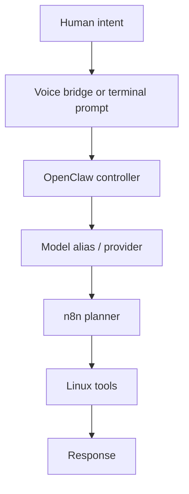

# Ultra AI WSL Build Plan

## Goal

Build a WSL-first assistant stack in /home/pc/ucube/project/Ultra-AI/wsl-ai-stack
that gives us:

- OpenClaw as the main agent shell
- Ollama as the local default model backend
- n8n for visible planning, task routing, and flow tracking
- OpenVoiceOS as the preferred open source voice layer
- Linux tool execution for real work on the WSL host

## System Shape

## Execution Layers

## Phase 1: Baseline

- [x] Verify WSL Ubuntu and the target project path
- [x] Verify OpenClaw is configured to use Ollama
- [x] Enable passwordless sudo for the WSL user
- [x] Add a local project scaffold in wsl-ai-stack
- [x] Add environment bootstrap scripts

Acceptance:

- OpenClaw points to ollama/gemma4:latest
- The WSL project folder contains plan, flow, and voice docs
- The bootstrap script reports missing tools cleanly

## Phase 2: Planner and flow layer

- [x] Add a local n8n install script
- [x] Add a starter OpenClaw bridge script
- [x] Add a visible task flow document
- [x] Define the task handoff path from OpenClaw to Linux tools
- [x] Add a starter n8n workflow for OpenClaw handoff

Acceptance:

- We can start n8n locally from WSL
- We can send text to OpenClaw from a shell bridge
- The flow is documented and easy to inspect

## Phase 3: Voice layer

- [x] Set up OpenVoiceOS in a local WSL venv
- [x] Add text to assistant bridge notes
- [x] Document microphone and TTS dependencies
- [x] Keep a fallback path for headless text use
- [x] Add a reusable WAV sample path for voice testing

Acceptance:

- Voice commands can be turned into text prompts
- Text prompts can enter OpenClaw through the bridge
- Responses can be routed back to TTS or the console

## Phase 4: Tooling and execution

- [ ] Add Linux tool wrappers for safe command execution
- [x] Keep OpenClaw on the main session for host access
- [x] Add logs and runtime state under runtime
- [ ] Add a simple recovery path for failures

Acceptance:

- Task execution is visible in logs
- Tool execution can be repeated safely
- The stack can be started from one place

## Phase 5: Validation

- [ ] bash -n passes on all shell scripts
- [x] openclaw models status shows Ollama
- [x] openclaw infer returns a short response
- [ ] n8n launches locally in WSL
- [x] Voice bridge script accepts text and forwards it

## Phase 6: Model Tracks

- [x] Add the AirLLM repository notes
- [x] Add the Kimi K2.5 model alias
- [x] Document the model selection rule

Acceptance:

- The docs show how the model layer swaps without changing the bridge path
- OpenClaw can be pointed at Kimi once the provider profile is ready
## Phase 6: AirLLM GPU lane

- [x] Add the AirLLM WSL bootstrap script
- [x] Add the AirLLM bridge script
- [x] Document the AirLLM runtime lane
- [x] Connect the Kimi model track to OpenClaw docs

Acceptance:

- The GPU lane is visible next to the Ollama lane
- The assistant can swap model backends without changing the control path