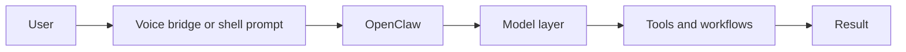

# Ultra AI WSL Stack

This folder is the WSL and Ubuntu control plane for the Ultra-AI workspace.
It binds together:

- OpenClaw as the orchestration and assistant layer
- Ollama as the local model runtime
- n8n as the visual planner and flow engine
- OpenVoiceOS as the preferred open source voice assistant base
- Linux shell tools and apps as the execution surface

## Current live state

- OpenClaw is configured to use ollama/gemma4:latest
- OpenClaw also has a `kimi-k2.5` alias pointing at `moonshot/Kimi-K2.5`
- WSL has Node.js available
- Docker is not installed in this distro
- Passwordless sudo is enabled for user pc

## Control flow



## Layout

- PLAN.md - phased build plan and acceptance criteria
- FLOW.md - end to end voice to task flow
- VOICE.md - voice assistant choice and setup notes
- MODELS.md - model tracks for Ollama, AirLLM, and Kimi
- scripts/bootstrap-wsl-ai.sh - environment checker and installer
- scripts/openclaw-bridge.sh - text bridge into OpenClaw
- scripts/setup-n8n.sh - local n8n installer and launcher
- scripts/setup-voice.sh - OpenVoiceOS oriented voice setup
- scripts/voice-sample.sh - reusable WAV sample generator
- scripts/voice-bridge.sh - file-based voice path into OpenClaw
- n8n/openclaw-starter-flow.json - starter importable workflow
- runtime/ - local working state, logs, and service data

## Quick start

```bash
cd /home/pc/ucube/project/Ultra-AI/wsl-ai-stack
bash ./scripts/bootstrap-wsl-ai.sh --check
```

If the checks look good and you want the script to install missing packages:

```bash
bash ./scripts/bootstrap-wsl-ai.sh --setup
```

To launch the OpenClaw bridge directly from text:

```bash
bash ./scripts/openclaw-bridge.sh "summarize the current system state"
```

To test the first voice path in this WSL environment:

```bash
bash ./scripts/voice-bridge.sh --sample --speak-response
```

To import the starter n8n flow:

```bash
bash ./scripts/setup-n8n.sh --start
```

Then import `n8n/openclaw-starter-flow.json` into the local editor.

## Runtime model

The recommended control path is:

assistant -> agent -> model -> tools

OpenClaw stays the main control plane. n8n manages explicit flows and task visibility.
Linux tools stay the execution surface for shell, files, and local apps.

## Model tracks

See [MODELS.md](MODELS.md) for the current Ollama, AirLLM, and Kimi paths.

## Recommended voice stack

OpenVoiceOS is the recommended open source voice base for this build.
Mycroft Core is archived and read only, so it is not the primary choice for a fresh setup.