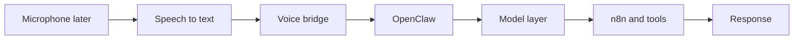

# Voice Assistant Notes

## Recommended base

- OpenVoiceOS (OpenVoiceOS/ovos-core)

Why:

- active open source voice assistant path
- modern successor line to Mycroft
- easier to bridge into OpenClaw than building a full assistant from scratch

## Current WSL voice path



For this WSL host, the first reliable path is:

- reusable WAV sample or typed prompt
- PocketSphinx transcription
- OpenClaw bridge execution
- optional TTS response with espeak-ng

## Current constraints

- This distro does not expose a microphone device yet.
- Live capture should wait until WSL audio input is available.
- The sample WAV path keeps the assistant end-to-end testable now.

## Bridge path

- speech input or typed prompt
- voice bridge script
- OpenClaw agent session
- model alias or provider
- n8n flow and Linux tools
- response back to voice or terminal

## Model notes

- OpenClaw default stays on `ollama/gemma4:latest` for the local loop.
- `kimi-k2.5` is available as an OpenClaw alias for the Kimi track.
- AirLLM is the GPU memory optimization track for future large-model hosts.

## Testing command

```bash
bash ./scripts/voice-bridge.sh --sample --speak-response
```