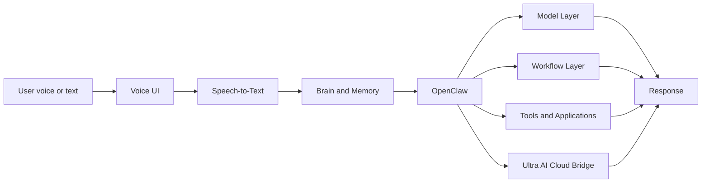

# ZeroAI Architecture

ZeroAI is the local assistant layer for the Ultra-AI workspace.
It is designed to run in WSL as a closed, offline-first system.

## Design goals

- Work without Internet access
- Keep the user-facing interface simple
- Route all decisions through a single control plane
- Reuse local device resources, applications, and workflows
- Preserve English-only project docs and file names
- Support memory, learning, and future improvements

## Layer model

## Core layers

### Voice UI

The user speaks to ZeroAI from a local interface.
This layer should stay simple and should not try to reason.

The UI can be implemented as either Open WebUI or a LocalAI-centered local surface, but the user experience must remain ZeroAI-controlled.

### Speech-to-text

This layer converts audio into text locally.
PocketSphinx is not accurate enough for the final system.
We will evaluate stronger offline/open-source options and keep the best fit.

Current candidates are Whisper, faster-whisper, and Vosk.

### Brain and memory

ZeroAI needs a memory layer and a reasoning layer.
The memory layer stores conversation context, task history, and user preferences.
The brain layer decides whether to answer, delegate, trigger a tool, or escalate.

The memory layer should store conversation context, task state, and reusable preferences.

### OpenClaw

OpenClaw remains the control plane and router.
It receives the cleaned text input and chooses the model or action path.

OpenClaw must not be bypassed by direct model selection in the final design.

### Model layer

Ollama is the default local generation path.
AirLLM is a future optimization lane for heavier models or better resource control.

Local model serving should stay optional and replaceable behind the same interface.

### Workflow layer

n8n is the visible automation backbone.
It handles repeatable tasks, workflow execution, and system orchestration.

### Tools and applications

ZeroAI may use local applications and system tools when a task needs action.
The assistant should be able to open apps, process files, and invoke local utilities.

## ZeroAI versus Ultra AI

ZeroAI is the device-local assistant and control layer.
Ultra AI is the distributed platform that ZeroAI can call when a task requires shared services, cloud compute, or network-wide orchestration.

The edge layer should handle local actions first and escalate only when needed.

## Recommended open-source candidates

- Speech-to-text: Whisper, faster-whisper, Vosk
- Memory: Mem0, Qdrant, SQLite-backed memory
- UI: Open WebUI, a custom lightweight desktop/web launcher
- Workflow: n8n
- Voice assistant base: OpenVoiceOS
- Local model runtime: Ollama, AirLLM

### UI candidates

- Open WebUI for the fastest polished local interface
- LocalAI when a lighter serving-oriented approach is preferred

## Integration principle

ZeroAI should remain the top-level assistant entry.
UltraAI stays the larger ecosystem and can be merged where it adds value.
If UltraAI diagrams or components need adjustment, they should be adapted to the new ZeroAI control flow rather than copied blindly.
