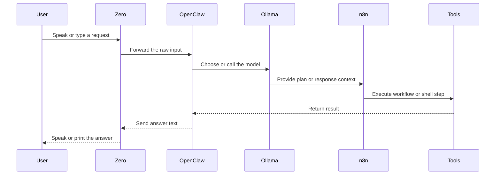

# ZeroAI Flow

## Main routing

## Rules

- Zero should not answer from canned fallback phrases
- Zero should act like a transport layer
- OpenClaw should decide how to route each request
- Ollama should generate the text response
- n8n should stay visible and reusable
- Everything should stay WSL-local unless we explicitly add a bridge

## Future expansion

- Add more tools only when they clearly fit the same control path
- Keep each new tool behind OpenClaw instead of hard-wiring it into Zero
- Preserve a single English naming scheme across scripts and docs
