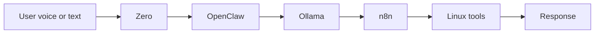

# ZeroAI

ZeroAI is the WSL-first local assistant layer for this workspace.

It is designed to work as a closed internal system:

- Zero is the voice ingress layer
- OpenClaw is the assistant router and control plane
- Ollama is the default local model backend
- AirLLM is a future optimization layer for heavier local models
- n8n handles visible flows and orchestration
- Linux tools perform the actual work

## UI direction

ZeroAI needs a local control surface rather than a plain chat screen.
The preferred UI options are:

- Open WebUI as the quickest local model interface path
- LocalAI if a tighter serving and runtime layer is preferred

The first implementation should keep the UI focused on local status, task control, memory visibility, and workflow confirmation.

## Goals

- Keep all docs, file names, and runtime notes in English
- Keep the assistant inside WSL Linux
- Avoid direct fallback replies inside Zero
- Send user input straight into OpenClaw
- Keep model selection behind OpenClaw
- Make the system easy to extend with extra tools later

## Current flow



## Integration intent

ZeroAI is the local layer we will grow first.
Later, we will fold in the older UltraAI work so the two systems share the same execution model instead of competing with each other.

Ultra AI is the broader network platform that ZeroAI can route into when a task needs shared services, distributed compute, or cloud-scale orchestration.

## Start point

```bash
cd /home/pc/ucube/project/Ultra-AI/wsl-ai-stack
bash ./scripts/start-zeroai.sh
```
