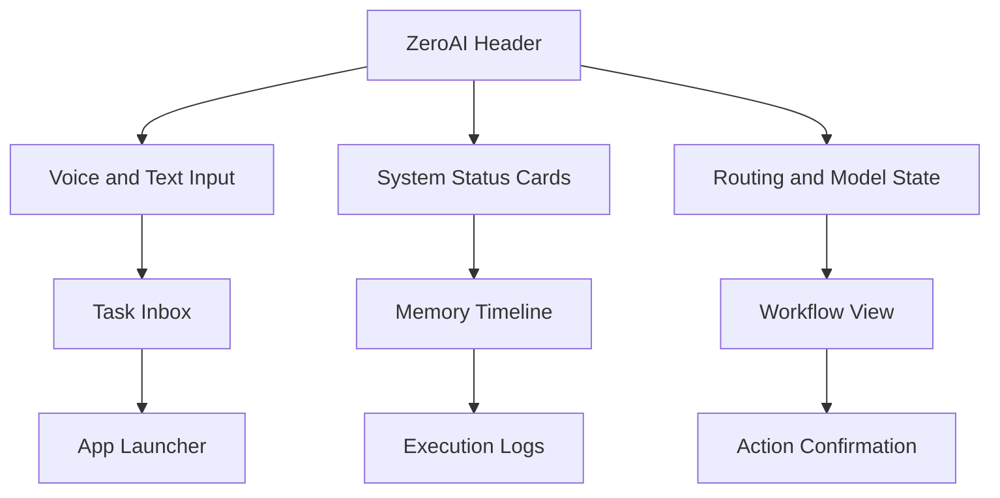

# ZeroAI UI Design

ZeroAI needs a local user interface that acts as the control surface for the assistant.

## UI goals

- Start and stop ZeroAI.
- Show system status.
- Show voice input state.
- Show model routing state.
- Show memory and task history.
- Expose n8n workflow visibility.
- Keep the user inside one interface.
- Make local-vs-cloud routing visible.
- Support confirmation for sensitive actions.
- Keep the assistant usable offline where possible.

## Recommended shape

- A lightweight local web app or desktop launcher.
- Optionally implemented through Open WebUI or LocalAI for the first release.
- A single command entry box.
- A voice input button.
- Status cards for OpenClaw, Ollama, n8n, and tools.
- A task log panel.

## Recommended panels

## First release priorities

1. Local start/stop and health status.
2. Voice and text input with routing feedback.
3. Memory visibility for conversation and task context.
4. n8n workflow visibility and result tracking.
5. Local tool launch and confirmation prompts.
6. Open WebUI or LocalAI integration as the first UI backend choice.

## UI principle

The UI should not replace Zero.
It should simply let the user operate ZeroAI while Zero handles orchestration in the background.

ZeroAI is the on-device experience; Ultra AI remains the wider network platform that can be reached when the task demands it.

